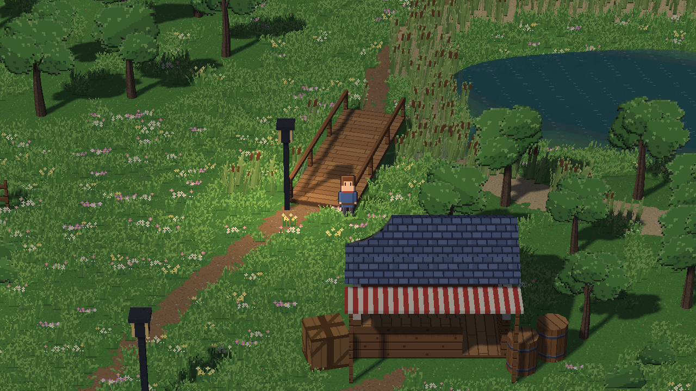
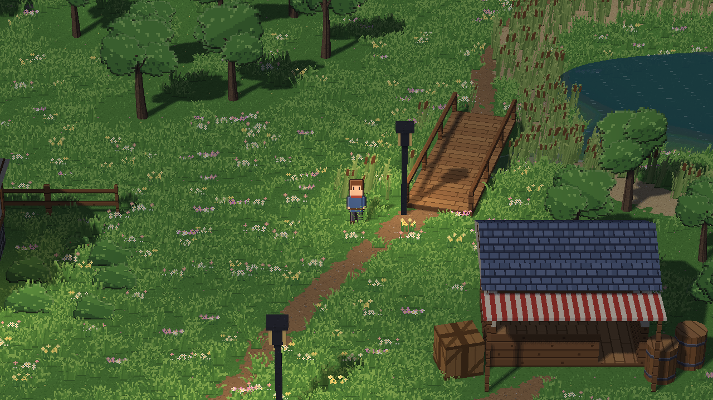
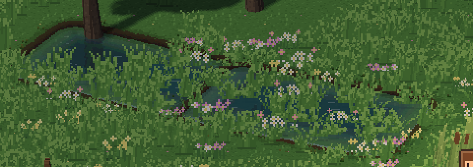
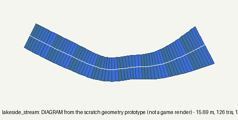
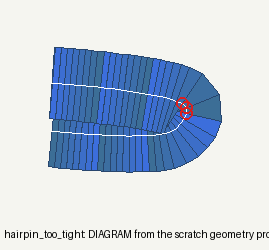
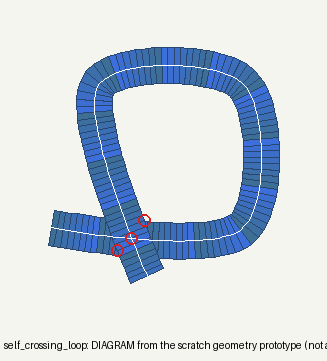
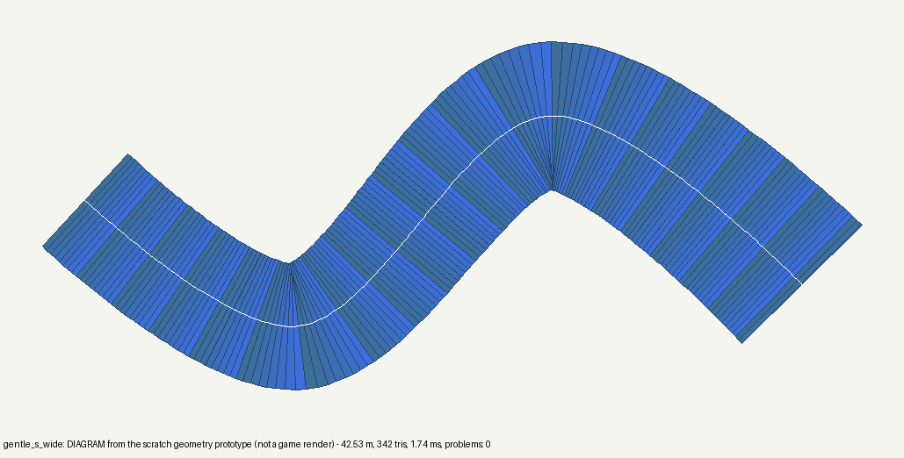

# Rivers & streams, Stage 1: feasibility report and implementation plan (investigation only)

**Baseline:** `redesign/visual-editor` at `082041c` (after #459). No production code, asset or project changed, no PR opened.
- **Evidence:** the evidence-only branch `review/461-river-study`.
- **Projects:** scratch copies only; the owner's Lakeside originals are untouched.
- **Labels:**
  - **[F]** = fact (code `file:line`, capture or measurement); **[H]** = hypothesis.
  - **TODAY** = real in-engine captures of *existing* features.
  - **DIAGRAM** = output of a scratch pure-Python geometry prototype, **not a game render**.

Related: #458 (visual finishing), #460 (DoF, after rivers V1), #449 (roadmap).

---

## 0. What exists today, and what a river can reuse
**[F] There is no river, path, flow or polyline primitive anywhere** in the water or terrain code (19A–20E reports list rivers as out of scope; 19B: "no path editor and no river system").

**A water body today** (`engine/water.py`) is **one instanced quad per body**, with an analytic outline in the fragment shader (`sd_at`, water.py:366-389):
- **shapes:** `ellipse`, `rect`, `natural` (a radial blob), plus one `rotation`;
- **level:** one flat level, the entity's `elevation`;
- **no flow:** waves are two sine trains with **fixed world directions** (water.py:510-511), so turning a body doesn't turn its waves.

**Reusable as-is or nearly:**
- **The look:** colours, depth gradient, glints, the 32 px/m snapping (water.py:447).
- **Rain rings:** world-space, gated by the precipitation map (513-532).
- **Reflections:** a **screen-space copy of the frame** marched in the shader, so there's no extra scene pass (702-732, 562-582); full, half or sky.
- **The `terrain` shore:** per-fragment `water_depth = level − ground(q)`, discarded where ≤ 0 (459-463). It reads a height texture of the terrain's corners.
- **The bridge rule:** blocking water only blocks characters within a step of its level (`world.py:128-135`), so a deck a step above passes.
- **Scatter's keep-clear test,** through `ground_for(..., waters)` (`project_ops.py:3198-3204`, `scatter.py:242-294`, reeds allowed on the bank).
- **Footstep ripples and sounds** (`water_surface.py:85-116`), and the existing `stream_loop.wav` ("Flowing water") for a `SoundEmitter`.

### Real captures of today's best attempt (TODAY, scratch Lakeside copy, 1280×720, hidden window)
**Setup:**
- six rotated `rect` water bodies along a curved course (`natural_pond` look), made with the engine's own `place_blank` + `set_water`;
- each at the ground height read from the live terrain;
- the course runs from the west meadow, under Lakeside's existing footbridge, into the lake's inlet (`tools/chain_today.py`).

| | |
|---|---|
| unchanged room, same camera as #458's shot 02 |  |
| **the chain 3 px below the ground: invisible.** The sculpted ground draws over water, so water on terrain only shows where a basin has been carved. |  |
| **2 px above the ground:** only the two flat pieces show (top left). The 4 pieces on the slope to the bridge stay buried; each is one flat level on a slope. |  |
| crop ×2: **separate puddles with bank ridges across every joint**, and old grass growing through (scatter is only kept clear when it's painted) |  |

**[F] The flat levels along the course** were −3, −3, −14, −26, −25, −29 px: **a stream on sculpted ground needs a sloped surface and a bed, not flat bodies.**

**The Studio capture opened the template village instead,** because Studio only opens rooms listed in the world, and the scratch scene isn't listed. It's reported here, not shown.

---

## 1. Recommended path geometry and data format
### Data: `settings.hd2d.rivers[]` (an id-keyed list, like `structures`)
```json
"rivers": [{
  "id": "mill_stream",
  "points": [[760, 930, 72, -3], [860, 880, 72, -3], [960, 840, 64, -14], [1100, 850, 72, -26], [1230, 905, 112, -29]],
  "flow": 1.0,
  "look": {"preset": "stream", "colour": "#3d7f86", "deep_colour": "#1f4e5a", "opacity": 0.85,
           "waves": 0.4, "reflection": 0.35, "shore": "terrain", "shore_width": 12, "rain_ripples": true},
  "walkable": true, "step_sound": "", "mouth": "auto"
}]
```
**Points** are `[x px, y px, width px, level px]`, given **upstream to downstream**:
- the **order is the flow direction**;
- **`flow`** is a speed in m/s, where **0 = still** and negative is not allowed (reverse the points instead);
- **`level`** is the water surface, the same px convention as `elevation`.

**Why settings and not an entity:**
- **[F] A river is room geometry with its own picking and drawing,** and needs no per-entity runtime behaviour.
- **[F] An entity would bring along 2D `place_blank` semantics,** a single x/y anchor and collider side effects (`project_ops.py:831-913`).
- **[F] `settings.hd2d` has a strict key allow-list** (`hd2d/settings.py:168-171`), so `rivers` must be added there; that is explicit and reviewable.
- **Existing ponds stay entities, untouched.** The water *look* parser (`water.parse_water` fields) is reused for `look`, so there's one vocabulary.
- **Storage:** rivers are stored in id order, points in flow order, numbers rounded like structures. That's deterministic, and a readable diff.

### Geometry (DIAGRAMS: `tools/ribbon_proto.py`)
- **Centreline:** a **centripetal Catmull–Rom** spline through every control point. It passes through the points the creator placed, with no cusps or loops within a span.
- **Sampling:** **resampled every 0.25 m of arc** (8 px, the pixel grid), with width and level interpolated.
- **Ribbon mesh:** two vertices per sample, at ±width/2 along the local normal, each with:
  - **`u`** = metres downstream (the flow coordinate);
  - **`v`** = −1 to +1 across;
  - the level.

  It's one strip: no joints, so no seams.
- **Refusals in V1, with readable `OpError`s:**
  - **a bend tighter than 0.6 × the half width** ("This bend is too tight for a stream this wide: widen the curve or narrow it here"), because the inner bank would fold over itself;
  - **any crossing** of the centreline or either bank with itself;
  - **fewer than 2 points, more than 64** (a V1 cap), **width outside 0.5–16 m**, a **point off the ground**;
  - **a level that rises downstream** by more than 2 cm (water doesn't run uphill; a waterfall comes later);
  - **two rivers crossing** (tributaries come later).

| | |
|---|---|
| the scratch stream's course, 2.25 m widening to 3.5 m at the lake: **15.7 m, 126 triangles, 1.8 ms**, accepted |  |
| a 3 m-wide hairpin: **refused**, the inner bank folds (circled) |  |
| a self-crossing loop: **refused** (centreline and both banks) |  |
| a wide S, 6–8 m: **42.5 m, 342 triangles, 1.7 ms**, accepted |  |

**Long-river cost [F]:** 40 points over **245 m** produce **1,962 triangles and build in 13–14 ms in pure Python.** That's a one-off on edit, not per frame; a vectorised or cached build would be well under that.

---

## 2. Renderer and terrain integration
### Rendering: a ribbon mesh drawn by the existing water shading
- **A `RiverLayer` beside `WaterLayer`,** sharing its fragment shading (colour, depth, glints, reflections from the same frame copy, rain rings, the `terrain` shore discard, 32 px/m snapping).
- **What changes is where the outline comes from:**
  - **bank distance** = `(1 − |v|) × half width` (from the mesh), not `sd_at` of an analytic shape;
  - **depth** comes from the ground under it (the `terrain` shore), or from bank distance on flat ground.
- **One static vertex buffer per room,** rebuilt only when a river or the ground under it changes. **One draw call** for all rivers. No per-frame allocation: the buffers are made on load and on edit, like the terrain chunks.
- **It's drawn in the water pass,** after structures and characters (`renderer.py:1195`): depth-tested, no depth write, blended. **[F] That's how ponds already sit correctly under the bridge deck**, so the same holds for rivers.

### Directional flow (not relabelled pond waves)
- **The pattern** (highlights, ripple streaks, glint drift) is sampled at **(`u` − t × flow, `v`)** in metres, so it **follows the local tangent through every bend**, and its speed is `flow`.
- **It stays put as the camera moves,** because `u` and `v` are world quantities stored on the mesh; nothing uses screen space.
- **It's pixel-stable,** snapped to the 32 px/m texel grid along `u` and `v`, as ponds are.
- **Still water** is `flow` = 0. **Varying speed:** a per-point speed can follow (V2); V1 has one speed per river.
- **At the mouth** the river's flow is faded out over its last 1.5 m (below), so there is **no hard switch** between flowing and still water.

### Levels, slopes and the terrain
- **The surface is sloped,** following the interpolated `level` downstream, unlike a pond's single level. That's what today's flat chain couldn't do.
- **The bed is authored, never automatic.**
  - **[F]** Sculpted ground draws over water below it (capture 01). A visible stream on terrain needs ground below its level.
  - **V1 adds an explicit, undoable op, `carve_river_bed(river, depth=…)`** (and a Studio button "Carve the stream's bed"). It lowers the terrain under the ribbon to `level − depth`, easing back to the existing ground across the bank (`shore_width`).
  - **It's built on `Terrain.sculpt(tool="flatten", target=…)`,** which exists (terrain.py:257-307), as dabs every quarter radius along the samples, like a Studio stroke. **It's one undo step.**
  - **Never run on load or on point edits:** the creator presses it, and can undo it.
- **Without carving,** the river can be set to stand a hair above the ground (`level` = ground + 2 cm, with a "Follow the ground" button that fills each point's level from the terrain). It will then look **pasted on** where the ground isn't level; that's documented.
- **Banks:**
  - **[F]** The `terrain` shore already discards water above the ground and draws the waterline (water.py:459-463, 602).
  - Mud, grass or stone banks paint the ring at the ribbon's edges (`v` near ±1).
  - The **bank material** can be painted with the existing terrain **paint** tool (mud and sand exist). A "Paint the banks" convenience (V2) would call `paint_terrain_stroke` along the edges.
- **Scatter:**
  - **[F]** It is never regenerated, so grass already standing in the bed stays (capture 03).
  - **V1:** `ground_for` also tests river ribbons, so **future** scatter keeps out and reeds keep their bank allowance.
  - **V1 also adds an explicit, undoable `clear_scatter_in_river(river)`** (a Studio button).
- **Terrain edits under a river** rebuild only that river's mesh: its samples' heights for the `terrain` shore.

### Lake junctions (the "mouth")
- **`mouth: "auto"`:** when the **last point lies inside a pond's outline** (`water.inside`, the same test as footsteps and scatter) and the levels match within 5 cm:
  - the river's **banks stop where it enters the pond**: no bank vertices inside it;
  - its **flow fades** over the last 1.5 m;
  - its **colour blends** into the pond's over the same distance.

  That gives one continuous water surface, not two overlapped shapes. A level mismatch is a refusal ("The stream meets the lake 0.4 m above it: lower its last point or carve…").
- **Rivers into rivers** (tributaries) and waterfalls (level steps) are **V2.** The data model already holds them: a tributary's `mouth` names another river; a waterfall is a level drop between two points marked `"fall"`.

---

## 3. Studio authoring workflow
**[F] The only multi-point editor in Studio is the 2D patrol-route editor** (`studio.py:2137-2263`): add on click, drag with a live override, commit on release, Delete or Esc, a per-point problems list. **[F] It doesn't work in the HD-2D 3D view:** it hit-tests with the 2D camera and draws in 2D.

**The River tool reuses its state machine with 3D picking and drawing:**
- **Where:** Terrain tab → a fourth button beside **Sculpt / Paint / Scatter** (`studio_hd2d.py:1544-1569`), with its own mode state (sculpt clicks go to `begin_stroke`). The right panel is `panel == "river"`, as `"route"` is (`studio.py:1944`).
- **Draw a new stream:** "New stream", then click points on the ground. Each click is a 3D ground hit (`ground_hit`/`ground_px`, `studio_hd2d.py:969-979`), and the level is filled from the ground. Enter or double-click finishes it: **one undo step** (`add_river`).
- **Select:** click the water. The ribbon is picked by its triangles at their levels, extending `_water_at` (`studio_hd2d.py:590-607`).
- **Edit points:**
  - **move:** drag a handle (a ring at the point via `renderer.draw_lines`, as the sound-emitter rings are; hit-tested by ray distance, as `_markers_hit` does at `studio_hd2d.py:549-588`). It's live, through a renderer preview, and **commits once on release**;
  - **insert:** click on the centreline between two points;
  - **remove:** Delete;
  - **width:** drag a side handle, or use the inspector field per point;
  - **level:** the inspector (with "Follow the ground").
- **Whole river:** flow speed, "Reverse flow" (reverses the points), the look (the same widgets as ponds' `_water_look`), walkable or blocking, "Carve the bed", "Clear plants from the stream", Remove.
- **Problems are drawn in red** on the leg or point (like routes): a tight bend, a crossing, uphill, a level mismatch at the mouth. An edit that a refusal would block keeps the last good state and shows the message (`Studio._edit` already does).
- **Undo, redo and save** are standard `Studio._edit` / `edit_scene` (one snapshot per committed edit; drags never touch the document).
- **Play parity [F]:** F4 loads the Studio documents into the same loader and renderer (`studio.py:313-321, 1059-1079`). F7 hot reload runs a strict `parse_hd2d`, so a malformed river refuses the reload and keeps the running scene. Export copies scenes byte-for-byte (`export_bundle.py:378-408`).

**Existing water controls stay live and unchanged:** ponds keep their entity, inspector and ops. The River panel is separate; nothing is inert.

## 4. Gameplay and collision
- **Walkable (default): wading,** like ponds today. Characters walk the ground or the carved bed. Footsteps make ripples and the `step_sound`, using the **same ribbon `inside` test** as the renderer's outline (a CPU twin of the mesh: point in strip, through a 1 m bucket grid).
- **Blocking (`walkable: false`):**
  - `World` gets a **river strip test, the rendered ribbon itself**, not an axis-aligned box. Today's blocking water is a box around the turned outline [F, 19B report].
  - The **existing level rule applies:** it blocks only characters within a step of the water's level at that point, so **a bridge deck a step or more above stays walkable** [F: `world.py:128-135`].
  - The nav grid marks those cells blocked at that level.
- **Bridges:** the deck is a structure floor. **[F] `stand` picks the highest surface within a step,** and the nav grid keeps several heights, so walking across and walking under both work. The acceptance tests below prove it on a river.
- **Slopes and edges:**
  - points off the ground are refused;
  - a river whose bank falls outside the room is clipped to the ground's extent, with a warning;
  - the walkable bed follows the (carved) terrain's existing 0.7 slope limit.
- **Picking, collision, rendering and scatter** all share one geometry: the ribbon built from the same samples.

## 5. Performance and compatibility
- **Per edit:** the ribbon build is about 2 ms for a 16 m stream and about 14 ms for a 245 m river (pure Python, measured above). Plus one VBO upload. "Carve the bed" costs about a Studio sculpt stroke.
- **Per frame:**
  - one draw call for all rivers;
  - fragment cost ∝ the **covered** area, unlike a long diagonal rotated quad, which would be mostly discarded fragments [H, from the shader's design];
  - the reflection copy is **shared** with ponds, so no extra VRAM: a room with ponds already pays it;
  - **no per-frame allocations** (a test like `test_frames_allocate_no_gpu_objects…` covers it).
- **llvmpipe (CI):** about the same per-pixel cost as a pond of the same area. The GPU tests' rivers stay small: 1–2 rivers, ≤ 40 m.
- **Compatibility:**
  - **Rooms without `rivers` are byte-identical** in data and render; pond entities and 2D maps are untouched.
  - **Old engines reading a scene with `rivers`** refuse the key under the strict allow-list. That's the same contract every past `settings.hd2d` addition had (structures, scatter, terrain).
  - **2D rooms:** the ops refuse ("This room isn't an HD-2D room…"), as `set_water_reflections` does.

## 6. Proposed PR sequence (each reviewed and gated; nothing stranded invisible)
1. **PR R1: the river foundation, visible.**
   - **Scope:**
     - the `settings.hd2d.rivers` parser and allow-list;
     - ribbon geometry and refusals;
     - `RiverLayer` (ribbon mesh, directional flow, the shared water shading, the `terrain` shore, reflections, rain rings);
     - ops `add_river`, `set_river`, `move_river_point`, `insert_river_point`, `remove_river_point`, `remove_river` (auto-registered for MCP), with `_river_lines` in `authoring.summarize`;
     - footsteps and walkable wading.
   - **Result:** rivers are authorable today by MCP, `mesh author` and JSON, and **visible in Studio's view and in Play.**
2. **PR R2: the Studio River tool.** The Terrain-tab mode, 3D point handles (add, move, insert, remove, width), the inspector, red problem markers, one undo step per committed edit, save, reopen and Play parity.
3. **PR R3: terrain and gameplay integration.**
   - `carve_river_bed` (undoable) and `clear_scatter_in_river`;
   - scatter keep-clear for rivers;
   - **blocking rivers** (the World strip test, the nav grid, the bridge rule);
   - "Follow the ground" levels.
4. **PR R4: lake mouths.** `mouth: auto`, with banks stopping at the pond, flow fading and colour blending; level-mismatch refusals; the Lakeside acceptance scene.
5. **V2 (later, separately authorised):**
   - per-point speed;
   - tributaries (river into river);
   - **waterfalls** (`fall` steps with a falling sheet and foam);
   - foam around rocks;
   - bank auto-paint;
   - a flowing-water sound emitter along the course.

**R1 and R2 could merge into one PR if review prefers,** but R1 alone is complete and useful (MCP and JSON authoring, plus Play), not invisible.

## 7. Acceptance tests
**Automated (fast or integration, no GL):**
- **Geometry:** deterministic ribbon (same JSON → same vertices); refusals for a tight bend, crossing, rising level, too few or too many points, width limits, off-ground points, two rivers crossing; width and level interpolation; `u` continuous and monotonic.
- **Ops:** round trip, one undo step each, MCP registration, readable `_river_lines`, sorted deterministic storage, strict-loader refusal of malformed rivers, 2D-room refusal.
- **CPU strip test** vs the ribbon: `inside` agrees with the polygon at 10,000 random points.

**GPU (`gl`, both OSes in the Extended lanes):**
1. **No gaps or overlaps:**
   - render the river's coverage top-down into a mask: **one connected component, no holes**;
   - its area within 2% of the ribbon polygon's;
   - each pixel covered once, checked by additive blending of coverage.
2. **Flow follows the tangent:**
   - two frames 0.25 s apart;
   - at 6 points, including both sides of a bend, the pattern's shift (cross-correlation along `u`) is **downstream, with a speed within 15% of `flow`**;
   - **no movement with `flow` 0**;
   - **the same world point shows the same pattern after the camera moves** (world stability).
3. **Flicker:** the same frame drawn twice is pixel-identical; per-frame GL objects created = 0.
4. **Terrain:** after `carve_river_bed`, the water is visible along the whole course (coverage = ribbon). Without carving, at ground level, the documented "pasted on" behaviour holds.
5. **Bridge:**
   - a river under the Lakeside footbridge;
   - `World.stand` on the deck returns the deck height;
   - a walk across the deck with a **blocking** river succeeds, while walking into the river beside the bridge is refused;
   - the deck is drawn over the water.
6. **Mouth:** no bank pixels inside the pond (a probe of the bank mask = 0); one continuous waterline; the flow fades to zero at the pond.
7. **Picking and collision agree with the render:** clicks along the edge select the river exactly where the mask says, within 1 px.
8. **Performance:** 4 rivers × 60 m, frame time recorded, **report-only first** (with #456 calibration); 0 allocations.

**Real-window visual acceptance (hidden window, 1280×720, owner review):**
- the Lakeside stream under the bridge into the lake, before and after carving;
- a 6-frame sequence showing the flow;
- a bend at close range at 3× crop (pixel scale against the 32 px/m world);
- night with the repaired lamps (#459), and rain;
- Studio editing shots (selection, handles, a red tight-bend marker).

## 8. Risks and open questions for review
- **Spline vs polyline:** I recommend Catmull–Rom for creator-friendly curves. A plain polyline with corner rounding is simpler, but looks angular at 32 px/m. **Owner call.**
- **Sloped surface vs reflections:** the screen-space reflection assumes a roughly flat mirror. On a gentle slope it stays plausible [H]. Steep stretches will be refused until waterfalls (V2).
- **The carve op and later sculpting:** carving is a one-off terrain edit. Moving the river afterwards doesn't move its bed (it's undoable and re-runnable). An automatic "bed follows the river" would be a destructive, implicit edit, so it's not proposed.
- **The strict allow-list:** a scene with `rivers` needs an engine that knows them, the same as previous additions.
- **The terrain-shore approximation:** the shore samples a bilinear height texture, so it can differ slightly from the terrain's triangle split [F, water.py:437-441, as an inference]. That's acceptable visually; the collision twin uses the real triangles.
- **CI cost:** new GPU tests stay small, and the 60 ms terrain threshold and #422's CI settings are untouched.

**Stopped after the investigation, for independent review and the owner's go-ahead.** No production change, no PR.
