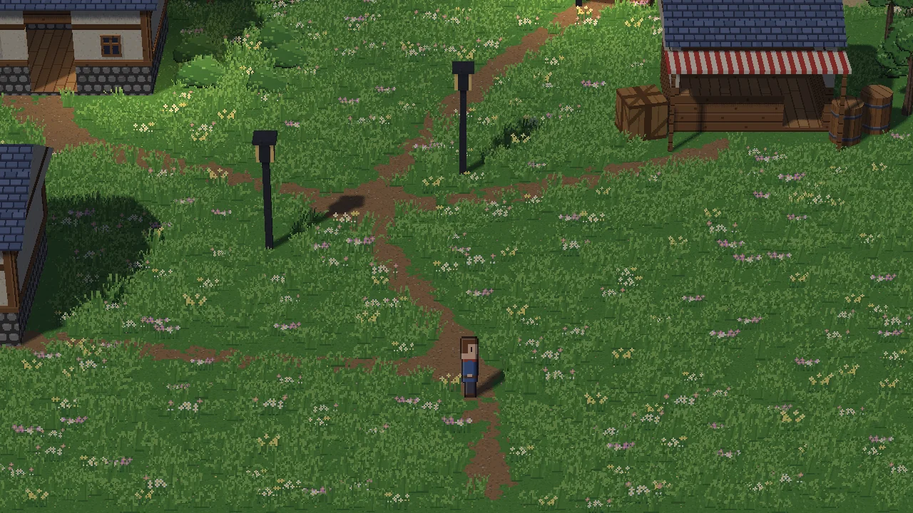
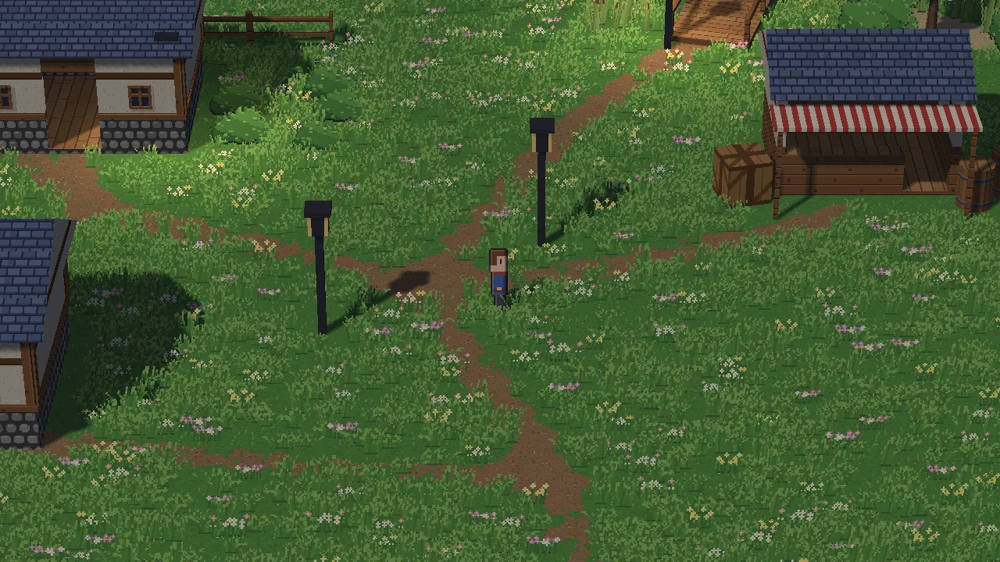
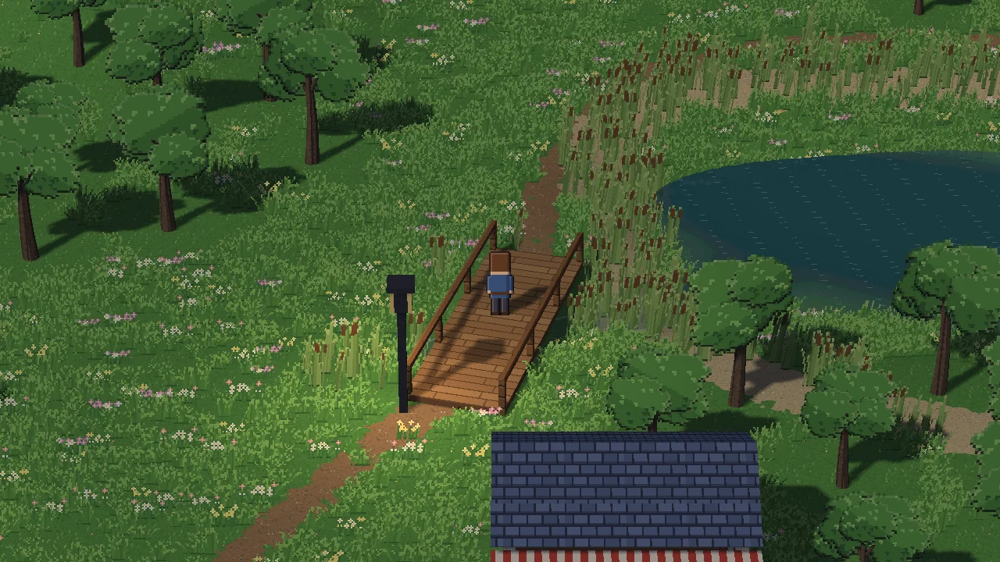
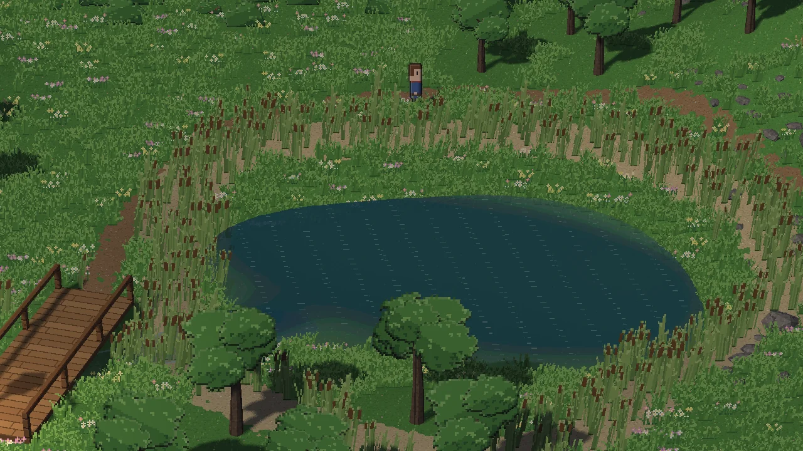
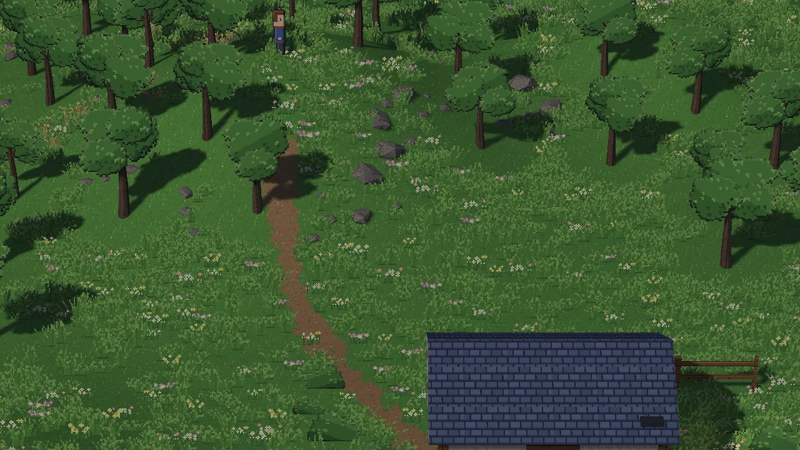
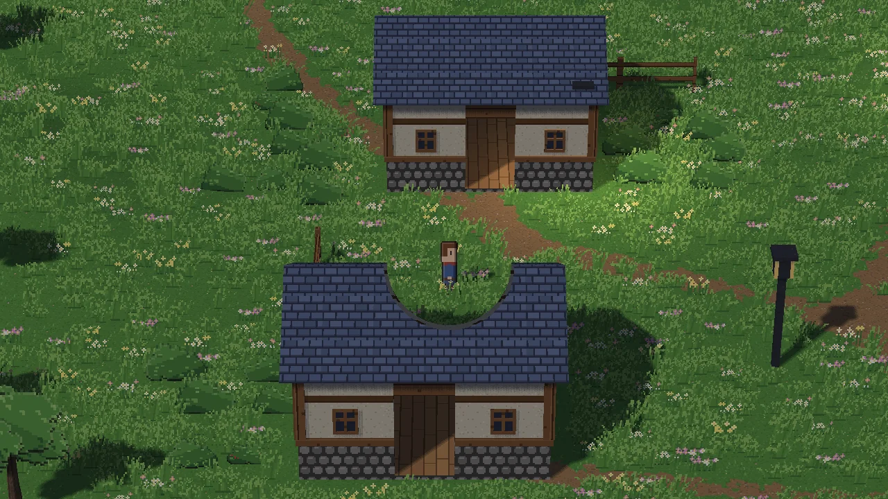
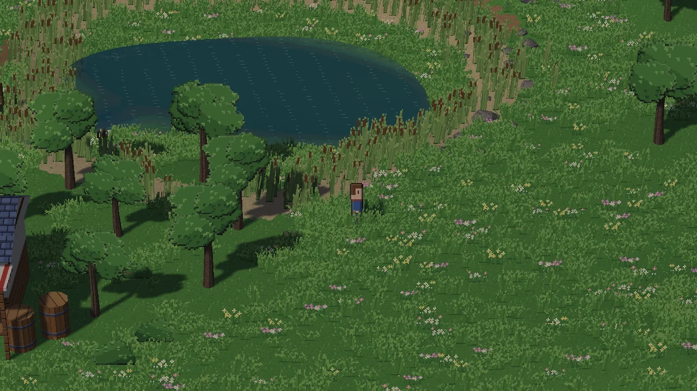
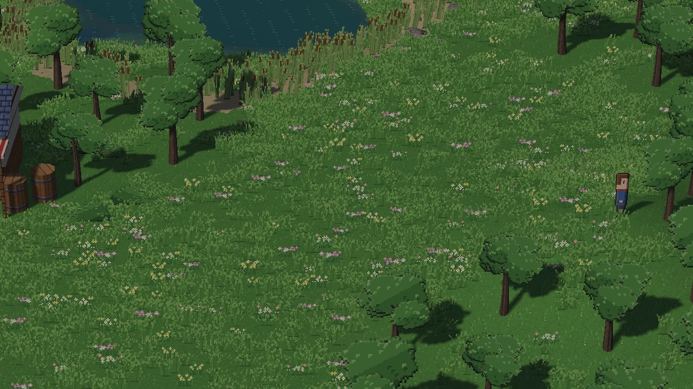

# Lakeside Village: an HD-2D showcase built in Mesh Studio

**Recommendation: CONDITIONAL PASS** (details at the end).

Lakeside Village is a 64 × 48 m outdoor HD-2D room. It has:

- rolling sculpted hills;
- winding earth paths;
- a pond with natural banks, reeds, ripples and reflections, and a narrow inlet crossed by a railed footbridge;
- two cottages, a market stall with barrels and crates, fences, and four warm lamp posts;
- small trees, shrubs, rocks, deadfall, a wildflower meadow;
- a breeze that moves the plants.

The player walks it in from the template's Village, along a road.

## How it was built

**Where the project lives:** `D:\Games\Lakeside Village`, made with `mesh new "Lakeside Village" --template hd2d_rpg`. `mesh new` refuses a game inside the engine folder, so the project lives beside the engine.

**How it was authored:** in Mesh Studio, through Studio's own input events in a hidden window, never by writing the room's JSON. The script is [`tooling/lakeside_village.py`](../../tooling/lakeside_village.py) (`… all PROJECT OUT` rebuilds the village from a fresh project). It uses:

- Studio's buttons;
- typed fields (Ctrl+A, the text, Enter);
- mouse strokes on the 3D view;
- right-click menus and keys.

Two kinds of step are not Studio input:

- **Pointing the editor's view** at the area being worked on. A person does this with WASD and the mouse wheel. It doesn't touch the room.
- **The approved workarounds** (below).

| Phase | Studio work | Result |
|---|---|---|
| 1. Room | **+ New room** "Lakeside", Save. Then the documented edit (below), then reopened: Studio shows it as a 3D room | an empty 64 × 48 m meadow |
| 2. Ground | **Sculpt**: Raise (5 hills, 1.5–3 m), Lower (the pond's basin, about 1.5 m deep; a narrow inlet), Smooth. **Paint**: Earth (5 winding paths), Sand (an irregular shore) | hills of 3.1, 2.2, 2.8, 1.8 and 1.5 m; the basin 1.5 m deep; the inlet 0.6–1.0 m |
| 3. Water | **Objects > Water** placed on the basin's slope where the ground is at the water's level, dragged to the middle. Inspector: Natural pond, Natural shape, Ground shore, its size, Walk through it: Off; the inlet the same, narrow and turned 25° | a pond (level −0.41 m) and an inlet (−0.45 m), both Walk through it: Off (deep water blocks) |
| 4. Buildings | **Models…** > search > Place in scene > a click; inspector X, Y, Turn, Height. Two cottages and the stall (See-through in play: On), the bridge (Height −1.8 m: the kit's deck is made 2 m up, between cliff tops), barrels, a crate, fences, 4 lamp posts. **Paint**: paths to the doors | 15 placed models |
| 5. Nature | **Scatter**: Small tree (One thing at a time…), Rocks and Deadfall (Earth off: not on the paths), Shrubs, then Meadow, Wildflowers, Pond edge. **Wind and motion**: Breeze, Animation: on | 13,395 things: 93 small trees, 147 rocks, 152 shrubs, 358 reeds and cattails, a meadow and wildflowers; wind 3 m/s, animation on |
| 6. Finish | **Lighting**: + Add light at each lamp post's lantern (More settings: size 224, height 2.4 m); As project. The player dragged to the south road; right-click at the road's end > **Add door to Village** | 4 lamps; the way in |
| 7. Doors | Village: its new door dragged to the east road's end; both doors shown as **Passage** (an invisible area across the road) | roads between the rooms |

**The approved workarounds, as used:**

- **HD-2D room (one edit, `make_hd2d`).** Studio's + New room only makes 2D rooms, with an indoor wood floor and stone walls (those walls block movement invisibly in HD-2D). The edit does what the HD-2D template does to make its own village (`engine.hd2d.starter_village`), at 64 × 48 m:
  - an outdoor grass map;
  - the ground's extent;
  - the gameplay camera (30° pitch, 11.25 m view);
  - the sun, the ambient light and the sky light.

  It writes nothing else.
- **Water level.** It is set by where the water is placed; it was placed on the bank's −0.45 m contour, then dragged into the basin.
- **Larger trees as models: not possible with Mesh's assets.** The kit's only tree, `tree_small.glb`, is a trunk: its canopy is four scatter sprites. Imported and placed as a model, it is a bare trunk ([evidence](lakeside_village_evidence/finding_imported_tree_is_a_bare_trunk.webp)). Every tree is the scatter brush's Small tree.

## Validation

**Play (the game runtime, as an exported game runs it; a hidden window; arrow-key events).** Every route behaved as expected:

| Route (arrow keys) | Result |
|---|---|
| South road to the crossroads | reached (29.5, 11.5) |
| Over the bridge, steering along its deck | reached the north bank; on the deck at 0.2 m over water at −0.45 m that blocks |
| Round the pond's north side, then south along its east bank | reached; up to 1.76 m on the far slope |
| Straight into the pond | stopped at its shore (feet at −0.40 m, the water's edge): deep water blocks |
| Up the hill path | reached the top, 3.05 m up |
| Into a cottage's wall | stopped at the wall (y 17.8) |
| Up the south-east mound | reached its top, 1.70 m up |
| Navigation (the engine's planner, from the start) | a walkable way to the crossroads, the bridge's far end, the pond's east bank, the hilltop, the mound and a cottage door |

- **Feet:** never off the ground or sunk into it on any route (largest gap 0.00 m), on the hills too.
- **The bridge:** its deck carries the player at 0.2 m over water at −0.45 m.
- **Blocking:** the pond and a cottage wall stop the player; a scattered tree stops them too (trees block, as designed).
- **Vegetation animation:** standing still, 21,663 of 921,600 (189,584 over 30 frames) pixels change from one frame to the next (plants swaying in the breeze, the water).
- **GPU objects:** unchanged across room changes.

**Save, close, reopen in Studio:** closed and reopened, nothing unsaved after opening and none at the end. The room Studio opens is the saved file exactly, apart from the player: the file keeps them as the project's player, and Studio shows that player expanded, as it does in every room. The reopened room has 15 structures, 13,395 scattered things, 2 waters, 4 lamps, and the wind and motion. Play (F4) and Stop five times switched mode each time, with GPU objects unchanged.

**Export:** `mesh export build` gave 1,057 files (11.5 MB). Run outside Studio with the bundle's own engine (a hidden window):
- it starts in the Village;
- walking east along the Village's road, its passage takes the player to Lakeside, arriving on the south road;
- the player walks to the crossroads.

[Picture](lakeside_village_evidence/10_exported_game.webp).

**Existing 2D projects:** a fresh `mesh new --template starter` project with this branch's engine. In a hidden window:
- the player walks 150 px;
- the game saves to a slot, and a new window loads it with the player's place and a flag restored;
- 594 colours on screen ([picture](lakeside_village_evidence/2d_starter_after_load.webp)).

**Tests:**
- fast tier: 4,843 passed;
- GPU tier (every hidden-window test, the HD-2D and water ones among them, after both engine fixes): 173 passed;
- ruff and the ruff gate: ok;
- mypy: at its 73-error baseline.

**Screenshots** (the game's camera, 1280 × 720; [evidence folder](lakeside_village_evidence/)):

| | |
|---|---|
|  |  |
|  |  |
|  |  |
|  |  |

**Visual check:**

- **Characters:** none floating (measured).
- **Clipping:** none seen.
- **Terrain:** no unnatural edges (the hills were smoothed).
- **Camera framing:** consistent; the camera is bounded by the room.
- **Brightness:** normal daylight (Studio's Night ambient doesn't reach the HD-2D render; see below).
- **Known defect:** the controls-hint banner is the known 2D/UI issue #398.

## Engine defects found and fixed (narrowly, with regression checks)

**A structure turned off a right angle blocked its own walkway.** A wall collider is kept as an axis-aligned box. Turned 74°, each of the bridge's railings became the box round its turned corners, about 1.75 × 5.8 m, which covered the deck between them, so the bridge couldn't be crossed. Studio's Turn field and +15 button make such turns easy for any creator.

**Fix** (`engine/hd2d/world.py`, `_walls`):

- a wall turned by a right angle (or not at all) stays one exact box;
- at any other turn, it is cut into slices no more than 0.25 m across, each boxed on its own, so their union hugs the turned wall;
- movement code is unchanged.

**Regression tests:** `tests/test_hd2d_world_turned_walls.py` (9 of its 10 tests).

- A railed walkway turned 74°, 15°, 45° or −30° can be walked along, and its railings still stop a walker crossing them. These fail before the fix (4 of 9) and pass after.
- A right-angle turn keeps exactly one box per wall.

**Water that blocks also blocked the bridge over it.** Water with Walk through it: Off becomes a solid box the water's size. A scene's 2D solid counted as on a character's level when within a body's height (1.5 m), so the inlet blocked a player on the footbridge 0.65 m above it.

**Fix** (`engine/hd2d/world.py`, `_on_level`):

- a water surface blocks only a character not standing a step (0.35 m) or more above its level;
- every other solid keeps its rule;
- a side effect for the better: on a bank above the water's level the player isn't stopped by the box's corners outside the natural outline, only where the ground meets the water.

**Regression test:** `test_a_footbridge_deck_crosses_water_that_blocks_and_the_bank_does_not` fails before the fix (the deck walker stops at 1.31 m) and passes after.

## Usability assessment

**Easy, worked as a creator would hope:**

- Sculpting (Raise / Lower / Smooth with a radius and a rate); each stroke is one undo step.
- Painting paths and shores; the Soft edges look natural.
- The water inspector: presets, a natural outline, the sculpted ground as its shore, size, turn.
- The Models browser with search; place, then type exact X / Y / Turn / Height.
- See-through in play on buildings (the roof opens round the player).
- The scatter collections; the wind presets.
- F4 play in place; Save.

**Awkward:**

- **Sculpting is by time.** The height reached depends on how long the brush is held. Fine by eye; there's no "raise to N m" except Flatten's picked height.
- **A stroke works only inside the view.** A long path is painted as several strokes with the view panned between them.
- **The kit's bridge is built for cliff tops.** It is a deck 2 m up; over water at ground level it needs a typed negative Height.
- **The first light changes the room's 2D lighting.** Adding a light in an HD-2D daylight room turns the room's 2D lighting On at a "Night" ambient. It doesn't reach the HD-2D render, but the panel then says "Night" and "dark away from lights". The template's sky light also appears as "Light 1: custom, size 0".
- **No brightness field** for an HD-2D lamp: only size and height.
- **A Natural pond can be waded by default.** Its preset is Walk through it: On, so a player walks out to the middle of a 1.5 m basin, 1.1 m under the surface. Deep water needs Walk through it: Off.
- **Ctrl+S after typing in a field didn't save.** Right after typing a value and Enter, the field kept the keyboard (seen with Studio's own key events). The Save button saved.

**Broken (found; not fixed here: findings for follow-up):**

- **Scatter is order-dependent, silently.** Two scattered things keep apart by the mean of their spacings. After a meadow is scattered, a Small tree (3 m) or a Rock has no room: Studio says "The stroke changed nothing (the rules, or the density already reached, left nothing to do)", not that the grass is in the way. Big things have to be scattered first, or the meadow thinned there.
- **Import 3D model accepts a canopy-less model without a warning.** The scatter tree's trunk imported as a model is a bare trunk.
- **Arrival spots can't be picked in the 3D view.** The Village's arrival from Lakeside stayed near the Village start instead of at its new passage.

**Missing (high priority, as the owner asked):**

1. **Create an HD-2D room** (and set its ground's size) in Studio.
2. **Gameplay camera, sun and sky controls.**

**Missing (lower priority):**

- **Set the start room.** The village is reached from the template's Village through a road passage.
- **A large tree asset.**
- **A water-level field.**

## Scope and safety

- Two narrow engine fixes in `engine/hd2d/world.py` (turned walls; water under a bridge), with 10 regression tests. Plus the build script and this report with its evidence (screenshots, the run's report, the project as a zip).
- No new assets and no paid generation; only the HD-2D starter kit.
- `main`, #344, the owner's projects, settings, stash and untracked files are untouched.
- Hidden windows only.

## Verdict: CONDITIONAL PASS

**The village works:**
- it was authored through Studio's controls, apart from the approved workarounds;
- it saves, closes and reopens unchanged;
- it plays: every route, the bridge, the water, the elevations, navigation, animation, collisions;
- it exports and runs outside Studio;
- existing 2D projects still work;
- the screenshots show a place worth exploring.

**Conditions:**
1. **The two engine fixes need the owner's review.** They are narrow, tested, and pass the GPU tier, but they change HD-2D collision.
2. **CI on this draft PR.** Timing budgets are subject to Rule F, as on the integration branch.
3. **The owner accepts the documented workarounds and gaps.**
   - HD-2D room, camera and sun come from the template's edit.
   - The water level is set by where the water is placed.
   - There are no large trees.
   - The start room is the template's Village, reached by road.

**High-priority follow-ups** (Studio tools, not started, as the owner asked):
- create an HD-2D room and its ground;
- gameplay camera, sun and sky controls;
- scatter that says what blocks a stroke, or lets large things go in after grass.

