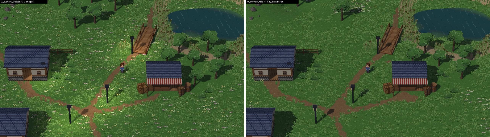

# M17-L1: Lakeside meadow and daylight composition pass (candidate for owner review; evidence only, never merged)

**Authorised:** #458 [comment 6703738229](https://github.com/septimus82/Mesh/issues/458#issuecomment-6703738229).
This is a content-only candidate on a scratch copy.

**Status:** candidate ready for your visual sign-off. **Nothing was copied into `D:\Games\Lakeside Village`**; its three
scene files have the same sha256 as before. No engine, Studio, shader, preset, AI, asset, template, DoF, grading,
cutaway or water change.

| | |
|---|---|
| Engine | `redesign/visual-editor` at **`f9f1f81`** |
| Source | the shipped `lakeside.json`, sha256 `18a7ee94…7f3901` |
| Candidate | [`candidate/lakeside.json`](candidate/lakeside.json), sha256 `040068d0d76c983826801d3f1f1bb6bd278b712acae36756c0cb820b643b3ee9`, made by [`scripts/l1_compose.py`](scripts/l1_compose.py) |
| Reproducible | the script only calls `engine.project_ops`: `set_light`, `scatter_stroke`, `set_scatter`, `clear_scatter` and `paint_terrain_stroke`, the operations Studio's Light, Scatter and Paint controls record. It uses fixed seeds; two runs give the same sha256. It writes JSON exactly as Studio saves a scene (sorted keys, indent 2). |
| Machine | RTX 4070, GL 4.6, Windows 11, Python 3.13; hidden windows only |

## 1. What the candidate changes

| Change | How (existing tools) |
|---|---|
| **Noon lamp pools gone, lamps kept** | The four lamp posts are unchanged. Their point lights are switched off (`enabled: false`, Studio's light On toggle), so night lighting is one toggle per lamp. The ambient light is untouched. |
| **Tree stands and clearings** | The 93 evenly spaced single trees become woods on the NW and NE hills, at the W, E, SW and SE edges, and west of the cottages, plus 5 singles. The shipped grove between the shop and the pond is kept. Under a stand the meadow comes back sparser, with bushes, as a woodland floor. |
| **Flower drifts with quiet spaces** | 14 drifts and clumps: open meadow, along the cottage fence, garden fronts, the pond's grassy north margin, by the barrels. Nothing on the paths, the crossroads or the village green. |
| **Worn ground** | Earth trodden in at both doorsteps, the shop front, the crossroads and the bridge's south end. Grass is cleared only where the earth now shows. |
| **Path edges** | Tall grass thinned within about 1.3 m of the village's paths. There are a few shrub clumps at the cottages' corners. |

**Guard rails, all checked by assertions in the script:**
- Structures, entities (doors, arrivals, the player, water), terrain heights, existing path paint, wind, motion, camera
  and sun are identical to the shipped scene.
- Rocks and reeds are byte-identical. Clearing strokes take only grass, flowers and shrubs.
- No tree stands on or within 1.6 m of a path, and the hilltop the hill path climbs to stays a clearing.
- No tree is placed in an 8 m chunk that held none before. A tree model draws once per chunk, so no view gains a draw
  call.

**Exact file difference** (`data/diff.json`, `scripts/l1_diff.py`):
- **lights:** indices 1–4 gain `"enabled": false`, and nothing else changes.
- **terrain paint:** 5 chunks (`2,0` `2,2` `3,1` `4,1` `4,2`), 221 painted corners, all earth.
- **scatter:** as below. Everything else in the file is unchanged.

| Scatter kind | Before | After | Note |
|---|---|---|---|
| tree_small | 93 | 53 | 6 kept from the pond grove; stands limited by the kit's 3 m tree spacing |
| flowers_pink + yellow | 1,078 | 366 | regrouped into drifts |
| grass_tuft / grass_tall | 7,996 / 3,431 | 5,933 / 2,577 | cleared under stands and worn ground, thinned at path edges |
| grass_dry | 140 | 34 | cleared under stands |
| bush / bush_berries | 109 / 43 | 133 / 55 | woodland floor, cottage corners |
| rock_small / rock_medium / reeds / cattails | 134 / 13 / 242 / 116 | identical | |
| **total** | **13,395** | **9,656** | |

## 2. Before and after (matched, deterministic, real engine frames)

The same harness as the audit is used: identical camera and player position, and wind and water clocks reset, so the
two frames differ only by the scene. The same frame captured twice is identical to the pixel (max difference 0). The
shipped and candidate frames were captured interleaved in one process.

**Sheets** (before | after, full size):
- [v0 overview (wide preset)](sheets/v0_overview_wide.jpg)
- [v1 village centre](sheets/v1_village.jpg)
- [v1 at 1920×1080](sheets/v1_village_1080.jpg)
- [v3 cottages](sheets/v3_cottage.jpg)
- [v4 crossroads](sheets/v4_paths.jpg)
- [v4b north meadow](sheets/v4b_north.jpg)
- [v2 shoreline](sheets/v2_shore.jpg) (extra)

**1:1 crops:**
- [crossroads and lamps](crops/c1_crossroads_lamps.png)
- [cottage door and garden](crops/c2_cottage_door_garden.png)
- [shop front](crops/c3_shop_front.png)
- [flower drifts and wood edge](crops/c4_flower_drift_woods.png)
- [pond grove](crops/c5_pond_grove.png)
- [overview village green](crops/c6_overview_village_green.png)
- [shop and lamps at 1080p](crops/c7_shop_lamps_1080.png)

**Raw frames:** `captures/720/*__before.png` and `*__after.png`, `captures/1080/`, and the no-light controls in
`captures/control/`.

**Plan maps from the data** (not renders): [before](maps/map_before.png) · [after](maps/map_after.png).

## 3. Measured against the brief's targets (`data/metrics.json`)

**Fine detail** (mean |Laplacian|): target at least 10% lower in v0, v1, v3, v4 and v4b. **Met.**

| View | Before | After | Change |
|---|---|---|---|
| v0 overview | 32.61 | 25.94 | **−20.4%** |
| v1 village | 25.26 | 20.05 | **−20.6%** |
| v1 1920×1080 | 17.98 | 14.28 | −20.6% |
| v3 cottages | 26.35 | 19.92 | **−24.4%** |
| v4 crossroads | 28.35 | 21.18 | **−25.3%** |
| v4b north | 23.93 | 21.24 | **−11.2%** |
| v2 shore (extra) | 21.61 | 19.34 | −10.5% |

**Other targets:**

| Target | Result |
|---|---|
| At least 70% of flowers clumped (5 or more neighbours within 1.5 m) | **91.5%** (was 27%); median neighbours 10 (was 3) |
| Noon lamp ground within ±5% of a no-light control | **0.0%** at all four lamp feet measured, in v1 and v4. The candidate's frames are pixel-identical to the same scene with the point lights removed. Lamp feet were 112–126 before and 72–85 after. |
| Scatter total ≤ 13,395 | **9,656** |
| No increase in draw calls | **Met:** v0 96→94, v1 65→65, v3 72→70, v4 61→60, v4b 67→66, v2 72→70, v1 1080p 65→65 |
| No increase in GPU cost | **Met.** Renderer draw GPU time, p50 / p95 ms, 480 frames each over 4 alternating rounds (clocks not locked, so it's a comparison): v1 1.95/4.97 → 1.83/4.51, v4b 1.81/2.96 → 1.74/2.81, v4 1.83/4.06 → 1.73/3.37 (`data/gpu_cost.json`). |

## 4. Validation (`validation/before` and `validation/after`; identical results for both scenes)

Each run used the same tooling on a pristine copy and on the candidate copy, with scratch APPDATA, XDG and Mesh user
directories:
- **Walkable routes** (`tooling/lakeside_village.py play`):
  - 7 of 7 routes behave as expected: road, bridge deck, round the pond, stopped at the shore, up the hill path,
    stopped by a cottage wall, up the SE mound;
  - 6 of 6 navigation queries find a way;
  - feet never off the ground (0.0 m);
  - GPU objects stable across three room changes.
- **Studio save/reopen** (`reopen`):
  - the room reopens with no differences apart from the shared player;
  - nothing is unsaved after opening or at the end;
  - Play (F4) and Stop five times, with GPU objects stable.

  This runs in a hidden Studio window, per the standing rule.
- **Export** (`export`):
  - `mesh export build` exits 0;
  - the bundle runs on its own engine, starts in the Village, and walks east through the passage into Lakeside
    (arrives at 30.0, 3.44 m; walks on to 30.0, 11.02 m).
- **Room transitions both ways** (`scripts/transitions.py`):
  - Lakeside's south passage leads to the Village, and the Village's east road leads back to Lakeside;
  - in the candidate, the renderer lights 0 lamps (the shipped scene lights 4).
- **Other rooms:** `start.json` and `cottage.json` are byte-identical in both copies. The owner's original project
  still has the shipped sha256 for all three scenes.

**Problems found on the way, and fixed before this candidate:**
1. **Rocks:** an "all" clearing stroke had removed 112 of 147 rocks. Clearing now takes ground cover only, with an
   assertion.
2. **Hill path:** the routes test caught a tree on the hill path, and then one on the hilltop past the path's end.
   Trees now keep off paths and that clearing.
3. **Draw calls:** a tree placed in a chunk that held none before added a draw call. The chunk rule now prevents it.

## 5. Visual judgement and limitations (for your sign-off)

**Better:**
- The meadow reads as grass rather than confetti.
- Paths, doorsteps and the shop front have a clear structure.
- Flowers sit where they would grow.
- The daylight hot spots under the lamps are gone.
- Woods frame the room's edges and the pond grove is kept.

**Calmer, sometimes emptier:**
- The north meadow (v4b) is now an open clearing with drifts and two trees, where the shipped scene had an evenly
  spaced grove.
- The overview's centre is a broad, plain green.
- This is the grass-tone monotony the audit showed composition can't fix: green share is unchanged at about 0.75–0.86,
  because Mesh has no grass variants or tint.

**Darker on average:** mean luminance falls 1–10 levels. Most of that is the removed noon lamp pools; the rest is
composition (`data/luma_split.json`).

| View | Mean luminance, before → after | From the lamps | From composition |
|---|---|---|---|
| v0 | 82.9 → 76.9 | 5.5 | 0.6 |
| v1 | 85.0 → 78.1 | 6.6 | 0.3 |
| v3 | 84.9 → 76.3 | 6.3 | 2.3 |
| v4 | 89.3 → 80.4 | 7.1 | 1.7 |

**Looser woods than a real forest.** The kit's trees keep at least 3 m apart (an engine rule), so a "stand" is an open
wood. Rocks kept, trees off paths and the chunk rule thin it further: 53 trees.

**Not exercised:**
- night lighting (the lamps' lights are off; one toggle each turns them back on);
- a physical desktop window (hidden windows only, per the standing rule).

**The fine-detail number is a proxy.** The controlling criterion is your visual judgement of the sheets.

**If accepted:** replacing `D:\Games\Lakeside Village\packs\core_regions\scenes\lakeside.json` with
`candidate/lakeside.json` needs your separate authorisation.

## 6. Files

- `candidate/`: the candidate scene.
- `scripts/`:
  - `l1_compose.py` (the transformation);
  - `capture.py`, `l1_metrics.py`, `l1_sheets.py`, `l1_diff.py`, `scenemap.py`, `transitions.py`, `gpu_cost.py`;
  - `run_all.sh` and `run_validate.sh`, and the shot lists.

  They hard-code the audit worktree path `D:\Games\Mesh-lva`.
- `captures/`, `sheets/`, `crops/`, `maps/`, `data/`, `validation/`.
