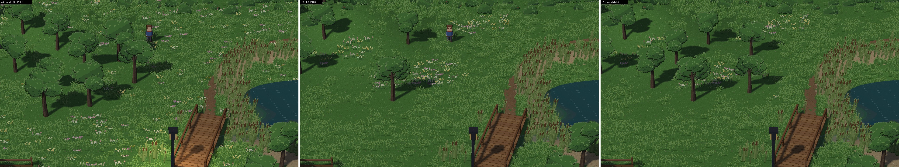

# M17-L1b: one restrained refinement of the L1 Lakeside candidate (for owner visual sign-off; evidence only, never merged)

**Brief:** #458 [comment 6704119001](https://github.com/septimus82/Mesh/issues/458#issuecomment-6704119001). L1 passed
the technical checks, but the village green and the north meadow came out too bare. L1b brings back some tree grouping
along the north meadow's wooded edge and adds a few small flower clumps at the green's margins. The centre, the
crossroads, paths and doorways stay clear.

**Status:** candidate for your sign-off.
- L1 (`1c23187`) stays the unchanged reference. Its frames reproduce bit for bit here.
- **Nothing was written to `D:\Games\Lakeside Village`**; its scenes keep their shipped sha256s.
- No engine, Studio, shader, preset, asset, template, camera, sun, structure or other-scene change.

| | |
|---|---|
| Engine | `redesign/visual-editor` at `f9f1f81` |
| Candidate | [`candidate/lakeside.json`](candidate/lakeside.json), sha256 `dd850648923cb382bf2914a26f824c2c2d58410cdad9ccc52326154966f12213`, 1,060,164 bytes, LF |
| Script | [`scripts/l1b_compose.py`](scripts/l1b_compose.py): **L1's script verbatim** (every L1 stroke, same order, same seeds), plus one appended block (section 6) of authoring operations. Run on the pristine shipped scene; two runs give the same sha256. |

Take the committed bytes: the raw GitHub file, or `git show`. A Windows checkout with `core.autocrlf` writes CRLF.

## 1. The L1b block (exactly what is added to L1)

**a) Tree group along the north meadow's wooded west edge** (the NW wood's east side). The script picks the spots
nearest that edge that pass every rule:
- at least 3.2 m from every tree (the kit keeps 3 m);
- at least 1.6 m from any path, with the hilltop clearing kept;
- about 1 m clear of flowers (one L1 drift's edge gives way);
- only in 8 m chunks that held trees in the shipped scene, and never at a chunk's edge.

Result: four trees at (834, 1160), (1002, 1208), (786, 1064) and (1002, 1040) px. Each gets a 2.1 m clearing (the kit's
tree-to-bush spacing), then some meadow and a bush or two back round it. It reads as a group off the wood's edge, not
the old even spacing. The chunk rule leaves only this band open in the north meadow view, which limits the group to
four trees.

**b) Seven small flower clumps at the green's margins:**
- by the shrub clumps at both cottages' corners;
- the green's north edge, west of the bridge approach;
- east of the shop front;
- the green's south-west and south-east edges, off the crossroads.

Each clump has 4–17 flowers, placed after thinning the meadow under it. There is nothing in the green's centre, on
the crossroads, on paths or at doorways.

**Exact changes:**

| | L1b vs L1 (`data/diff_b_vs_l1.json`) | L1b vs shipped (`data/diff_b_vs_shipped.json`) |
|---|---|---|
| tree_small | 53 → **57** (all 53 L1 trees kept) | 93 → 57 |
| flowers pink + yellow | 366 → **431** (333 of L1's kept; 98 new) | 1,078 → 431 |
| grass_tuft / grass_tall | 5,933 / 2,577 → 5,779 / 2,498 | 7,996 / 3,431 → 5,779 / 2,498 |
| bush / bush_berries | 133 / 55 → 134 / 56 | 109 / 43 → 134 / 56 |
| rocks, reeds, cattails, dry grass | identical | rocks, reeds, cattails identical; dry grass 140 → 34 (L1) |
| terrain paint, lights, structures, entities, other settings | **identical** | as L1: 4 lamps `enabled: false`; 221 earth corners in 5 chunks |
| scatter total | 9,656 → **9,494** | 13,395 → 9,494 |
| file | 1,075,086 → 1,060,164 bytes; text diff: +900 / −1,872 lines (scatter lists only) | 1,418,146 → 1,060,164 bytes |

## 2. Shipped | L1 | L1b (matched, deterministic, real engine frames)

All three versions of each view were captured in one process, with the same camera, player spot and wind/water
clocks.

**Sheets:**
- [v0 overview](sheets/v0_overview_wide.jpg)
- [v1 village](sheets/v1_village.jpg)
- [v1 1920×1080](sheets/v1_village_1080.jpg)
- [v4 crossroads](sheets/v4_paths.jpg)
- [v4b north meadow](sheets/v4b_north.jpg)
- [v3 cottages](sheets/v3_cottage.jpg) (extra)
- [v2 shore](sheets/v2_shore.jpg) (extra)

**1:1 crops:**
- [north wood edge](crops/c1_north_wood_edge.png)
- [green by the cottage corner](crops/c2_green_cottage_corner.png)
- [green by the bridge approach](crops/c3_green_bridge_approach.png)
- [green south of the crossroads](crops/c4_green_south_crossroads.png)
- [overview green](crops/c5_overview_green.png)

**Plan maps:** [shipped](maps/map_shipped.png) · [L1](maps/map_l1.png) · [L1b](maps/map_l1b.png).

## 3. Guard rails (`data/metrics_b.json`)

**Fine detail** (mean |Laplacian|): target at least 10% below shipped in each target view.

| View | Shipped | L1 | L1b | L1b vs shipped |
|---|---|---|---|---|
| v0 overview | 32.61 | 25.94 | 26.23 | **−19.6%** |
| v1 village | 25.26 | 20.05 | 20.38 | **−19.3%** |
| v1 1920×1080 | 17.98 | 14.28 | 14.53 | −19.2% |
| v4 crossroads | 28.35 | 21.18 | 22.20 | **−21.7%** |
| v4b north | 23.93 | 21.24 | 20.04 | **−16.3%** |
| v3 cottages (extra) | 26.35 | 19.92 | 20.34 | −22.8% |
| v2 shore (extra) | 21.61 | 19.34 | 19.20 | −11.1% |

**Other guard rails:**

| Guard rail | L1b |
|---|---|
| At least 70% of flowers clumped (5 or more neighbours within 1.5 m) | **92.1%** (L1 91.5%, shipped 27%) |
| No daytime lamp hot spots | **0.0%**: lamp-foot ground is pixel-identical to the same scene with the point lights removed (v1 and v4 frames identical) |
| Scatter total ≤ 13,395 | **9,494** |
| Draw calls ≤ shipped | **met:** v0 96 / 94 / 94, v1 65 / 65 / 65, v4 61 / 60 / 60, v4b 67 / 66 / 66, v3 72 / 70 / 71, v2 72 / 70 / 70, v1 1080p 65 / 65 / 65 (shipped / L1 / L1b) |
| GPU cost | **p50 met, p95 at noise level** (see below) |

**GPU cost** (`data/gpu_cost_b.json`): renderer draw GPU time, p50 / p95 ms, 480 frames per cell, rounds alternating
the three scenes, clocks not locked.

| View | Shipped | L1 | L1b |
|---|---|---|---|
| v1 | 1.90 / 4.01 | 1.70 / 3.90 | 1.76 / 4.04 |
| v4b | 1.82 / 2.88 | 1.35 / 2.48 | 1.10 / 2.38 |
| v4 | 1.91 / 4.11 | 1.74 / 3.49 | 1.57 / 4.13 |

- **p50:** below shipped in every view.
- **p95:** within ±1% of shipped in v1 and v4, and lower in v4b. This is the unlocked-clock variance already seen for
  L1, not a consistent cost.

## 4. Validation (`validation/`)

These are the same checks as L1, on a fresh scratch copy holding the L1b scene. Every result matches the shipped
scene's:
- 7 of 7 walking routes behave as expected, including up the hill path to the hilltop;
- 6 of 6 navigation queries;
- feet never off the ground;
- GPU objects stable across room changes;
- Studio reopen with no differences apart from the shared player, and nothing unsaved;
- Play/Stop ×5 with GPU objects stable;
- `mesh export` exits 0; the bundle runs on its own engine and walks Village → Lakeside;
- Lakeside ↔ Village transitions both ways;
- no lamps lit;
- `start.json` and `cottage.json` byte-identical;
- the original project's three scenes still have their shipped sha256s.

## 5. Judgement and limits

**Better than L1:**
- The north meadow has a wood edge again: a loose group, with the drifts in the open beside it.
- The green's margins have small, deliberate flower clumps, while its centre, the crossroads and the doorways stay
  clear, so walking spaces read as walking spaces.
- Everything else is L1, unchanged.

**Still limited:**
- The no-new-tree-chunk rule (draw calls) and the kit's 3 m tree spacing leave room for only four trees in the north
  meadow view.
- Grass-tone monotony is untouched, as agreed: no grass-colour feature.
- The fine-detail number is a proxy; your visual judgement of the sheets decides.

**If accepted:** replacing the original `lakeside.json` needs your explicit go-ahead, with a backup and a
hash-preserving process.

## 6. Files

- `candidate/`: the L1b scene.
- `scripts/`:
  - `l1b_compose.py`;
  - `capture.py`, `l1b_metrics.py`, `l1b_sheets.py`, `l1_diff.py`, `scenemap.py`, `transitions.py`, `gpu_cost_b.py`,
    `run_validate_b.sh`;
  - the shot lists.

  They hard-code the worktree path `D:\Games\Mesh-lva`.
- `captures/`: `__before` = shipped, `__l1` = L1, `__l1b` = L1b, plus the L1b no-light controls.
- `sheets/`, `crops/`, `maps/`, `data/`, `validation/`.
