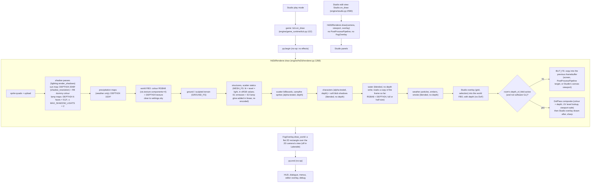

# M17-L4A: HD-2D post-processing investigation (evidence only, never merge)

**Branch:** `review/m17-l4a-postfx` (evidence only), on `redesign/visual-editor` `0fa2f25` (L3 C1–C3, E1, E2 and #481
merged).
**Scenes:** a hash-verified scratch copy of the installed Lakeside Village (`lakeside.json` sha256 `dd850648…`, the
approved L1b). The installed project, its backup and the L1b composition are untouched. Variants come from
`project_ops.set_hd2d_sun`, written into the scratch copy only.
**Code:** every prototype runs in a scratch harness (`scripts/`). No engine, scene, asset, serialization or CI change.
**Machines:**
- NVIDIA RTX 4070 (Windows 11);
- Mesa 26.0.3 llvmpipe, loaded locally from the same pinned, hash-checked archive CI's Windows jobs use (`scripts/mesa_preload.py`).

## Verdict

1. **The existing post-processing never reaches the HD-2D picture**, and it is architecturally the wrong place for
   HD-2D effects:
   - `PostProcessPipeline` is created empty, and nothing adds an effect.
   - It never runs in Studio's edit view.
   - It has no depth.
   - It works full-window, ignoring Studio's canvas viewport.
   - It grades 8-bit sRGB values directly.

   The one HD-2D post effect that works, depth of field (#460), lives in the renderer's final composite. That is
   where L4 belongs too.
2. **Colour grading is the main lever, and it is safe:**
   - modest but real mood gains at evening and night, small at noon;
   - characters as readable as before (|Weber contrast| change ≥ −0.012, edges ≥ 0.995);
   - lamp glass hue within 0.4°;
   - shadows crushed +0.095% of pixels at most, nothing clipped.
3. **Vignette** is safe and subtle (0.18). It is near-invisible indoors (dark backdrop) and never touches HUD, menus or
   dialogue (drawn after the world in play and in Studio).
4. **Atmospheric depth is genuine but low-value at Mesh's camera:**
   - the depth-based haze recedes the far band (far/near contrast 0.84× the original's) without touching characters;
   - a flat overlay of the same mean colour and amount gives no depth cue (0.99×) and costs readability
     (character contrast −0.157, edges 0.71×).
   
   But the telephoto camera (fov 12°, 53.5 m) sees only about −8 / +12 m of depth around the focus, so depth haze
   reads mostly as a band across the top of the picture. At noon it flattens the far meadow. Evening and night get a
   little; morning mist is a stylised choice. Recommended **optional and off by default**, and it must start beyond
   the character's band (see findings).
5. **Tilt-shift: reuse the existing depth of field; don't add a second blur.**
   - It is already depth-based, which is a better "miniature" than a screen-band blur, because tall near objects
     keep their own depth.
   - Subtle stays sensible outdoors.
   - "Miniature" values smear near interactables (lamp posts: edges 0.83×).
   - Indoors it does almost nothing (±2.5 m of depth).
   - Software GL bypasses it (18 ms a 720p frame on llvmpipe).
6. **Bloom: not now.**
   - Outdoors in daylight nothing reaches a bloom threshold.
   - At night only the lamp glass does (0.03–0.08% of pixels).
   - Indoors, 3.4% of pixels already sit near white on the lamp-lit floor, so a luminance-threshold bloom would haze
     them.
   
   If ever pursued, it should be driven by the emission data (E1/E2 surfaces), not by luminance.
7. **Cost:**
   - **GPU:** the combined grade + haze + vignette pass costs +0.05–0.07 ms over the blit it replaces on the RTX 4070
     (720p and 1080p), and +1.9 ms on llvmpipe (+9% of a 26 ms frame), so it is affordable on CI's software GL.
   - **CPU:** the prototype's submission costs 0.35 ms (Python uniform sets). Production must cache settings uniforms.
   - **Memory:** none, unless chained after the DoF: then one RGBA8 frame-sized target (3.5 MiB at 720p, 7.9 MiB at 1080p).

## 1. The rendered-frame path (`0fa2f25`)



**Formats and colour space:**
- **The world:** colour **RGBA8 UNORM** (not sRGB-typed), depth **DEPTH_COMPONENT24** texture, `compare_func=None`
  (the DoF reads it).
  - Clip planes: near 0.1, far 500.
  - Perspective (orthographic optional).
  - Never multisampled.
- **Lighting:** happens in **sRGB-encoded values** (texel × light factor, gamma-space lighting). Only E1/E2 emission is
  added in linear light, then re-encoded.
- **Inputs and output:** textures are uploaded as plain RGBA8, except E1's linear-filtered emission maps
  (`SRGB8_ALPHA8`). The default framebuffer is not sRGB (no `GL_FRAMEBUFFER_SRGB`).
- **What this means for post effects:** they read sRGB-encoded 8-bit values. A grade must decode to linear, work, and
  encode, or it grades in gamma space (as the old `ColorGrading` does, pivoting contrast at 0.5).
- **Depth availability:** ground, terrain, structures, scatter, campfires and characters write depth. Water,
  weather, embers, smoke and soft shadows don't, so depth effects treat them as what lies behind them (water as its
  bed).
- **Depth span the camera sees:**
  - outdoor camera (pitch 30°, fov 12°, 53.5 m, so 26.8 m high): view-axis depth 45.3–65.4 m, i.e. **−8 / +12 m
    around the focus**;
  - indoor camera (pitch 55°, 35.7 m): about **−2.5 / +2.8 m**.

  This is why depth haze and DoF are mild indoors, and why outdoor depth runs mostly with screen height.

## 2. Why earlier post-processing never reached the picture

- **`engine/post_processing.py`** (`PostProcessPipeline` plus `Vignette`, `ColorGrading`, `ScreenFade`, `CRTEffect`) dates
  from 2026-03-06, before HD-2D.
  - `GameWindow` builds one (`engine/game.py:650`) and `tick.on_draw` wraps the world in it.
  - **Nothing in the engine ever calls `add_effect`**, so `has_active_effects` is false and `begin()` returns
    immediately every frame.
  - The effect classes are exercised only by tests, which is #458's finding #1, still true at `0fa2f25`.
- **Even populated, it would be wrong for HD-2D:**
  1. **Studio's edit view never calls it** (`Studio.on_draw` draws the renderer straight into the canvas). The creator
     would not see what players see. Only Studio's play mode goes through it.
  2. **No depth:** its ping-pong targets are colour-only RGBA8, so no haze or DoF can live there.
  3. **Full-window:** it renders into window-sized targets and to `window.use()`, so it can't respect Studio's
     canvas viewport.
  4. **Gamma-space maths:** contrast pivots at sRGB 0.5, and saturation uses Rec.709 weights on encoded values.
  5. **Order:** `FogOverlay` (a 2D flat overlay) lands inside it, after the world.
- **#458's prototypes** patched `PostProcessPipeline.__init__` in a scratch harness, so they were only ever visible in
  that harness. They were never architecturally right for HD-2D, for the reasons above.
- **The only HD-2D post effect that reaches the screen is #460's depth of field.** It replaces the renderer's final
  blit, reads colour and depth, is viewport-safe, draws Studio's overlay after itself, and is bypassed on software GL.
  Lakeside sets no `depth_of_field`, so it is off there.
- **`FogOverlay`** is a 2D, global, translucent rectangle (fog colour × density), not depth-aware. Lakeside doesn't
  enable it, and Studio's edit view doesn't draw it.

## 3. Baseline (`sheets/baseline_*.png`, `frames/*__original.png`)

- **Real game frames:** 1280×720, `Hd2dRenderer.draw` into an offscreen RGBA8 target (exactly the game's composite),
  with no HUD.
- **Determinism:** motion and water time reset, 120 settle frames, the player's feet at a fixed spot, so the camera
  follows to a fixed place. Re-rendering is **byte-identical** (9 of 9 frames re-rendered in a new process).
- **Shots:**
  - village centre / crossroads;
  - shoreline and lake;
  - bridge (water both sides);
  - cottage south face;
  - north cottage from the arrival path;
  - the cottage **interior** (its authored lamp on).
- **Times:**
  - `authored` (the approved L1b as shipped, lamps off);
  - `morning`, `noon`, `evening`, `night` (sun presets, lamps as authored, i.e. off);
  - `night_lamps` (night with the four authored lamps switched on, a controlled variant for E1/E2 and lamp colour).
  
  The interior is authored only: a sun preset would recolour its dark backdrop.
- **Authored vs the noon preset:** 1.8–2.2% of pixels differ (max 36), so `authored` is kept as the approved baseline.
- **Lamp 4:** with lamps on, `lamp_post_4` sits 0.2 m inside the cottage's corner (the known L3 C2 content defect), so
  its glass is hidden.

## 4. Visual treatments (`sheets/effects_*` (village: authored = day), `sheets/closeup_*`, `sheets/presets_*`, `data/summary.json`)

**The prototype** (`scripts/postfx.py`) is one full-screen pass after the renderer's composite, in linear light:
1. depth haze;
2. grade;
3. vignette.

It uses `texelFetch` (no filtering). With every effect off its output is the input **exactly** (checked every
baseline frame, on both drivers).

**Metrics:** 31 frames per candidate (5 outdoor shots × 6 times + the interior), each against its original.

| Candidate | char. \|Weber\| change (worst) | char. edges (worst) | crushed (+%, worst) | clipped | depth cue (far/near contrast vs original, median) | far sat. | near sat. |
|---|---|---|---|---|---|---|---|
| grade (per time of day) | −0.012 | 0.995 | +0.095 | 0 | 0.999 | 1.06 | 1.06 |
| vignette 0.18 | 0.000 | 1.000 | +0.061 | 0 | 1.002 | 1.00 | 1.00 |
| vignette 0.35 | 0.000 | 1.000 | +0.107 | 0 | 1.005 | 1.01 | 1.01 |
| depth haze | −0.001 | 1.000 | 0 | 0 | **0.837** | 0.76 | 1.00 |
| flat overlay control (same colour, haze's mean amount) | **−0.157** | **0.712** | 0 | 0 | 0.994 | 0.85 | 0.83 |
| existing DoF, Subtle | −0.006 | 0.941 | 0 | 0 | 0.930 | 0.99 | 0.99 |
| existing DoF, miniature values | −0.035 | **0.826** | 0 | 0 | 0.955 | 0.98 | 0.98 |
| combined (grade + haze + vignette) | −0.012 | 0.995 | +0.111 | 0 | 0.818 | 0.76 | 1.06 |
| combined + DoF Subtle | −0.004 | 0.938 | +0.039 | 0 | 0.804 | 0.74 | 1.05 |

**Reading the metric columns:**
- **Characters:** every on-screen character, masked by drawing it flat against the world's depth
  (`Hd2dRenderer.draw(solid=…)`).
- **Weber contrast:** against a 6 px ring round the character.
- **Edges:** mean luminance gradient inside the character.
- **Depth cue:** <1 means the far band recedes relative to the near band.

**Colour grading** (`GRADES` in `scripts/presets.py`):
- **How it works:**
  - white balance;
  - contrast about mid-grey on luminance only (log space, soft shoulder);
  - saturation;
  - split toning;
  - highlight protection (bright pixels keep their colour).
- **Lamp colours preserved:** the brightest glass pixels, (255,177,72), become (255,177,74) under the night grade, a
  hue shift ≤0.4°. The larger hue numbers in `data/summary.json` come from lamp 4, hidden in the cottage wall, where
  the sampler reads wall pixels.
- **What it looks like:**
  - evening warmer;
  - night cooler, with lamps holding their warmth against it (the clearest gain);
  - noon a little richer.
- **Drawback found and fixed:**
  - The first night grade (contrast 1.06 plus a blue shadow tint) crushed shadows up to **+1.04%** of pixels (luma ≤ 8).
  - Contrast 1.0 with exposure 1.03 brought that to ≤ +0.095%.
  - Rule: night grades must not add contrast. The first run is in `data/v1_*`.

**Vignette** (aspect-correct, round in the picture, 0 at the centre radius):
- At 0.18 it is barely noticed but frames the shot.
- At 0.35 it is visible on bright days.
- Indoors it is lost in the dark backdrop.
- It never touches the HUD (drawn after it in play and Studio).
- **Drawback:** it dims corner content by up to 18% (0.18), e.g. a lamp in the corner (value −0.045).

**Tilt-shift / depth of field** (the existing #460 pass, in-process settings, no scene change):
- **Subtle** calms the far band (depth cue 0.93) and keeps the followed character sharp.
- **Miniature values** (focus range 1.5 m, falloffs 6/8 m, max blur 3.5) read more toy-like, but blur near
  interactables (the near lamp post in `closeup_village__night_lamps.png`).
- **Indoors:** almost no effect (±2.5 m of depth).
- **Honest drawback (both settings):**
  - At the shore, the player stands behind a near tree canopy.
  - The canopy's correct near-field blur spreads over the player's visible edges (edges 0.94 Subtle, 0.83 miniature;
    `probe_shore_player.png`).
  - A real lens does the same, but readability loses.
  - **Recommendation:** keep Subtle as the only preset; no miniature preset; no screen-band tilt-shift. A screen band
    would blur tall near objects at the top and keep far ground at the band's height sharp, which is worse than depth.

**Atmospheric depth** (depth haze, `HAZES`):
- **How it works:**
  - mixes toward a haze colour (the time of day's sky, lightened for day) by how far a pixel lies beyond the focus
    (view-axis metres from the depth buffer);
  - smooth onset 3 m beyond the focus, full at +15 m;
  - optional height thinning (morning mist, e-folding 1 m above the ground).
- **Genuine vs overlay** (`effects_*`, "control" tile):
  - the haze lowers far contrast and saturation, leaves near and character pixels alone, and keeps occluders' own
    depth (tree canopies at the top stay clear: `debug_haze` tiles);
  - the flat overlay washes everything.
- **Drawbacks found:**
  1. **Haze starting at the focus hurts characters.** A morning mist with onset 0 m hazed the ground right behind
     the player but not the player, so contrast fell from 0.22 to 0.07 (bridge, cottage). Starting 3 m beyond the
     focus removes it (−0.001). Rule: the onset must stay beyond the character band (≥ band + margin), enforced by
     the renderer.
  2. **The first strengths (0.28) looked milky.** 0.12 day and evening, 0.15 night, 0.22 morning mist.
  3. **At noon it flattens the far meadow** for little gain. Recommended off for day.
  4. **Water has no depth,** so it hazes as its bed (a few cm more than the shore beside it): invisible at these
     strengths.

## 5. Bloom assessment (`data/bloom_probe.json`)

Share of each original frame over common LDR bloom thresholds:

| | max channel ≥ 250 | luma ≥ 200 |
|---|---|---|
| Outdoor, every time of day, lamps off | 0% | 0% |
| Outdoor, night, lamps on (lamp glass only) | 0.03–0.08% (300–750 px) | 0% |
| Interior (lamp-lit floor and walls) | **3.4%** | 3.7% |

- **Outdoors:** a luminance-threshold bloom would do nothing outdoors by day.
- **At night:** it would put halos round the lamp glass, the one place it would help.
- **Indoors:** it would haze the interior's lit planks (false sources).
- **The frame is 8-bit (LDR):** there is no headroom above 1.0, so bloom can't tell a lamp from a white wall without
  a mask.
- **Verdict:** defer. If wanted after L4, prototype an **emission-masked glow**: E1/E2 surfaces write a mask, and a
  half-res blur adds only that. Its cost is a multi-pass blur chain (2–4 passes, ~0.5× frame memory).

## 6. Performance (`data/perf_*.json`, `scripts/perf.py`)

**Method:** each pass on the same settled frame, interleaved in one process (the same clock state), order rotated
each round, first 10% dropped.
- **RTX 4070:** GL timer query per pass, 400 rounds.
- **llvmpipe:** wall time around `ctx.finish()`, 30 rounds (its timer query isn't trustworthy, #460).

**Clocks:** unlocked (locking needs a system setting). The RTX sat at P5 or P8 (225–1545 MHz) for these light frames,
so compare within a row, not across rows.

**Median, ms** (village noon; the night-with-lamps rows are within ±0.01 ms on the RTX):

| | blit (today) | grade | vignette | haze | **combined** | DoF Subtle | DoF + combined (2 passes) |
|---|---|---|---|---|---|---|---|
| RTX 4070, 1280×720 | 0.034 | 0.076 | 0.060 | 0.059 | **0.090** | 0.551 | 0.644 |
| RTX 4070, 1920×1080 | 0.025 | 0.058 | 0.046 | 0.046 | **0.070** | 0.444 | 0.515 |
| llvmpipe, 1280×720 | 0.67 | 2.37 | 2.04 | 1.97 | **2.61** | 18.1 (bypassed in the engine) | 20.6 |

**GPU, incremental over the blit it would replace:**
- combined pass: **+0.05–0.07 ms** on the RTX 4070, **+1.9 ms** on llvmpipe;
- whole frame on llvmpipe: 25.6 → 28.0 ms (+9%).

**CPU:** the prototype's submission costs 0.35 ms against the blit's 0.13 ms. That's Python setting ~25 uniforms
plus a 4×4 inverse each frame. Production should set the settings uniforms only when they change, and the matrix
once per frame.

**Whole-frame GPU timer (RTX):** draw+combo minus draw+blit = +0.6–0.85 ms. That timer spans the CPU's preparation
between the passes, so it is an upper bound, not GPU cost.

**Memory and passes:**
- **Combined pass replacing the blit:** 0 new textures, 1 program; reads the existing world colour and depth.
- **With the DoF on:** either (a) one intermediate RGBA8 frame-sized target (3.5 MiB at 720p, 7.9 MiB at 1080p,
  31.6 MiB at 4K), or (b) the grade and vignette folded into the DoF composite (0 new).
- **Haze after the blur:** applying haze after the DoF uses sharp depth over blurred colour. Halo risk at far
  silhouettes is negligible at ≤0.15 strength. If haze grows, apply it before the blur.

**Exact original when disabled:** yes. Keep today's blit path when every effect is off, as the DoF does. The prototype
pass is also an exact copy when off (checked).

**Drivers:**
- llvmpipe vs RTX already differ on the plain world (3–7.6% of pixels, a few >2 levels at raster edges).
- The effects add only ±1–2 levels of rounding: the >2-level share is unchanged (`data/mesa_vs_rtx.txt`).
- So tests must compare on/off **on the same machine**, never cross-driver golden images.

## 7. Studio and gameplay sharing

- **One home:** the renderer's final composite, which both views run. That is already how the DoF works.
- **One source:** settings in `settings.hd2d` (a new block, parsed like `depth_of_field`).
- **Requirements carried over from #460:**
  - **UV/viewport-safe lookup:** Studio draws into a canvas viewport. The prototype's `gl_FragCoord` texel lookup
    must become `gl_FragCoord − viewport.xy`, or UV.
  - **Studio's overlay after the effects:** grid and selection stay sharp and ungraded (`_overlay_after`).
  - **A Studio preview toggle:** for vignette only. Grading should show by default, so the creator sees the player's
    picture.
- **Screenshots and tests:** `Hd2dRenderer.draw(read=True)` returns the world before the composite. The
  implementation needs a final-composite read (or tests render into their own target, as `scripts/lab.py` does).
  Deterministic on one driver; HUD unaffected.

## 8. Recommended presets (all off by default; values in `scripts/presets.py`)

| Preset | Grade | Vignette | Haze | DoF |
|---|---|---|---|---|
| Off (default) | none: byte-identical to today | 0 | off | room's own |
| Natural (day) | contrast 1.06, sat 1.06, protect 0.6 | 0.15 | **off** | room's own |
| Golden hour (evening) | WB (1.06, 1, 0.90), contrast 1.08, sat 1.06, split 0.5 warm high / cool low, protect 0.8 | 0.18 | optional 0.12, `#e0a27c` | room's own |
| Moonlight (night) | WB (0.95, 0.98, 1.05), contrast 1.0, exposure 1.03, sat 0.92, split 0.4, protect 0.9 | 0.22 | optional 0.15, `#1c2440` | room's own |
| Morning mist (artistic) | gentle warm/cool split | 0.15 | 0.22, `#c9d5e4`, onset ≥ 3 m, height 1 m | room's own |
| Interior warm | WB (1.04, 1, 0.94), contrast 1.05, split 0.35, protect 0.85 | 0.2 | off | off |

- **Who chooses:** the creator picks a preset (no automatic time-of-day switching). A later "match the sun preset"
  suggestion in Studio is possible but not proposed now.
- **DoF:** stays its own opt-in (Subtle).

## 9. Staged implementation plan (small, independently reviewable PRs)

**L4-1, final-composite infrastructure (essential):**
- **What:** `settings.hd2d.post` parsed and validated (absent = off). An `Hd2dRenderer` final composite that replaces
  the blit only when active:
  - one program;
  - viewport-safe;
  - settings uniforms cached;
  - DoF chaining via an intermediate target only when both are on;
  - Studio overlay after;
  - a final-composite read for tests;
  - `release()` frees it;
  - software GL allowed.
- **No visible effect yet:** identity only, plus a debug pass for tests.
- **Acceptance:**
  1. Absent or off: frames **byte-identical** to `0fa2f25` in 8 views (4 rooms × day/night), same draw calls, same GL
     objects.
  2. Enabled with neutral values: identical to off.
  3. Studio's canvas (offset viewport) equals the game's world pixels for the same camera.
  4. Window resize keeps the target sized.
  5. The HUD bytes are unchanged.
  6. With DoF: DoF frame then neutral post = DoF frame exactly.
  7. GPU cost ≤ 0.05 ms at 1080p on a discrete GPU (the blit replaced), CPU ≤ 0.05 ms per frame.
  8. llvmpipe runs it.

**L4-2, colour grade + vignette + presets (the visible step):**
- **What:** the grade (linear-light, luminance contrast, saturation, split toning, highlight protection) and the
  vignette. The presets above; a Studio control (Camera and sun panel: preset + strength); an AI op
  (`set_hd2d_post`, auto-discovered).
- **Acceptance:**
  1. Per preset on the baseline set: characters' |Weber| change ≥ −0.02 and edges ≥ 0.98.
  2. Crushed ≤ +0.1% and clipped +0.
  3. Lamp glass hue shift ≤ 2° (E2 heads at night).
  4. Vignette leaves the centre radius unchanged.
  5. Off = byte-identical.
  6. Scene round-trip (save, reopen, export), undo and redo.
  7. Studio and game show the same picture.
  8. llvmpipe within 2 levels of its own off frame plus the effect (same-machine comparison).

**L4-3, atmospheric depth (optional, artistic; after L4-2 is reviewed in use):**
- **What:** depth haze with onset forced ≥ the character band + 1 m, colour from the sky by default, optional height
  term, indoor default off.
- **Acceptance:**
  1. Characters' |Weber| change ≥ −0.01 at every preset.
  2. Depth cue ≤ 0.9 on outdoor views, while a flat overlay of the same mean stays ≥ 0.98 (proves depth).
  3. Water and particles behave (no halos at shorelines).
  4. Off = byte-identical.
  5. Cost ≤ 0.03 ms at 1080p on top of L4-2.

**L4-4, bloom (optional, separately authorised; investigation first):**
- **What:** emission-masked glow only (E1/E2 surfaces).
- **Acceptance:**
  1. Interior planks unchanged (no false sources).
  2. Lamp glass halos ≤ N px.
  3. Cost and memory measured on both drivers.

**DoF follow-ups (no new blur):**
- Document foreground-occluder bleed.
- Keep Subtle the only preset.
- Optionally clamp near blur within the character's screen box (a separate, small investigation).

**Order:** L4-1 → L4-2 → (owner review of the look in play) → L4-3 → L4-4. L4-1 alone ships nothing visible, by
design: it is where every regression guard lives.

## 10. Limitations

- **One project:** Lakeside (plus its interior). Other rooms (the template village, rivers, snow) are not captured;
  grades were judged on these frames only.
- **No Studio capture:** Studio parity is argued from the code path (`Studio.on_draw` → `Hd2dRenderer.draw(camera,
  viewport, overlay)`); no Studio frame with the prototype was captured.
- **Unlocked clocks:** GPU timings within a row only. No integrated-GPU measurement.
- **Metrics are proxies:** contrast, edges and band statistics. The visual judgement is in the sheets.
- **No HDR:** the frame is 8-bit, so grading can't recover clipped highlights (the interior's lamp-lit planks are
  already clipped in the baseline: a lighting or authoring matter, not post).

## Reproduce

```
py -3.13 scripts/variants.py <scratch copy of Lakeside Village>
py -3.13 scripts/lab.py <out>                      # every shot x time x candidate, metrics.json
py -3.13 scripts/lab.py <out> --mesa --only village,interior --times authored,night_lamps
py -3.13 scripts/summarize.py <out> summary.json
py -3.13 scripts/make_sheets.py <out> <sheets>
py -3.13 scripts/perf.py perf.json 1280 720 [--mesa]  ;  py -3.13 scripts/perf_table.py <perf dir>
py -3.13 scripts/bloom_probe.py <out> bloom.json
```

The scripts expect the scratch Lakeside copy beside them (`lakeside/`), the worktree at `D:\Games\Mesh-l4a`, and for
`--mesa` the two Mesa DLLs extracted from the pinned archive (`mesa/x64/`).
