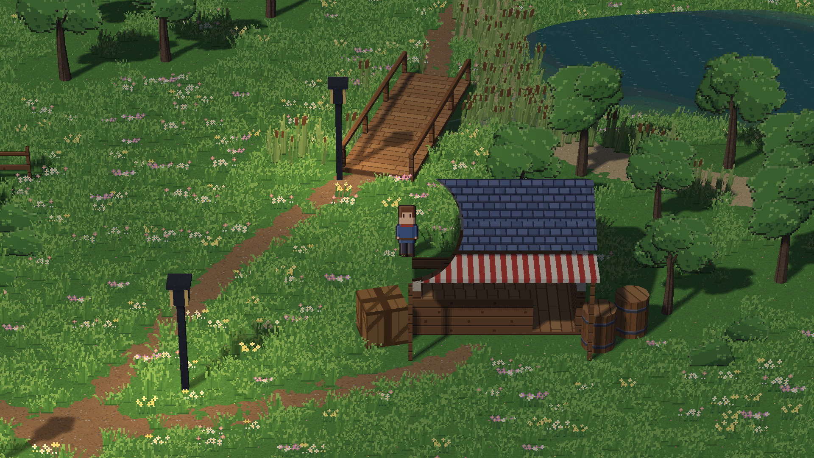

# M17: Lakeside Village visual-quality audit (investigation only; evidence branch, never merged)

**Question:** what stops Lakeside Village looking like a compelling HD-2D RPG place, and what single change would
improve it most?

**Answer in one line:** the meadow. 68–85% of every outdoor frame is one saturated green with flowers sprinkled
evenly everywhere. That is mostly **scene composition**, which the existing authoring tools can largely fix, so the
recommended next milestone is a content pass, not a renderer feature (§6).

| | |
|---|---|
| Engine | `redesign/visual-editor` at **`f9f1f81`** (#475 merged). No engine, Studio, asset or scene file changed. |
| Branch | `review/m17-lakeside-audit` (this folder only) |
| Project | a scratch copy of `D:\Games\Lakeside Village` (the original is untouched). sha256 of the shipped scenes, checked before and after every script: `lakeside.json` 18a7ee94…7f3901, `start.json` d2e8a80e…c401b, `cottage.json` 1a07a9cb…440f08 |
| Machine | RTX 4070, GL 4.6, Windows 11, Python 3.13, arcade 3.3.3; hidden windows only (nothing shown on the desktop) |
| Related | #458 (the first M17 audit, at `6861631`), #459 (lamp self-shadow fix, merged), #460/#475 (depth of field, merged) |

Evidence labels: **[F]** fact (a capture, a measurement or code); **[H]** hypothesis.

---

## 1. Method (reproducible)

- **Real frames.** `scripts/capture.py` opens the real `GameWindow` hidden, loads the scene through the real scene
  loader, puts the player at a fixed spot (the position is set directly), resets the wind/water clocks, runs 150
  frames (2.5 s: past the fade-in, camera settled), draws one frame and saves it. It also saves what was drawn:
  camera, sun, ambient, sky, depth of field, lights and draw calls (`data/shots_*.json`).
- **Deterministic.** The same shot captured twice in one run is identical pixel for pixel (max difference 0), so
  every matched pair differs only by the setting compared.
- **Variants use Mesh's own authoring operations.** `scripts/variants.py` writes the comparison scenes with
  `engine.project_ops`: `set_hd2d_sun(preset=…)`, `set_depth_of_field(preset="subtle")` and
  `set_hd2d_camera(preset="wide")`. These are what Studio, `mesh author` and MCP apply. `data/variants.json` lists
  exactly which `settings.hd2d` keys each variant changes.
- **Colour grading and vignette have no scene field, op or Studio control.** The engine ships `ColorGrading` and
  `Vignette` (`engine/post_processing.py`), but nothing uses them. They are attached at runtime to the window's
  existing `PostProcessPipeline`, which grades the world before the HUD is drawn.
- **Baseline first.** Every baseline frame uses the shipped scene exactly: noon sun, DoF off, normal game camera
  (pitch 30°, fov 12°, distance 53.5 m outdoors; 55°/35.7 m indoors).

| View | Scene | Player (px) | Camera target (m) | Note |
|---|---|---|---|---|
| v1 village centre | lakeside | 1100, 650 | 34.4, 19.6 | shop, bridge, lamps, lake edge |
| v2 shoreline | lakeside | 1400, 780 | 43.8, 23.6 | the large pond, reeds, trees |
| v3 cottage | lakeside | 600, 540 | 18.8, 16.1 | two cottages, path, fence, lamp |
| v4 paths | lakeside | 960, 250 | 30.0, 8.4 | painted-earth path junction, lamps |
| v4b north | lakeside | 1000, 1300 | 31.3, 32.2 | woodland, bridge, inlet |
| v5 village + NPCs | start | 840, 300 | 26.3, 8.6 | the project's village room (Lakeside has no NPCs; Mara is behind the counter) |
| v6 interior | cottage | spawn | 8.0, 5.1 | Tomas, interact prompt |
| v0 overview | lakeside + `wide` camera preset | 1000, 650 | 31.3, 19.6 | **not the game camera** (40°, 85.6 m): an overview aid |
| v0b village overview | start + `wide` | 640, 420 | 20.0, 12.4 | the same |

**Sun in every baseline frame:** direction (−0.45, −0.55, 0.70), colour #fff0d8, intensity 1.0, ambient 0.45
(Mesh's noon). Lakeside's ambient light is #9aa6d0. It has four lamps (radius 224 px, #ffcc88, 2.4 m up).

**Caveat:** the start room's key-hint box ("Q: Quest Log …") shows on the first load in a run only. It appears in
`v5_npcs__default` and not in the other v5 frames. It is HUD, not scene content.

---

## 2. Baseline (shipped settings, 1280×720 unless noted)

| View | Frame |
|---|---|
| v1 village centre | [v1_village__default](captures/720/v1_village__default.png) · 1920×1080: [hd_v1_village__default](captures/1080/hd_v1_village__default.png) |
| v2 shoreline and water | [v2_shore__default](captures/720/v2_shore__default.png) · 1920×1080: [hd_v2_shore__default](captures/1080/hd_v2_shore__default.png) |
| v3 cottage exterior | [v3_cottage__default](captures/720/v3_cottage__default.png) |
| v4 path and terrain transition | [v4_paths__default](captures/720/v4_paths__default.png) · [v4b_north__default](captures/720/v4b_north__default.png) |
| v5 populated village | [v5_npcs__default](captures/720/v5_npcs__default.png) |
| v6 interior, character interaction | [v6_interior__default](captures/720/v6_interior__default.png) · [v6b_interior_tomas__default](captures/720/v6b_interior_tomas__default.png) |
| overviews (wide preset) | [v0_overview_wide](captures/720/v0_overview_wide.png) · [v0b_village_wide](captures/720/v0b_village_wide.png) |

---

## 3. Diagnosis

Measurements are in `data/measurements*.json`, produced by `scripts/measure.py` and the commands in this README.
Luminance means Rec.709 weights on the stored 0–255 values.

### Lighting direction, contrast, mood
- **[F] One fixed noon sun, high in the south-west.** Shadows are clean and correctly placed, and the form reads
  (v1, v3).
- **[F] Value range is narrow and mid-heavy:** luminance p5/p50/p95 is about 35/82/115–141 in every outdoor view.
- **[F] Most of the frame is the same saturated green.** Mean saturation is 0.48–0.51.
- **The result is pleasant but flat.** The default looks like a bright, even noon with no mood.
- **Classification:** scene choice (time of day) plus composition; not a renderer defect.

### Light sources (lamps, windows)
- **[F] Lamp heads are the darkest objects in the frame, day or night.** Measured at v4: head 49–52 vs meadow 89.5
  at noon, and 20–21 vs meadow 31 at night ([c2](crops/c2_lamp_night.png)).
- **[F] Cottage windows are dark panes** in every preset.
- **[F] The renderer can't do better yet.** `engine/hd2d` has no emissive or unlit material (grep finds none). The
  kit's `lantern` and `glass` materials carry no emissive factor.
- **[F] At noon the lamps light the ground.** A control capture with the point lights removed
  (`control/`, `scripts/nolamps.py`) shows the ground under each lamp at:

  | Place | Lamps on | Lamps removed |
  |---|---|---|
  | Lakeside lamp bases | 124–126 | 87 (+43–46%) |
  | Village lamp bases | 133–135 | 80 (+65–68%) |
  | Far meadow | 89.5 | 89.5 |

  These are the bright yellow-green pools by the posts in daylight ([c9](crops/c9_lamp_noon_pool.png), v5, v0b).
- **[F] Night doesn't read as night.** The night preset gives a dimmed day: the grass stays saturated green and the
  lamp pools are faint (lamp base 67–69 vs meadow 31) ([night sheet](sheets/night.jpg)).
- **Classification:**
  - no emissive: missing renderer feature, plus asset metadata;
  - noon lamp pools: **scene and template authoring**. A scene's sun is fixed, so a noon scene's lamps shouldn't
    shine. The `hd2d_rpg` starter village does the same;
  - flat night: preset palette, plus the emissive gap.

### Terrain, paths, materials
- **[F] The ground is one grass texture plus painted earth paths** (`terrain.MATERIALS`: grass, earth, stone, mud,
  sand). The paths read clearly; their pixel-wobble edges suit the style (v4).
- **[F] Flowers are sprinkled evenly everywhere** (572 pink, 506 yellow over the whole map) over about 11,400 grass
  sprites. The meadow reads as uniform noise: fine detail (mean |Laplacian|) is 22–28, against 7 indoors. There are
  no clearings, no trodden ground at doors and junctions, and nowhere for the eye to rest.
- **[F] The village room (`start.json`, the starter template) has flat grass and rectangular dirt "plates"**
  ([c8](crops/c8_template_paths.png)). This is #458 finding 3, unchanged.
- **Classification:** composition (Lakeside), template content (village room); see §4.4 for what tools can and
  can't fix.

### Buildings, roofs, silhouettes, cutaway
- **[F] The cottage and shop assets are coherent pixel-art models** ([c5](crops/c5_roof_cottage.png)): timber,
  plaster, stone plinth, door and windows.
- **[F] Roofs are large, evenly lit slate rectangles** (from the 30° camera a roof is roughly half of a house's
  screen area), with no eave shadow or ridge accent.
- **[F] The village is sparse:** 3 buildings, 4 lamps, 4 fences, 3 props in 64 × 48 m.
- **[F] Cutaway still over-cuts** ([c1](crops/c1_cutaway_overcut.png), v1). With the player beside the shop and
  fully visible, a hard half-disc is cut out of the roof and awning. This is #458 finding 4, unchanged at `f9f1f81`:
  a 1.3 m cylinder test with no on-screen overlap test and a binary discard.
- **Classification:**
  - roofs: assets;
  - sparseness: composition;
  - cutaway: **renderer defect**.

### Vegetation
- **[F] One tree species,** `tree_small`, 93 instances: billboard canopies of near-identical shape and size, spaced
  evenly ([c4](crops/c4_meadow_trees.png)). They read as a field of clones rather than woodland. There is no
  understory gradient and no grouping into stands with clearings.
- **[F] The reeds round the pond are dense and convincing** (v2).
- **Classification:** composition (placement) and assets (a single tree), not the renderer.

### Water and shoreline
- **[F] The shoreline is well integrated:** a sand ring, reeds, and a shallow-to-deep gradient (v2).
- **[F] The water reads as a dark hole.** Open water is 0.61–0.63× the lit meadow's luminance in every preset.
- **[F] In the evening it loses its colour:** RGB (31, 33, 31), a neutral grey
  ([c3](crops/c3_water_presets.png), [sun_v2 sheet](sheets/sun_v2_shore.jpg)).
- **[F] Code:** `engine/water.py:684` computes `lit = mix(col * light, refl, fresnel) * shadow`. The sky/scene
  reflection is darkened by the sun's shadow too. At the game camera's 30° pitch, fresnel peaks around 0.2–0.37.
- **[F] Static dash glints are drawn on all open water** (by design, `water.py:686–687`). At gameplay scale they read
  a little like rain.
- **Classification:** renderer shading.

### Characters vs environment
- **[F] Pixel density matches** at 32 px/m, about 2 screen px per texel ([c6](crops/c6_character_scale.png)).
- **[F] Grounding is good:** a sun shadow, and grass in front of the feet.
- **[F] The character art is simpler and outlined, as #458 found.** Indoors the sprites are about 1.5× larger.
- **Classification:** assets; not a priority.

### Depth, atmosphere, colour cohesion
- **[F] No haze.** At this telephoto camera the frame spans only about 20 m of depth, so the far edge is as crisp
  and saturated as the foreground.
- **[F] DoF Subtle (now shipped) softens the far third** (detail kept 23–31%), but also the near third (48–57%):
  at this camera the near band is the meadow just below the player.
- **[F] The palette is green, slate blue and wood brown at similar saturation.** There is no warm/cool separation
  between light and shadow at noon.

### Composition at gameplay scale
- **[F] The player and buildings read clearly** (strong silhouettes, dark roofs).
- **[F] The meadow competes with everything.** The flower sprinkle has the highest local contrast in most frames,
  so the eye has nowhere to settle.

---

## 4. Controlled comparisons (identical framing and content; only the named setting differs)

### 4.1 Sun presets: [v1](sheets/sun_v1_village.jpg) · [v2](sheets/sun_v2_shore.jpg) · [v3](sheets/sun_v3_cottage.jpg) · [v5](sheets/sun_v5_npcs.jpg) · [night](sheets/night.jpg)

| Preset | What changes | Verdict |
|---|---|---|
| **morning** | Cooler and lower light; long shadows. Meadow luminance 86 → 67. | More depth, slightly duller. **Not clearly better.** |
| **evening** | Warm low sun and long shadows, but the green meadow goes muddy (meadow 54). Water turns grey-black; lamps stay dead. | More dramatic, **less readable.** It needs luminous lamps and a warmer palette to work. |
| **overcast** | Soft, even, cohesive colour; shadows almost gone. | Calmer but flat: form is lost. **Not better** as a default. |
| **night** | A dimmed day: saturated green, faint lamp pools, black lamp heads. | **Not convincing.** |

**Conclusion:** no existing preset improves Lakeside on its own. In this scene, the low-sun presets mostly add
darkness. They depend on the light-source gap (finding 3) to pay off.

### 4.2 Restrained colour grading and vignette: [sheet](sheets/grade.jpg)
- **Settings:** `ColorGrading(contrast=1.06, saturation=0.9)` plus `Vignette(strength=0.25, radius=0.85)`.
- **Effect:**
  - mean saturation is unchanged (0.506 → 0.506: the contrast lift cancels the desaturation);
  - shadows a little deeper (p5 35 → 28.5);
  - corners 15–25% darker.
- **Verdict:** a small, tasteful gain in framing and depth. It does not touch the core problem, and it has no
  authoring control today. **Low priority.**

### 4.3 Depth of field off vs Subtle: [sheet](sheets/dof.jpg) · [far-band crop, 1:1](crops/c7_dof_far_band.png)
- **Effect:**
  - the far third keeps 23–31% of its fine detail and the near third 48–57%;
  - pixels changed by more than 8 levels: 20–21% in v1/v2 and 7% in v5;
  - the player stays sharp (as #475 verified).
- **Verdict:** it calms the busy far meadow a little and gives a hint of a lens. At Lakeside's shallow depth range it
  reads more as softness than as miniature. It is not a fix for the meadow, and evening + DoF is still muddy.
  **Keep it opt-in; don't make it a default.**

### 4.4 What composition can and can't do: an authoring probe, plus one scratch prototype

**Authoring probe** (`scripts/probe.py`, `probe/`, [overview sheet](sheets/meadow_overview.jpg),
[paths sheet](sheets/meadow_paths.jpg)). One crude, ten-minute pass with the existing operations (Studio's Scatter
and Paint brushes):
- the flower sprinkle removed, with a few clumps attempted;
- earth worn in at the doorsteps, the shop front and the lamp feet;
- a few dry-grass patches added.

Results:
- **[F] Fine detail fell 11–13%** in every view (32.6 → 28.9 in the overview, 28.4 → 24.7 at the paths). The
  meadow reads as grass instead of confetti, and the paths, buildings and player stand out.
- **[F] Large-scale tone did not change:** green share stayed at 0.75–0.86, and 64-px block luminance std went
  16.8 → 16.2. The only paintable materials besides grass are earth, stone, mud and sand, and neither the ground nor
  the scatter can be tinted.
- **[F] Adding flowers next to fences and walls is refused by the Off-buildings rule.** Studio explains this ("Held
  back: on or by a structure or doorway"). Adding them into the full meadow first needs a Thin stroke. This is
  workflow friction, not a defect.

**Scratch prototype: a broad meadow tone** (`scripts/proto_macro.py`, `prototype/`). In the capture process only, a
world-space value-noise field (~11 m and ~4 m features) multiplies the unpainted grass texels and the scatter
billboards, between lusher/darker/cooler and paler/warmer. No engine file was changed.
- **[F] It gives soft, visible patches** (colour variation of block means +3–8%).
- **[H] With the declutter it gives a calmer, more painterly field** (`prototype/mp_*`).
- **[F] The gain is modest.** It is visible on a good screen; it is not a transformation.

---

## 5. The three most visually significant weaknesses (ranked)

| | 1. Meadow monotony and clutter | 2. Cutaway over-cuts | 3. Light sources aren't luminous |
|---|---|---|---|
| Visible to a player | **Every outdoor frame** (68–85% of pixels) | Often, around every cutaway building (v1, #458 02/03/09) | Every evening, night and interior frame; noon lamp pools in daylight |
| Evidence | §3 terrain and vegetation; probe −11–13% clutter; c4 | [c1](crops/c1_cutaway_overcut.png): a roof bitten beside a fully visible player | c2, c9, control (+43–68% at noon), night sheet |
| Kind | **Composition** (clutter, placement, sparseness) + one tool gap (no grass tone variety) | **Renderer defect** | Missing renderer feature (emissive) + **authoring** (noon lamps) + preset palette |
| Complexity | Low (content), medium (tone variation) | Medium (on-screen overlap test, soft edge) | Medium (emissive materials, kit asset metadata) |
| Regression risk | None for content; medium for a tone feature (every outdoor frame) | Medium (cutaway tests, every building) | Low (only emissive materials change) |
| Existing tools? | **Mostly yes** (declutter, worn ground, tree stands, lamp lights at noon) | No (cutaway off shows the roof over the player) | Noon pools yes; glow no |
| Ezekiel relevance | High: method and guidelines for every outdoor map | **High:** towns are full of buildings | High: towns at night, interiors, windows |

**Also present, not in the top three:**
- **Water reads as a dark hole** (renderer shading; low complexity; medium risk because of water tests). This is the
  next after these three.
- **Barren village template** (#458 finding 3, content).
- **Flat roofs and one tree species** (assets).
- **No grading control** (§4.2).

---

## 6. Recommended next milestone: M17-L1 "Lakeside meadow and daylight composition pass" (content only)

**Problem.** The meadow's evenly sprinkled flowers and evenly spaced clone trees, plus lamp pools under a noon sun,
make every outdoor frame busy and flat. This is finding 1, plus the authoring half of finding 3.

**Evidence:**
- baseline v0, v1, v3, v4 and v4b;
- c4 and c9;
- the authoring probe: −11–13% clutter from one crude pass with existing tools;
- the noon control: lamps add +43–46% to the ground beneath them in daylight.

**Why this first.** It ranks highest on visible improvement, complexity and risk, and the existing tools can do
it. The audit's rule applies: no engine feature where composition can fix the problem. It also tests the authoring
workflow Ezekiel will use, and turns any real tool gaps into evidence rather than guesses.

**Implementation boundary:**
- **Change:** Lakeside's `lakeside.json` only, made reproducibly with an authoring-ops script from the shipped scene
  (as `scripts/probe.py` does), on a copy. The owner decides whether it replaces `D:\Games\Lakeside Village`.
- **In scope:**
  - flowers as drifts and edge clumps (thin the meadow first where needed);
  - worn earth at doors, the shop front, path junctions and lamp feet;
  - trees regrouped into stands with clearings;
  - a few rocks and bushes at the shore and along fences;
  - noon lamp lights removed or dimmed (Lakeside stays a noon scene), or an explicitly chosen time of day if the
    owner prefers;
  - existing kit props only.

**Acceptance (matched before/after with this folder's harness, same views and positions, 1280×720 and v1 at
1920×1080):**
1. Owner visual sign-off on the matched sheets (the primary criterion).
2. Fine detail (mean |Laplacian|) at least 10% lower in v0, v1, v3, v4 and v4b. At least 70% of flower instances lie
   in clumps (instances with 5 or more neighbours within 1.5 m). Today it is 27% (1,078 flowers, median 3
   neighbours).
3. At noon, the ground at each lamp's foot is within ±5% of the same spot with the lights removed (no daylight hot
   spots).
4. Unchanged:
   - structures, doors, arrivals and walkable routes (`tooling/lakeside_village.py` validation: reopen, play
     routes, export);
   - the shipped `start.json` and `cottage.json`.
5. Scatter instance count at or below today's 13,395, and draw calls in these views at or below baseline.

**Tests:**
- the Lakeside validation routine (reopen equality, play routes, export);
- `scatter_report` clean (no obstructions);
- the capture harness's determinism check.

No engine tests change, because no engine code changes.

**GPU and performance:** equal or lower. Fewer scatter instances mean fewer billboards; there are no new passes.

**Explicit exclusions:**
- no renderer, shader, Studio or engine code;
- no new assets;
- no changes to the starter template, the village room or the cottage;
- no DoF or grading defaults;
- no meadow tone feature (decide after seeing L1: §4.4 shows its gain is modest on its own);
- no cutaway, emissive or water work. Each needs its own authorisation, in the ranked order above.

**If an engine milestone is preferred instead:** the cutaway over-cut (finding 2, #458 finding 4) has the widest
Ezekiel reach. It is a defect in a narrow area: on-screen overlap before cutting, and a softened edge.

---

## 7. Changes since #458 (`6861631` → `f9f1f81`)

- **Fixed:** shadow-casting lamps no longer black out their own light (#459). The night lamp pools in this audit
  are the fixed behaviour.
- **Added:** depth of field (#475, opt-in); rivers (R1–R4, not used in Lakeside).
- **Still present:**
  - cutaway over-cut;
  - no emissive;
  - unused grading and vignette;
  - barren template;
  - water darkness. #458 did note the "dark, flat surface"; this audit measures it.

## 8. Files

- `captures/720`, `captures/1080`: every frame named in this README.
- `probe/`, `prototype/`, `control/`: §4.4 and §3.
- `sheets/`: labelled matched sheets, JPEG; each source frame is a PNG in `captures/`.
- `crops/`: nearest-neighbour detail crops.
- `scripts/`: the scratch tools and shot lists. They hard-code the audit's worktree path `D:\Games\Mesh-lva`.
- `data/`: per-shot metadata, the variant list and the measurements.
