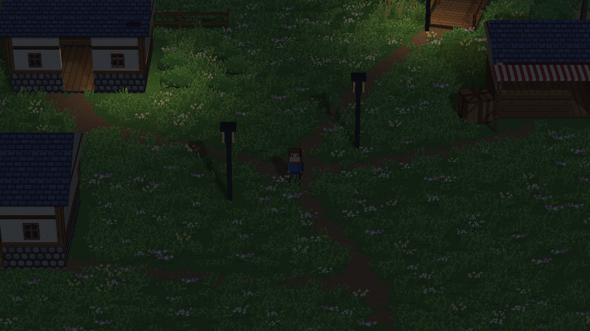
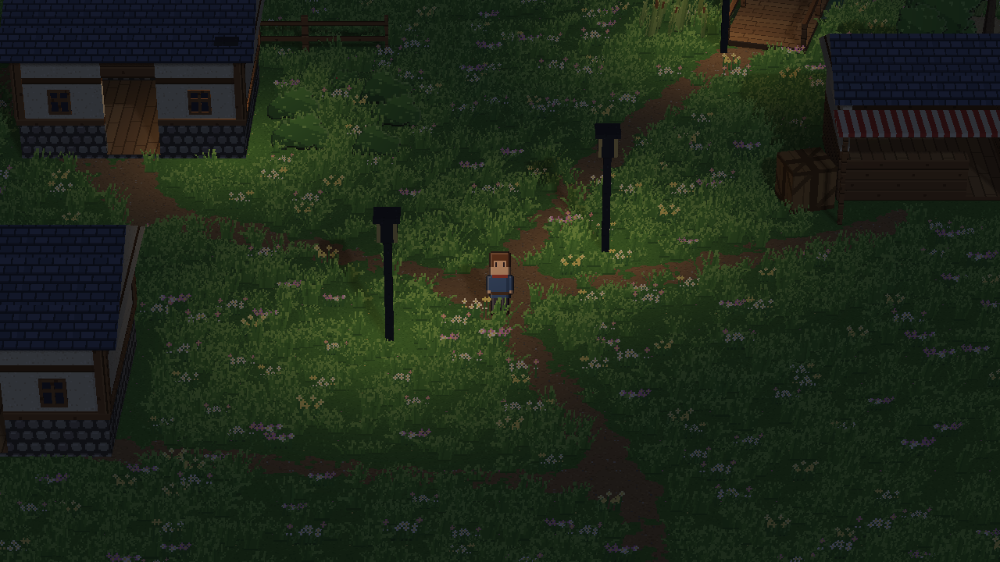
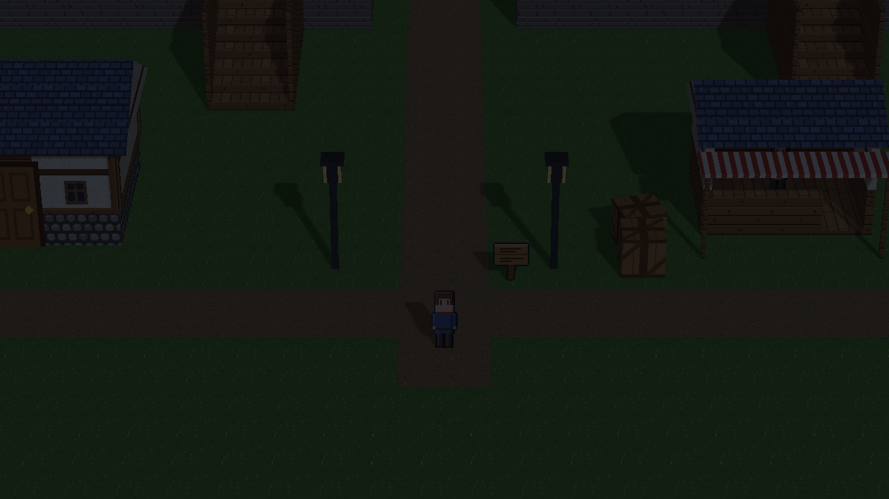
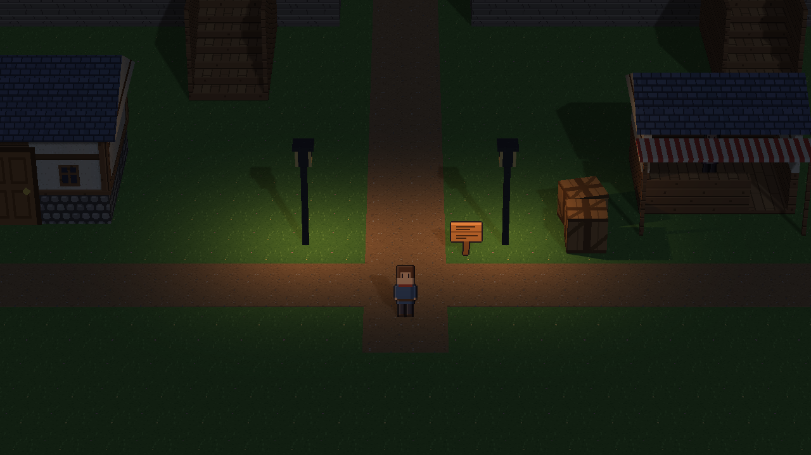
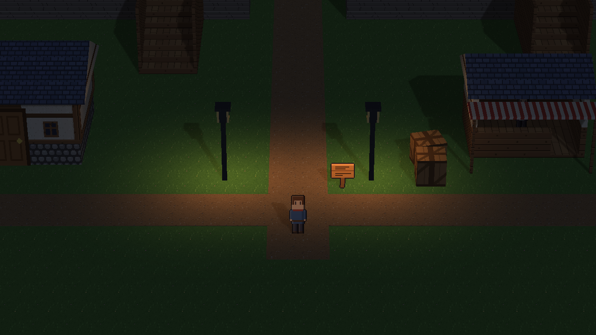
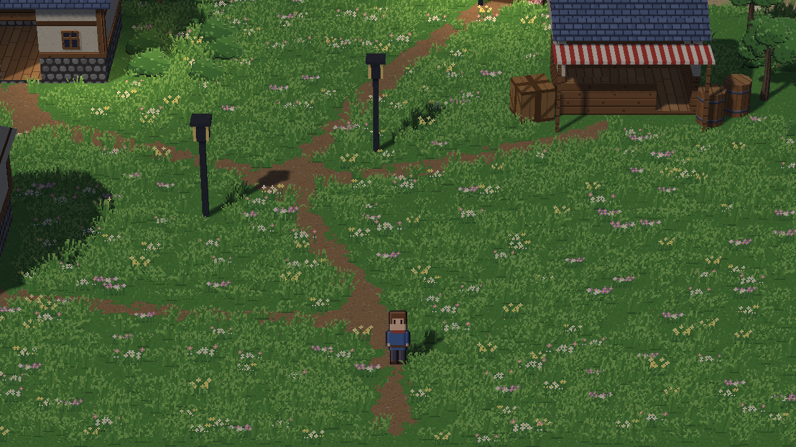
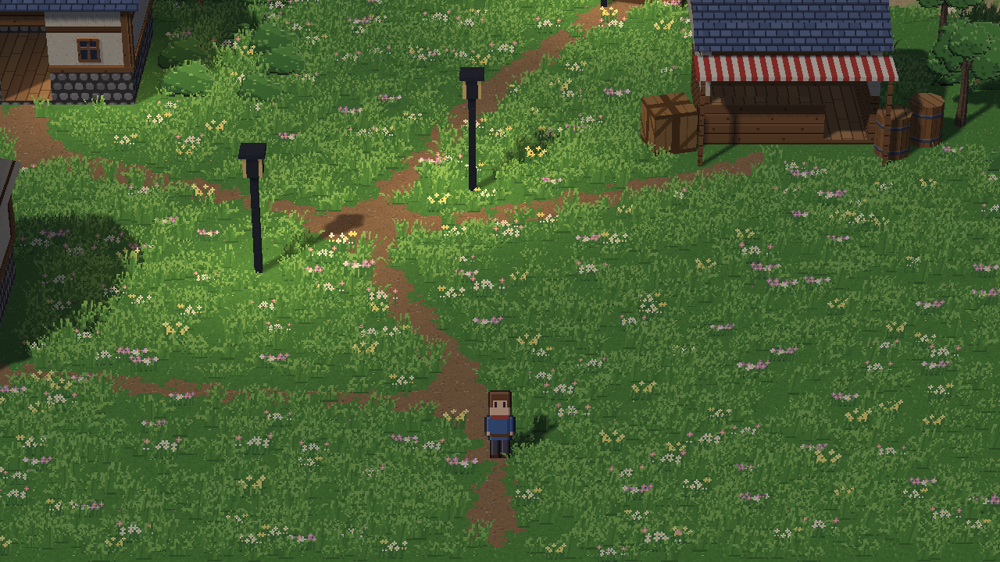
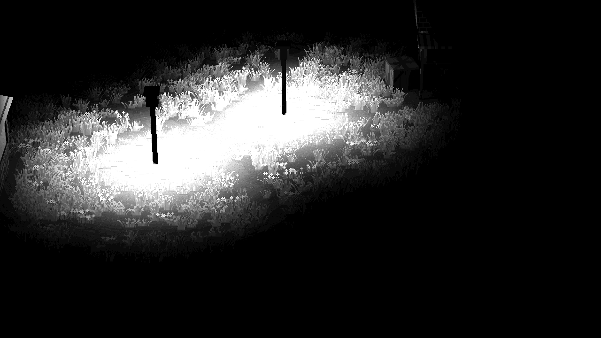

# M17 PR 1 evidence: lamps no longer shadowed by their own lamp post (#458)

This is an evidence-only branch, not for merge. Every image is a real in-engine capture at **1280×720** from a hidden window (`tooling/scene_snapshot.py`, the real `GameWindow`):
- `*_before`: base `6861631`;
- `*_after`: the fix, `fix/hd2d-lamp-fixture-shadow`;
- `*_lamp_shadows_off_reference`: the same scene with the lamps' `shadows: false`, at base.

Within a pair, the camera, player position, scene file and settings are identical.

**Scenes**, all scratch copies; the owner's projects are untouched:
- **Lakeside:** `D:\Games\Lakeside Village`, room `lakeside`. The night variant is made by `set_hd2d_sun(preset="night")`, scene settings only. Player at (870, 380) px for night and the default arrival for day.
- **Starter:** a fresh `hd2d_rpg` project (`create_project`). Night is made the same way; player at (640, 200) px.

## Measurement method
Mean luminance (PIL `L`, 0–255) over fixed pixel windows of the 1280×720 frame:

| frame | window | box (x0, y0, x1, y1) |
|---|---|---|
| Lakeside night | lamp A base | (440, 360, 560, 470) |
| Lakeside night | lamp B base | (720, 290, 840, 380) |
| Lakeside night | far field | (900, 550, 1100, 700) |
| starter night | west lamp base | (420, 330, 540, 440) |
| starter night | east lamp base | (740, 330, 860, 440) |
| starter night | crate's lamp shadow | (965, 340, 1045, 410) |
| starter night | far field | (900, 580, 1100, 700) |

**Day:** whole-frame RGB difference, before vs after; pixels changed by more than 2 levels.

## Results
| window | before | after | lamp shadows off |
|---|---|---|---|
| Lakeside lamp A base | 25.6 | **60.4** (2.36×) | 60.4 |
| Lakeside lamp B base | 27.5 | **65.6** (2.39×) | 65.6 |
| Lakeside far field | 28.6 | **28.6** | 28.6 |
| starter west lamp base | 24.2 | **71.3** (2.95×) | 71.4 |
| starter east lamp base | 23.9 | **71.9** (3.01×) | 71.9 |
| **starter crate's lamp shadow** (2 m from the east lamp) | 24.4 | **25.0** (shadow kept) | 37.0 (lost) |
| starter far field | 25.0 | **25.0** | 25.0 |

**Lakeside by day:** 26.4% of pixels changed, by at most 82 levels. They are confined to two overlapping ellipses round the two repaired lamps, inside their 7 m radius (`lakeside_day_diff_x10.png`); zero elsewhere. Those two lamps now add the warm pools that the room's two other lamps (no shadows) already gave at noon.

| | |
|---|---|
| Lakeside night before |  |
| Lakeside night after |  |
| starter night before |  |
| starter night after |  |
| starter night, lamp shadows off (reference) |  |
| Lakeside day before |  |
| Lakeside day after |  |
| Lakeside day difference ×10 |  |

## Tools
`tools/` holds the scripts that made these:
- `capture.py`, `variants_and_walk.py` and `starter_prep.py`: the captures and scene variants;
- `perf.py`: the cost measurement;
- `mutate.py`: the failure injection.
