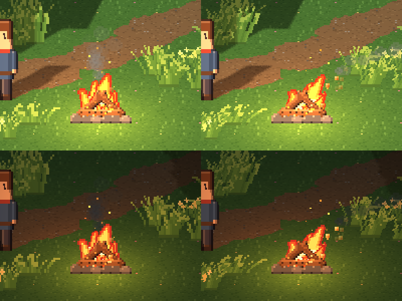
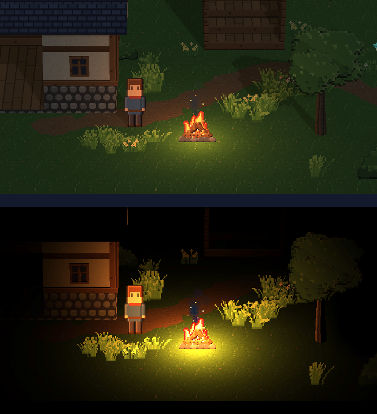
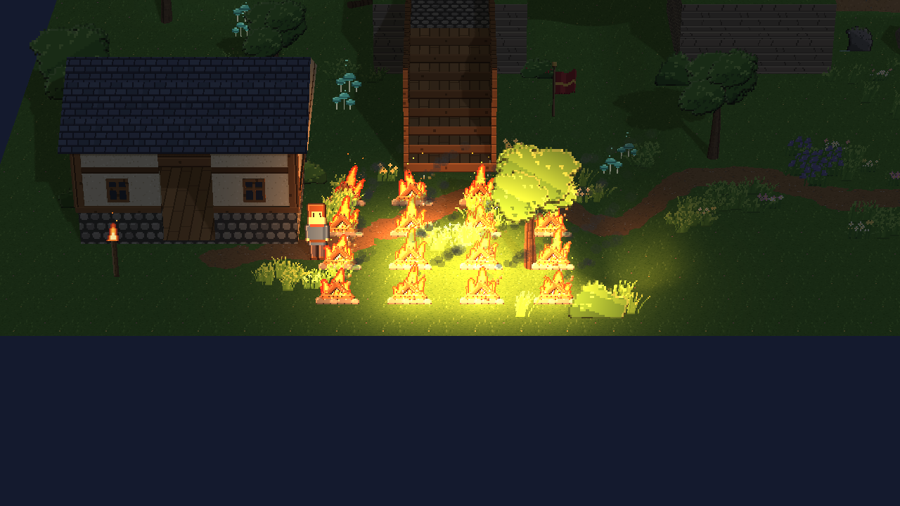
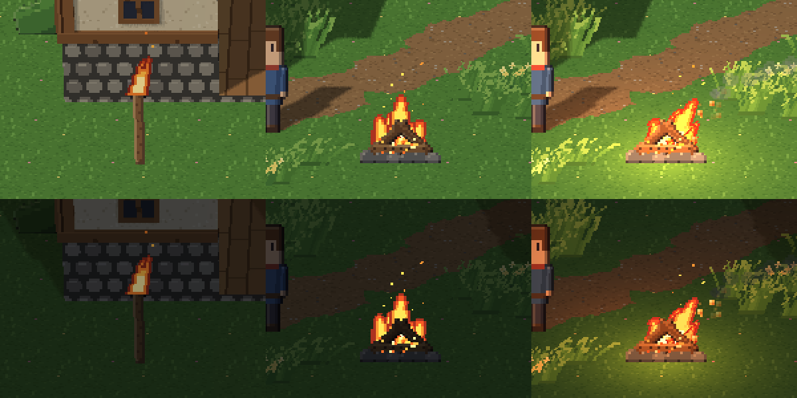
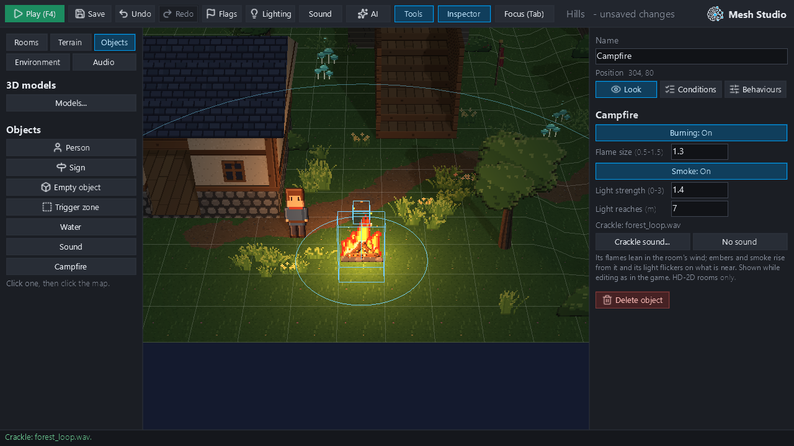
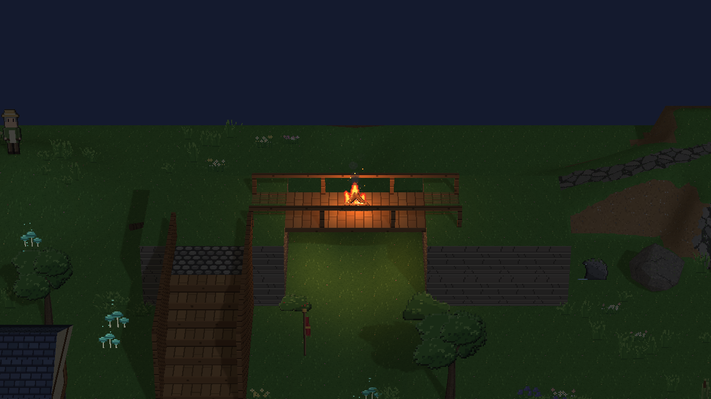

# Milestone 23B: HD-2D fire and warmth

A placeable, editable campfire for HD-2D rooms, built from what Mesh already has: no new particle framework and no new general system. M23B is based on `redesign/visual-editor` at `c5cd06d` (#413). Evidence is in `m23b_evidence/`.

Every picture and number below comes from hidden windows (`tooling/m23b_fire_study.py`; the phases' reports are in `m23b_evidence/reports.json`). Studio was driven by its own input events. Every project's master volume is 0, so nothing was played aloud.

## Stage 1: the audit (what was reused)

| Existing piece | What it is | Used for the fire? |
|---|---|---|
| `ParticleEmitter` behaviour (`engine/behaviours/particle_emitter.py`) | 2D screen-space particles: no depth in an HD-2D room, drawn over everything | **No**: fire behind a wall would show through it |
| `engine/scene_particles.py` (M18) | World-space GPU particles: depth-tested against the 3D world, stateless (seed + time), one draw per effect, a 32×24 pixel atlas | **Yes**: embers, sparks and smoke are two new kinds (3, 4) in its shader, anchored at the fires instead of a box about the camera |
| M20E animated decoration (`engine/hd2d/motion.py`, `scatter_layer.py`) | Billboard sprites with frames, wind lean with gust lag, glow, "nearer the camera" offsets: the torch's flame | **Yes**: the logs and flames are two hidden scatter assets drawn by a scatter layer of their own whose motion is always on |
| HD-2D lighting (`engine/hd2d/lighting.py`) | Up to 8 point lights, from the room's settings, uploaded per program each frame | **Yes**: `extra_lamps`, a per-frame list after the room's own lamps (no shadow map) |
| `engine/wind.py` | The room's wind and its gust fronts, the same function in Python and GLSL | **Yes**: the smoke, embers and flames share one gust timing |
| Water's registry (`engine/water.py`) | A behaviour registers its object with the room; reset on room load; "Show when" flags respected | **Yes**: the same pattern (`engine/fire.py`) |
| Sound emitters (M21B) | `SoundEmitter` behaviour, Studio's sound picker | **Yes**: the optional crackle is a `SoundEmitter` on the same object |

The M20E torch has animated, glowing flames, but no light, no embers or smoke, and its flame leans like a banner. The campfire keeps the torch's machinery and adds what it lacks.

## Stage 2: the campfire

**Art** (`tooling/hd2d_assets/scatter_art.py`): 10 new 48 px cells appended to M20E's animated sheet (cells 43–52). The sheet grew from 1248 to 1728 px; every older cell is pixel-identical, and `foliage.png` is byte-identical.
- **Base (cell 43):** a stone ring, two leaning logs and a cross log, charred.
- **Embers (44–46):** 3 frames of a glowing bed.
- **Flame (47–52):** 6 frames of three tongues with their own heights, leans and forks, a dark-red edge, and a few sparks.

**How it's drawn:**
- **Logs and flames:** two hidden scatter assets.
  - `campfire`: the logs, always size 1, drawn 8 cm nearer the camera than the flames, so the flames burn behind and between the logs.
  - `campfire_flame`: the ember bed plus three flame sprites. Their frame rates (10, 12.5 and 8.5 fps), sizes (1, 0.7, 0.6) and offsets differ, so the flicker never repeats in step. It is sized by the flame size, and its glow is 1.25 so M20E's glow pulse never dims it to a muddy orange at night.
  - Flex 0.8–0.9: flames bend in gusts, across the picture only (M20E's flame rule).
  - The assets are hidden from scatter brushes (`Asset.hidden`).
- **Embers, sparks and smoke:** `scene_particles` kinds 3 and 4, drawn with `FireParticles`, which uses the weather's program and atlas.
  - Per fire: 28 embers (about 14% sparks: brighter, faster, higher, gone sooner) and 18 smoke puffs (three sizes by age, translucent at 0.32 opacity, lit by the room's light).
  - Carried downwind with the room's gusts.
  - One seed buffer; two draws per frame for all the room's fires.
  - Each particle's seed comes from its number within its own fire and where the fire stands. Embers and smoke are drawn for the 16 lit fires nearest the camera (the shader's anchors); every fire's logs, flames and light are drawn regardless. Lighting or putting out one fire never changes another's particles. (The first version reshuffled them: the occlusion check found it.)
- **Light:** one warm point light per lit fire (colour 1.0, 0.56, 0.24; strength 1 = intensity 1.8; the template's lamps use 1.6), 0.6 m up in the flames above where the fire stands.
  - It flickers by the time alone (four out-of-step waves, about ±6%), so it is deterministic.
  - No shadow map. With more fires than the 8 lights allow, the nearest the camera are lit.
- **Off:** cold logs only, with no flames, embers, smoke, light or sound.

**Registry and lifecycle:** the `Campfire` behaviour registers the fire in `window.campfires` (reset on every room load). The renderer reads the fires present each frame, respecting "Show when" flags as water does. The decoration clock runs whenever a room has a fire.

**Depth:** the logs and flames are depth-tested billboards and the particles are depth-tested without writing depth, as the weather is. Objects in front hide the fire.

## Stage 3: Studio

- **Objects > Campfire:** shown in HD-2D rooms only; it is also in the right-click "Place ... here" menu. A click places a lit campfire.
- **The inspector's Campfire section:**
  - Burning
  - Flame size (0.5–1.5)
  - Smoke
  - Light strength (0–3)
  - Light reaches (m)
  - Crackle sound..., which opens the existing sound picker, and No sound
- Every change is one checked edit (`project_ops.set_campfire`): it undoes, redoes and saves like any other. Putting the fire out also turns its crackle off.
- The fire previews while editing exactly as in Play: the same renderer path, including embers and smoke, which Studio draws without the weather preview.
- **Older projects:** placing a campfire updates the project's copy of the animated sheet only when it is an *older copy of Mesh's own*: narrower, and pixel-identical as far as it goes. A sheet a creator has changed is kept.
- AI and scripts use the same `set_campfire` and `campfire_of` operations.

## Stage 4: evidence

The room is M20E's decorated Hills room made into a woodland clearing: a cottage, small trees (more where the scatter rules allow), M20E's torch and a meadow. The campfire stands before the cottage's front wall with a tree 3 m to its east.

### Day and night, calm and gusty (`states_grid.png`, clips `day_gusty_clip.webp`, `night_calm_clip.webp`, `night_gusty_clip.webp`)

Rows: day, night. Columns: calm, gusty (5 m/s east, gust 0.9). The clips show 3 s of embers and sparks rising and smoke drifting downwind.

The flames' lean, measured from the pictures (their middle's offset from the fire's foot, 60 samples over 6 s):

| | mean | range | spread |
|---|---|---|---|
| day, calm | −0.9 px | −6.6 … 4.7 | 3.0 |
| day, gusty | **+9.2 px** (downwind) | −0.2 … 19.6 | 5.0 |
| night, calm | −0.9 px | −7.3 … 4.9 | 3.2 |
| night, gusty | **+9.1 px** | −1.0 … 18.5 | 5.0 |

In still air the flames stand and flicker. In gusts they lean downwind and swing as the gusts come and go.

### Light on terrain, a tree and the cottage's wall (`night_light.png`)

The top picture is lit; the bottom is the difference from the same night with the fire put out, ×3. Mean RGB added (9×9 px):

| Spot | Distance | Added (R, G, B) |
|---|---|---|
| Ground | 1.5 m | +25.8, +23.4, +4.3 |
| Cottage front wall | 2.2 m | +20.0, +10.5, +4.6 |
| Tree (trunk) | 2.9 m | +4.8, +4.1, +0.4 |

The flicker on the ground over 4 s ranges 45.6–49.0 (mean 47.4), about ±4%: noticeable but subtle. Put out, the room has no fire light.

### Occlusion as the camera moves (`occlusion_grid.png`)

A second fire stands 1.3 m behind the cottage (its light 0, so only its flames, embers and smoke can differ). The camera turns round the cottage. The fire's visible pixels at each turn:

| Yaw | 0° | 30° | 60° | 90° | 120° | 150° | 180° | −90° |
|---|---|---|---|---|---|---|---|---|
| Visible px | **0** | **0** | 404 | 2 | 2,342 | 2,321 | 2,180 | 2,061 |

It is hidden (embers and smoke too) while the cottage is in the way, peeks round its corner at 60°, and is fully visible once the camera looks from behind. The 16-fire picture below also shows a tree hiding the fires behind it.

### Multiple fires (`perf_16_fires.png`)

Night, gusty, the fires in view; each a fresh room. Times are per frame.

| Fires | Draw calls | Fire lights | Fires' CPU | Sprite pass GPU | Particle pass GPU | Frame wall time* |
|---|---|---|---|---|---|---|
| 0 | 45 | 0 | 0.005 ms | — | — | 6.6 ms |
| 1 | 48 | 1 | 0.027 ms | 0.005 ms | 0.003 ms | 9.7 ms |
| 4 | 48 | 4 | 0.053 ms | 0.019 ms | 0.005 ms | 10.3 ms |
| 16 | 48 | 8 used (nearest) | 0.134 ms | 0.047 ms | 0.006 ms | 5.6 ms |

\* On this PC a frame's wall time swings between 5 and 10 ms with the GPU's clocks: the same 0-fire room measured 6.7–8.6 ms and the 16-fire room 4.9–5.9 ms in alternation. It shows no fire cost above that noise. The GPU passes (timer queries round 20 draws) and the CPU time are the fires' real cost: **3 draw calls whatever the number of fires; under 0.06 ms of GPU and 0.14 ms of CPU for 16 fires.** No GPU budget is approached.

The 16-fire grid is a stress test: 8 overlapping firelights add up to an over-bright yellow, as any 8 lamps that close would.

### Compared with a static flame and the M20E torch (`compare_torch_static_campfire.png`)

Rows: day and night, in the same gust. Columns:
- **The M20E torch:** a glowing, animated flame that lights nothing.
- **A static flame:** the campfire's own sprites with no animation, wind, embers, smoke or light. By day it reads as a sticker; at night its logs and stones go dark.
- **The campfire:** it leans with the gust, embers and sparks rise, smoke drifts, and it lights its own logs, the grass, the player and the wall.

### Studio, save, reopen, Play and export (`studio_02_edited.png`, `studio_03_put_out.png`, `studio_05_play.png`, `export_frame.png`)

Studio, driven by its own events:
1. **Place:** Objects > Campfire is listed and a click places one, burning. The editing view shows its flames, embers, smoke and light at once.
2. **Edit:** flame size 1.3, light 1.4 and reach 7 m typed; Smoke off and on; the crackle chosen from Mesh's library.
3. **Put out:** cold logs, no lamp, no particle draws, the crackle disabled.
4. **Light again:** everything returns.
5. **Save:** Ctrl+S, "Saved 1 file(s)."; the file holds the same settings.
6. **Reopen:** the same settings, nothing unsaved, drawn and lit.
7. **Play and Stop, three times:** in play the fire is registered, lit and drawn; master volume 0.

`mesh export build` succeeded. The bundle, run on its own engine in a hidden window, registered 1 fire, 1 lamp, 1 sprite draw and 2 particle draws, with no error (`export_frame.png`).

Mesh's sound library has no fire crackle (birds, forest, rain, stream and wind). The evidence uses the forest loop only to show the crackle path works. A real crackle is an asset decision for the owner.

## Visual assessment

At normal HD-2D gameplay scale the campfire reads as a fire rather than a sprite:
- the logs stay visible in front of the flames;
- the three tongues flicker out of step;
- embers and occasional sparks rise; smoke is a light grey wisp by day and nearly invisible at night, as real smoke is;
- the ground, the player and the cottage wall warm visibly at night, with a gentle flicker.

The clearest gain over the M20E torch and the static flame is the light and the movement together.

**Weaker points:**
- Smoke by day is subtle; it is meant to be, but it can be missed at 1280×720.
- The tree 3 m away is lit only faintly; reach 6 m is the default and creators can raise it.
- Each additional fire's light adds up (the stress grid), but at normal spacing two or three fires look right.
- The flame art is the starter kit's style: 48 px cells, pixel-art, no smoothing.

## Review: four edge cases (after `fcfabb9`)

Each was reproduced in a hidden window before any change (`tooling/m23b_fire_study.py edges`), then fixed or documented, with a regression test.

| Case | Before | After |
|---|---|---|
| A fire placed on the bridge's deck (Studio gives it the deck's height, 2.0 m) | Logs, flames and particles at −0.54 m (the valley under the bridge), light at 0.06 m | All at 2.0 m, light at 2.6 m. A fire stands at its elevation if it has one, else on the ground: fires without an elevation, as every one in the evidence above, are unchanged |
| 17 fires, the first 16 put out | `fires_of` kept the first 16 registered, all put out: the lit 17th drew nothing and gave no light | Every fire is kept; the lit one draws its flames, embers, smoke and light. Particles go to the 16 lit fires nearest the camera |
| The fire's GPU objects refused | Fires turned off, but their light stayed: a light with no fire | A fire that isn't drawn gives no light |
| A room whose own lamps use all 8 lights | The fire gives no light, silently | **Documented limitation:** room lamps keep their slots, and the lighting framework isn't expanded. The Campfire inspector now says when the room's lamps leave no light, or too few, for its fires |

**A further limitation, documented:** fire lights have no shadow map, so the light passes through floors. The bridge fire also lights the valley floor under the deck. Giving fire lights shadow maps would mean expanding the lighting framework.

## Tests and gates

- **New fast tests** (`tests/test_fire.py`, 9):
  - settings and refusals;
  - deterministic flicker;
  - only lit fires light, with no shadow map;
  - registration;
  - `set_campfire`, including the crackle following the fire;
  - the hidden assets not offered as brushes;
  - an older copy of the animated sheet updated and a creator's changed copy kept;
  - a fire's height (its elevation, else the ground), and every fire kept however many are put out (review).
- **New GPU tests** (`tests/test_fire_gpu.py`, 5; integration, GL-gated):
  - light on the ground, the tree and the wall, and none put out;
  - the lean in gusts against calm;
  - occlusion behind the cottage;
  - Studio placing, editing, putting out, saving, reopening and playing, silently;
  - the review's edge cases (bridge, 17 fires, a refused GPU, 8 room lamps).
- **GPU tier:** 235 passed, including every existing weather, motion, scatter, lighting and workspace test unchanged (the weather kinds' shader paths are untouched).
- **Default selection:** 10,074 passed. The two policy tests it failed (an `arcade.gl` import in the renderer) were fixed to use `engine.optional_arcade` and rerun: they pass, with the exception-policy and docs-freshness contracts.
- **Gates:** ruff gate ok; mypy 73 (baseline); the exception-policy ratchet holds (the fire's GPU guards catch only `ShaderException` and `GLException`). No timing budget or baseline changed.

**Not done (out of scope):** spreading fire, combustion, damage or heat; fires in 2D rooms (the object is HD-2D only); a fire crackle asset; shadowed fire light.

**Known limitations:** at most 8 lights in an HD-2D room, the room's lamps first (fires then use the slots left, the nearest the camera first); fire light isn't shadowed, so it passes through floors; embers and smoke for the 16 lit fires nearest the camera.
