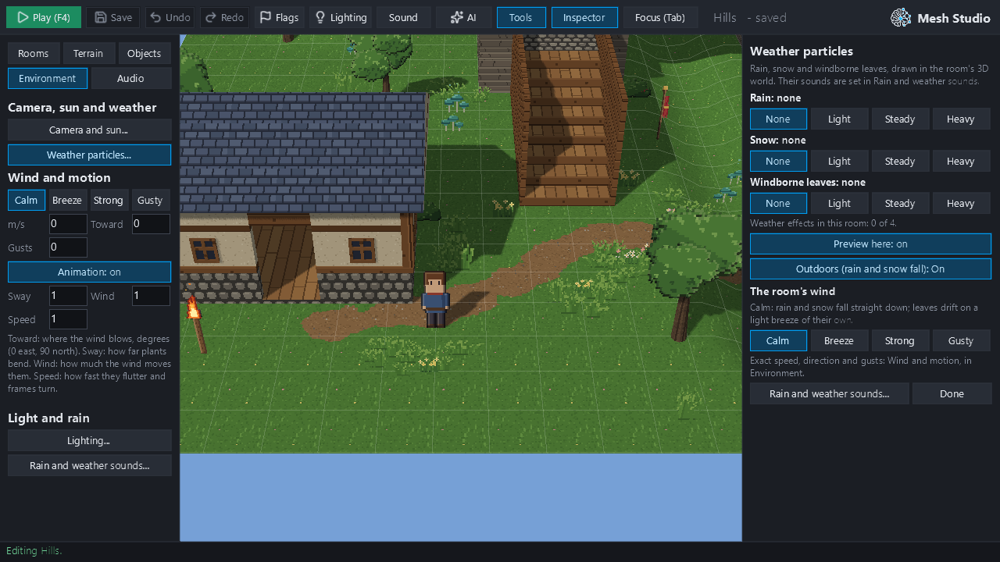
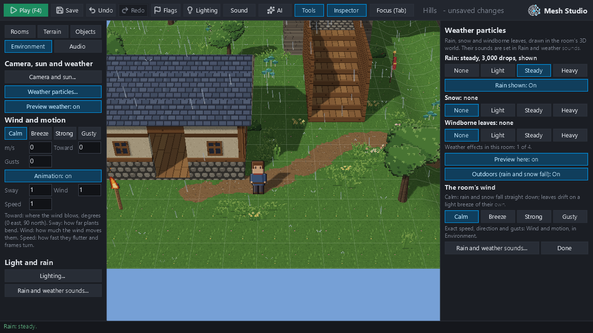
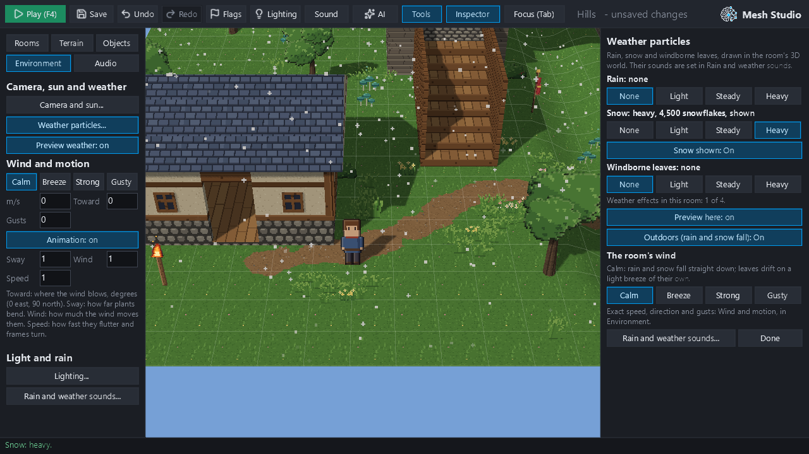
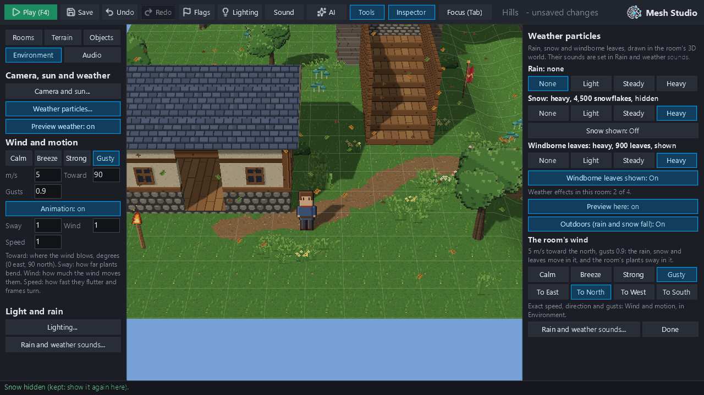
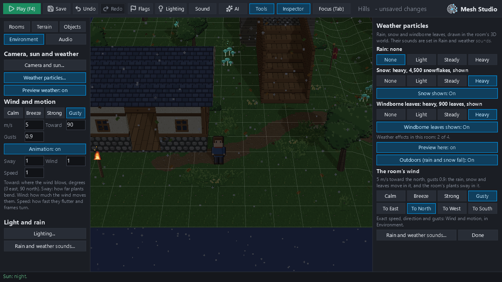
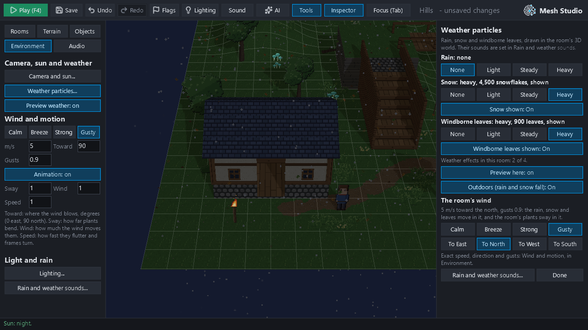
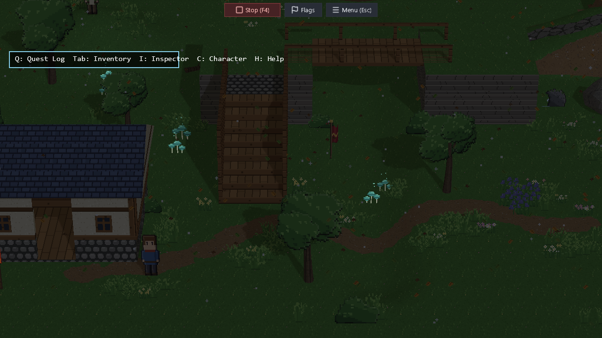
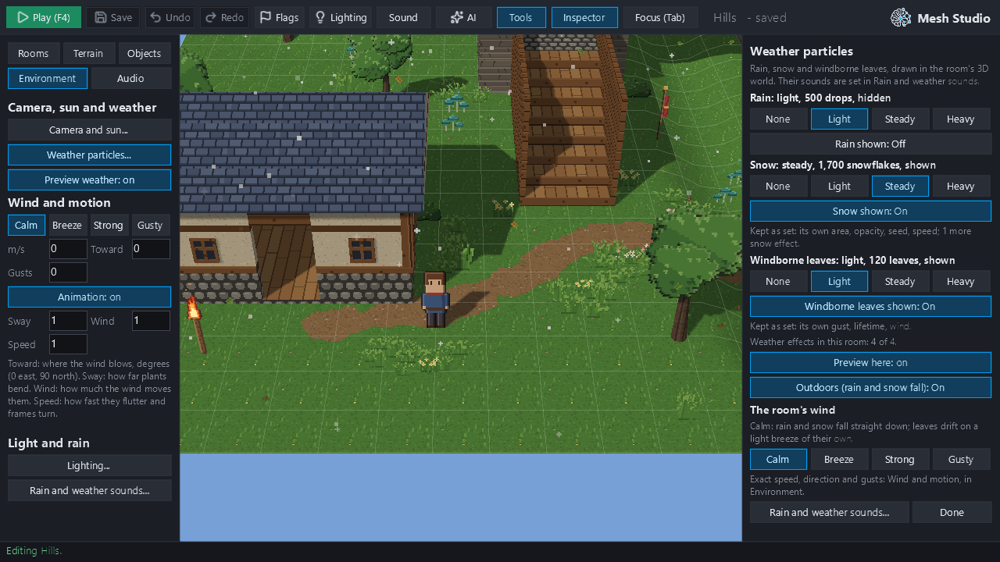
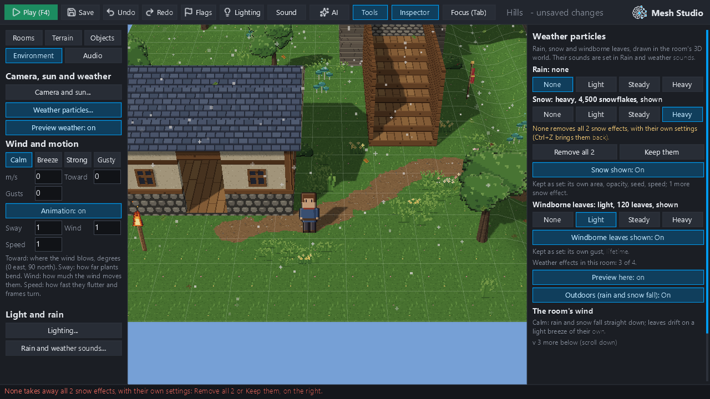

# Milestone 23C: weather authoring in Mesh Studio

Rain, snow and windborne leaves already existed as world-space, depth-tested HD-2D particles (`engine/scene_particles.py`, M18). Studio could only set rain. M23C makes all three authorable with normal editor controls, with no JSON editing and no new rendering. It is based on `redesign/visual-editor` at `d1fe1d7` (the #414 merge). Evidence is in `m23c_evidence/`, with the phases' reports in `m23c_evidence/reports.json`.

Every picture and number below comes from hidden windows: Studio was driven by its own input events (`tooling/m23c_weather_studio.py`) in a disposable project. Master volume was 0 throughout.

## Gate 0: M23B

#414 head `d9574bf`, run 40777239477:
- **Attempt 1:** Ubuntu verify-all failed only on `pytest-fast`: 83.3 s against the 79.0 s limit, on a runner measured slow (speed 1.18, outside its calibrated 0.622–1.152).
- **Attempt 2 (the failed job rerun once, unchanged):** green on every required job. Speed 0.92–0.94; `pytest-fast` 67.8–70.2 s against 79.05 s; 10,076 passed.
- **Ratio of `pytest-fast` to the speed-adjusted expectation:** about 1.15 at the base `c5cd06d` (1.15, 1.17), at `fcfabb9` (1.14–1.16) and at `d9574bf` (1.12–1.16). M23B didn't grow the fast tier; the base already runs about 15% over its budget expectation, which predates M23B.

Merged as `d1fe1d7`; its tree is identical to `d9574bf`'s. `main` was not touched.

## Stage 1: the audit

**What exists:**

| Piece | Where | Capability |
|---|---|---|
| Particle presets | `engine/scene_particles.py` `PRESETS` | `rain` (3,000 drops, splashes where they land), `snow` (2,000 flakes, settle on surfaces), `wind` (400 windborne leaves and debris, never land) |
| Room settings | `settings.particles`, `parse_particles` | Up to **4 effects**; per effect `count` (0–20,000), `speed`, `wind`, `gust`, `lifetime`, `seed`, `area`, `opacity`, `enabled` |
| Room wind | `settings.wind`, `engine/wind.py` | An effect without its own `wind`/`gust` takes the room's (unless calm: then its preset's own) |
| Exposure | `settings.weather_exposure` | "indoor": no rain or snow (leaves stay); a notice says so |
| Lifecycle | `scene_particles.configure` | Built on every room load, released on the next: nothing carries between rooms |
| Studio preview | `studio_hd2d` | "Preview weather" (on by default), shown once a room has particles; the preview clock runs only while it's on |
| Ops | `project_ops.set_particles`, `set_weather_exposure`, `set_wind`, `set_rain`, `rain_strength`, `weather_sounds_of`, `set_weather_sounds` | Checked as the game reads them |
| Studio controls | Sound panel ("Rain and weather sounds..."): Rain Off/Light/Steady/Heavy, room wind presets, rain and wind sounds; Environment: Wind and motion | **Rain only.** Snow and leaves couldn't be authored (M22 backlog) |
| Weather sounds (M21B) | `engine/sound_emitters.py` | The rain loop follows the rain falling; the wind loop follows the room's wind. Independent of snow and leaves |

**Limitations found (not changed here):**
- **`set_rain` discarded custom rain settings:** it rebuilt the rain effect from scratch (speed, area, seed, opacity and a hidden state were lost). Fixed by routing it through the new op.
- **An effect with its own `wind` vector** ignores the room's wind, by the engine's design. The panel shows it as "kept as set".
- **2D rooms draw particles too,** over their map, but the new panel is HD-2D only (as Studio's other environment panels are). 2D rooms keep the Sound panel's rain.

**Reused, not duplicated:** `set_particles` for all checking and storage, `set_wind` and Studio's existing `set_wind`, `set_weather_exposure`, `toggle_weather`, the Sound panel and `_edit` (undo, redo, reload).

## Stage 2: the controls

**Before:** rain from the Sound panel. Snow and leaves only by editing `settings.particles` by hand.

**After:** **Environment > Weather particles...** opens a focused right-hand panel, consistent with M23A (one button in the left category; the controls in the panel).

For each of **Rain**, **Snow** and **Windborne leaves**:
- **Its state in words:** for example "Snow: heavy, 4,500 snowflakes, shown".
- **None / Light / Steady / Heavy:**

  | Kind | Light | Steady | Heavy |
  |---|---|---|---|
  | Rain (drops) | 1,200 | 3,000 | 6,000 |
  | Snow (flakes) | 800 | 2,000 | 4,500 |
  | Windborne leaves | 150 | 400 | 900 |

  Steady is each preset's own count; None takes that kind away.
- **"... shown: On/Off":** hides the effect and keeps it.
- **"Kept as set: ..."** when the room has settings of its own for it, or more effects of that kind.

Then:
- "Weather effects in this room: N of 4";
- **Preview here: on/off**;
- **Outdoors (rain and snow fall)** (the existing exposure);
- **The room's wind** in words: "5 m/s toward the north, gusts 0.9: the rain, snow and leaves move in it, and the room's plants sway in it". It has the existing Calm, Breeze, Strong and Gusty presets and To East / North / West / South. Exact numbers stay in Wind and motion.
- **Rain and weather sounds...** (the sounds stay in the Sound panel) and **Done**.

"Windborne leaves" is never called "wind": the room's wind is its own section, which says what it moves.

**One checked op:** `project_ops.set_weather(scene, preset, strength=..., enabled=...)`. It adds, changes, hides, shows or removes. It edits only the first effect of that kind and only the keys it owns (`count`, `enabled`), so every other key and every other effect is kept. It refuses a fifth effect with "A room has at most 4 weather effects ... take one away first". `weather_of(scene)` describes the room for the panel. Every change goes through Studio's `_edit`, so it is one undo step and the view reloads.

`set_rain` (the Sound panel's rain) now uses the same op. It keeps a rain's own settings and shows a hidden rain when a strength is chosen. Its stored form for a plain rain, and new rain going first, are unchanged.

## Stage 3 and 4: behaviour, through Studio's own events

The disposable project is M23B's woodland clearing (the Hills room: a cottage, trees, a bridge) with no weather, wind or campfire, plus the template's village.

| Step | Configured (Studio) | What the renderer had |
|---|---|---|
| Rain: Steady | `[{"preset": "rain", "count": 3000}]` | rain 3,000, shown, 1 draw. Probe: 770 drops falling, 93 landed (81 within 15 cm of the ground, the rest on roofs) |
| Rain: None, Snow: Heavy | `[{"preset": "snow", "count": 4500}]` | 1,154 flakes falling, 181 settled (151 on the ground, the rest on surfaces) |
| Leaves: Heavy; Gusty; To North | snow 4,500 + leaves 900; wind 5 m/s toward 90°, gust 0.9 | both effects in the room's wind (0, 5) m/s, gust 0.9; 2 draws |
| Snow shown: Off | snow kept with `"enabled": false` | snow present but not drawn; leaves drawn (1 draw). **The leaves' median movement, measured: (0.00, 4.54) m/s, northward with the wind** |
| Undo, Redo (Ctrl+Z, Ctrl+Y) | heavy → light → heavy → light | runtime follows |
| Outdoors: Off | `weather_exposure: indoor` | snow withheld (the existing notice: "This room is indoors ... its snow is not shown"); leaves stay |
| Outdoors: On, Ctrl+S | "Saved 1 file(s)." | the file equals what was configured |
| Reopen | identical; nothing unsaved | snow 800 + leaves 900, shown |
| Play, Stop (twice) | — | in play, the same effects, drawn, their clock running; master volume 0; back to editing |
| The village room, then back | the village has no particles | the village: none drawn (no leak); the clearing's back as configured |
| Export: `mesh export build`, run on the bundle's own engine | — | snow 800 + leaves 900, wind (0, 5), gust 0.9; 2 draws; no error |

| | |
|---|---|
|  |  |
| Rain, steady, by day | Snow, heavy, by day |
|  |  |
| Snow hidden, windborne leaves in a gusty breeze | Snow and leaves at night (Camera and sun...: Night) |
|  |  |
| The whole cottage at night: flakes in front of it drawn, those behind it hidden by it | Play |

`snow_2x.png` is a 2× crop by day: flakes falling in front of the cottage and settled on its roof, the path and the grass. Depth and shelter are the M18 system's, unchanged; its own GPU tests, roofs and the bridge's deck keeping rain and snow off what's under them, still pass. `export_night.png` is the exported game.

**Compatibility:**
- **An older room's own weather, unchanged.** A room written before Studio could author weather (or by the AI): snow with its own speed, area, seed and opacity; leaves with their own wind, gust and lifetime; a hidden rain; a second snow. It reopens byte-identical with nothing unsaved. The panel describes it as it is ("Kept as set: its own area, opacity, seed, speed; 1 more snow effect", "4 of 4").
  - "Snow: Heavy" changed only that effect's count.
  - "Rain: Light" changed the hidden rain's count and left it hidden.

  
- **Weather sounds:** the panel never sets a sound. The saved room's `weather_sounds` were untouched (none set). The rain loop still follows the rain particles (M21B, unchanged).
- **Determinism:** the particles stay stateless (seed + time), as before; nothing new is random.
- **2D rooms:** unchanged; the panel is HD-2D only. The 2D rain GPU test still passes.

## Performance and draw calls

The clearing, gusty, by day; each kind at each strength alone. The panel's own op set it.

| | Particles | Draw calls | Particle pass, GPU |
|---|---|---|---|
| none | 0 | 45 | — |
| rain light / steady / heavy | 1,200 / 3,000 / 6,000 | 46 | 0.004 / 0.005 / 0.008 ms |
| snow light / steady / heavy | 800 / 2,000 / 4,500 | 46 | 0.002 / 0.002 / 0.004 ms |
| leaves light / steady / heavy | 150 / 400 / 900 | 46 | 0.001 / 0.001 / 0.002 ms |

Each effect is one draw. GPU times are timer queries around 20 draws of the pass. A frame's wall time on this PC (4–8 ms) varied with run order more than with weather. Studio's strengths stay far below the engine's limit of 20,000 per effect.

## Review: None with more than one effect of a kind (after `f16a953`)

`set_weather(..., strength="none")` takes away every effect of that kind, while every other control edits only the first and keeps the rest. Reproduced in Studio (`tooling/m23c_weather_studio.py extras`): a room with two snow effects of its own (speed, area, seed, opacity) and leaves of its own.
- **Before:** one click on Snow > None removed both, with only "No snow." to say so.
- **Now:** when a room has more than one effect of the kind, None asks first. In that kind's section the panel says "None removes all 2 snow effects, with their own settings (Ctrl+Z brings them back)" and shows **Remove all 2** and **Keep them**.
  - **Keep them** changes nothing.
  - **Remove all 2** removes both and says so ("No snow: all 2 effects taken away (Ctrl+Z brings them back)").
  - A single effect is still removed in one click: None keeps its meaning.
  - The question is dropped on any reload (another room, an undo).

| Step | Result |
|---|---|
| First None click | Nothing removed; the question shown |
| Keep them | Unchanged; the question gone |
| Remove all 2 | Both snow effects removed; the custom leaves exactly as they were |
| Ctrl+Z | Both restored exactly |
| Ctrl+Y | Removed again; the leaves exact |
| Light, Steady, Heavy, shown off and on, leaves Heavy | Each changes only its own key; the second snow and the leaves byte-identical |

A GPU regression test covers it (`test_none_asks_before_taking_away_more_than_one_effect_and_ordinary_changes_keep_the_rest`).

## Known limitations

- An effect with its own `wind` vector (written by hand or by the AI) keeps it and ignores the room's wind. The panel says "kept as set: its own wind"; Studio doesn't offer to clear it.
- The panel edits the first effect of each kind; further effects of that kind are kept and listed, not edited. "None" removes every effect of that kind.
- At most 4 effects (the engine's limit). With all three kinds present there is room for one custom extra.
- HD-2D rooms only for the new panel. 2D rooms keep the Sound panel's rain.
- Out of scope: snow accumulation, seasons, lightning, thunder, scripted weather and new simulation.

## Tests and gates

- **New fast tests** (`tests/test_weather_authoring.py`, 5): adding, sizing, hiding, showing and removing; custom settings and extra effects kept; the Sound panel's rain shown again; the 4-effect limit and refusals; authored effects in the room's wind (no vectors written). The existing `test_sound_authoring.py` and `test_scene_particles.py` pass unchanged (48 with the new tests).
- **New GPU tests** (`tests/test_weather_authoring_gpu.py`, 9; integration, GL-gated): the creator flow, the compatibility check and the review's None question above. 9 passed.
- **GPU tier:** 244 passed, including every existing weather test unchanged: roofs, the bridge's deck and the cottage interior keeping rain and snow off what is under them, impacts staying put, Studio's preview, the 2D room's rain, and room changes keeping GPU objects level.
- **Default selection:** 10,083 passed, 0 failed (239 skipped, 163 deselected).
- **Gates:** ruff gate ok; mypy 73 (baseline). No budget, baseline, policy or coverage requirement changed.
