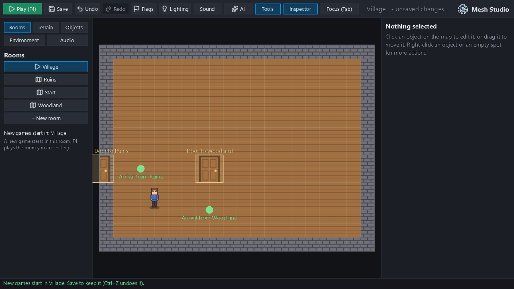
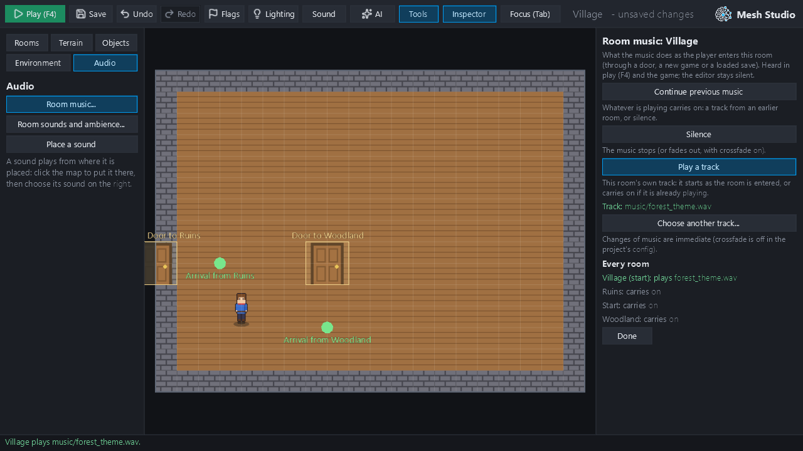
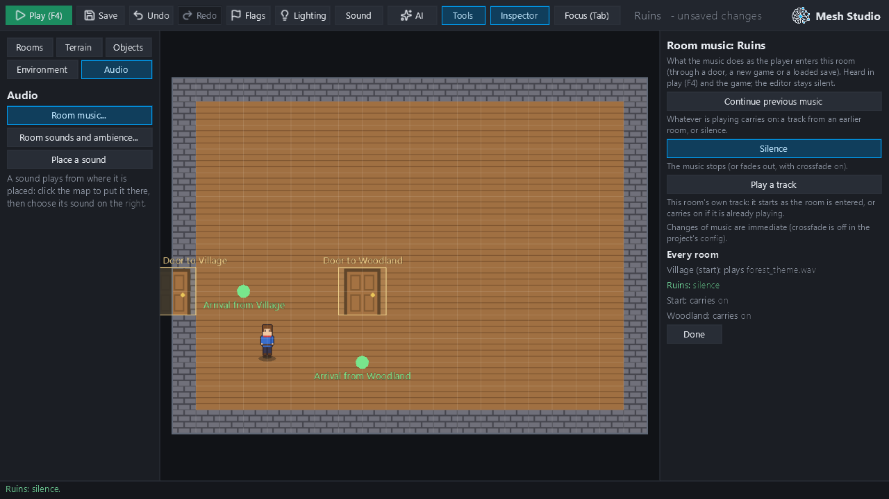
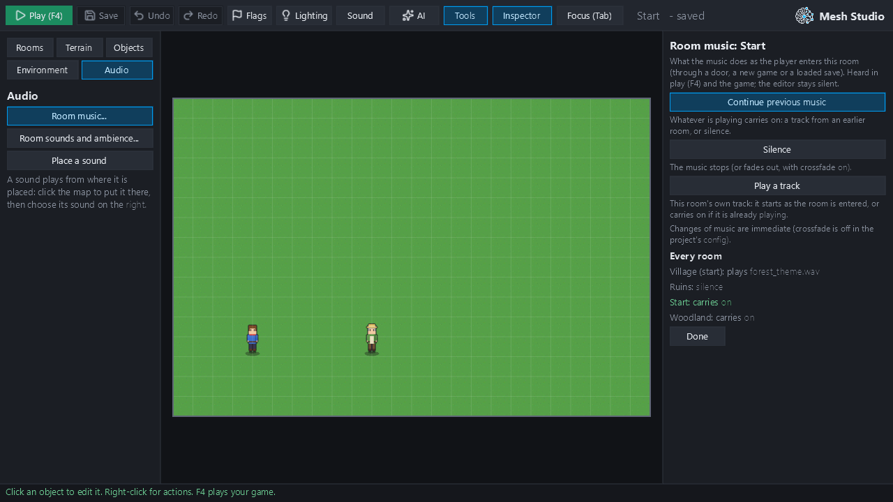

# Milestone 23D: the starting room and room music in Mesh Studio

Two things a creator couldn't do in Studio: choose the room a new game starts in, and choose what music plays as each room is entered. Both already existed in the engine's data and runtime. M23D makes them usable through Studio, without JSON, and adds no new audio engine, world format or editor framework. It is based on `redesign/visual-editor` at `2144b8d` (#415). Evidence is in `m23d_evidence/`, with the phases' reports in `m23d_evidence/reports.json`.

Every result below comes from hidden windows (`tooling/m23d_start_music_studio.py`): Studio driven by its own input events, and games run on Mesh's own runtime and on an exported bundle's engine. Each project's master volume is 0; the editor plays nothing.

## Audit: what already worked

**The start room** (`engine/world_controller.py`, `engine/game_runtime/scene_flow.py`, `main.py`, the main menu's New Game):
- A new game starts in the world's `start_scene` (a room key), else its older `initial_scene_key`, else its first room tagged "start".
- When none of those names a room of the world, the game starts at `config.json`'s `start_scene` path.
- `main.py`, the main menu's New Game and `mesh edit` all use `resolve_game_start_scene`.
- Saves record their own room (`meta.scene_path`) and load into it, whatever the start room is.

**Studio's project** (`engine/studio_project.py`):
- One `_snapshot`/`_record` per change covers the world document. `world_dirty` marks it for saving.
- Save writes the world when dirty, and marks undo and redo states dirty again, so undo after Save is saved again.
- Undo and Redo restore the whole project state, the world included, then reload the room.
- `world_rooms` lists the start room first, but Studio didn't mark it and couldn't change it.
- `Project.start_key()` read only `start_scene` and fell back to the first room. That doesn't match the runtime's rules, and an invalid key would have failed in `scenes_dir`.

**Room music** (M21A, `docs/audio.md`, `scene_lifecycle_controller.apply_scene_music`): the three states already exist and are distinct at runtime.

| Room setting | Runtime |
|---|---|
| no `music` key | the music playing carries on (a track or silence) |
| `"music": null` (or `""`) | silence: the music stops, or fades out with `music_crossfade_enabled` |
| `"music": "<path>"` | that track; the same track already playing carries on uninterrupted |

M21A fixed the loader and compact saving that used to collapse no key into `null`. The asset manifest lists `settings.music`, so export includes it. The editor is silent (`audio.scene_music` off); F4 plays the room being edited, with music on.

**Studio's sounds** (M21B): the sound picker (project sounds, Mesh's ambience library, import), `Project.import_sound` (copied into `assets/ambience/` at once, not undone; the same bytes reused; never replacing another file), `sound_problem` (can this computer play it). There was no music control: the Audio category had room sounds only.

**Templates:** the starter template has an empty `assets/music/`, and Mesh ships `assets/music/forest_theme.wav` and `dungeon_theme.wav`. So `assets/music/` is the established place for a soundtrack, separate from `assets/ambience/`.

## What M23D adds

**Ops** (`engine/project_ops.py`):
- **`start_room(world)`:** the start room by the game's own rules (None when the world names none of its own).
- **`set_start_room(world, key)`:** sets only `start_scene` and refuses a key the world doesn't have. Rooms aren't reordered or recreated, and legacy keys are left.
- **`room_music(scene)`:** `{"mode": "continue" | "silence" | "track", "path"}`.
- **`set_room_music(scene, mode, path)`:** continue removes the key; silence writes `null`; track writes a project-relative, forward-slash `.wav`, `.ogg` or `.mp3` path. It refuses absolute paths and `..`.

**Project** (`engine/studio_project.py`):
- **`start_key()`:** uses `start_room`, else the first room.
- **`set_start_room(key)`:** one undo step that marks the world dirty and leaves `current` alone.
- **`music_files()`:** `assets/music/` first.
- **`import_sound(path, "music")`:** copies into `assets/music/` with the existing rules (same bytes reused; a different file of the same name gets `_2`).

**Studio:**
- **Rooms category:** the start room's button carries the play icon, and a line says "New games start in: Village". **Set as starting room** acts on the room being edited, so it never switches rooms. When the world names no start room of its own, Studio says so, names where the game will really start (the config's room), and leaves the file as it is.
- **Audio category > Room music...:** a focused panel for the room being edited.
  - **Continue previous music**, **Silence** and **Play a track**, each explained in a line.
  - The chosen track, checked for being present and playable, with **Choose another track...**.
  - The project's crossfade setting in words, and **Every room**: each room's music, with the start room marked.
- **Play a track** opens the existing sound picker in a music mode: the project's sound files with `assets/music/` first, **Import music file...** into `assets/music/`, and no ambience library. Imported files stay when the choice is undone; the panel says so.

Before and after: the start room and room music used to be hand-edited in `worlds/main.json` and each room's JSON. Now both are set from the Rooms and Audio categories.

| | |
|---|---|
|  |  |
| Rooms: Village made the start room (play icon; "New games start in: Village") | Village: Play a track, Track A imported |
|  |  |
| Ruins: Silence | Reopened: every room's music |

## Creator acceptance (Studio's own events)

The disposable project is Mesh's starter template ("Start", 2D), plus Village (2D), Woodland (HD-2D) and Ruins (2D). The three rooms were added with Studio's own project operations and joined by walk-in doors Village–Woodland, Woodland–Ruins and Ruins–Village. Track A is Mesh's `assets/music/forest_theme.wav`, imported with Studio's own Import music file... button; the file dialog's answer was supplied, since no OS dialog can be driven in a hidden window.

| Step | Result |
|---|---|
| Rooms: Village, **Set as starting room** | start `village`; still editing Village; world marked unsaved; "New games start in: Village" |
| Village: Room music..., Play a track, Import music file... | `assets/music/forest_theme.wav` copied in; Village `{"mode": "track"}` |
| Woodland: Silence, then **Continue previous music** | `null`, then the key taken away again |
| Ruins: **Silence** | `"music": null` |
| Editing throughout | audio manager: no music, 0 live players, `scene_music` off |
| F4 in Ruins | plays Ruins (the room edited), silent; Stop: the editor silent again |
| F4 in Village (after reopening) | Studio's play-test plays Track A (1 live player), as the game does; Stop: no music, 0 players |
| Ctrl+S, close, reopen | saved `{start: village, village: Track A, woodland: (no key), ruins: null}`; reopened: track, continue, silence; nothing unsaved |
| Woodland, Set as starting room; Ctrl+Z; Ctrl+Y; Ctrl+S; Ctrl+Z; Ctrl+Y; Ctrl+S | woodland, village, woodland, saved woodland; after Save, undo → village and the world unsaved again; saved woodland; still editing Woodland throughout |
| Reopen | start woodland |
| Village, Set as starting room, save | start village |

### The game (Mesh's runtime) and the exported game (the bundle's own engine)

A new game is started as `main.py` starts one. Travel goes through the doors: the player stands on each, and the game's own touch takes them through. Everything is read from the audio manager: the track's path, its track and player objects, its playback position, and what is fading out or released.

| | Game | Exported game |
|---|---|---|
| New game starts in | **Village** | **Village** (the music in the bundle) |
| Village | Track A playing | Track A playing |
| → Woodland (carry on) | **the same track and player objects**, playback position still advancing: not restarted | the same |
| → Ruins (silence; crossfade off) | music none, 0 live players, 1 released: stopped at once | the same |
| → Village | Track A again: a new player from 0 s (M21A: it had stopped) | the same |

**With the project's existing crossfade on** (`music_crossfade_enabled`, 1 s out): on entering Ruins, Track A is in `fading_out` at once and still at 0.5 s; by 1.5 s it has been released.

**Saves:**
- A game was saved in Woodland. Studio then set the start room to Ruins, and the save file stayed byte-identical.
- A new game now starts in Ruins.
- The save still loads Woodland: the slot records `woodland.json`, Woodland's own five objects come back, and the HD-2D renderer is present (Woodland is the HD-2D room).
- Track A plays after the load. Woodland has no music setting, so the save's recorded music plays (M21A).
- Studio then set Village back as the start room.

## Compatibility

**An older world** with no `start_scene` and no room tagged "start", where Ruins stores `"music": null` by hand and Woodland has no music key:
- Studio opens it unchanged and says "This world names no starting room: a new game starts in Start (the project's config)".
- After giving Village a track and saving, the world still names no start room, Ruins is still `null` and Woodland still has no key. Reopened, the same.
- In the fast tests, a world whose `start_scene` names a missing room opens, and Save writes nothing.

Rooms written before M23D are read as they are, with no migration. `start_room` follows the runtime's rules, including `initial_scene_key` and the "start" tag. Saves aren't touched.

## Known limitations

- **Imported music isn't removed by undo.** Like pictures and sounds since M21B, an imported music file is copied into the project at once. Undo takes back the room's choice, not the file.
- **The picker lists every project sound file** (music first): a creator may choose an ambience loop as music. OGG and MP3 need the system's decoders; the panel flags a file this computer can't play.
- **No per-room music volume or crossfade controls** in the panel (M21A's `music_volume` and crossfade settings): it states the project's crossfade setting.
- **Studio opens on the room it was launched with,** not the start room, as before. In a world naming no start room, Studio's own fallback for new rooms' folder is its first listed room, while the game falls back to the config's room. The Rooms category says which room the game will start in.
- **The Rooms list puts the start room first,** as `world_rooms` always has. The world's own order is unchanged.

## Tests and gates

- **New fast tests** (`tests/test_start_room_music.py`, 11): the start-room rules; `set_start_room` and refusals; one undo step, dirty, undo and redo before and after Save, and reopen; an older world opening untouched; the three music states through save, reopen, undo and redo; refusals; music import never replacing a file.
- **New GPU tests** (`tests/test_start_room_music_gpu.py`, 7): the creator flow, the new game, travel and music, the save, and the older project above.
- **GPU tier:** 252 passed (the 7 new tests included; every existing audio, soundscape, Studio and HD-2D test unchanged). The Village Play-parity check was added after that run; its module was rerun: 7 passed.
- **Default selection:** 10,094 passed, 0 failed (247 skipped, 163 deselected).
- **Gates:** ruff gate ok; mypy 73 (baseline). No timing budget or baseline changed.
- **Required CI on `f683966`** (run 40849367364): green at the first attempt on every required job.
  - tests on Ubuntu and on Windows: 10,092 passed each; no verify-all step failed.
  - web-smoke and arcade3-canary: green.

**The known Ubuntu `pytest-fast` timing pattern (#414, #415), reported separately; it failed nothing here:**
- **Ubuntu (runner speed 0.93):** `pytest-fast` took 69.96 s and 70.10 s against 60.8 s expected at that speed (ratio 1.15). The advisory check called it "slow" by 0.05–0.10 s; the enforced limit (79.05 s) was ok.
- **Windows (runner speed 1.19–1.23):** 134.8 s and 127.5 s, over the fixed 121.82 s. Rule F didn't fail it: within that slow runner's speed-adjusted range.

The same ratio (about 1.15) was measured at the base `c5cd06d` before M23B, so it predates these milestones. In #415 an A/B run on one machine showed no fast-tier change from M23C. M23D adds 11 fast tests, about 3 s locally including imports.

## Verdict

**PASS.** In Mesh Studio alone, a creator can choose the opening room and give a three-room game its soundtrack: a track, carry on, silence. They can save, reopen, undo and redo, test with F4, and export, and the new game and the exported game start in the chosen room, with the music behaving as M21A specifies (from the audio manager's own state). Older projects and existing saves are kept as they were. Stopped for independent review before merging.

