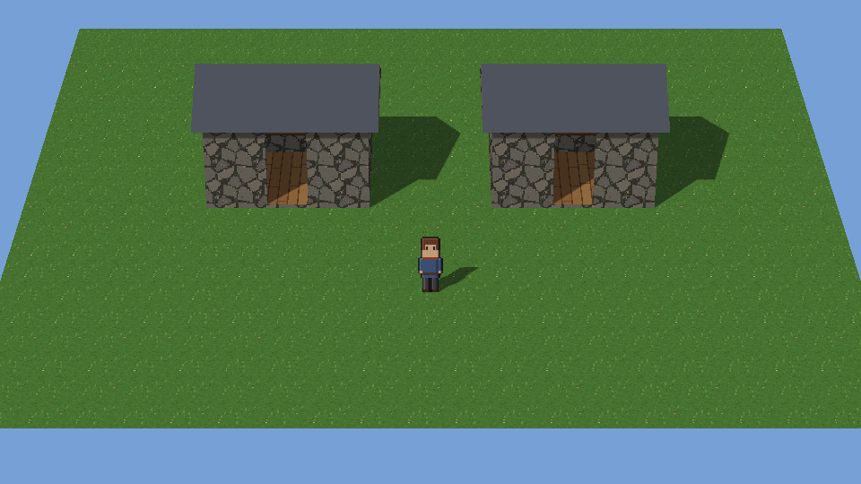
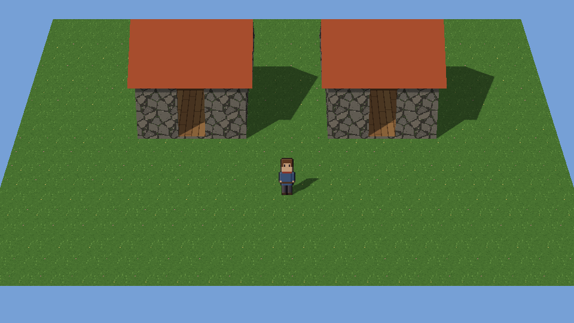

# M2-1: one Blender building, created and safely reimported

Plan: `docs/plans/hd2d_online_investigation.md` §5 (M2-1). Base `75601584`.

## Pipeline

1. `tooling/hd2d_assets/build_house.py` builds a small stone house in headless Blender with the existing
   `blender_kit.py` helpers and placeholder materials: the `stone`, `timber` and `floorboards` pixel textures, and a
   flat-colour roof. It has a floor slab, four walls, a 1 m doorway under a lintel and a gable roof.
   - Collision: `col_floor` (solid), plus six walls: `col_wall_north`, `col_wall_west`, `col_wall_east`,
     `col_wall_south_w`, `col_wall_south_e` and `col_lintel`.
   - `--v2` is the Blender edit. The north wall moves 1 m north (the floor and side walls grow with it), the ridge
     goes from 3.2 m to 3.9 m, and the roof turns from slate grey to terracotta. Collider names are unchanged.
2. Both exports are committed, 25.6 KB each: `tooling/hd2d_assets/house.glb` and `house_v2.glb`. CI has no Blender,
   so the tests use these files.
3. Mesh side: no engine change. The house goes through the existing `catalog.import_model` and is placed twice with
   `project_ops.place_structure`. The edited export then goes through `catalog.plan_reimport` and `reimport_model`.

## Blender version and commands

Blender **5.2.0 LTS** (hash `fbe6228777e7`, built 2026-07-14), at `D:\program\blender.exe`. Headless only.

```
blender --factory-startup -noaudio --background --python tooling/hd2d_assets/build_house.py -- tooling/hd2d_assets/house.glb
blender --factory-startup -noaudio --background --python tooling/hd2d_assets/build_house.py -- tooling/hd2d_assets/house_v2.glb --v2
```

**Idempotent.** Each command was run twice into scratch files, and the output was byte-identical every time.

| File | SHA-256 | glTF generator |
|---|---|---|
| `house.glb` | `831add52846537681af096bff069a7678f62026a5f5360e0d307401342f5ef40` | Khronos glTF Blender I/O v5.2.39 |
| `house_v2.glb` | `7fbaed38295d3ca87907bfc8023099660a0e27087e0bcbf3ea3f84f360ea6621` | Khronos glTF Blender I/O v5.2.39 |

Blender 5.2.0 also rebuilds the existing `cottage.glb` byte for byte (`7b4c20ff…`).

## Reimport evidence

Command: `py -3.13 tooling/hd2d_assets/house_reimport_evidence.py OUT_DIR`, run with `MESH_USER_DIR`,
`MESH_PROJECTS_DIR` and `APPDATA` set to scratch folders. Output: [`report.json`](report.json).

Steps:
1. Create a new HD-2D RPG project and import the house.
2. Place two copies in a 20 x 20 m room that uses the template's light and camera.
3. Draw the room in a hidden window (`tooling/scene_snapshot.py`).
4. Re-export from Blender (v2), plan the reimport, reimport, and draw the room again.
5. Try a cut-off export.

| Before reimport | After reimport (both copies) |
|---|---|
|  |  |

- **The plan names what moved.** It wrote nothing.
  - `Size 4.5 x 3.5 x 3.2 m -> 4.5 x 4.5 x 3.9 m.`
  - `Collider 'col_floor' (solid) changed shape.`
  - `Collider 'col_wall_north' (wall) changed shape.`
  - `col_wall_east` and `col_wall_west` also changed shape.
  - It warned: walkable ground around `house, house_2` shrinks from 1528 to 1512 spots.
  - In the test, a character standing behind the house gets the warning "would have nowhere to stand".
- **Only the model's files changed:** `assets/models/catalog.json`, `assets/models/house.glb` and
  `assets/models/previews/house.png`. Every other project file is byte-identical, including the scenes and the
  other model. Scenes are not edited: both copies keep their ids and transforms.
- **Collision follows the edit**, checked by `World.stand` on each copy:
  - the old north wall's place is now floor (0.1 m up);
  - the new north wall blocks;
  - the ground behind it is open.
- **A cut-off export is refused** ("its glTF description is damaged") and the project is unchanged.
- **The pictures are deterministic.** Two runs gave the same files: before `a4a1b534…`, after `ab798b81…`.

## Tests

- `tests/test_hd2d_blender_house.py` (`integration`, 5 cases):
  - the committed exports are Blender's and have the script's colliders, bounds and materials;
  - import, place twice and reimport: exact plan, exact changed-file set, catalogue facts consistent with the file,
    the other entry untouched, collision for both copies before and after;
  - two kinds of broken export are refused with the project byte-identical;
  - a swap that fails part-way rolls back.
- `tests/test_hd2d_blender_house_gpu.py` (`MESH_GL_SMOKE=1`, gpu lane): the evidence run in a hidden window.
  - Before: slate roof pixels and no terracotta. After: the opposite.
  - Three changed files; the broken export is refused.

## PixelLab

**Not used. Generations used: 0. Remaining allowance: not checked.**

Partway through the task, the coordinator passed on the owner's permission to use PixelLab. It then asked for
PixelLab's REST API to be called directly with the `PIXELLAB_API_TOKEN` environment variable. No PixelLab MCP tools
are configured in this session.

The worker did not do this. A message relayed by another agent can't authorise using the owner's credential in raw
API calls that spend the paid allowance; that authorisation has to come from the owner directly.

PixelLab isn't needed for M2-1's acceptance. The building uses the existing procedural textures and a flat-colour
roof. A PixelLab texture is the plan's optional M2-4, which can follow once the owner confirms directly. The
`pixellab_budget.py` ledger, used to reserve and settle each generation, keeps it accountable.
