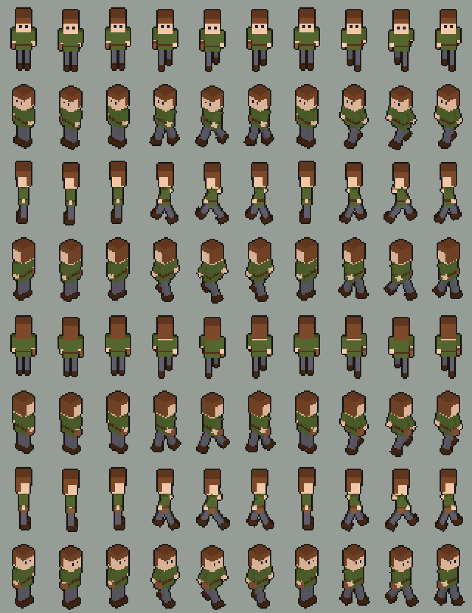
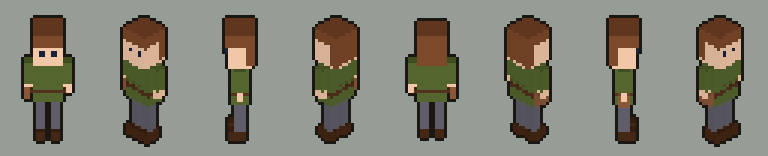

# M2-2: one rigged Blender character, rendered to an eight-direction sprite sheet

Plan: `docs/plans/hd2d_online_investigation.md` §5 (M2-2). Base `75601584`. Engine and Studio import (opt-in 8-way
facing) is M2-3, a later PR. No engine code changes here.

## Pipeline

1. `tooling/hd2d_assets/build_character.py` runs in headless Blender. It builds one low-poly villager, 1.4 m tall,
   standing on the origin and facing south.
   - **Rig:** an armature with 7 bones (`hips` root, `torso`, `head`, `arm.L/R`, `leg.L/R`). One mesh of 17 boxes
     is skinned to it with vertex groups and an Armature modifier.
   - **Animation:** one action, `idle_walk`. It holds `idle` (2 frames, a 1 px breath) and then `walk` (8 frames:
     legs ±32°, arms ±28°, the hips bobbing).
   - **Camera:** orthographic, looking north and down at the HD-2D pitch (32° below the horizon, the
     `settings.camera.pitch` default). The scale is 32 px per metre across the screen, as in the renderer
     (`PIXELS_PER_METRE`).
   - **Facings:** the camera stays put and the character turns −45° × i for facing i.
   - **Render:** Workbench, so there is no sampling. No anti-aliasing and no dither. The `paint.sl` studio light is
     fixed in world space, so every facing is lit from the same side. The background is transparent and the view
     transform is Standard.
   - **Output:** 80 frames, each 32 × 52 PNG.
2. `tooling/hd2d_assets/character_sheet.py` runs that script and assembles the frames with Pillow. It adds a 1 px
   four-neighbour outline. Blender's own outline came out part-transparent over a transparent film, so the outline
   is done here instead. It writes the sheet and its sidecar from the pixels alone, and checks each frame's size and
   that it isn't empty.

Committed: `tooling/hd2d_assets/character_8dir.png` (17.4 KB) and `character_8dir.json`. The `.blend` file is not
committed. It is 784 KB and the script regenerates it with `--blend OUT.blend`.

## Blender version and commands

Blender **5.2.0 LTS** (hash `fbe6228777e7`, built 2026-07-14), at `D:\program\blender.exe`. It runs headless only.

```
py -3.13 tooling/hd2d_assets/character_sheet.py tooling/hd2d_assets --evidence docs/reviews/m2_eight_direction_character
```

This runs the following command into a temporary folder:

```
blender --factory-startup -noaudio --background --python tooling/hd2d_assets/build_character.py -- FRAMES_DIR
```

Then it assembles the sheet. `--frames DIR` assembles frames that were already rendered, without running Blender.
`--blender PATH` picks another Blender.

## Reproducibility

The full pipeline ran **three times** into scratch folders. All three runs gave byte-identical outputs, and those
match the committed files.

| File | SHA-256 |
|---|---|
| `character_8dir.png` | `5c0ad71fa732fa9eae13eedbfa4cb46674007a940512301b975a8a4ce4d3a091` |
| `character_8dir.json` | `4d1a33abbc7d957f24727a6099429c6040b2458c207ae909c1e16f6f9ca99751` |
| `contact_sheet.png` | `9b41ec52a8206b4e889f5b0653c1baec77f6cb7987c29602279ba4e8b7a101c5` |
| `walk_8_facings.gif` | `9917b7b06a032bef0d82305674deccdede1134f793713c2085dd9b4e8126bd74` |

**One Blender non-determinism, handled.** Blender's own frame PNGs differ between runs as files. Their pixels are
identical: 80 of 80 frames compared. The difference is the metadata Blender writes into each PNG:

- `Date` and `RenderTime`;
- the `.blend` path.

The assembler reads pixels only and writes the sheet without metadata, so the sheet is byte-stable. Dither is off
(`render.dither_intensity = 0`). Blender's default dither adds noise to the 8-bit output.

**Pivot check (in Blender).** `world_to_camera_view` on the posed scene places these points:

- the feet's origin at pixel (16.0, 45.0), which is the sidecar's `pivot`;
- 1 m east at +32.0 px;
- 1 m up at 27.1 px higher (32 × cos 32°).

## Sheet layout (`character_8dir.json`)

- **Frames:** 32 × 52 px.
- **Rows:** 8, one per facing, row 0 at the top: `down, down_left, left, up_left, up, up_right, right, down_right`
  (S, SW, W, NW, N, NE, E, SE). These are Mesh's 4-way names (`project_ops.DIRECTIONS`) plus the plan's diagonal
  form (`walk_up_right`).
- **Columns:** 10. `idle` is columns 0–1 (2 frames, 2 fps) and `walk` is columns 2–9 (8 frames, 10 fps). Both loop.
- **Sheet size:** 320 × 416 px, RGBA. Alpha is only ever 0 or 255.
- **Pivot:** the feet point is at (16, 45) px from each frame's top-left.
- **Margins:** every frame keeps at least 1 px clear on all sides. The feet reach at most 4 px below the pivot (outline included),
  because the forward foot at full stride sits lower on screen.

The rows already fit today's 4-direction setup without changes. Pass `project_ops.character_clips` the rows
`{down: 0, left: 2, right: 6, up: 4}`, with `idle_first=0, idle_count=2, walk_first=2, walk_count=8`. Nothing is
mirrored, because the sheet draws its own left. M2-3 adds the diagonals.

| Contact sheet (3×; rows = facings, columns = idle ×2 then walk ×8) | Walk, all 8 facings (3×, 10 fps) |
|---|---|
|  |  |

## PixelLab

**Consumption: 1 generation.** The balance was 5000 of 5000 generations before (plan "Tier 2: Pixel Artisan",
active, USD credits 0.0) and 4999 of 5000 after (USD credits 0.0). Both balances were read from
`GET /v2/balance`. Nothing was purchased, topped up or upgraded.

| Endpoint | Purpose | Requests | Generations (API `usage`) |
|---|---|---|---|
| `create-image-pixflux` | palette and style reference for the villager: 64 × 64, low top-down view, facing south, seed 2202 | 1 | 1 |

- **Ledger:** the call was reserved and settled through `tooling/pixellab_budget.py`. The ledger is kept outside
  the repository, in a scratch path, with an approved budget of 10 and agent `character` capped at 10. The
  generation is `settled` with `used` = 1 and no overrun.
- **What it was used for:** colour values only. Nine sRGB values were picked from the reference: skin, hair, eyes,
  tunic, belt, trousers, boots, satchel and the outline. They are the `PALETTE` in `build_character.py` and the
  `OUTLINE` in `character_sheet.py`.
- **What was not shipped:** no PixelLab pixels are in the sheet, the evidence or the repository. That follows
  `docs/asset_licensing.md` (no AI-generated asset ships until its open requirements are settled). The reference
  image stays outside the repository.
- **Why one generation was enough:** everything repeatable (geometry, rig, animation, eight facings, frames, sheet,
  outline) is done by Blender and Pillow. A texture wouldn't read at 32 px per metre on boxes this size, so further
  generations would not have changed the sheet.

## Tests

`tests/test_hd2d_character_sheet.py` (`fast`, 4 cases). It runs without Blender against the committed files.

- **The sidecar matches the sheet:**
  - facing and compass order;
  - contiguous animation spans that fill the columns;
  - sheet size = columns × frame width by rows × frame height;
  - binary alpha;
  - pitch 32, orthographic;
  - pivot inside the frame.
- **Every frame is drawn whole and stands on the pivot.** All 80 frames are non-empty and none touches its frame's
  edge. The bounding box spans the pivot's x, and its bottom is within 0 to 6 px of the pivot's y. The 8 idle
  frames are all different, and each facing's walk has more than 2 distinct frames.
- **The rows follow the facing order:**
  - `down` shows face pixels at head height and `up` shows none;
  - each `*left` facing's face is left of the matching `*right` facing's.
  - Mutation check: swapping the left and right rows fails this test. Blanking a frame, or moving the pivot, fails
    the frame test.
- **Today's 4-direction setup reads the sheet unchanged:**
  - `project_ops.DIRECTIONS` is still the 4-tuple;
  - `character_clips` builds the 8 clips from the cardinal rows, with no mirroring;
  - `set_animation` sets `directional_mode` to `"4-way"`;
  - the unchanged `SpriteAnimatorBehaviour`, with a stub loader that slices the sheet the way `engine/assets.py`
    does, plays `walk_left/right/up/down` from the `left`, `right`, `up` and `down` rows.
