# M4-6 rendered evidence: two hidden windows under injected latency

The final M4-6 evidence set (HD-2D Online Foundations, milestone M4; plan: `docs/plans/m4_online_combat.md` §4 M4-6).
Five short runs of `tooling/m4_render_evidence.py`, all with lag compensation on:

| Run | RTT, jitter, loss | Queue preset |
|---|---|---|
| `rtt000_drain` | 0 ms ±10 ms, 1% | drain (provisional default) |
| `rtt100_drain` | 100 ms ±10 ms, 1% (OD1's envelope) | drain |
| `rtt200_drain` | 200 ms ±10 ms, 1% | drain |
| `rtt100_deep` | 100 ms ±10 ms, 1% | deep |
| `rtt100_small` | 100 ms ±10 ms, 1% | small |

**Where this lives.** The repository keeps evidence under `docs/reviews/<name>/` (for example `m3_two_client`), so
this set is here rather than under a new `docs/evidence/` tree. Each run folder holds `evidence.json` (every frame and
event of the run) and a curated five of its ten frames, saved as 128-colour PNGs (about 170 KB a run, 0.9 MB in all).
`evidence.json`'s `frames_kept` names the five; the other frames were read back too and are listed but not kept.
No user names or local paths are in the files.

## How it was made

- **The world** (`tooling/m4_demo_world.py`, the same one the owner plays: `docs/plans/m4_playable_demo.md`):
  - the floors demo's HD-2D crossing, with three co-op bandits walking `FloorRoute`s on the server (the open ground,
    the west stairs, the bridge deck);
  - a walk-in door to the packaged expedition's Layer 1, a 2D room.

  The packaged expedition has no moving enemy (an enemy walks online only in an HD-2D room, M4-4), so it could not
  show a hit on one.
- **The processes.** One process runs the real authority (`WorldServer`, `--rewind on`), the M4-6 delay proxy
  (`tooling/net_delay_proxy.py`, seed 7) and window A. Window B is `tooling/net_world_probe.py` in a second process.
  - Both windows are hidden and never activated (`tooling.hidden_windows.no_activate`), and their audio is silent.
  - Every input is a key event through the client's own handler, never OS input.
  - A read-only foreground monitor ran as a thread in the first process: **0 focus changes in every run**, and no
    test window ever came to the foreground.
- **The scenario** (about 12 s a run, 17 s with start-up):
  1. B steps west. A walks up off the lane the ground bandit walks (prediction), east over the middle of its walk, and
     a step down to face it.
  2. A swings while its window shows the bandit walking under the hitbox, and again on a miss (at most 5 swings).
  3. Both walk west through the door into the ruins (a room transfer).
- **Frames** are read back from each window's framebuffer:
  - A's swing is framed by the swing call itself, as the press shows it;
  - the hit is framed inside its 0.15 s flash;
  - B is framed as soon as its state shows A's swing.
- GPU: NVIDIA GeForce RTX 4070. Timings are descriptive, one run each: never gates.

**What a swing and a hit look like** (`mesh_net/scene_client.py`, `SceneView.swing` and `flash`):
- **Swing:** a white crescent with a blue rim over the hitbox the server makes: the room's reach (32 px) ahead, in
  the facing direction, bulging that way. It lasts the hitbox's life (0.2 s).
  - The window's own swing shows on the press itself (OD4), before any server reply.
  - A peer's swing shows when its state arrives.
- **Confirmed hit:** a red, eight-rayed burst with a yellow core on the enemy, following it as it walks, for 0.15 s.
  It is keyed off the server's `hit_seq` only.
- The two never share a colour or a place: the swing is at the attacker's hitbox, the hit on the enemy.
- HD-2D's billboards ignore a sprite's tint, so the old red tint alone showed nothing in an HD-2D room. Both marks are
  sprites, so both renderers draw them. The packaged player still has no `attack` animation clip: the crescent is the
  swing's picture.

## Measurements (one run each; from each run's `evidence.json`)

Times are in ms. Each one is from the key event's dispatch to the moment named:
- the swing frame is the swing call's own draw;
- prediction is the first drawn frame showing the own avatar moved, then the first snapshot whose own row moved;
- the hit is the first frame showing the server's confirmation.

| RTT | Preset | Press → swing visible | Move press → local move / server row | Press → hit confirmed | Bandit x: shown at press → server at press → server at hit | View tick / server tick at press | Clamped views | Transfers, enter → room shown | Corrections | Proxy chunks held beyond jitter | Focus changes |
|---|---|---|---|---|---|---|---|---|---|---|---|
| 0 ms ±10, 1% | drain | 7.1 | 4.0 / 47.6 | 81.2 (1 swing) | 592.2 → 598.0 → 600.0 | 187.33 / 189 | 0 | 1, 136.9 | 5 (max 7.5 px), drained 8 | 33/379 up, 20/390 down | 0 |
| 100 ms ±10, 1% | drain | 6.3 | 19.6 / 187.3 | 168.0 (1 swing) | 592.9 → 600.0 → 610.5 | 187.53 / 190 | 0 | 1, 138.4 | 7 (max 7.5 px), drained 12 | 49/386 up, 30/399 down | 0 |
| 200 ms ±10, 1% | drain | 15.4 | 18.9 / 302.1 | 273.2 (1 swing) | 593.0 → 600.0 → 616.0 | 187.58 / 191 | 1 | 1, 136.1 | 9 (max 7.5 px), drained 13 | 68/398 up, 53/416 down | 0 |
| 100 ms ±10, 1% | deep | 15.9 | 13.6 / 182.0 | 161.2 (1 swing) | 593.9 → 600.0 → 610.5 | 187.83 / 190 | 0 | 1, 150.1 | 0, drained 0 | 54/389 up, 30/401 down | 0 |
| 100 ms ±10, 1% | small | 18.0 | 14.4 / 134.8 | 182.0 (1 swing) | 592.6 → 600.0 → 610.5 | 187.47 / 190 | 0 | 1, 142.2 | 15 (max 37.5 px), drained 0 | 45/378 up, 30/389 down | 0 |

- **The local swing is visible on the frame that reads the press** in every run: 6–18 ms after the press. The mark is
  in A's frame (`marks: swing_mark`) before the server has seen the attack.
- **Prediction:** A's avatar moves on the next frame after the press (4–20 ms). The server's row follows a round trip
  later (48–302 ms).
- **Hits on a moving enemy.** Each run's first swing was confirmed. The bandit was walking east: its server x moved
  2–16 px between the press and the confirmation.
  - The attack carried a view tick 2.5–3.4 ticks behind the server's tick at the press.
  - At 200 ms that view was beyond the 300 ms cap and was clamped (`clamped_views` 1), and the swing still hit.
  - These runs show hits with rewind on. They do not separate rewind's share: the presses fell well inside the
    hitbox. The same-seed probe measures that (plan §4 M4-5).
- **Corrections.**
  - drain: one-step corrections (7.5 px) from steps it drained after loss stalls (8–13 drained).
  - deep: no corrections.
  - small: 15 corrections, three of them 30–37.5 px. Those are its walk-on after a burst, as M4-3 measured.
- **Server counters:** stale, refused, future and unseen views were 0 in every run. Every swing shown ran.
- **The peer:** B's frame shows A's crescent, and the burst on the bandit where B shows it.
  - The swing and the hit arrive in one snapshot here: the hit landed on the attack's first tick. So B's "swing seen"
    and "hit seen" pictures are alike, and only the first is kept.
  - In the 200 ms run, A's own hit frame shows the burst alone: the swing's 0.2 s were over before the confirmation
    came.

## Limitations

- **One run per cell.** These are pictures and descriptive timings, not statistics; the plan's same-seed probe tables
  are the measurements.
- **Window A shares a process with the authority and the proxy.** A frame of A can delay a tick or a delivery by a few
  ms. That keeps the run within the two-process limit.
- **Frame timing.** "Press → swing visible" is the draw the swing call makes inside the key's dispatch. A real window
  draws that frame on its next loop iteration, so add up to one frame (about 16 ms at 60 fps).
- **The proxy delays chunks read from a socket, not TCP segments.** A chunk can hold several frames, which share one
  fate. Loss is the per-message model (RTT + 200 ms per stall), not bursty loss.
- **No claim is made about how it feels.** That is the owner's play-test (`docs/plans/m4_playable_demo.md`).

## Contact sheet

### rtt000_drain: 0 ms ±10 ms, 1% loss, drain, rewind on

| Frame | Moment (ms after the run's start; client / server tick) |
|---|---|
| 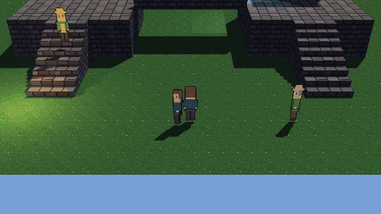 | **A: prediction (own avatar moved, server row not yet)**, 4949 ms (140 / 140); marks on screen: none |
| 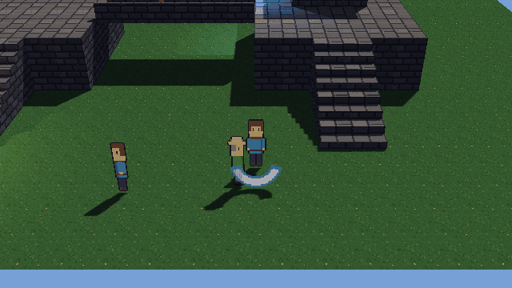 | **A: local swing on the press**, 7422 ms (189 / 190); marks on screen: swing_mark |
| 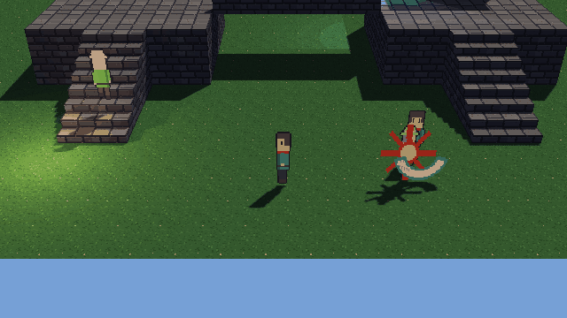 | **B: A's swing (and hit) seen by the peer**, 7488 ms (191 / —); marks on screen: swing_mark, hit_mark |
| 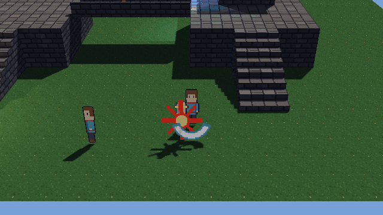 | **A: server-confirmed hit (burst) on the walking bandit**, 7496 ms (191 / 191); marks on screen: swing_mark, hit_mark |
|  | **A: after the transfer to the ruins (2D)**, 11675 ms (25 / 26); marks on screen: none |

### rtt100_drain: 100 ms ±10 ms, 1% loss, drain, rewind on

| Frame | Moment (ms after the run's start; client / server tick) |
|---|---|
| 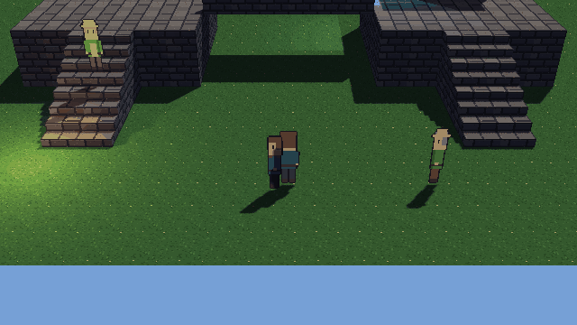 | **A: prediction (own avatar moved, server row not yet)**, 5175 ms (143 / 145); marks on screen: none |
| 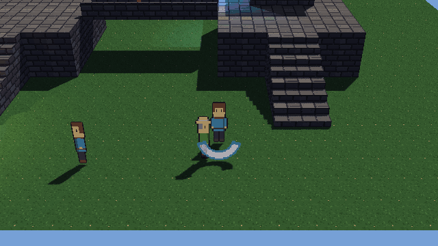 | **A: local swing on the press**, 7485 ms (189 / 191); marks on screen: swing_mark |
| 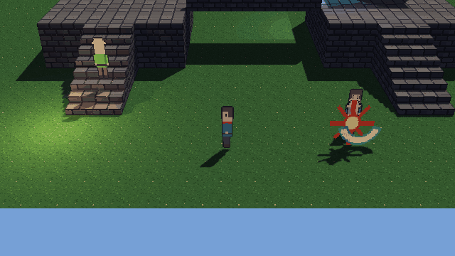 | **B: A's swing (and hit) seen by the peer**, 7637 ms (193 / —); marks on screen: swing_mark, hit_mark |
| 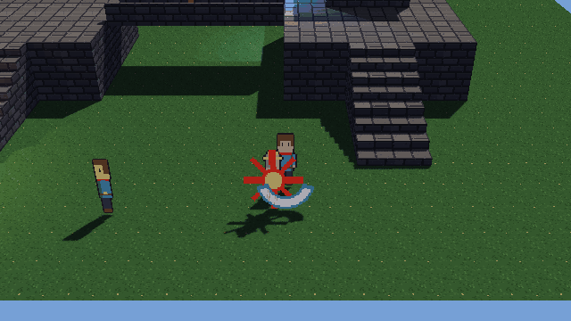 | **A: server-confirmed hit (burst) on the walking bandit**, 7646 ms (193 / 194); marks on screen: swing_mark, hit_mark |
|  | **A: after the transfer to the ruins (2D)**, 11994 ms (28 / 29); marks on screen: none |

### rtt200_drain: 200 ms ±10 ms, 1% loss, drain, rewind on

| Frame | Moment (ms after the run's start; client / server tick) |
|---|---|
| 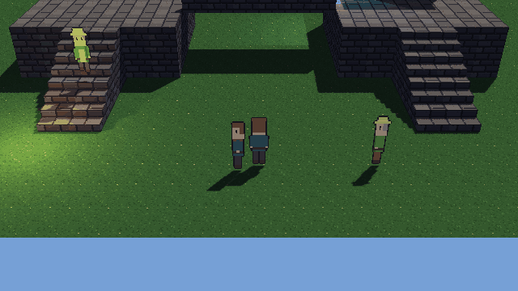 | **A: prediction (own avatar moved, server row not yet)**, 5387 ms (147 / 149); marks on screen: none |
| 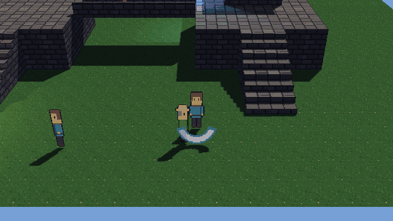 | **A: local swing on the press**, 7516 ms (190 / 192); marks on screen: swing_mark |
| 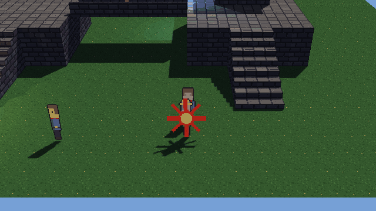 | **A: server-confirmed hit (burst) on the walking bandit**, 7774 ms (195 / 197); marks on screen: hit_mark |
| 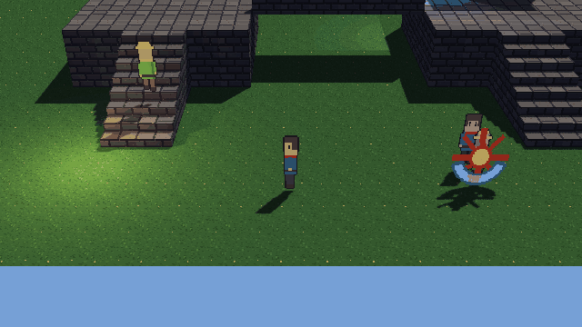 | **B: A's swing (and hit) seen by the peer**, 7799 ms (195 / —); marks on screen: swing_mark, hit_mark |
| 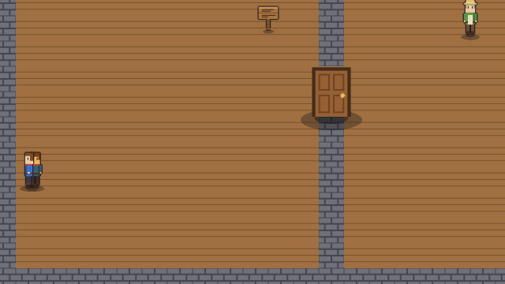 | **A: after the transfer to the ruins (2D)**, 12414 ms (32 / 34); marks on screen: none |

### rtt100_deep: 100 ms ±10 ms, 1% loss, deep, rewind on

| Frame | Moment (ms after the run's start; client / server tick) |
|---|---|
| 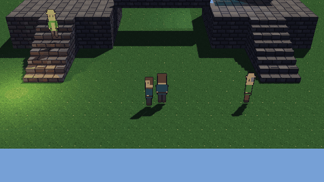 | **A: prediction (own avatar moved, server row not yet)**, 5097 ms (141 / 142); marks on screen: none |
|  | **A: local swing on the press**, 7528 ms (190 / 191); marks on screen: swing_mark |
|  | **A: server-confirmed hit (burst) on the walking bandit**, 7673 ms (193 / 194); marks on screen: swing_mark, hit_mark |
|  | **B: A's swing (and hit) seen by the peer**, 7695 ms (193 / —); marks on screen: swing_mark, hit_mark |
| 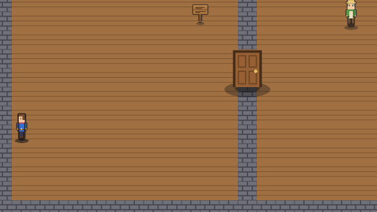 | **A: after the transfer to the ruins (2D)**, 11976 ms (26 / 27); marks on screen: none |

### rtt100_small: 100 ms ±10 ms, 1% loss, small, rewind on

| Frame | Moment (ms after the run's start; client / server tick) |
|---|---|
| 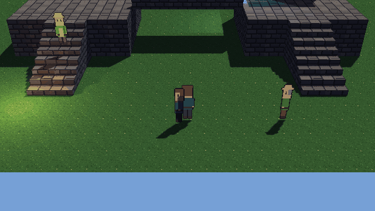 | **A: prediction (own avatar moved, server row not yet)**, 5114 ms (142 / 143); marks on screen: none |
| 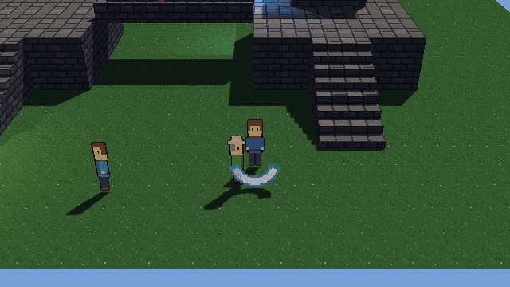 | **A: local swing on the press**, 7480 ms (189 / 191); marks on screen: swing_mark |
| 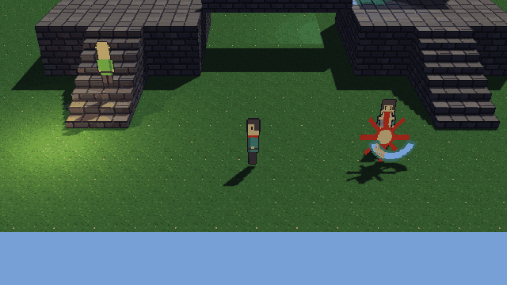 | **B: A's swing (and hit) seen by the peer**, 7640 ms (193 / —); marks on screen: swing_mark, hit_mark |
|  | **A: server-confirmed hit (burst) on the walking bandit**, 7644 ms (193 / 194); marks on screen: swing_mark, hit_mark |
|  | **A: after the transfer to the ruins (2D)**, 11750 ms (23 / 24); marks on screen: none |

## Reproduce

From the repository root (hidden windows; one run is two Python processes for about 20 s):

```powershell
$env:PYTHONPATH = (Get-Location).Path
py -3.13 tooling/m4_render_evidence.py OUT --rtt-ms 100 --jitter-ms 10 --loss 0.01 --seed 7 --queue drain
```

Change `--rtt-ms` (0, 100 or 200) and `--queue` (drain, deep or small) for the other runs. `OUT` must be a new or empty
folder whose path has no spaces. Run the curation step yourself: these frames were reduced to 128 colours with
Pillow.
