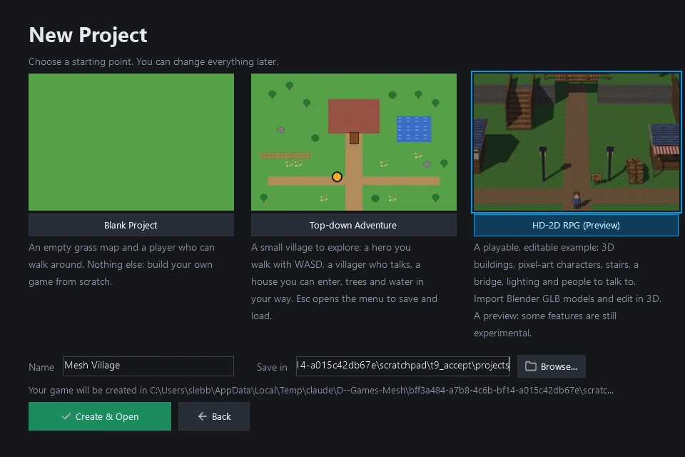

# Milestone 16: HD-2D RPG (Preview) in the New Project workflow

**Verdict: PASS** (pending owner review; draft PR, not merged).

HD-2D RPG (Preview) is now offered in Mesh's ordinary New Project workflow. From a clean pip install, outside the
repository, a new user can choose it in the launcher, create it, open it in Mesh Studio, edit it, play it and export
a runnable game. That was verified with the launcher's own buttons in hidden windows
(`tooling/hd2d_install_acceptance.py`; [report](milestone16_hd2d_preview_evidence/install_report.json), local paths
shown as `<OUT>`).

## Part A: Stage 6B integrated

- **#364 merged** into `redesign/visual-editor` as **`0fd517a`**:
  - its head `387103e` was green on Linux and Windows (push `40222853627`, PR `40222857452`; 9,666 passed, 0 failed);
  - the diff was its six reviewed commits, on an up-to-date base;
  - the merge commit's tree is identical to the tested head.
- **Post-merge push CI** `40224821544` is green on both OSes.
- **Unchanged:** #344 stays a draft and `main` is untouched.

## Part B: the template, enabled as a Preview

Through the existing registration (`engine/project_templates.py`):

- **Registration:** `hd2d_rpg` is now `launcher=True`, titled **HD-2D RPG (Preview)**, with a card picture
  (`assets/templates/hd2d_rpg.png`).
- **The picture:** a real render by the game's HD-2D renderer, made by `tooling/make_template_previews.py`, which now
  draws HD-2D templates that way.
- **The description:** "A playable, editable example: 3D buildings, pixel-art characters, stairs, a bridge, lighting
  and people to talk to. Import Blender GLB models and edit in 3D. A preview: some features are still experimental."
  It doesn't claim production readiness or an executable (a test checks this).
- **Unchanged:**
  - Blank Project and Top-down Adventure, their pictures (which regenerate byte-identical) and their order;
  - the default choice, still Top-down Adventure;
  - Studio's free editing camera;
  - orthographic support (`camera.ortho`).

**Launcher pictures from the clean install:**

- [home](milestone16_hd2d_preview_evidence/30_launcher_1_home.webp);
- [New Project, Top-down Adventure chosen by default](milestone16_hd2d_preview_evidence/30_launcher_2_new_project.webp);
- [HD-2D RPG (Preview) chosen](milestone16_hd2d_preview_evidence/30_launcher_3_chosen.webp);
- [opening it in Mesh Studio](milestone16_hd2d_preview_evidence/30_launcher_4_opening.webp).

## Part C: clean-install preview verification

A fresh environment with the wheel and its dependencies from the package index (arcade 3.3.3, pyglet 2.1.19, pillow
11.3.0, jsonschema 4.26.0), plus a second with Mesh's dependencies only.

- **Isolation:** the driver ran in isolated mode from an empty folder; the engine was confirmed to come from the
  environment; no `sys.path` entry or variable pointed at the repository; Mesh's user and project folders were inside
  the test folder.
- **The launcher itself (`engine.launcher`)** was worked in a hidden window through its own buttons and fields:
  **New Project**, the **HD-2D RPG (Preview)** card, a name, the location, **Create & Open**.
- **Studio's start.** The launcher starts Mesh Studio as a process of its own, which would open a visible window. That
  start was recorded instead: `python -m mesh_cli edit "Mesh Village"` in the new folder. The project was then opened
  in Mesh Studio in a hidden window.

| What a new user does | Result |
|---|---|
| Select HD-2D RPG (Preview) | The launcher offers Blank Project, Top-down Adventure, HD-2D RPG (Preview); the default is still the adventure; clicking the card chose the preview |
| Create and open the starter project | Created "Mesh Village"; opened in Studio as HD-2D with 45 structures and no error ([picture](milestone16_hd2d_preview_evidence/01_studio_opened.webp)) |
| View its models, textures and character sprites | The model catalogue lists the 14 starter models with pictures; the village draws its textures and the HD-2D characters |
| Place and edit structures and NPCs | The shop moved; a crate turned (See-through on, then undone); a lamp post placed from the catalogue ([picture](milestone16_hd2d_preview_evidence/05b_lamp_post_placed.webp)); a Person placed on the raised plateau in 3D ([picture](milestone16_hd2d_preview_evidence/04_person_placed.webp)); what they say edited in the Dialogue tab |
| Undo, redo, save and reopen | Placing the person undone and redone; Ctrl+S; reopened with the shop, person, lamp, crate and lamp post exactly as saved |
| Play the stairs, bridge and interior | Up the west stairs to 2.0 m, across the bridge, down the east stairs, under the bridge, into the cottage on its wooden floor ([bridge](milestone16_hd2d_preview_evidence/08_play_across_the_bridge.webp), [inside](milestone16_hd2d_preview_evidence/11_play_inside_the_cottage.webp)) |
| Use dialogue and save/load | The new person said the line written in Studio, "Welcome to the west hill!" ([picture](milestone16_hd2d_preview_evidence/talk_person.webp)); then the Elder and the sign; quick save, a move, quick load back |
| Export a runnable game | `mesh export build`, then the game started from the bundle by a Python with Mesh's dependencies and without Mesh: HD-2D village loaded, no error, the player walked 3.5 m ([picture](milestone16_hd2d_preview_evidence/20_exported_game.webp)) |

**The 2D templates are unaffected:**

- **Top-down Adventure:** created through the launcher with its default choice; the player walks, and it opens in
  Studio as a 2D room ([played](milestone16_hd2d_preview_evidence/41_adventure_played.webp),
  [in Studio](milestone16_hd2d_preview_evidence/41_adventure_in_studio.webp)).
- **Blank:** created with `mesh new`; it plays and opens in Studio the same way
  ([played](milestone16_hd2d_preview_evidence/42_blank_played.webp)).

**Presentation, measured in a fresh project from the install:**

- 0% empty background;
- the player exactly 82 px (2×);
- fully visible behind the cottage (cutaway), and 92% under the bridge, whose deck still covers them
  ([picture](milestone16_hd2d_preview_evidence/installed_behind_cottage.webp)).

**Assets and licences, checked in the installed environment:**

- `share/mesh-engine` holds exactly the 178 allow-listed files;
- the five notices are present: `assets/NOTICE.md`, the branding `NOTICE.md`, the icons' `NOTICE.md` and ISC
  `LICENSE`, and the kit's `PROVENANCE.md`;
- the three unverified sprites appear nowhere in the install;
- the new project includes `HD-2D Help.md`.

## Part D: creator help and limitations

`docs/hd2d_preview.md` is shipped in the wheel and copied into every new HD-2D project as **`HD-2D Help.md`**, so a
pip-installed creator has it beside their game. It covers:

- starting a project (the launcher, or `mesh new --template hd2d_rpg`);
- the two cameras: Studio's free one, and the gameplay camera with its settings, with no Studio controls yet;
- Blender GLB export settings, collision objects and pixel textures (Closest; **Keep pixels sharp**);
- adding and reimporting models (no automatic sync);
- placing people on floors, editing what they say, undo and save;
- **See-through in play** (the cutaway);
- exporting: `mesh export build` needs Python 3.11+ with arcade, pillow and jsonschema to play (`python main.py`).
  There is no executable or installer.
- known limitations: static models, no animated 3D characters, no Blender sync, no gameplay camera controls in
  Studio, the cutaway's hard edge, baked character shading, no backdrop scenery, no weather or post-processing, not a
  web target.

**Visual polish is tracked separately** in issue **#365**: smoother cutaway edges, better character art, environment
detail (backdrops, props, cut-away interiors), and revealing NPCs behind buildings.

## Part E: CI timing

Separate and advisory only. See its own draft PR and `docs/reviews/ci_timing_advisory_proposal.md` on that branch. The
enforced budgets are unchanged.

## Part F: housekeeping

- **#345 is fully superseded by #364.** Every functional piece of #345 is on `redesign/visual-editor`:
  - the bundled-file lookup;
  - the data-files allow-list (all 12 of its files are in the 178);
  - the `paths` and `project_scaffold` changes;
  - its tests and its documentation.

  The only differences are comment wording and one equivalent error path. #345 targets the old `main`, which is meant
  to receive this work through #344. **Recommendation: close #345 without merging.** It has been left open, untouched,
  for the owner.
- **#357** is updated with its accurate status: partly resolved.
  - Resolved: installed-engine `mesh export`, `mesh assets` and the release-check pipeline.
  - Still repository-only: `mesh campaign` and `mesh replays`, and the main menu's web demo export and preview (hidden
    when absent). The developer gates are repository-only by design.
- **#356 and #359** remain open and tracked.
- **Unchanged:** #344 stays a draft and `main` is untouched.

## Tests

| Suite | Result |
|---|---|
| `tests/test_launcher_and_templates.py` | The launcher offers Blank, Top-down Adventure and HD-2D RPG (Preview), each with a picture |
| `tests/test_hd2d_starter_template.py` | 11 passed. New: it is offered as a labelled preview, after the unchanged templates, with no production or executable claims; the help is in the project |
| `tests/test_hd2d_starter_gpu.py` (GL) | 12 passed. New: what the placed person says is edited in Studio, and spoken in play |
| All GPU suites, hidden windows | 120 passed, 1 skipped (the Stage 1 lab test, which needs NumPy) |
| Fast tier | 4,556 passed, 0 failed |
| Ruff gate, mypy gate, type-ignore ratchet | ok |
| `tests/test_wheel_bundles_engine_data.py` (slow) | passed: exactly the 178-file allow-list |
| Clean-install acceptance, through the launcher | passed (above) |
| Linux and Windows CI on the preview PR | recorded in the PR description (it runs on this commit) |

## Current limitations

The template is a preview:

- **Models are static,** with no animated 3D characters.
- **Blender reimport is manual.**
- **No gameplay camera controls** in Studio.
- **The cutaway** has a hard edge and reveals only the player.
- **Character shading** is baked into the art.
- **No backdrop scenery.**
- **Exported games need Python** and Mesh's dependencies; there is no executable.
- **Not a web target.**
- **The developer-only monster template** still names two unverified sprites, which are not distributed.
- **Every project logs a harmless "Quest file missing" notice** (pre-existing).

## Stopping point

Draft PR to `redesign/visual-editor`, not merged. No further features have been started, weather included.
