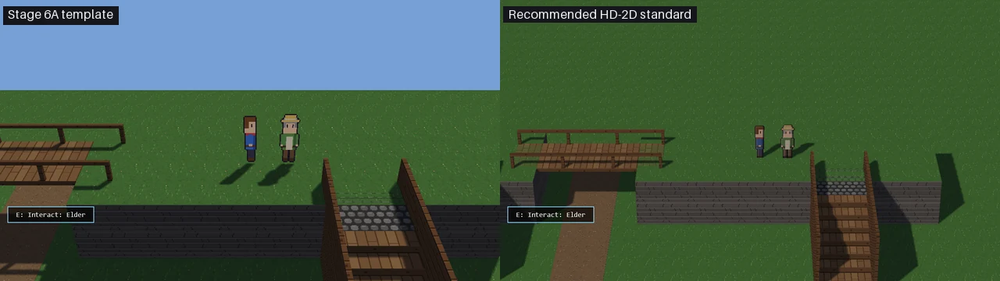
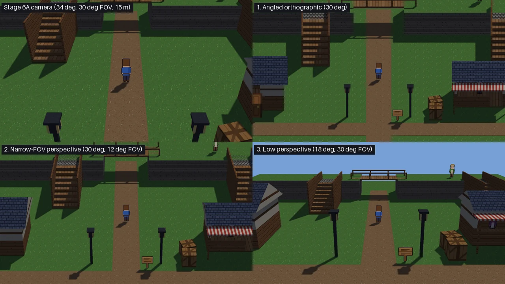
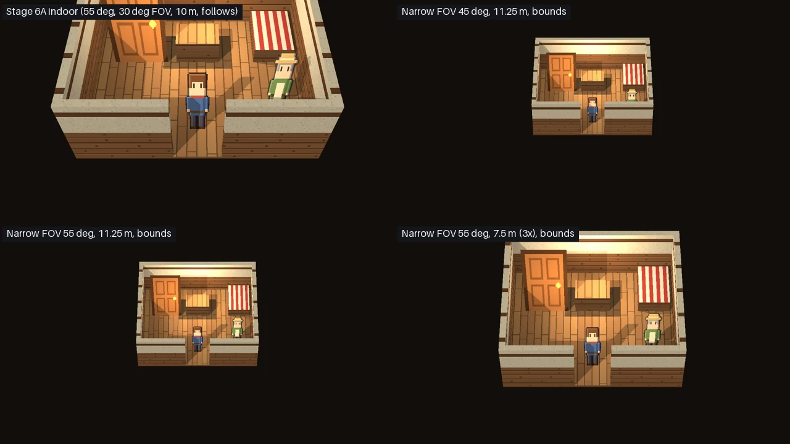
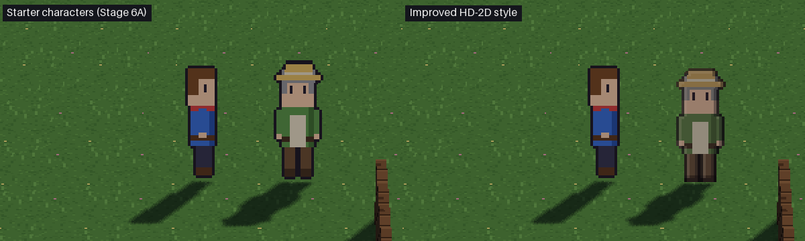
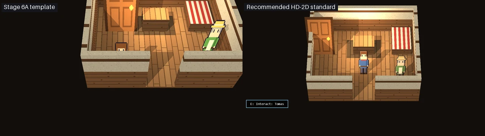

# Milestone 16: HD-2D visual direction (camera and characters)

**Verdict: PASS** (pending the owner's choice of direction; draft PR, not merged).

The owner can now compare real in-engine camera treatments and two character styles in the same village, and choose
a direction before the HD-2D template is offered to ordinary users. A study tool renders every comparison in a hidden
window: `tooling/hd2d_visual_study.py`, evidence in [the evidence folder](milestone16_hd2d_visual_direction_evidence/).

My recommendation is applied to the **developer-only** template so it can be judged as a whole; every part of it is
reversible.

- **Camera.** A long-lens (12°) perspective camera, fixed in angle, follows the player and never shows past the
  room's edges.
- **Pixel density.** The art's 32 px per metre is drawn at exactly 2× outdoors and 3× indoors on a 720-line picture.
- **Lighting.** The engine's default south-west sun lights the walls facing the camera as it lights the characters.
- **Characters.** The characters are redrawn in a muted, shaded style that shares the textures' palette.

Before (Stage 6A) and after (the recommended standard) at the same spot:

## Part A: Stage 6A integrated

- **#362 merged** into `redesign/visual-editor` as **`1cf75b8`** (a merge commit, as for #361).
  - Its head `e18a4e7` was green on Linux and Windows: push run `40213503075` and PR run `40213504533`, 9,653
    passed, 0 failed.
  - The diff was the 7 Stage 6A commits only (83 files).
  - The merge commit's tree is identical to the tested head.
- **Post-merge CI.** The push run `40214566340` is green on both OSes. #344's pull_request run on the same commit
  (`40214571672`) failed one Windows timing check; see *Windows CI timing* below.
- **Unchanged:** #344 stays a draft and `main` is untouched. The merged 6A worktree has been removed. #345 is untouched,
  and this work is not built on it.

## How the study works

`tooling/hd2d_visual_study.py <command> OUT` creates a project from the `hd2d_rpg` template.

- **The baseline.** Every comparison starts from the Stage 6A look: its cameras, sun, characters, village extent and
  cottage spots. Only the one variable under study changes.
- **The walk.** The player follows one key-driven route and stops at the same spots: the village centre, half-way up
  the stairs, on the bridge, beside the Elder, beneath the bridge, beside the cottage, behind the cottage, inside the
  cottage. The camera never turns, so every treatment visits exactly the same positions.
- **The picture.** Hidden 1280 × 720 window.
- **Measured at each spot:**
  - empty background (the sky colour), as a share of the picture;
  - the player's height on screen;
  - how much of the player is hidden;
  - the camera's target.
- **Also measured:**
  - a movement clip;
  - the frame cost, split into game update, drawing, GPU and picture read-back;
  - GPU light probes;
  - a CPU profile.

| Command | Compares |
|---|---|
| `cameras` | The three camera treatments plus the Stage 6A camera, with lighting, characters and geometry unchanged |
| `sprites` | The starter characters and the improved style under the preferred camera |
| `lighting` | Stage 6A's sun and the engine's default sun |
| `indoor` | Indoor cameras in the cottage |
| `cost`, `play_cost`, `profile` | Rendering cost per camera; what Stage 6A's "21 ms" contained; where a frame's time goes |
| `recommended` | The template as it now ships, beside Stage 6A |

## Part B: camera treatments

To compare angle and projection rather than zoom, the three treatments all show **11.25 m** of the world top to
bottom at the player. That is 64 px per metre on a 720-line picture: exactly 2× the art's 32 px per metre.

| | Pitch | Projection | Distance | Background, bridge / village centre | Size: bottom vs top edge | Player on screen |
|---|---|---|---|---|---|---|
| Stage 6A camera | 34° | perspective, 30° FOV | 15 m | 32% / 0% | 2.32× | 118 px (2.8×, uneven pixels) |
| 1. Angled orthographic | 30° | orthographic | (21 m) | 35% / 0% | 1.0× | 84 px (2×) |
| 2. Narrow-FOV perspective | 30° | perspective, 12° FOV | 53.5 m | 37% / 0% | 1.45× | 84 px (2×) |
| 3. Low perspective | 18° | perspective, 30° FOV | 21 m | 50% / 22% | 10.4× | 84 px (2×) |

**Pictures:**

- side by side: [village centre](milestone16_hd2d_visual_direction_evidence/compare_establishing.webp),
  [stairs](milestone16_hd2d_visual_direction_evidence/compare_stairs.webp),
  [bridge](milestone16_hd2d_visual_direction_evidence/compare_bridge.webp),
  [beside the Elder](milestone16_hd2d_visual_direction_evidence/compare_npc.webp),
  [under the bridge](milestone16_hd2d_visual_direction_evidence/compare_under_bridge.webp),
  [beside the cottage](milestone16_hd2d_visual_direction_evidence/compare_cottage.webp),
  [behind the cottage](milestone16_hd2d_visual_direction_evidence/compare_behind_cottage.webp),
  [inside](milestone16_hd2d_visual_direction_evidence/compare_inside.webp);
- movement, all four at once (west stairs, across the bridge, to the Elder):
  [walk.webp](milestone16_hd2d_visual_direction_evidence/walk.webp).

**What each one does:**

- **Stage 6A camera.** Close, with a wide-ish lens: verticals lean hard (the lamp posts) and things near the bottom
  edge are drawn 2.3× larger than at the top. The art is magnified 2.8×, a non-integer factor, so its pixels come out
  2 or 3 screen pixels wide and look smeared. This is the "technical 3D demonstration" look.
- **1. Angled orthographic.** No perspective: equal sizes everywhere and perfectly square pixels at 2×, a clean tabletop
  look. It is also the flattest: stairs read as a ladder seen head-on, and side walls disappear, so height comes only
  from shadows.
- **2. Narrow-FOV perspective (recommended).** Almost orthographic at the player, so the art is crisp 2× there.
  - It keeps real depth cues: the sides of the stairs, the cottage and the plateau show and converge slightly. This is
    what makes a diorama read as 3D, and it is closest to the HD-2D look the owner described.
  - Its cost is a 1.45× size change from the bottom to the top edge. A character at the top of the picture is drawn at
    about 1.7× instead of 2×.
- **3. Low perspective.** The most cinematic: tall facades and a sense of scale. The horizon is just out of view, but a
  near-horizontal view means everything beyond the village shows: 22–50% of the picture is empty sky with this
  geometry. Characters near the bottom are 10× larger than at the top. It would need backdrop scenery the kit doesn't
  have.

**The other criteria:**

- **Yaw.** It is fixed at 0 (looking north) in every treatment. The gameplay camera never orbits.
- **Stairs, bridges and underpasses.** The follow target rises with the floor the player stands on, 2.0 m from ground
  to bridge in every treatment, so the composition stays put. During the walk the player stayed within 27–33 px of the same screen height (the Stage 6A camera:
  within 46 px).
- **Under the bridge.** The player is 80–88% visible beneath the deck. The low camera sees under it fully.
- **Behind a building.** The player is **0% visible** directly behind the cottage in every treatment. No pitch below
  about 60° clears a 4 m roof from 1 m away. See *Remaining limitations*.

## Gameplay camera behaviour: bounds (new, opt-in)

The camera comparison shows that the sky problem is not the angle but **the edge of the world**. At the bridge,
every treatment shows 32–50% empty background.

`settings.hd2d.camera.bounds` (`[x0, y0, x1, y1]` in px) keeps the follow camera's view inside a rectangle.

- **Inside the rectangle.** Where it is larger than the view, the camera follows and stops at its edges, as 2D RPG
  cameras do.
- **A small rectangle.** Where it is smaller than the view (a small room), the camera stays still and centred.
- **How.** `engine.hd2d.renderer.fit_view` computes the picture's footprint on the floor from the camera's own rays,
  so it works for orthographic and perspective cameras alike. It leaves a view that reaches the horizon alone.
- **Unchanged:**
  - **Existing rooms.** It is opt-in, so they behave as before.
  - **Studio's free editing camera.** It is separate and untouched.
  - **Scripts.** A script can still change the game camera's pitch, distance or lens: the bounds use the live camera.
    That is the hook for future scripted camera moves, without a cinematic system.

**What it showed about content.** A long lens looking 30° down sees about 16–20 m of ground beyond the player (more
from a 2 m plateau). Stage 6A's village ended 8 m north of its hills. With bounds, the camera had to stop well short,
and the player ended up 76 px from the top of the picture. The real fix is level content, and that is the standard I
recommend:

> An outdoor room's ground and scenery extend at least the view's reach beyond anywhere the player can stand (for
> the recommended camera: about 9 m east and west, 4 m south and 12 m north of a 2 m-high walkway), and its camera
> bounds are that ground.

The template's village now reaches 12 m further north (40 × 44 m, open grass to build on; nothing moved). With its
bounds, the recommended camera shows **0% background at every spot**, with the player at the same height on the
picture everywhere except near the south and west edges. [Evidence](milestone16_hd2d_visual_direction_evidence/recommended.json)

## Indoor composition

[Door](milestone16_hd2d_visual_direction_evidence/indoor_door.webp) and
[1.6 m east](milestone16_hd2d_visual_direction_evidence/indoor_east.webp), the same lighting and room:

| | Behaviour | Player on screen |
|---|---|---|
| Stage 6A indoor (55°, 30° FOV, 10 m, follows) | the room slides with the player and is cropped at the edges | 183 px (about 4.5×) |
| Narrow FOV 45°, 11.25 m view, bounds | still, centred, small; the south wall hides more of the floor | 82 px (2×) |
| Narrow FOV 55°, 11.25 m view, bounds | still, centred, small | 82–84 px (2×) |
| **Narrow FOV 55°, 7.5 m view (3×), bounds** | still, centred, the room fills the picture | 124–127 px (3×) |

- **Pitch.** The cottage's walls are 2.2 m high. At 30° the south wall would hide 3.8 m of its 5 m floor, so one pitch
  can't serve indoors and out. At 55° it hides about 1.5 m.
- **Stage 6A's arrival spot was in that hidden strip.** Arriving, the player was 0–24% visible. The template now starts
  and arrives the player in the middle of the room (the inside door moved to the west wall, 3.3 m away), fully visible.
- **Recommended indoor default:** the same 12° lens, 55° pitch, the room as bounds, and a 7.5 m view (an exact 3× at
  720 lines).
- **Recommended asset standard for future interiors:** walls on the camera's side at most 1.2 m high (a cut-away),
  and the player's spots at least 1.6 m from them.

## Part C: character and environment cohesion

Why the Stage 6A characters looked pasted on, measured:

| Cause | Measured | Fix (or option) |
|---|---|---|
| **Lighting.** The template's sun was in the north-east, behind the scene, so every wall facing the camera got only ambient light. Billboards take a fixed share of the sun regardless. | GPU probe at the village centre: character **0.694**, camera-facing wall **0.311** (2.2× darker). Beside the cottage the character stood in the cottage's own shadow. | The engine's default sun (south-west, high): wall 0.592, character 0.694 (1.17×). [Pictures](milestone16_hd2d_visual_direction_evidence/lighting_cottage.webp), [close-up](milestone16_hd2d_visual_direction_evidence/lighting_close_cottage.png) |
| **Non-integer magnification** | 2.8× at the Stage 6A camera: art pixels drawn 2 or 3 screen pixels wide | A camera chosen for an exact 2× / 3× at the player |
| **Palette** | The sprites' main colours were saturated (the hero's tunic: saturation 0.58) and the brightest things in the scene (skin lightness 0.79). The kit's textures sit at saturation 0.1–0.45, lightness 0.2–0.67. | The improved style's palette sits within the textures' range |
| **Outline** | A near-black 1-px outline is 30% of the hero's opaque pixels; nothing in the environment has outlines | Outlines in a darker shade of the colour they edge |
| **Shading** | Flat fills with one shade strip, against shaded geometry | Three tones, lit from the upper left (matching the default sun) |
| **Ground contact** | Feet end 2 px above the frame's bottom: the character floats about 6 cm | Feet on the bottom row |
| **Height** | Unchanged and correct: on screen a character is 1.25 m against a 2.0 m doorway (1.73 m foreshortened), a ratio of 1.38 | Keep |
| **Billboards** | Upright, facing the camera's direction, stretched 1 / cos(pitch) so their pixels stay square on screen; shadows cast by the sun; lamps lit. No surface normals, so no directional shading on the character itself. | *Option (not built):* normal maps for sprites, or a per-sprite "front/back light" term in `light_at`. With the default sun, baked shading in the art is enough. |

**The improved style** is one original style in `tooling/make_starter_art.py`. It applies three palettes, giving
`hd2d_hero.png`, `hd2d_villager.png` and `hd2d_merchant.png`.

- **What it keeps:** the same figures, frames and four-direction animation (4 × 4 sheets of 32 × 48), so nothing else
  changes.
- **What it changes:**
  - muted colours;
  - three-tone shading;
  - selective outlines;
  - feet on the bottom row;
  - left-facing frames drawn rather than mirrored, so the light stays on the left.
- **Existing sheets.** They rebuild byte-identical.

**Comparison:** under the preferred camera and Stage 6A's lighting, so only the characters differ:
[village centre](milestone16_hd2d_visual_direction_evidence/sprites_establishing.webp),
[beside the Elder](milestone16_hd2d_visual_direction_evidence/sprites_npc.webp),
[beside the cottage](milestone16_hd2d_visual_direction_evidence/sprites_cottage.webp),
[stairs](milestone16_hd2d_visual_direction_evidence/sprites_stairs.webp),
[inside](milestone16_hd2d_visual_direction_evidence/sprites_inside.webp).
Close-ups at 2× (nearest):
[beside the Elder](milestone16_hd2d_visual_direction_evidence/sprites_close_npc.png),
[beside the cottage](milestone16_hd2d_visual_direction_evidence/sprites_close_cottage.png).

**Honest assessment.** The style change is subtler than the lighting change. On its own, under the north-east sun, the
improved characters read a little dull. With the default sun they sit in the scene as the environment does
([recommended close-up](milestone16_hd2d_visual_direction_evidence/recommended_close_npc.png)). The biggest single
improvement is the lighting, then the integer scale, then the style.

## Part E: recommended defaults

| | Recommendation |
|---|---|
| **Outdoor gameplay camera** | Perspective, **12° FOV, 30° pitch**, 11.25 m of world top to bottom at the player (distance 53.5 m), following the player, **bounds = the room's ground**. Orthographic at 30° is the alternative for a flatter, pixel-exact look. |
| **Indoor camera** | The same lens, **55° pitch**, a **7.5 m** view, bounds = the room (still and centred). |
| **Orientation and follow** | Yaw fixed (north); no orbit. Smooth follow, as now (about 8/s). The target rises with the floor the player stands on. The camera stops at the room's edges. Scripts may change the live camera. |
| **Character proportions** | Keep the 32 × 48 frame with a figure about 41 px tall (1.25 m on screen against a 2 m door, a ratio of about 1.4). Feet on the bottom row. Big heads (about 3 heads tall) read well at 2×. |
| **Character style** | Palette within the environment's saturation (≤ 0.45) and lightness (0.2–0.75). Three tones lit from the upper left. Outlines a darker shade of what they edge, never black. Left and right frames drawn, not mirrored. |
| **Environment pixel density** | **32 px per metre** for every texture and sprite (the kit already is). Drawn at an exact multiple: 2× outdoors and 3× indoors at 720 lines (3× / 4.5× at 1080). Shadow maps should keep at least 32 texels per metre (a 2048 map covers up to 64 m). |
| **Lighting** | Key light high from the south-west (behind the camera, to its left): Mesh's default sun. Lamps as now. |
| **Level content** | Ground and scenery beyond the walkable area by the camera's reach; interiors with cut-away camera-side walls; key spots away from them. |

**Studio controls creators should eventually see** (none are built in this stage):

- **Camera:** Zoom (visible height at the player, in metres, snapped to whole pixel multiples); Angle (pitch);
  Lens (perspective FOV, or Flat for orthographic); Edges (bounds: the room's ground, a drawn rectangle, or none).
- **Room lighting:** Sun direction as a compass and a height, rather than a vector.
- **Hidden:** the raw `distance` and `height` stay out of view (derived from Zoom).

## Applied to the developer-only template

`engine/hd2d/starter_village.py` now writes the recommended standard:

- **Village:** the 12° camera with bounds; the default sun; extended 12 m north.
- **Cottage:** the indoor camera with bounds; the player's start and arrival moved clear of the south wall; its inside
  door moved to the west wall.
- **Characters:** the improved style for every character, and for Studio's Person object.

The 2D templates are unchanged. Before and after, at every spot:

- [village centre](milestone16_hd2d_visual_direction_evidence/recommended_establishing.webp),
  [stairs](milestone16_hd2d_visual_direction_evidence/recommended_stairs.webp),
  [bridge](milestone16_hd2d_visual_direction_evidence/recommended_bridge.webp),
  [beside the Elder](milestone16_hd2d_visual_direction_evidence/recommended_npc.webp),
  [under the bridge](milestone16_hd2d_visual_direction_evidence/recommended_under_bridge.webp),
  [beside the cottage](milestone16_hd2d_visual_direction_evidence/recommended_cottage.webp),
  [behind the cottage](milestone16_hd2d_visual_direction_evidence/recommended_behind_cottage.webp),
  [inside](milestone16_hd2d_visual_direction_evidence/recommended_inside.webp);
- full-size, lossless:
  [village centre](milestone16_hd2d_visual_direction_evidence/after_establishing.webp),
  [beside the Elder](milestone16_hd2d_visual_direction_evidence/after_npc.webp),
  [inside](milestone16_hd2d_visual_direction_evidence/after_inside.webp),
  [Stage 6A, village centre](milestone16_hd2d_visual_direction_evidence/before_establishing.webp);
- movement with the recommended standard (west stairs, across the bridge, to the Elder):
  [after_walk.webp](milestone16_hd2d_visual_direction_evidence/after_walk.webp).

The Stage 6A editing and play workflow (`tests/test_hd2d_starter_gpu.py`) passes unchanged with all of this:

- moving a building and placing a person in 3D;
- changing a lamp and accepting an AI proposal;
- save and reopen;
- stairs, bridge, underpass, three conversations, the sign, the door, quick save and load.

## Part F: performance

**What Stage 6A's "21 ms game frame" was.** `tooling/hd2d_starter_demo.py` timed the harness's
`StudioDriver.frame()` in Mesh Studio's Play mode, which covers:

- the game's update and drawing;
- Studio's own interface drawn over it;
- the harness reading the whole 1280 × 720 picture back into a PIL image, about 4 ms;
- and **with `tracemalloc` running**: the demo was measuring Python's peak memory at the same time.

Re-measured ([play_cost.json](milestone16_hd2d_visual_direction_evidence/play_cost.json)): the same driver frame
takes **12.0 ms without `tracemalloc` and 18.8 ms with it**. It is not a rendering figure. The 21 ms should not
become an FPS target.

**The real frame,** the game alone at the village centre, split (medians; laptop GPU, hidden window):

| Part | ms |
|---|---|
| Game update (movement, behaviours, interface logic) | 0.8 |
| Drawing, CPU (of which the HD-2D renderer: 3.4) | 4.2 |
| Waiting for the GPU | 0.2–2.0 |
| **Frame** | **3.6–7.6** (p95 6–17) |
| (Harness picture read-back, not part of a game frame) | 3.7–5.2 |

- **Where the CPU time goes** ([profile.json](milestone16_hd2d_visual_direction_evidence/profile.json)). The largest
  single item, **3.5 ms of a frame**, is pyglet's OpenGL error check after every GL call (`pyglet.gl.lib.errcheck`;
  pyglet's `debug_gl` option, on by default).
  - That is more than all of the HD-2D renderer's own Python.
  - Turning it off in release builds would be a one-line, engine-wide change with a cost: GL errors would no longer
    raise. It is not made here; it is the first candidate if an FPS target is set.
- **Cost of each camera** ([cost.json](milestone16_hd2d_visual_direction_evidence/cost.json); three interleaved
  rounds of 240 frames, the recommended template included):
  - Every treatment draws the same 29 draw calls and 1,372 triangles, with the same shadow work: the sun's shadow map
    covers the room, not the view.
  - Medians, round by round: Stage 6A 3.8–7.0 ms, orthographic 3.6–6.4, narrow 3.6–7.2, low 3.6–6.5, and the template
    as it now ships 3.8–6.5.
  - The spread between rounds (about 2×) is larger than any difference between cameras. No treatment is measurably
    more expensive.
- **The recommended template against Stage 6A,** interleaved: no systematic difference (above). Its larger
  village ground leaves the sun's shadow map at about 46 texels per metre, above the art's 32. In the single `recommended`
  run the frames were 5.4 ms (Stage 6A) and 7.2 ms (recommended), within the run-to-run spread.

## Windows CI timing

It recurred, and I investigated without changing any budgets.

- **Two failures.** #344's pull_request run on `d804e31` exceeded `pytest-fast` (125.4 s against 121.8 s). On
  `1cf75b8` it exceeded `exception-policy-scan` (3.97 s against 3.74 s). Both times, the push run on the same commit
  passed.
- **Every step was slower, not one.** Comparing every verify-all step of the push and pull_request runs on `1cf75b8`,
  the pull_request runner was slower at every step: 173 s in total against 130 s (+33%). `pytest-fast` ran 113 s
  against 89 s, `mypy-gate` 15.7 s against 11.1 s, `verify-demo` 23.2 s against 14.5 s.
- **Over six runs,** Windows `pytest-fast` took 66–125 s (median about 87 s).
- **Not a regression.** No step grew; one runner was slow.
- **Why it keeps tripping.** Per-step budgets with a fixed 1.25–1.3× allowance will trip whenever a Windows runner is
  about 30% slower than usual.
- **A possible fix (the owner's call):** judge each step against the same run's speed. For example, scale the
  thresholds by the run's total relative to its baseline, or compare a step's share of the run rather than its
  milliseconds.

## Tests

| Suite | Result |
|---|---|
| `tests/test_hd2d_camera_bounds.py` (new, fast) | 5 passed: the view stays inside a large room (orthographic and long-lens); a small room is centred and still; the horizon case is left alone; bounds validated |
| `tests/test_hd2d_starter_template.py` (fast) | 11 passed. New: the template follows the visual standard (cameras, bounds, sun, every character and the Person object in the HD-2D style); the sprite inventory is updated |
| `tests/test_hd2d_visual_standard_gpu.py` (new, GL-gated) | 3 passed: 0% background at the south edge, centre and on the bridge; the composition holds; the player is exactly 82 px (2 × 41) outdoors and within 5% of 3× indoors; the interior is still while the player walks |
| `tests/test_hd2d_starter_gpu.py` (GL-gated, Stage 6A workflow) | 9 passed, unchanged |
| All GPU suites, hidden windows | 114 passed, 1 skipped (the Stage 1 lab test, which needs NumPy) |
| Fast tier | 4,549 passed, 0 failed |
| Ruff gate, mypy gate, type-ignore ratchet | ok (no new `type: ignore`) |
| #359's replay goldens | untouched |

## Remaining visual limitations

- **Characters behind buildings are hidden.** At any gameplay pitch, the player directly behind the cottage is fully
  hidden. HD-2D games fade or cut away the occluding roof. *Option:* fade structures between the camera and the
  player, using the renderer's visibility measure, which already exists.
- **No backdrop scenery.** Beyond the ground the kit has nothing (no trees, distant hills or cliffs). The low
  cinematic camera depends on it; the recommended one avoids needing it by keeping the view on the ground.
- **The long lens's size change.** Characters near the top edge are drawn at about 1.7×, near the bottom about 2.4×.
  Orthographic avoids this at the cost of depth.
- **Characters have no directional shading in the engine.** It is baked into the art (lit from the south-west); a
  character walking past a lamp is lit, but not from one side. Sprite normal maps are an option.
- **Interior walls are full height on the camera's side.** The cottage interior's south wall still hides 1.5 m. The
  cut-away standard applies to new interiors; the kit model is unchanged.
- **Indoor and outdoor scales differ (3× and 2×).** Characters grow when you walk in. That's intended for small
  rooms; a large hall could stay at 2×.
- **No depth of field, tilt-shift, bloom or other post-processing,** per the brief. Those are a large part of
  Octopath's look, and the owner may want them later.
- **Studio camera controls aren't built.** The settings are data for now; recommended controls are above.
- **Stage 6B inventory.** The HD-2D template now ships `hd2d_hero.png`, `hd2d_villager.png` and `hd2d_merchant.png`
  instead of `starter_merchant.png`. Stage 6A's distribution list needs that update.

## Stopping point

The draft PR targets `redesign/visual-editor` and is not merged. The template stays developer-only. Stage 6B, weather
and cinematic post-processing are not started.
