# Milestone 16 Stage 5B: Blender asset pipeline and HD-2D asset management

**Verdict: PASS** (pending owner review; draft PR [#361](https://github.com/septimus82/Mesh/pull/361), not merged).

A creator can import an original Blender GLB into Mesh Studio, browse and place it, update it safely from Blender
with its collision and placed copies kept, and play-test the room, without editing JSON. That was shown in a hidden
window through Studio's own events, with models exported by Blender
([evidence](milestone16_stage5b_evidence/pipeline_check.json)).

The goal: **Blender → export GLB → import into Mesh Studio → preview → place → edit → play**, for ordinary
creators, without hand-editing JSON or copying files.

## Part A: the repository health checkpoint, finalised

- **#358 merged** into `redesign/visual-editor` as **`5a759cf`**.
  - Its head `1431089`, scope (64 files, the checkpoint's commits only) and last CI were checked first.
  - The merged tree is identical to the PR head.
- **CI after the merge:** green on Linux and Windows, in both runs on `5a759cf`:
  - push run `40199257335`, and the draft #344 run `40199260952`;
  - every job passed: full tests, `verify-all` with enforced step budgets, the baseline diff, the release bundle,
    `arcade3-canary` and `web-smoke`.
- **Issues closed with evidence:**
  - **#351:** the GPU-gated test passes on the merged tree, 12/12;
  - **#352:** all 26 failures are resolved and the CI runs above are green;
  - **#360:** closed by hand, since a PR to a non-default branch doesn't auto-close issues.
- **Known debt, still tracked:**
  - **#359:** the release replay goldens; not re-recorded;
  - **#356:** 2D GPU buffers;
  - **#357:** pip-installed exports;
  - **#345:** packaging, still a draft;
  - replacing the three unverified starter sprites with original art.
- **Untouched:** #344 is still a draft; `main` was not changed.

## Starting point (what already exists, and is reused)

| Piece | Where | Reused for |
|---|---|---|
| GLB reader (static meshes, embedded PNG textures, samplers, `mesh_collision` extras) | `engine/hd2d/glb.py` (`load_glb`, `GlbError`, `model_problem`, `contained`) | validating an import, its preview and its report |
| One path rule for HD-2D assets | `engine/hd2d/settings.py` `asset_path`, plus `glb.contained` (links followed) | where an imported model may live |
| Scene representation | `settings.hd2d.structures[]`: `{id, model, x, y, elevation, rotation, scale}` | unchanged; instances keep pointing at a model path |
| Placing and editing structures | `project_ops.place_structure` / `set_structure` / `remove_structure`, through `Studio._edit` (one undo step) and `authoring` (AI) | "Place in scene", AI placement |
| The 3D view, ghost preview, picking | `engine/studio_hd2d.py` (`Hd2dView`, `start_placing`, `set_preview`) | placing from the browser |
| File imports into a project | `Project.import_sprite` / `import_tileset` (`engine/studio_project.py`): slugged names, never overwrite, written straight away (not undo) | the same pattern for models |
| Import panel | `Studio._import_panel`: typed path (Enter applies) + Browse... (`ask_path`), live check, preview, Import / Cancel | the model import panel |
| Thumbnails | `Studio._thumbs` + `_draw_previews` (PIL images drawn over the UI, cached textures) | model thumbnails |
| Shared authoring + AI review | `engine/authoring.py` (ops from `project_ops`, `_bind` checks `model`), `engine/studio_ai.py` (stage, then a person accepts) | AI reads the catalogue, places and transforms; the person accepts |

Nothing like a per-asset catalogue or provenance record exists yet (the repo has `NOTICE` files and a build
provenance record, not per-asset metadata); Studio has no model import (it told creators to export into `assets/`).

## Architecture

**One asset module, no parallel system.** `engine/hd2d/catalog.py` is the project's structure catalogue and the only
code that writes model files into a project. `Project.import_model` / `reimport_model` call it (beside
`import_sprite` and `import_tileset`); Mesh Studio's panels call the Project; AI tools read the catalogue and place
through the existing `place_structure`.

**Storage.**

- Models are copied to `assets/models/<id>.glb`.
- Their previews go to `assets/models/previews/<id>.png`.
- The catalogue is `assets/models/catalog.json`:

```json
{"schema_version": 1, "models": [{
  "id": "cottage", "model": "assets/models/cottage.glb", "name": "Cottage", "category": "Buildings",
  "preview": "assets/models/previews/cottage.png", "scale": 1.0, "rotation": 0.0, "pixels": "sharp",
  "collision": {"solid": 1, "floor": 0, "wall": 4}, "floors": ["floor"],
  "notes": "", "license": "CC0 (made for this project)",
  "source": {"file": "D:/art/cottage.glb", "sha256": "…", "imported": "2026-10-25T12:00:00Z"}}]}
```

- **Everything in an entry is optional except `id` and `model`.** A `.glb` that is in the project but not in the
  catalogue (every Stage 1–5A project) is listed with defaults (its file name, category "Uncatalogued"), and works
  exactly as before.
- **Older scenes are unaffected:** they still name the model path, and nothing about them changes.
- **Instances share one file:** every placed copy names the same `model` path, so there is no per-instance copy, and
  the renderer already reads each model once per room.

**Import** (`catalog.import_model(root, source, …)`):

1. **Validate the source file first, where it is.** `load_glb` must read it (the same reader as the game). The
   report lists:
   - parts, triangles, bounds in metres;
   - materials and textures (size and filtering);
   - colliders by kind and name (the floor identities);
   - anything unsupported, refused with the reader's message.
2. **Refuse:** anything that isn't a readable `.glb`; an unsafe or out-of-project destination (`asset_path` +
   `contained`); a name that would overwrite another model. An existing id gets a numbered id (`cottage_2`); the
   same bytes as an already imported model are reported as "already imported as …".
3. **Pixel art.** With "keep pixels sharp" (the default), a texture that Blender exported as *Linear* gets a
   NEAREST sampler in the stored copy. Only the GLB's JSON chunk changes; the binary data is untouched. The report
   says which textures changed. Blender's default image interpolation is Linear, so without this a creator's
   PixelLab texture comes out blurred.
4. **Stage everything, then commit.** The model copy, the preview PNG and the catalogue entry are all written beside
   their targets under temporary names, checked (the copy is read back with `load_glb`), and only then moved into
   place. Any failure removes the temporary files and leaves the project as it was.

**Reimport** (`catalog.reimport_model(root, id, source)`): explicit, from the asset's details ("Reimport from
Blender...", defaulting to the recorded source file).

1. **Check first.** The new file is validated like an import. Before anything is written, it is compared with the
   current model:
   - colliders added, removed or changed kind;
   - floor identities (`<structure>/<node>`) gained or lost;
   - bounds;
   - in every room that uses the model, characters that stood validly and no longer would, and navigation cells
     lost (`engine.hd2d.world.World` with the old and new models).
2. **Swap safely.** The same staging as an import, plus backups of the files it replaces (the model, its preview,
   the catalogue), restored if any step fails.
3. **Instances keep their ids and transforms.** Scenes aren't edited at all.
4. **Studio reloads the room.** That rebuilds the renderer and the world, which releases the old GPU objects (Stage 2
   ownership) and reads the new geometry and collision together. If the room then fails to build, the previous
   files are restored and the room is reloaded again.

**Browser.** Studio's "Add a structure..." panel becomes the **Models** browser:

- import, search (name, category, notes);
- rows with a thumbnail, name, category and how many copies are placed in this room;
- the selected model's details: a larger preview, its facts, collision, provenance and properties;
- **Place in scene** (the existing ghost placement, now using the model's default turn and scale);
- **Reimport**.

The 2D picture picker no longer lists model previews.

**Thumbnails** are drawn on the CPU (`engine/hd2d/thumbnail.py`): a small z-buffered rasteriser over the model's own
textured triangles, from the view the editor opens with. They are made once at import or reimport and saved as
PNGs, so the browser costs no GPU work and no extra renderer, and tests can check them without OpenGL.

**AI.**

- `read_project` gains `models`: the catalogue as listed (id, model path, name, category, collision, default turn
  and scale, missing or unusable).
- Any change's `model` may name a catalogue id instead of a path (`_bind` resolves it, then validates as before).
- AI tools place and transform through `place_structure` / `set_structure`, as proposals the person accepts in
  Studio's review panel.
- There is deliberately no AI file import: AI can't write or overwrite project files, or accept its own proposals.

## Blender export requirements (exact)

What Mesh reads, and what the import report checks:

| Setting (Blender 4, File > Export > glTF 2.0) | Value | Why |
|---|---|---|
| Format | **glTF Binary (.glb)** | One file, textures embedded. A `.gltf` + `.bin` export is refused. |
| Include > Custom Properties | **On** | Carries `mesh_collision` to the node's `extras`: no collision without it. |
| Transform > +Y Up | On (the default) | Mesh turns glTF's Y-up into its own Z-up. |
| Mesh > Apply Modifiers, UVs, Normals | On | What is drawn is the evaluated mesh, its UVs and its normals. |
| Mesh > Vertex Colors | Off | Ignored; the report warns. |
| Compression (Draco) | **Off** | Required extensions are refused, with a message. |
| Animation, armatures, shape keys | None (apply shape keys) | Structures are static; skins, animation and morph targets are refused. |
| Cameras, lights | Leave out | Ignored with a note; lamps are added in Mesh Studio. |

**Modelling conventions.**

- **Units and origin.** One Blender unit is one metre. The object origin is the placement point, and Z = 0 is the
  ground: Studio puts that point where you click.
- **Textures.** A base-colour texture (PNG) per material. A material with only a flat base colour is drawn in that
  colour (new in this stage; before, it was grey). Other PBR maps and texture transforms are ignored, and the report
  warns about transforms.
- **Pixel art.**
  - One 32 px tile per metre matches Mesh's 2D scale.
  - Set the Image Texture node's interpolation to **Closest**. If you forget, **Keep pixels sharp** (on by default)
    fixes the imported copy and the report says so.
  - Keep UV islands inside texel boundaries. Mesh draws without mipmaps and with NEAREST sampling, so there is no
    filtering bleed between neighbouring islands of an atlas. Tiling textures use REPEAT; clamp a texture in Blender
    (Extension: Extend) when its edge must not wrap.
- **Collision** is separate mesh objects that Mesh never draws, each with the custom property `mesh_collision` set
  to one of:
  - `solid`: walkable on its upward faces (up to 60°) and solid below;
  - `floor`: walkable on top and open underneath, like a bridge deck;
  - `wall`: blocks a body within its box.

  Each copy's floors are named `<structure id>/<object name>`, so keep collision object names stable between exports:
  reimport compares them by name.

## Import and reimport behaviour

**Import 3D model** (Studio: Models... > Import 3D model...):

- **Choosing the file.** The path is typed or browsed. Browse... is a native file dialog for people; the tests type
  the path.
- **Checked as you go, before anything is written:**
  - **the reader:** the game's own reader must read the file, so what passes here also loads in the game;
  - **the report:** size in metres, triangles, textures (size, smooth or sharp), collision counts, warnings, and
    what the stored file will be called;
  - **a picture** of the model;
  - **duplicates:** "Already imported as …" for the same bytes;
  - **refusals,** each with the reason: missing, `.gltf`, not a GLB, damaged, skinned or animated, or using required
    extensions.
- **Import:**
  - **the copy:** the file is copied to `assets/models/<id>.glb`. A file already inside the project is catalogued
    where it is, with no second copy;
  - **the catalogue:** its preview and catalogue entry are written, with name, category, licence, and the source
    path, SHA-256 and import time;
  - **unique names:** a name in use gets `_2`, so nothing is ever overwritten;
  - **one transaction:** all three files land together or none do.
- **Afterwards,** the browser opens on the new model's page, with **Place in scene** and **Reimport...**.

**Reimport** (a model's page > Reimport...):

- **The source.** It defaults to the file the model came from. You can type or browse another.
- **The report comes first** ("What changes"):
  - warnings first, then size, triangles, and colliders added, removed, retyped or reshaped;
  - characters, in any room using the model, who would be left with nowhere to stand;
  - walkable ground lost, and floors that disappear.
- **Reimport:**
  - **the swap:** model, preview and catalogue are swapped together, with rollback;
  - **the room:** it reloads, so geometry, collision and floors change together in Edit and Play, and the old GPU
    objects are released;
  - **placed copies:** every copy keeps its id, place, turn and scale, because scenes are not edited;
  - **if the room can't build** with the new file, the previous files are put back and the room reloads again.
- **A broken or unreadable export** is refused before anything is written, and Reimport is disabled.

**Not an undo step.** Like importing pictures and tilesets, imports and reimports write files and are not undo
steps. What makes them safe is checking before writing, never overwriting, and atomic swaps with rollback. Undo
covers everything done in rooms (placing, moving, turning, removing).

## The Studio workflow (pictures)

All taken in a hidden 1280 × 720 window from Studio's own events: typed text, clicks and drags, key presses.

| Step | Picture |
|---|---|
| Import the cottage: the report and picture before importing | 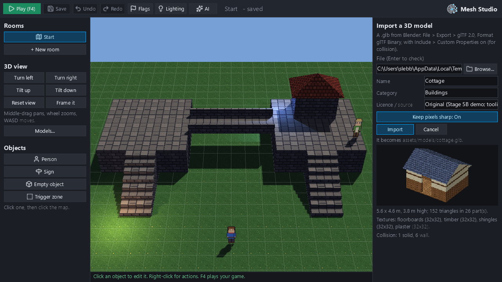 |
| Import the staircase: Blender's Linear filtering found and made sharp | 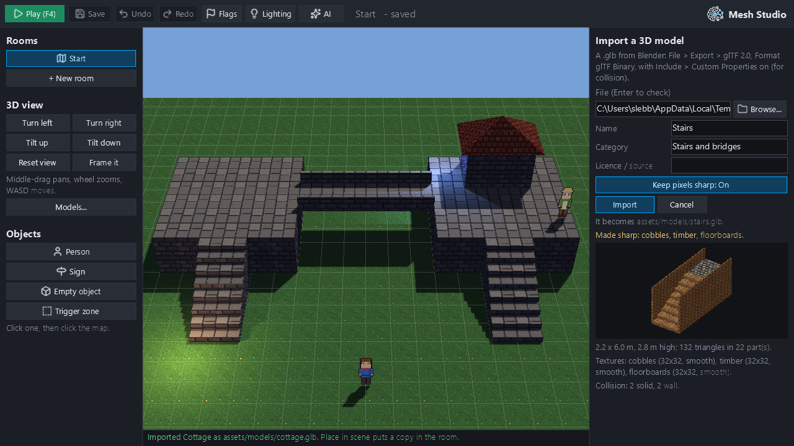 |
| The Models browser: categories, pictures, an older model (Stone Crossing) listed with defaults | 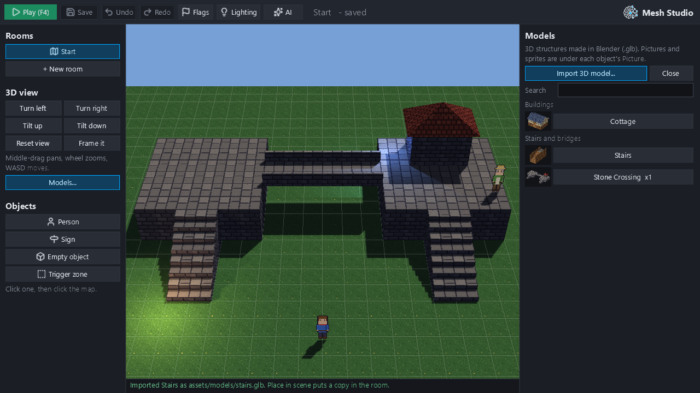 |
| Search "stair" | 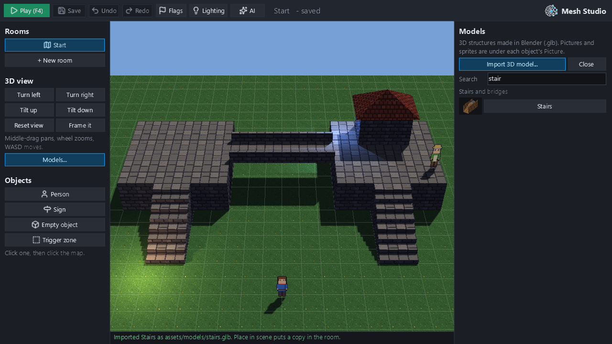 |
| The cottage's page: facts, floors, provenance, Place in scene, Reimport, editable details | 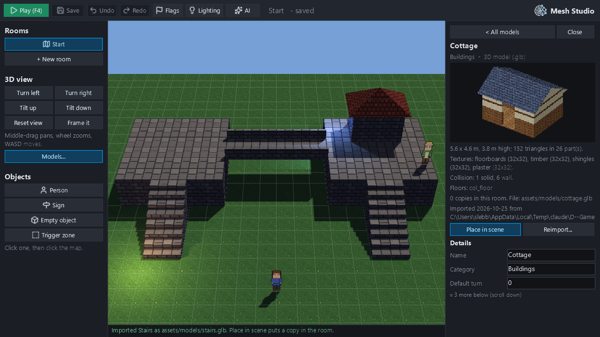 |
| Placing: the model follows the mouse | 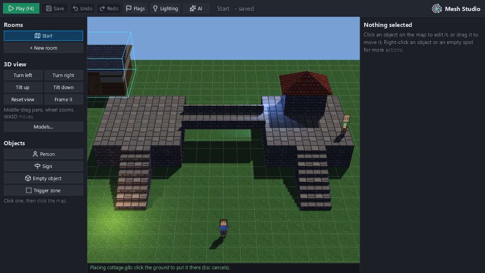 |
| Two cottages and the staircase placed | 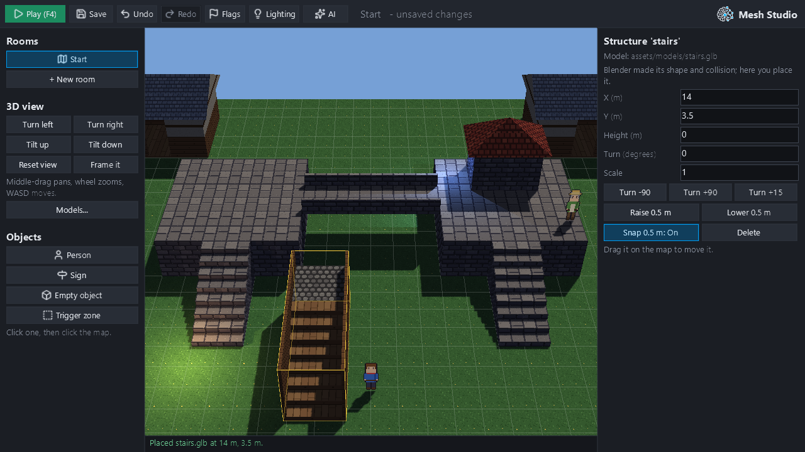 |
| One cottage dragged and turned 90° | 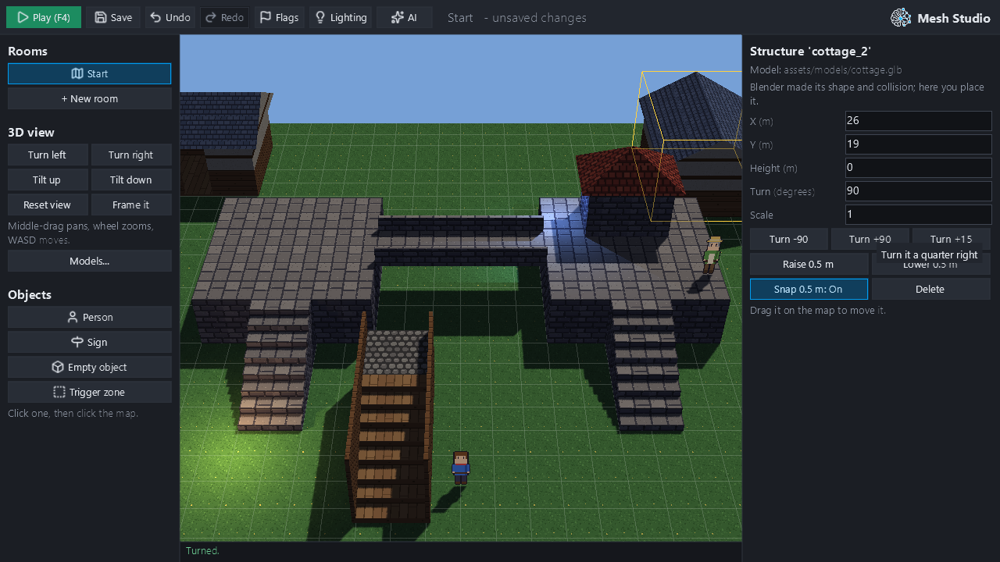 |
| An AI's proposal in Studio's review panel (a person inside a cottage; another staircase by catalogue id) | 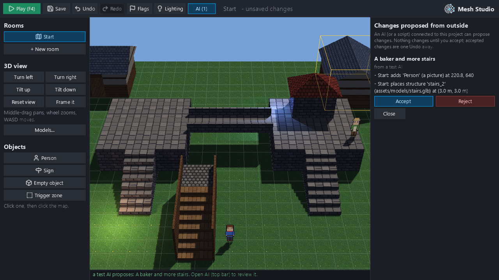 |
| Saved, Studio closed and opened again | 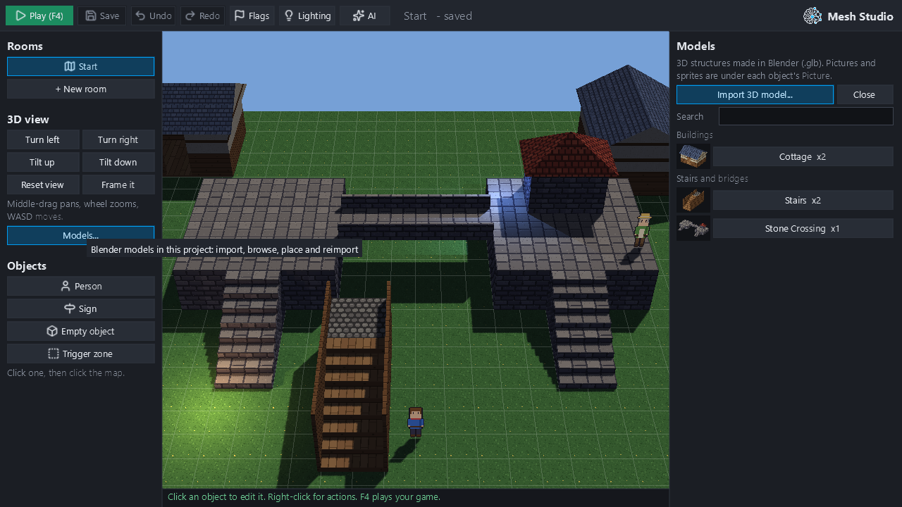 |
| Reimport after a Blender edit: what changes, with warnings first | 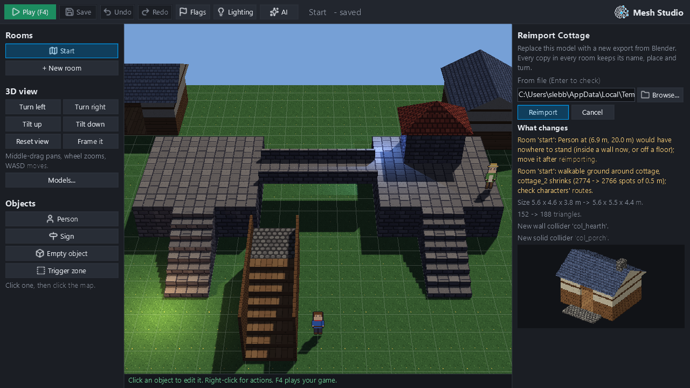 |
| Reimported: both cottages have the porch, hearth and chimney | 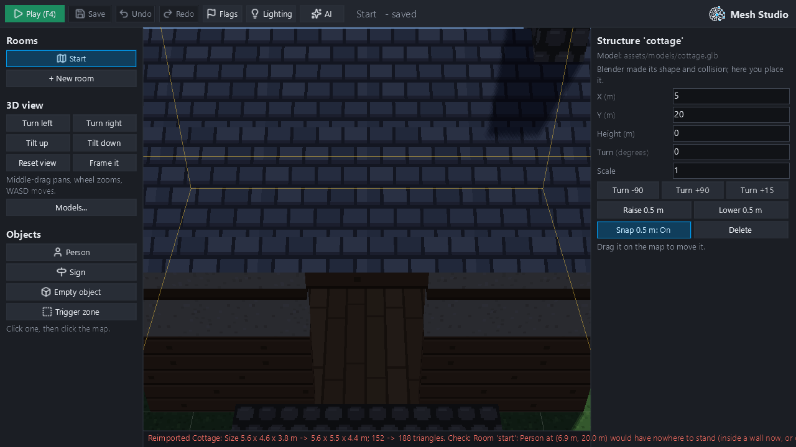 |
| A cut-off export refused; Reimport disabled; nothing written | 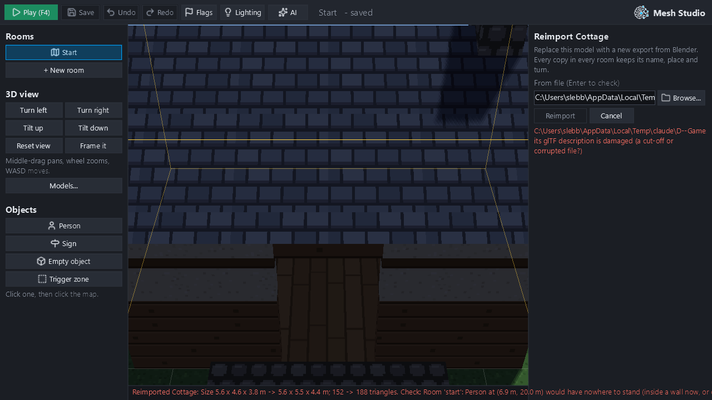 |
| Play: the player walked up the imported staircase onto its landing, 2 m up | 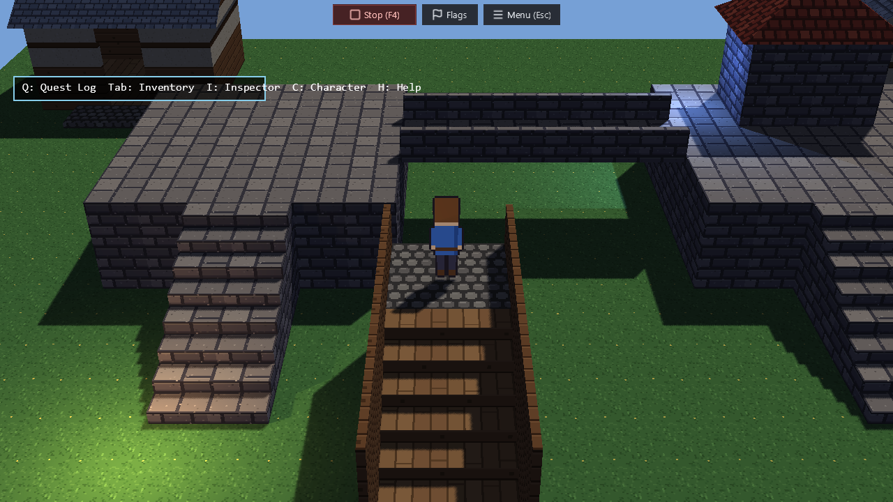 |
| The same staircase from the sharpened copy (left) and Blender's smooth export (right) | 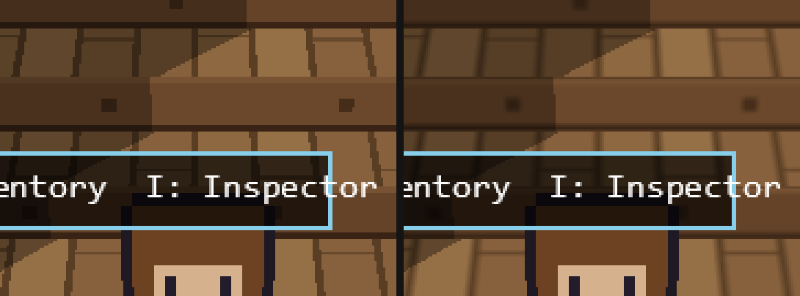 |

**What the run proved** (`pipeline_check.json`, exports built by Blender headless):

- **Imports.** The two imports wrote exactly the model, its preview and the catalogue. The staircase's three Linear
  textures were made sharp; the creator's export was untouched.
- **Placing.** Two cottages share one file. The second was picked by clicking its roof, dragged 1 m and turned 90°.
  The staircase's textures are NEAREST in both Edit and Play (GPU filters `9728, 9728`).
- **AI.** The AI read the catalogue (`cottage`, `stairs`, and the older `stone_crossing` as Uncatalogued) and
  proposed `place_structure` with `"model": "stairs"`. An unknown id, `tower`, was refused with the reason. A person
  accepted the proposal.
- **Save and reopen** kept every structure exactly.
- **Reimport** (the cottage after a Blender edit: a porch, a hearth and a chimney):
  - the plan listed the new `col_porch` (solid) and `col_hearth` (wall), the size change, and **the person who would
    now stand inside the hearth**;
  - both copies kept their ids and places, and gained `cottage/col_porch` and `cottage_2/col_porch`;
  - a character can stand on the new porch (0.15 m up) and can't stand in the hearth.
- **GPU objects across a reimport:** +1 texture (the new cobbles material), and framebuffers and programs unchanged.
  Six more reimports, alternating v1 and v2 through the same buttons, alternate exactly between two counts
  (25 and 26 textures), so nothing accumulates.
- **A cut-off export** was refused before writing. The project's model files were byte-identical afterwards. A drag
  of the staircase was undone exactly.
- **Play:** the player walked to the staircase and up it. The feet ended 6.5 m north at elevation **2.0 m** on floor
  **`stairs/col_landing`**.

## Catalogue and shared authoring

- **Human and AI share one validated path.** `place_structure`, `set_structure` and `remove_structure` (Stage 5A) are
  used by both.
- **Model references.** A `model` setting may now be a **catalogue id** (`"stairs"`) or a path. `authoring._bind`
  resolves it, then runs the same `model_problem` check.
- **What AI tools read.** `read_project` (Studio live, and from files) has a `models` list, and the MCP tool's
  description says how to place one.
- **No AI file writes.** AI tools can't import, reimport or edit catalogue files. Those are a person's actions in
  Studio. AI changes arrive as proposals in Studio's review panel, and only a person accepts them (Stage 5A's
  workflow, unchanged).

## Pixel-art textures: evaluation

Creators **do** need a filtering control. Blender's Image Texture node defaults to **Linear**, which exports as a
LINEAR sampler, and a PixelLab or Aseprite texture then renders blurred. On the same staircase and camera, the smooth
export drew **1,074** distinct colours and the sharpened copy **234** (picture 15).

The control is **Keep pixels sharp**, set at import, on by default, and remembered for reimports (`pixels` in the
catalogue). It rewrites only the stored copy's samplers, so Edit and Play read the same file and agree.

A per-structure or per-material runtime setting wasn't needed. The renderer already honours the file's sampler, and
there are no mipmaps to bleed.

## Tests and results

| Suite | Result |
|---|---|
| `tests/test_hd2d_catalog.py` (new, fast) | 25 passed. Covers: import, never overwrite, duplicates, 7 kinds of unusable file writing nothing, a model already inside the project, sharp vs as exported, links out of the project, projects without a catalogue, shared copies, missing files, a corrupt catalogue, properties, reimport report and warnings, rollback after a failure mid-swap, a reimport giving an older model an entry, flat colours, report warnings, deterministic previews, Studio project + AI by id, and a seeded damage fuzz (150 damaged GLBs: before this stage, 63 escaped as `TypeError`/`KeyError`/`AttributeError`/`IndexError`; now every one is a `GlbError` naming the file) |
| `tests/test_hd2d_asset_pipeline_gpu.py` (new, GL-gated) | 12 passed: the whole demonstration's facts, repeated reimports, and the sharp-vs-smooth render |
| All GPU suites (`tests/*_gpu.py` + background layers), hidden windows | 102 passed, 1 skipped (the Stage 1 lab test, which needs NumPy) |
| Fast tier (`tooling.pytest_fast`) | 4,524 passed, 0 failed |
| Type gate, ruff gate, type-ignore ratchet | ok (no new `type: ignore`) |
| CI on #361 at `c4e4ad0` (push `40202780804`, PR `40202796313`) | **Green on Linux and Windows.** Full pytest: 9,634 passed, 0 failed, 99 skipped; the 12 more skips than before are the new GL-gated suite, which CI doesn't run (`MESH_GL_SMOKE` is unset), and which passes locally. All `verify-all` steps and the enforced step budgets pass. The baseline diff: 0 regressions, 1 informational. The release bundle is strictly verified, 5,868/5,868 files. `arcade3-canary` and `web-smoke` pass. |

**Defects found and fixed on the way:**

- **The GLB reader let malformed files escape as other exceptions** (above). That also affected the game's scene
  loader, which only catches `GlbError`.
- **A model's import panel was taller than the window,** pushing Import below the fold. Actions and warnings now come
  before the picture.
- **The browser's inline details pushed the list off-screen.** Models now open on their own page.

## Performance

Measured in the evidence run, in a hidden 1280 × 720 window (medians):

| What | Time |
|---|---|
| Reading a model (`load_glb`) | 2.8–5.3 ms per model (staircase to crossing) |
| A model's preview picture (CPU) | 35 ms (crossing, 270 triangles), once per import or reimport |
| Opening the Models browser, **41 models** (rebuild and first draw) | 267 ms. An ordinary Studio panel measured the same way: 187 ms |
| The same before lazy rows (rebuild only) | 307 ms; after: 170 ms; an ordinary panel: 97 ms |
| Search | 131 ms |
| A model's page | 202 ms (it has six text fields) |
| Studio frame with the browser open | 15 ms |
| A room with **30 structures**: frame / edit commit | 14 ms / 274 ms |

- **Lazy rows.** `LazyRow`, a right-panel row of known height whose widgets are made only when shown, makes a long
  list cost what fits on screen. An arcade button takes about 5.6 ms to make.
- **No model cache.** Reading the room's models is about 12 ms of a 274 ms commit, and the renderer already reads
  each model once per room for all its copies. A cache would add invalidation risk for no visible gain. Studio does
  cache each model's facts and picture per file version, keyed on modification time and size, so a reimport refreshes
  them.

## Known limitations

- **No automatic Blender sync.** This is by design: reimport is explicit, and Studio doesn't watch files.
- **No "restore previous version".** A reimport isn't an undo step. The creator's Blender file is the source of
  truth, and a failed reimport writes nothing.
- **The source path is this machine's.** The catalogue records the absolute source path as provenance. On another
  machine Reimport asks for a file (the field is pre-filled and editable).
- **Supported subset.** Static meshes with base-colour textures or flat colours, plus collision.
  - Refused with a reason: armatures, animation, morph targets, external buffers or images, required extensions.
  - Ignored with a note: cameras, lights, vertex colours, texture transforms and PBR maps.
- **Previews are CPU pictures.** They show the textured model under a fixed light, not the room's lighting or
  shadows.
- **Catalogue details are written straight away.** Name, category, default turn and scale, licence and notes are
  saved as you change them, not as undo steps, like imported files.
- **Two gaps carried over from Stage 5A.** Placing characters by clicking in the 3D view isn't wired: characters come
  from the 2D view or proposals. The 3D view's default framing crops the front corners of a large room.
- **Browser cost.** Opening the browser costs about 80 ms more than an ordinary panel (the visible thumbnail rows).

## Provenance of the demonstration assets

The cottage, its v2 edit and the staircase are original. They are built by `tooling/hd2d_assets/build_cottage.py`
and `build_stairs.py` in headless Blender, from five pixel-art textures drawn in code by `pixel_textures.py`; there
is no third-party material. `tooling/hd2d_assets/PROVENANCE.md` records every asset in that folder and how to
rebuild it. Each import also records its source, SHA-256, time and licence line in the project's catalogue.
