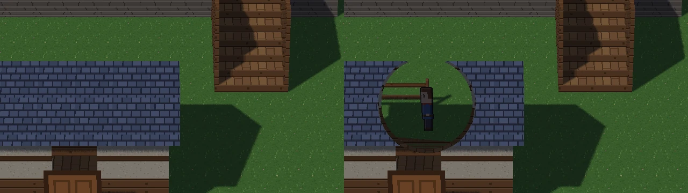

# Milestone 16 Stage 6B: installed-engine distribution

**Verdict: PASS** (pending owner review; draft PR, not merged). The HD-2D template stays developer-only until the
owner approves making it public.

A clean, pip-installed Mesh now creates, edits, plays, saves, reopens and exports the HD-2D RPG starter, outside any
repository. That was proven by `tooling/hd2d_install_acceptance.py`:

- the wheel is installed in a fresh virtual environment, with its dependencies from the package index;
- everything runs from an empty folder, with every repository and Mesh variable cleared, in hidden windows only;
- the engine reports itself loaded from that environment, with no repository on `sys.path`.

The exported game then ran under a Python that has Mesh's dependencies and not Mesh.

## Part A: #363 integrated

- **#363 merged** into `redesign/visual-editor` as **`d96c8fc`**:
  - its head `f5f742a` was green on Linux and Windows (push `40217559532`, PR `40217563621`);
  - the diff was its 5 visual-direction commits;
  - the merge commit's tree is identical to the tested head.
- **Post-merge push CI** `40219220764` is green on both OSes. No regression, so Stage 6B went ahead.
- The narrow-FOV camera, bounds, sun, character sheets and interior framing are the template's defaults.
  Orthographic remains available (`camera.ortho`), and Studio's free camera is unchanged.
- **Unchanged:** #344 stays a draft and `main` is untouched. The merged worktree has been removed.

## Packaging changes

PR #345 was built on an older `main`, so it was not merged or stacked on. Its validated parts were ported to the
current architecture and extended:

- **The bundled-file lookup** (`engine/repo_root.py`):
  - `bundled_data_roots()` looks in the source tree first (a checkout or an editable install; unchanged for
    development), then `<prefix>/share/mesh-engine` (a venv, system or `--user` install);
  - `bundled_file(rel)` and `bundled_dir(rel)` use it;
  - every reader uses this one lookup instead of `Path(__file__).parents[...]`:
    - the scaffold's starter files and default `config.json`;
    - the HD-2D template, which is now passed `bundled_file`, not a source folder, and says clearly what is missing
      if an install lacks the kit;
    - `paths.resolve_engine_bundled_path`;
    - Mesh Studio's branding and icons;
    - the launcher's template pictures.
- **The allow-list** (`pyproject.toml`, `[tool.setuptools.data-files]`): 176 files named by path, installed under
  `share/mesh-engine` (see the inventory below).
- **The schemas** (`[tool.setuptools.package-data]`). Measured: the wheel had no `engine/schemas/*.json`, so a
  pip-installed Mesh could not create *any* project; validation failed with "Schema file not found". The new wheel
  test found this.
- **The source distribution** (`MANIFEST.in`):
  - it now includes the allow-list's models, notices and the icons' licence, so a wheel built from the sdist carries
    the same 176 files (checked with PyPA `build`);
  - it excludes the three unverified sprites; no copy of them, under any name, is in the sdist (hashes checked).
- **New projects no longer get `animated_player.png`.** No template uses it, so new projects only get it if they
  name it, from a checkout or an install. This was the HD-2D rule from Stage 6A, now applied to every template.
  An older project that names it still gets it.
- **Exporting from an install (issue #357):**
  - `mesh export build` crashed outside the repository (`No module named 'tooling'`), even from a checkout run in a
    project folder;
  - the exporter and asset manifest moved into the package (`engine.tooling.export_bundle`,
    `engine.tooling.asset_manifest`), with the old `tooling/` names kept as aliases for repository scripts;
  - given a creator's project, the bundle is now a standalone game: its `main.py`, `config.json`, `packs/` and every
    file in `assets/`, plus the installed `engine` package as its runtime;
  - an export only ever replaces an earlier bundle or an empty folder. Before, it deleted whatever folder `--out`
    named;
  - its manifest no longer records the maker's machine path.

Inventory, method and how to add a file: `docs/packaging.md`.

## Asset and licence inventory

Measured: every template's project was created from the source tree and each file was matched to the engine file it
came from. Then the same workflows ran in a clean install. Full provenance is in `assets/NOTICE.md`, which ships with
the files.

| Group | Files | Size | Licence |
|---|---|---|---|
| `config.json` | 1 | 35 KB | Mesh's own |
| Monster data | 3 | 2 KB | Mesh's own |
| Sounds and music (synthesised by `tooling/generate_sounds.py`, `generate_music.py`) | 8 | 468 KB | Mesh's own |
| Sprites: starter hero, villager, sign; HD-2D hero, villager, merchant; door | 7 | 12 KB | Mesh's own (`tooling/make_starter_art.py`; door: commit `156068c`) |
| Starter tileset (`tooling/make_starter_tileset.py`) | 2 | 9 KB | Mesh's own |
| Launcher template pictures | 2 | 10 KB | Mesh's own |
| HD-2D starter kit: 14 GLBs, 14 previews, 2 textures, catalogue, `PROVENANCE.md` | 32 | 272 KB | Mesh's own (`assets/hd2d_starter/PROVENANCE.md`) |
| Mesh Studio branding, with `NOTICE.md` | 10 | 122 KB | © MeshMind Studios, all rights reserved; not covered by the code licence |
| Mesh Studio icons: PNGs, Lucide SVGs, `NOTICE.md`, the ISC `LICENSE` | 110 | 61 KB | Lucide, ISC: the licence text ships with them, as ISC requires |
| `assets/NOTICE.md` | 1 | 2 KB | Mesh's own |
| **Total** | **176** | **0.99 MB** | |

**Not distributed:** `animated_player.png`, `sproutling.png` and `shelltide.png`, whose provenance is unverified. The
developer-only monster template names the last two; in a pip install its creatures fall back to the placeholder. They
should be replaced with Mesh's own art before that template goes public.

**Wheel:** 2.55 MB with code only, **3.24 MB** with the bundled files.

## Clean-install acceptance

`py -3.13 tooling/hd2d_install_acceptance.py OUT` builds the wheel and makes two fresh environments:

- **mesh_venv:** the wheel, plus arcade 3.3.3, pyglet 2.1.19, pillow 11.3.0 and jsonschema 4.26.0 from the index;
- **player_venv:** Mesh's dependencies only.

It then runs `tooling/hd2d_install_driver.py` with mesh_venv's Python in isolated mode (`-I`), from OUT/work:

- the environment is scrubbed of `MESH_*`, `PYTHONPATH`, `PYTHONHOME` and `VIRTUAL_ENV`;
- `MESH_USER_DIR` and `MESH_PROJECTS_DIR` point into OUT, so the owner's own settings and project list are never
  touched;
- the hidden-window harness is copied beside the driver in a folder that holds no `engine`.

The driver asserts that the engine comes from the venv, that no `sys.path` entry is in the repository, and that the
working folder is outside it. [Report](milestone16_stage6b_evidence/install_report.json), with local paths replaced by
`<OUT>`.

| # | Step | Result |
|---|---|---|
| 1 | Create an HD-2D RPG project: `mesh new Village --template hd2d_rpg` | exit 0, 2.8 s; nothing missing |
| 2 | Open it in Mesh Studio | Village, HD-2D, 45 structures, no error ([picture](milestone16_stage6b_evidence/01_studio_opened.webp)) |
| 3 | Browse and place a starter model | The catalogue lists the kit; Lamp post placed at (22, 11) m by clicking the ground ([picture](milestone16_stage6b_evidence/05b_lamp_post_placed.webp)); a 15th model imported through Studio ([picture](milestone16_stage6b_evidence/13_model_browser_with_kit.webp)) |
| 4 | Select, move and rotate structures | The shop picked by its roof and dragged 1 m east; a crate picked and turned to 90° ([picture](milestone16_stage6b_evidence/02b_crate_turned.webp)); See-through switched on, then undone |
| 5 | Place a character on a valid 3D floor | A click into the fence refused with the reason; Person placed on `plateau_west_1/col_platform`, 2.0 m up, where it stands; undo and redo ([picture](milestone16_stage6b_evidence/04_person_placed.webp)) |
| 6 | Edit lights and save | Light 2 to Cold, height 3 m; an AI proposal accepted; Ctrl+S "Saved 1 file(s)." |
| 7 | Play: stairs, bridges, interiors | Up the west stairs to 2.0 m; across the bridge; down the east stairs; under the bridge; into the cottage, on `room/col_floor` ([pictures](milestone16_stage6b_evidence/08_play_across_the_bridge.webp), [inside](milestone16_stage6b_evidence/11_play_inside_the_cottage.webp)) |
| 8 | Dialogue and save/load | The new person, the Elder and the sign spoke, with the right speaker and first line ([picture](milestone16_stage6b_evidence/talk_elder.webp)); F5, a move, F9 back to the saved spot |
| 9 | Reopen without the repository | Reopened: the shop, the person, the lamp, the turned crate and the lamp post all exactly as saved |
| 10 | Export a standalone game | `mesh export build`: exit 0, 3.2 s, 1,037 files. Started from the bundle by player_venv's Python (no Mesh installed): the engine is the bundle's own, HD-2D active, no error, the player walked 3.5 m north ([picture](milestone16_stage6b_evidence/20_exported_game.webp)) |

**Also, from the same install:**

- **The 2D starter template still works.** `mesh new Pond --template starter` made a project; it played (the player
  walked 2.3 m) and opened in Mesh Studio as a 2D room, with Studio's branding and icons loaded from the install
  ([played](milestone16_stage6b_evidence/21_2d_starter_played.webp),
  [in Studio](milestone16_stage6b_evidence/22_2d_starter_in_studio.webp)).
- **The template stays developer-only:** `hd2d_rpg` is not among the launcher's templates.
- **Slow CI test.** `tests/test_wheel_bundles_engine_data.py` checks that the wheel bundles exactly the allow-list,
  plus the schemas. A clean install then creates a blank and an HD-2D project with nothing missing, and no unverified
  sprite.

## Camera and sprite presentation, verified in the installed engine

Measured in a fresh HD-2D project created by the installed engine
([centre](milestone16_stage6b_evidence/installed_centre.webp),
[behind the cottage](milestone16_stage6b_evidence/installed_behind_cottage.webp),
[under the bridge](milestone16_stage6b_evidence/installed_under_bridge.webp)):

- **Outdoor camera:** pitch 30°, 12° FOV, distance 53.518 m (an 11.25 m view), bounds `[0, 0, 1280, 1408]`.
- **Indoor camera:** pitch 55°, 12° FOV, distance 35.679 m (a 7.5 m view), bounds the room.
- **Sun:** `[-0.45, -0.55, 0.70]`.
- **Characters:** `hd2d_villager.png` and `hd2d_merchant.png` for the NPCs, `hd2d_hero.png` for the player.
- **Pictures:** 0% empty background at the centre, behind the cottage and under the bridge; the player exactly
  **82 px** (2 × 41) at each spot.

## Gameplay visibility: building occlusion

**The problem, confirmed:** behind the cottage the player was **0%** visible in every camera. Inside the walk-in shop,
under its roof and awning, 31%.

**The solution:** an opt-in, per-structure **cutaway**.

- **Settings:** `settings.hd2d.structures[].cutaway: true`, validated.
- **Editing:** `project_ops.set_structure(cutaway=)`, so AI tools have it too, and a **See-through in play: On/Off**
  button in Studio's structure inspector, which can be undone.
- **What gets cut.** In play, for marked structures only, the mesh fragment shader discards fragments that are all of:
  - within 1.3 m of the line from the camera to the player's chest;
  - in front of the player;
  - above the player's floor.
- **What is kept:**
  - **Collision** is untouched.
  - **Shadows:** the shadow pass uses its own shaders, so cut buildings still cast full shadows.
  - **Depth:** discarded fragments write none, and everything else is normal depth rendering.
  - **The ground, lower floors and anything behind the player** are never cut.
  - **Studio's editing camera** never cuts.
  - **Unmarked structures,** such as bridges, platforms and stairs, are untouched.
- The template marks its cottage and shop.

[Behind the cottage](milestone16_stage6b_evidence/cutaway_behind.webp) and
[inside the shop](milestone16_stage6b_evidence/cutaway_shop.webp), without the cutaway (left) and with it (right):

Measured in one game, the same frame drawn with and without the cutaway (`tests/test_hd2d_cutaway_gpu.py`):

| Spot | Player visible, without → with | Picture changed |
|---|---|---|
| Behind the cottage | 0% → **100%** | 2.7% (an opening, not the building) |
| Inside the shop (`shop/col_floor`) | 31% → **100%** | 1.7% |
| Under the bridge (not marked) | 92% → 92%: the deck still covers the player | 0% |
| In front of the cottage (nothing in the way) | 100% → 100% | 0% |

**Its limits:**

- **The opening has a hard edge**, and you can see the cut roof's inside rim. A dithered or faded edge would be
  softer.
- **One followed character:** only the player is revealed, not NPCs behind houses.
- **Upper floors.** A two-storey interior with the player upstairs is untested: there is no such model yet. The
  "above the player's floor" rule should keep the floor below intact.

None of these needs a rendering redesign.

## CI timing (Part E)

The full analysis is in [milestone16_stage6b_ci_timing.md](milestone16_stage6b_ci_timing.md), reproducible with
`tooling/ci_timing_analysis.py` and [the data](milestone16_stage6b_evidence/ci_timing_data.json): 71 job samples
from 36 runs. **No budget was changed.**

- **Slow runners, not code.** Both Windows failures came from the two slowest of 31 Windows runners (speed factors
  1.27 and 1.32). Runner speed varies 2.12× on Windows, and the speed of a run's other steps explains 70–97% of each
  step's time.
- **Same-run total normalisation is unsafe, proven.** pytest-fast is about 65% of the total, so normalising by it
  detected **0%** of ×2 pytest-fast regressions.
- **Recommended (not made): leave-one-out speed calibration.** Judge each step by the median speed of the run's other
  steps, with a per-step slope and allowance fitted from at least 20 CI runs, cross-validated.

  | | Current rule | Recommended |
  |---|---|---|
  | False failures | 2/31 | 1/31 |
  | Windows jobs failing on a ×1.3-slower runner | 14/31 | 2/31 |
  | Isolated ×1.5 regressions detected | 81–94% | 97–100% |
  | Real earlier regression runs flagged | 3/5 | 5/5 |

- **What it would give up:**
  - small ×1.25 regressions in verify-demo and exception-policy-scan;
  - uniform all-step slowdowns, which need a scheduled rolling-median check instead.
- **The exact change is listed** in the analysis. It is the owner's decision.

## Tests

| Suite | Result |
|---|---|
| `tests/test_wheel_bundles_engine_data.py` (slow, new; replaces `test_wheel_includes_pack_data.py`) | 1 passed: exactly the allow-list plus the schemas; blank and HD-2D projects from a clean install, nothing missing |
| `tests/test_bundled_data_roots.py` (fast, new) | 3 passed |
| `tests/test_export_bundle.py` (fast) | 38 passed (2 new: a project exports as a standalone game; never replaces a folder that isn't an earlier bundle) |
| `tests/test_hd2d_cutaway.py` (fast, new) | 2 passed |
| `tests/test_hd2d_cutaway_gpu.py` (GL, new) | 3 passed |
| `tests/test_hd2d_starter_gpu.py` (GL) | 11 passed (new: turning a structure with See-through and undo; browsing and placing a starter model) |
| `tests/test_hd2d_starter_template.py` (fast) | 11 passed (the template marks the cottage and shop cutaway; 2D templates keep their art and no unverified sheet) |
| All GPU suites, hidden windows | 119 passed, 1 skipped (the Stage 1 lab test, which needs NumPy) |
| Fast tier | 4,556 passed, 0 failed |
| Ruff gate, mypy gate, type-ignore ratchet, tier-marker ratchet | ok (no new `type: ignore`, no new unmarked test) |
| Clean-install acceptance (`tooling/hd2d_install_acceptance.py`) | all 10 steps passed, plus the 2D template and the presentation checks (above) |
| #359's replay goldens | untouched |

## Remaining release risks

- **The template is developer-only, by design.** Making it public is the owner's decision. Launch readiness:
  - **Clean wheel installation passes:** done.
  - **Assets and licences verified:** done (`assets/NOTICE.md`).
  - **Installed-project playtesting passes:** done.
  - **The 2D templates still work:** done.
  - **The major visibility issue is addressed:** the cutaway.
  - **The owner approves:** pending.
- **#357, not all of it.** `mesh campaign` and `mesh replays` (`tooling.campaign_replay`) and the main menu's web demo
  export and preview still need the repository. The menu hides those items without it, and the HD-2D renderer is not
  a web target.
- **The monster template** names the two unverified sprites; they need replacing with Mesh's own art before it goes
  public.
- **The exported game** includes the whole engine package, Mesh Studio included (9.5 MB, about 1,000 files). A
  player-only export (as `package-player` trims) would be smaller.
- **Players need Python** with arcade, pillow and jsonschema. There is no frozen executable.
- **Dependencies come from the package index** at install time. The acceptance ran with arcade 3.3.3 and pillow
  11.3.0. A future arcade 3.x within `>=3,<4` could change behaviour; pinning tighter is an option.
- **Every project logs "Quest file missing"** (pre-existing; harmless).
- **#356** (2D rooms +5 GL buffers per load) is still open and tracked.
- **CI step budgets** still trip on slow Windows runners until the recommended rule is adopted.

## Stopping point

Stage 6B is ready for review on `feature/m16-stage6b-distribution` (draft PR, not merged). The HD-2D template is not
in the launcher. #344 stays a draft and `main` is untouched.
