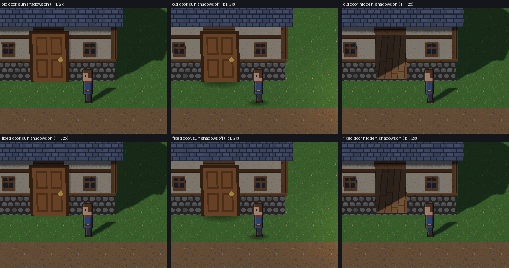
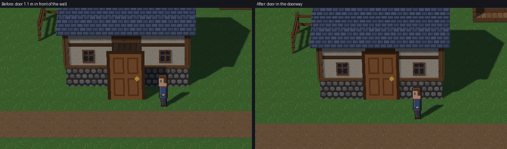
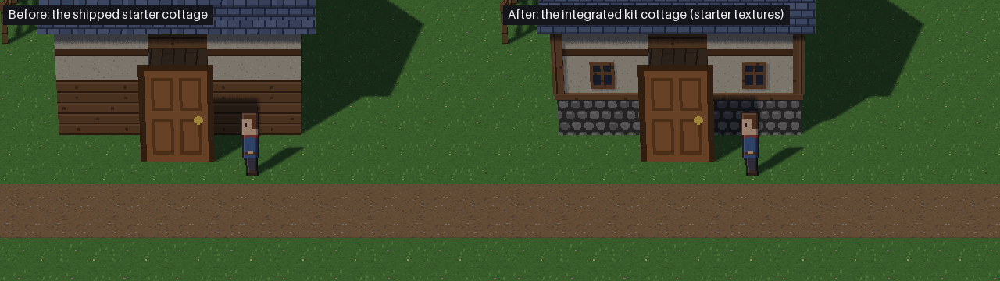
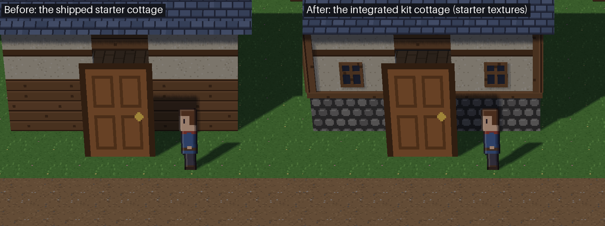

# Milestone 17: cottage integration (Stage 1B accepted)

**Ready for owner review.** At the owner's decision on Stage 1B, the HD-2D starter kit's cottage now has the
improved geometry of Stage 1B's variant B, built with the existing starter textures only, and its roof UVs corrected.

- **What changes:**
  - one kit model (with its preview and catalog entry);
  - the launcher's HD-2D template picture;
  - the builder.
- **What is preserved:** collision, floors, door entry and exit, navigation, the cutaway, Studio reimport, export and save/load all behave as before, and existing projects are untouched.
- **What is not adopted:** no PixelLab or other generated art. The rejected hero candidates and the starter characters are untouched.
- **The experimental PRs:** #370 and #371 are not merged and stay as review records.
- **The doorway:** the dark area beside the cottage's door, which the owner reported, is diagnosed and fixed. The template stood the door sprite 1.1 m in front of the wall; it now stands in the doorway. See [The doorway](#the-doorway).

## The doorway

**The report.** The door didn't cover a dark rectangle behind it and to its right. It shows in the earlier
[close-up](milestone17_cottage_integration_evidence/integration_cottage_close.png), on the old cottage as well as the new one.

**The cause: a misplaced sprite, and the shadow that misplacement throws. There is no geometric gap.**

- An HD-2D billboard stands on its **bottom edge** (`engine/hd2d/renderer.py`, `_sprite_quads`).
- The template placed the 64 px (2 m) door sprite's **centre** 0.1 m from the wall, so the door stood **1.1 m in front of the wall**: its base was at y 8.9 m, the wall face at 10.0 m.
- That produced two dark areas:
  - **To the right of the door: the door's sun shadow on the wall.** A 2 m board standing 1.1 m out casts its upper shadow onto the wall, offset east by the south-west sun. In the 4× close-up it is 7,799 px, 96% of it right of the door. It disappears with sun shadows off or the door hidden.
  - **Above the door: the doorway itself.** From the 30° camera, the 1.2 m opening (dark, roof-shaded interior floor) shows between the door's top and the lintel. That happens with shadows on or off.
- The opening and the door hidden show nothing wrong with the cottage model.

Controlled renders, all from the same project with the same camera, geometry and player, changing one thing at a time
([2× sheet](milestone17_cottage_integration_evidence/door/sheet_2x_door.png),
[4× sheet](milestone17_cottage_integration_evidence/door/sheet_4x_door.png),
[numbers](milestone17_cottage_integration_evidence/door/diag.json)):

- sun shadows on or off;
- the door shown or hidden;
- the old placement or the fixed one;
- the camera centred, or moved 2 m west or east.

**The fix.** One template constant: `COTTAGE_DOOR` in `engine/hd2d/starter_village.py`. It stands the door sprite's bottom edge **6 cm in front of the wall face**.

- **Why 6 cm:** it's just clear of the timber sill beam, which stands 5 cm out. My first version used 2 cm; independent visual QA found that the beam then cut a notch across the door's edges.
- **Unchanged:**
  - the door's size: it is still 1.5 × 1.94 m of art over the 1.2 × 2.0 m opening, overlapping the wall, as it always has;
  - every shadow setting;
  - the cottage model;
  - no patch was painted.
- **What moves with it:** the arrival point for leaving the cottage stays 3 m south of the door.
- **Existing projects keep their door:** only the template moved. To fix an existing project, move its door about 1 m north in Mesh Studio.
- **The test:** `test_the_cottage_door_stands_in_its_doorway` checks that the door is centred in the doorway with its opaque bottom edge 5–10 cm in front of the wall face. It fails on the old placement.

**Visual acceptance at gameplay scale** (1:1 crops at 2×, sun shadows on, before and after):

- [the front](milestone17_cottage_integration_evidence/door/compare_front.png);
- the camera moved [west](milestone17_cottage_integration_evidence/door/compare_front_camera_west.png) and [east](milestone17_cottage_integration_evidence/door/compare_front_camera_east.png);
- [the player beside the door](milestone17_cottage_integration_evidence/door/compare_beside.png);
- [walking in](milestone17_cottage_integration_evidence/door/compare_entering.webp);
- [inside](milestone17_cottage_integration_evidence/door/compare_inside.png);
- [back outside](milestone17_cottage_integration_evidence/door/compare_arrived_outside.png);
- [behind the cottage, with the cutaway](milestone17_cottage_integration_evidence/door/compare_behind.png);
- [4× close-up](milestone17_cottage_integration_evidence/door/compare_front_close.png).

**Independent QA of the fix** (read-only):

- [**Visual QA**](milestone17_cottage_integration_evidence/door/visual_qa.md):
  - it confirmed the diagnosis;
  - after the fix, the door's shadow on the wall is 0 px from all three cameras, with no dark sliver and no z-fighting;
  - outside the door, the only changes are the door, its old shadow and the player at the moved arrival point.
  - It found the sill-beam notch at 2 cm, recommended 6 cm and checked it in its own renders. That change is in the final commit.
  - **Low, cosmetic, not changed:** the door covers the lower half of the lintel and reaches about 0.15 m past the opening's sides. The owner asked not to resize the door; if it matters, widen the opening in the model.
- [**Technical QA**](milestone17_cottage_integration_evidence/door/tech_qa.md), reviewed at 2 cm; 6 cm differs by 4 cm in depth:
  - **Entering:** works from straight on, both diagonals and along the wall. Straight on, it triggers 1.08 m before the wall face; before the fix it was 2.17 m.
  - **Beside the door:** standing there doesn't trigger it.
  - **Leaving:** the player lands 1.47 m clear of the door, with no re-entry over 600 frames.
  - **Movement:** a 1,200-frame random walk never enters the wall.
  - **Unchanged:** save/load both ways, the cutaway (the door hides 0 player pixels at 35 positions behind the cottage) and existing projects. The installed engine's new project has the new door.
  - **One improvement:** walking along the cottage's front at y 8.5 no longer enters it by accident.
- **On the final commit (6 cm),** I re-ran: the renders above, entering (it triggers with the feet at 8.94 m) and leaving (arrival at 7.38 m), the template tests, the GPU suite and the fast tier.

**Remaining, outside this fix's scope:**
- The cottage's **interior** door, the way back out, stands by the inside west wall rather than in the room's south doorway. It pokes 0.15 m through that wall into the dark void.
- That door has the same bottom-edge placement issue. It's reported by technical QA, and not changed here because the owner scoped this to the cottage's door.

## What changed

| File | Before | After |
|---|---|---|
| `assets/hd2d_starter/models/cottage.glb` | 35,568 B, `7b4c20ff…`, 152 triangles, 4 materials | 72,148 B, `a3677bfc…`, 402 triangles, 6 materials (cobbles and a flat dark pane added) |
| `assets/hd2d_starter/previews/cottage.png` | `048d9e70…` | `fac6ff48…` |
| `assets/hd2d_starter/catalog.json` | kit version 1 | kit version 2; the cottage's note: "A timber-framed cottage on a cobbled plinth, with windows; walk inside." Collision and floor facts unchanged. |
| `assets/templates/hd2d_rpg.png` | `a5ff6fbd…` | `9c1e631b…` (the new cottage's corner at the left edge) |
| `assets/hd2d_starter/PROVENANCE.md` | | names `build_kit()` and the Blender version |

The other 13 kit models, the textures, every sprite (the starter hero included), `pyproject.toml`'s allow-list and
`MANIFEST.in` are unchanged. No filename changed, so packaging is unaffected.

**The builder.**

- `tooling/hd2d_assets/build_cottage.py` gains `build_kit()`. It calls the unchanged `build()`, then refines it, and `build_starter_kit.py` uses it for the kit.
- The Stage 5B pipeline demo cottages (`tooling/hd2d_assets/cottage.glb` and `cottage_v2.glb`, from `build()`) still rebuild byte-identically, so the reimport demonstration and its tests are untouched.
- `build_kit()` is Stage 1B's variant B ported exactly. The first build was byte-identical to #371's `cottage_m17_geo.glb` (`1e7ce0ae…`), so every Stage 1B QA result applies to it.
- On top of B:
  - **window frame gaps:** the window frame pieces abut instead of stopping 2 mm short, so the 4 mm gaps that showed the pane are gone (Stage 1B tech QA D6);
  - **dark frame edges:** each frame piece's texture is shifted to the middle of a timber board, so no dark board line runs along a 2 px frame edge (this QA's D1).

**Refinements, all in starter textures:**
- a cobbled plinth to 0.85 m in place of timber to 1.3 m;
- a timber sill ring and L-shaped corner posts with vertical grain, wholly outside the walls;
- two front windows: a timber frame and cross mullion over a flat dark pane, 2 cm out from the wall;
- no faces hidden inside the model (coplanar faces of different materials: 60 before, 0 now);
- the shingles run up the slope at 32 px/m.

**The roof.** The inverted roof was a Stage 1 pilot mistake. The starter roof was already upright, and so is the
adopted one: measured on renders, the shingles run up the slope, the same way up as the original. The adopted
mapping also corrects the density along the slope from 27.9 to 32 px/m. The shop's and `roof_4m`'s roofs keep the
flat mapping: changing them wasn't in scope, and there's no evidence of a defect. As a result, the cottage's roof now
differs slightly from the shop's next to it.

**New and existing projects.**

- A project is given the kit only when it is created: `engine.hd2d.catalog.install_kit` never overwrites, and nothing upgrades an existing project.
- New projects record the source "Mesh HD-2D starter kit 2" and each model's SHA-256.
- The template test now also checks that a new project's models are the kit's current files.
- In the clean-install acceptance, every project created by the installed engine has the new cottage (matching hash), and so does its exported game bundle.

## Gameplay-scale before and after

Rendering conditions:
- Mesh's own renderer, hidden windows;
- 1280×720, the template's 12° camera, the same sun, lamps and walk;
- the starter hero in both;
- 1:1 crops (the art at 2×), not resampled.

The renders come from the M17 comparison harness on #371's branch (`tooling/m17_visual_pilot.py`), with the shipped cottage against this branch's kit cottage swapped in under the same structure id. The door in these pictures is still at its old placement, 1.1 m out. See [The doorway](#the-doorway) for the fix.

Close up (1:1 at 4×):

More pictures:
- [the path](milestone17_cottage_integration_evidence/integration_path.png);
- [the village centre](milestone17_cottage_integration_evidence/integration_centre.png);
- [walking past both at 1:1](milestone17_cottage_integration_evidence/integration_walk.webp);
- the measurements in [`integration.json`](milestone17_cottage_integration_evidence/integration.json).

| | Before | After |
|---|---|---|
| Draw calls / triangles / texture bytes | 29 / 1372 / 241,664 | 31 / 1622 / 245,764 |
| Hero height and visible pixels at the cottage, path and centre | 82 / 83 / 82 px; 1721 / 2431 / 2392 | identical |
| Hero edge contrast at the door | 32.8 | 33.9 (cobbles behind it, not dark timber) |

## Independent QA

A read-only QA agent re-measured everything at commit `11d0b1d` with hidden windows and headless Blender: [full report](milestone17_cottage_integration_evidence/cottage_integration_qa.md). **Verdict: ready for owner review**, with no blocker or major defect.

- **Reproducibility:** all 14 kit models, both demo cottages, the catalog, the 14 previews and the template picture rebuild byte-identically.
- **GLB:** valid, and read with no warnings. NEAREST sampling and 32 px/m on every textured face, the roof included. No degenerate triangles, nothing drawn inside the walls, lintel, slab or room, and window joints closed.
- **Flat pane:** it renders correctly in the reader, the renderer, the Studio catalog and preview, and `mesh export`.
- **Collision and navigation:** the `col_` nodes are byte-identical. 0 of 1,450 floor queries differ. Wall stops and door entry are identical, and so are positions walking into each wall, through the door, round the room and out.
- **Cutaway:** no new z-fighting. Behind the cottage there are 63–184 fewer depth-flickering pixels than before.
- **Studio:** reimport new → old → new → old → new gives exact file matches, nothing left over and stable GPU counts.
- **Export and save/load:** the bundle holds the new cottage, and save/load keeps the player and the structure entry.
- **Existing projects:** a simulated older project opened in Studio and the game had 0 files changed, and there is no migration path.
- **Performance:** +2 draw calls, +250 triangles, +4.1 KB of textures and +18 KB of buffers; about 0.1–0.15 ms per frame in steady state. Textures, framebuffers and programs don't grow across reloads or close; only the pre-existing GC-timed buffer drift appears.
- **Suites:** fast tier 4605 passed, GPU files 111 passed, ruff gate ok. mypy shows only the two pre-existing local `tooling/hd2d_lab` errors.

Fixed after QA, and re-verified on the final commit:

| QA finding | Fix |
|---|---|
| D1 (minor): each window's outer frame post picked up the timber's dark board line | `_mid_board()` centres each frame piece on a board. A 4× crop shows even frames. Collision is still byte-identical, and the build is reproducible (`a3677bfc…` twice). |
| D2 (minor): the builder's docstring linked a report absent from this branch | It now links this report. |
| D3 (minor): the budget accepted an approved total of NaN or ∞, which disabled the cap check | The total and every cap must be finite and above 0; tests added. |
| D4 (minor): settling a usage of ∞ blocked the ledger | Usage must be finite and ≥ 0; tests added. |
| D5 (minor): the sanitizer kept creator fields, URLs or id paths used as keys, percent-encoded storage paths, and `Bearer …` values when the token isn't in the environment | All four are now removed; a test is added. A bare id under an ordinary key such as `id` is still kept, because it can't be told from a job id. The hygiene test is the backstop for that. |
| D6 (minor): the hygiene test missed `raw/` outside `tooling/hd2d_assets/`, `.log`, `.html`, `.js` and similar files, and a token written without hyphens | Any `raw/` folder is now ignored and may never be tracked. Six more text types are scanned. Digests are taken without hyphens, so either form is caught. The digests still recognise exactly the 10 raw files known to hold the account id. |

**Smaller notes, not changed:**
- Through the cutaway, the room's lower inside walls show cobbles where they showed timber.
- The floor slab's ground-level flicker band predates this change.
- Studio's reimport keeps the old licence line; that's tracked in `docs/asset_licensing.md`.
- The fast tier leaves two save files in an ignored `saves/` folder; that predates this change.

## Safeguards ported from Stage 1B

- **`tooling/pixellab_budget.py`, one shared reserve-before-request budget:**
  - Unknown endpoint costs are refused, and so is anything over budget, any non-positive or non-finite amount, and any agent not in the ledger. QA agents are never listed.
  - Results are stored sanitized.
  - **New: per-agent caps.** Each generation agent's cap is fixed when the ledger is made, and the caps never exceed the approved total. A subtask an agent delegates reserves under that agent's name, since any other name is refused, so delegating can't add budget.
  - QA's attack tests held: 40 concurrent reservations on a budget of 20 accepted exactly 20, split 15 and 5.
- **Hygiene:**
  - `raw/` folders are git-ignored;
  - `tests/test_generated_asset_hygiene.py` (its full scan is integration-tier: it reads every tracked text file, about 2.6 s, so it runs in CI's whole-suite pytest step rather than the time-budgeted fast tier) rejects tracked raw records, storage or signed URLs containing ids, bearer-token literals, and the owner's token or account id by digest.
- **mypy gate:** `tooling/mypy_gate.py` skips git-ignored folders as well as untracked ones.

## Licensing

`docs/asset_licensing.md` records the decisions and requirements:
- no PixelLab-generated asset is in the starter kit or the allow-list;
- the open requirements: written clarification from PixelLab, a Mesh code licence with separate starter-asset usage terms, and provenance for any third-party or AI-generated asset;
- the safeguards.

The clarification email is prepared from the licence review's draft (#371, `licence_review.md` §4.2) and **has not been sent**. Sending it needs the owner's explicit confirmation.

## CI investigation (#371)

#371's pull-request run passed while its push run failed `verify-all`. Both tested the same tree (`990db11`). The push
run's failures were enforced fixed-millisecond budgets on runners the speed advisory measured at 1.12× (Windows) and
1.20× (Linux) the median runner:

| Step | Duration | Advisory's expected range | Enforced threshold |
|---|---|---|---|
| `pytest-fast` | 130.0 s | 104.7–153.4 s | 121.8 s |
| `exception-policy-scan` | 3.69 s | 3.25–4.12 s | 3.56 s |

The PR run's runners were 0.60–0.67×. A re-run with budgets unchanged passed. The only real difference from the
updated base is that the stacked branches predate #369, so their pushes still trigger the retired `build.yml`. No test
or budget was changed.

**On this PR's own CI.**

- The first push run was fully green.
- The pull-request run's Windows `tests` job failed the same fixed `pytest-fast` budget twice, on runners measured at 1.22× and then 1.34× the median: 131.7 s and 130.7 s against 121.8 s. The advisory judged both within range for those speeds (120.7–176.8 s at 1.34×).
- Part of the time was this branch's: the hygiene test's full scan reads every tracked text file (about 2.6 s locally). It is now `integration`-tier. It still runs on every PR in CI's whole-suite pytest step, but no longer in the time-budgeted fast tier.
- The next push (13aa21d) passed. The pull-request run then missed the budget again: 136.0 s at 1.17×, and on its one re-run 129.4 s at 0.98×.
- Timed side by side on one machine, this branch's fast tier is no slower than the base: base 4e8ea36 ran 135.1 s (cold) then 118.4 s; this branch ran 117.4 s then 117.0 s, with 25 more tests.
- No budget was changed.

**The Windows `verify-all` budget instability is pre-existing, and it is a timing issue, not a functional one.**

- Over the last 30 CI runs, the Windows `pytest-fast` step took 66–136 s, depending on runner speed (0.62–1.34× the median). Its enforced threshold is a fixed 121.8 s.
- About 6 of roughly 23 executions went over it: #369's PR run, #371's push run, and four on this PR. Every one was inside the advisory's speed-adjusted range, and every test passed.
- The base branch hits it too.
- Every failure and re-run is recorded on its PR. None was re-run until green and then hidden.
- A recalibration is proposed separately for review in [septimus82/Mesh#373](https://github.com/septimus82/Mesh/issues/373), with the data and three options. Nothing is changed here.

## Tests on the final commit

- fast tier;
- the 17 GPU files (`MESH_GL_SMOKE=1`);
- the HD-2D template, catalog, cutaway and launcher tests;
- the clean-install wheel test (`tests/test_wheel_bundles_engine_data.py`, slow; run without `PYTHONPATH`, which would make pip build from the repo's `build/` folder);
- the installed-engine acceptance (`tooling/hd2d_install_acceptance.py`): wheel = allow-list, 178 files; driver exit 0;
- the ruff and mypy gates.

Results are in the PR.
