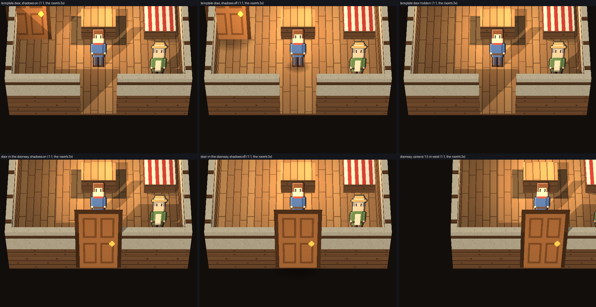
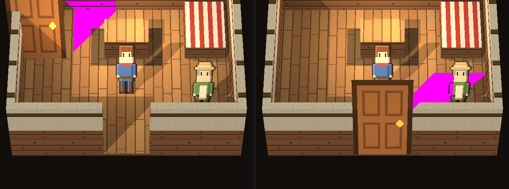
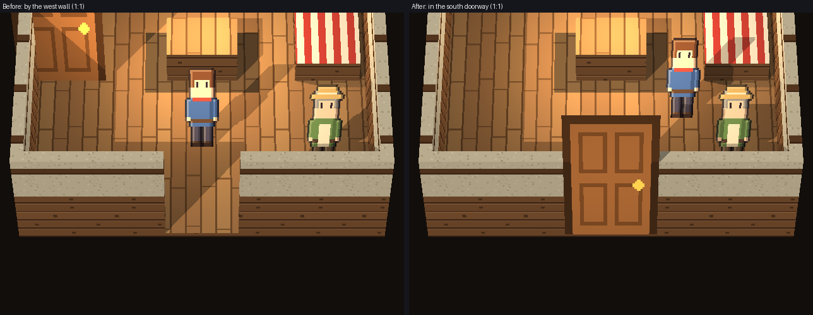

# Milestone 17 follow-up: the cottage's interior exit door

**Ready for owner review.** The HD-2D template's interior exit door now stands in the room's real doorway, in the
south wall. Before, it stood free on the floor by the west wall, with its picture 15 cm through that wall.

- This is a template change only: new starter projects get it, and existing projects are never rewritten.
- No geometry was added, no shadow setting was changed, and the renderer is unchanged.

## Root cause

- An HD-2D billboard stands on its **bottom edge** (`engine/hd2d/renderer.py`, `_sprite_quads`), but an entity's x/y is its sprite's **centre**. This is the lesson from the exterior door (#372).
- The template linked the inside door at (5.6, 7.6) m.
- That was the wrong place twice over:
  - It is by the **west** wall, which has no opening; the interior model's doorway is in its **south** wall (x 7.4–8.6, outer face y 3.5).
  - It was placed as a centre. So the 64 px (2 m) door's base stood at y 6.6, free on the floor 1.7 m in front of the north wall.
- The 1.5 m-wide picture spanned x 4.85–6.35, through the west wall (outer face x 5.0) and 0.15 m into the void. The west wall's top was drawn across the door.
- It also cast about 13,600 px of detached shadow on the floor.

## The fix

All in `engine/hd2d/starter_village.py`.

- **`INSIDE_DOOR`:** the door's centre is (8.0, 4.48) m. Its opaque bottom edge stands 2 cm in front of the south wall's outer face, centred on the doorway, at the floor's height (0.1 m). There is no trim indoors to clear. It's the same door and the same size.
- **`INSIDE_ARRIVAL` (the arrival and start inside):** (8.0, 5.6) → (9.2, 6.2).
  - The door is now the object nearest the indoor camera (55°). At (8.0, 5.6) it would have hidden the arriving player's legs, and the player's hit box would have touched the door's touch area.
  - The new point is beside the door's line, so the player is neither hidden nor touching it. Walking west past it doesn't touch it either.
  - It's east of the table and west of Tomas.
- **Tomas's line:** "The door at the front of the room takes you back outside." It replaces "…behind the table…", which described the old position. Art QA suggested "front of the room" over "south wall", since players have no compass indoors.
- **Regression test:** `test_the_cottage_inside_door_stands_in_its_south_doorway` (fast). It checks that the door is centred in the south doorway, its opaque bottom edge 0–5 cm in front of the wall, its picture within the room's width, and the arrival and start beside its line. It fails on the original placement.

## Controlled diagnosis

All renders from one project, at the room's gameplay scale (indoors the art is drawn 3×), with 1:1 crops. One thing changes at a time:

- sun shadows on or off;
- the door shown or hidden;
- the old placement or the doorway;
- the camera centred, or moved 1.5 m west or east.

[Sheet](milestone17_interior_door_evidence/sheet_interior.png), [numbers](milestone17_interior_door_evidence/diag.json).

**The door's own cast shadow** (magenta: before left, after right):

- **Before:** about 13,600 px, detached on the floor behind a door standing in the room.
- **After:** about 7,100 px. It starts at the door's top-right corner and falls north-east onto the floor (x 8.8–10.8, y 4.9–6.1 m) across Tomas's feet.
- **Art QA's judgement: plausible, not misplaced, but over-long.**
  - Billboards are stretched by 1/cos(pitch) to keep their drawn proportions: 1.74× at 55°. The engine's sun shadow pass uses that stretched height for every billboard, characters included.
  - A true 2 m door's shadow would end behind the wall, so every visible pixel of it comes from the stretch.
  - Fixing that is an engine-wide renderer change (it would shorten every character's shadow), which this follow-up was told not to make. It's recorded below as a possible separate change.

## Gameplay at the game's own scale

Before and after, sun shadows on, 1:1 crops:

- [inside](milestone17_interior_door_evidence/compare_inside.png);
- the camera moved [west](milestone17_interior_door_evidence/compare_inside_camera_west.png) and [east](milestone17_interior_door_evidence/compare_inside_camera_east.png);
- [the door](milestone17_interior_door_evidence/compare_inside_door.png);
- [talking to Tomas](milestone17_interior_door_evidence/compare_tomas.png);
- [leaving](milestone17_interior_door_evidence/leaving_walk.webp) and [its frames](milestone17_interior_door_evidence/walk_sheet.png);
- [back outside](milestone17_interior_door_evidence/compare_outside.png);
- [the exterior door](milestone17_interior_door_evidence/compare_outside_door.png).

| Check | Result (after) |
|---|---|
| Entering from outside (straight on and at angles) | arrives inside with feet at (9.20, 6.01), not touching the door |
| No re-entry loop | 600 idle frames inside, and 600 outside after leaving: no transition. Holding a key away from the door: none |
| Exiting (straight on and diagonally) | arrives in the village at (10.0, 7.38), the same as before |
| No unwanted transitions nearby | walking west past the door's line from the arrival: stays inside. The rest of the room is reachable without leaving |
| Tomas | his conversation opens, with his line |
| Save/load, both rooms | saving and loading inside and outside restores the exact room and position; then walking out or in works. Quick-save F5/F9 inside works |
| Collision, navigation, cutaway | the interior's collision, floors and settings are identical; every entity has somewhere to stand |
| The exterior doorway (#372) | `start.json` is byte-identical, and the outdoor before/after pictures are pixel-identical |
| Existing projects | a simulated old-template project keeps its positions in the game and in Studio. The only file written is `.mesh/editor_session_state.json`, as for every project |
| Installed engine | the acceptance passes, and the new project's inside door is in the doorway |

## Independent QA (read-only)

- [**Art QA**](milestone17_interior_door_evidence/art_qa.md): **approve, with minor notes.**
  - The diagnosis is correct.
  - **Placement passes:** the door's bottom row sits on the wall's base line, its frame overlaps each wall end by about 15 px, and no slivers or z-fighting show from the three cameras.
  - **The shadow** is plausible and over-long (above).
  - **Composition passes:** the arriving player is fully visible.
  - **Leaving:** nothing pops. For the last 5 frames before the room changes, the legs pass behind the door's top, which reads as walking up to the door.
  - **No regressions.**
  - **Owner's call:** on screen the door rises about 57 px above the 2.2 m wall's top. That's in proportion with the characters, not the wall, and it's the same billboard rule.
- [**Technical QA**](milestone17_interior_door_evidence/tech_qa.md): **pass, with minor findings.**
  - Placement, entering, exiting, the re-entry checks, Tomas, save/load, unchanged collision, existing projects, the installed engine and the new test failing on the original placement all check out.
  - It reviewed `2c202df`. The only later change is Tomas's wording and a comment.
  - **D1 (design call):** the exit triggers anywhere the feet are within about 1.9 m in front of the doorway (x 7.0–9.0, y 3.5–5.6), 24% of the floor against 16% for the old door. That's the engine's picture-box touch for a door nearest the camera. It fires as the feet pass behind the door's top, so it reads as reaching the door.
    - A tighter zone would make the player vanish behind the door and wall before leaving.
    - The door's existing `area_width`/`area_height` settings could tighten it if wanted.
  - **D2 (test gap, not changed):** `test_every_character_door_and_arrival_has_somewhere_to_stand` checks a door at its sprite centre rather than its bottom edge. Checking the bottom edge would wrongly fail any door standing correctly at a threshold's edge.
  - **D3 (comment):** fixed.

## Limitations and possible separate changes

- **Over-long billboard sun shadows indoors.** At 55°, billboards cast shadows from 1.74× their true height. A renderer change could cast from the true height, but it would affect every character, so it's an owner decision for a separate change.
- **The door rises above the 2.2 m wall on screen**, for the same billboard reason. The alternatives are a doorless exit or a renderer change.
- **The deep exit zone** (D1), as above.

## Tests

On the final commit:
- fast tier;
- the 17 GPU files (`MESH_GL_SMOKE=1`);
- the template, launcher and catalog tests;
- the clean-install wheel test;
- the installed-engine acceptance;
- the ruff and mypy gates.

Results are in the PR.
