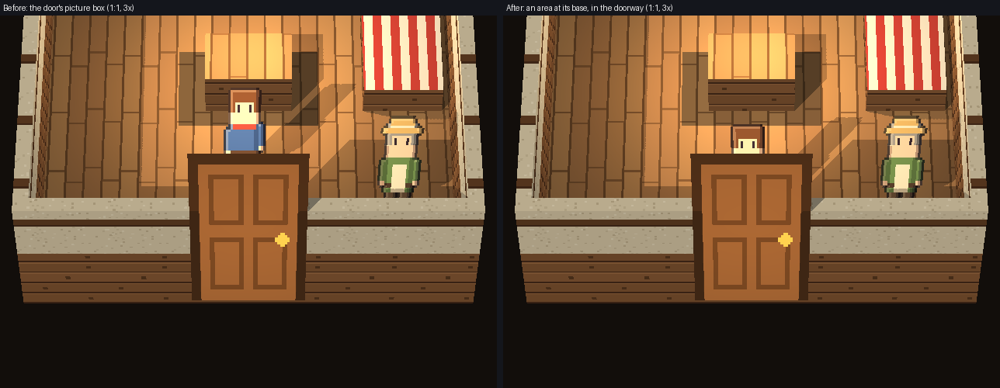

# Milestone 17 follow-up: the cottage's interior exit, walked into at its doorway

**Ready for owner review.** The template's inside exit door now takes the player out only when they step into the
doorway. Before, it fired about 1.9 m before it, and also caught anyone crossing the room's south part or walking
along its south wall.

- **Scope:** only new starter projects change. Every existing door and project behaves exactly as before.
- **Not changed:** player collision, the renderer, and the door's picture and place (#374).

## The problem, measured

- **The cause:** walking-in doors fire when the player's sprite box overlaps the door's **picture box** (`SceneTransition`, arcade hit boxes). An HD-2D billboard stands upright on its bottom edge, but its picture box lies flat across the floor plane, 1.94 m north from where it stands. For the inside door, which sits in the south doorway nearest the camera, that box covers the floor in front of the doorway.
- **The effect:** it fired with the feet anywhere up to y ≈ 5.6 m. The wall's inner face is at 3.7 m.
- **The existing `area_width` / `area_height`** can replace the picture box, but they're always centred on the entity, and an HD-2D door's centre is 1 m above where it stands. No size could put the area in the doorway. Any area wide enough for the doorway also caught walks along the wall.

**Where the feet can go** (hidden window, the door's trigger switched off; [probe](milestone17_interior_door_trigger_evidence/probe.json)):

| Movement | Feet reach |
|---|---|
| Walking straight into the doorway | y 3.544, deep in the doorway |
| Walking along the south wall, hugging it | y 3.934 at the closest |
| Pressing diagonally into the wall | y 3.889 at the closest |

So a trigger at feet below about y 3.8 fires only for stepping into the doorway.

## The fix

- **The engine:** `SceneTransition` gains one optional parameter, `area_at`: `"centre"` (the default, unchanged) or `"base"`. `"base"` centres the door's area on its picture's bottom edge, where an HD-2D billboard stands. It's 4 lines in `engine/behaviours/scene_transition.py`. Every door without it behaves exactly as before; there's no migration and nothing in saves.
- **The template:** `INSIDE_DOOR_AREA` gives only the inside door a 0.5 × 0.25 m area at its base. With the player's sprite box that fires once the feet go below y ≈ 3.79: the player steps into the doorway.
- **Studio:** a door picture with an area isn't something Studio sizes ("A door picture is its own area"). Choosing the door's style again in Studio removes the area, and the door goes back to its picture box. That's acceptable for a starter, and noted.

## Gameplay, measured in hidden windows

Each scenario starts from the inside freshly loaded ([results](milestone17_interior_door_trigger_evidence/trig_accept.json)):

| Scenario | Before (picture box) | After (area at the base) |
|---|---|---|
| Entering from the village | arrives at (9.20, 6.01), stays 600 frames | the same |
| Walking straight out | fires at feet y **5.58**, 1.9 m before the wall | fires at feet y **3.78**, in the doorway |
| Arriving in the village | (10.0, 7.38), stays 600 frames | the same |
| Crossing the room at y 4.8 | **leaves by accident** | stays inside |
| Walking along the south wall | **leaves by accident** | stays inside |
| Walking down to the wall west of the door | stays | stays |
| Diagonal approaches ([sweep](milestone17_interior_door_trigger_evidence/diag_sweep.json)) | (fires mid-room) | **23 of 26** leave through the doorway |

**The three diagonal approaches that don't leave** meet the wall right at the doorway's far corner. The player's 0.6 m footprint can't line up with the 1.2 m opening, and the engine's ordinary wall-sliding carries them past. Releasing the sideways key then walks them in. Making those fire would mean firing for players hugging the wall too, which is the accidental activation this change removes. The gap between the two cases is only about 2 cm of collision rounding, too fragile to rely on.

**The walk out, before and after** ([clip](milestone17_interior_door_trigger_evidence/compare_exit_walk.webp)). Before, the room changed while the player still stood in view, well short of the door. After, they walk into the door:

## Regression tests

- `tests/test_hd2d_starter_template.py::test_the_inside_door_takes_the_player_out_only_from_its_doorway` drives the real `SceneTransition` headlessly with the template's door. It checks that the trigger fires only for feet between 3.70 and 3.85 m, that the picture box reached more than 1.5 m further, and that it doesn't fire at y 5.0, along the wall (y 3.934, x 5.5–10.5) or at the arrival. It fails on the original template.
- `tests/test_door_styles_integration.py::test_a_door_area_centres_on_the_picture_unless_asked_for_its_base` checks that `area_at` defaults to the old behaviour and that `"base"` moves the area.

## Billboard height and shadows: investigated, not changed here

See the separate renderer issue, [#375](https://github.com/septimus82/Mesh/issues/375), with this evidence:
- [prototype picture](milestone17_interior_door_trigger_evidence/shadow_current_vs_prototype.png);
- [numbers](milestone17_interior_door_trigger_evidence/shadow_proto.json).

**In short:** the sun shadow pass draws the same stretched, camera-facing billboard quads as the picture, so every billboard casts the shadow of its stretched height (1.74× at the indoor camera's 55°).

**Option 2 was prototyped.** The pass skipped billboards that opt out, done at runtime with no engine change.
- The door's shadow went from 6,954 px to 0.
- No other pixel changed outside the door's shadow region.
- With no opt-outs, the village was pixel-identical.

**It isn't implemented**, because it would reuse the existing `cast_shadow` field. That field today means "shadow from lamps", with type-based defaults, and Studio only stores it when it differs from them, so its meaning needs an owner decision first.
