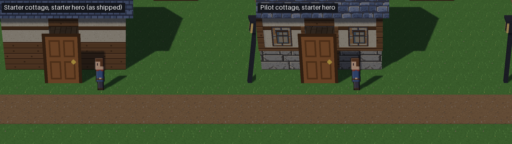
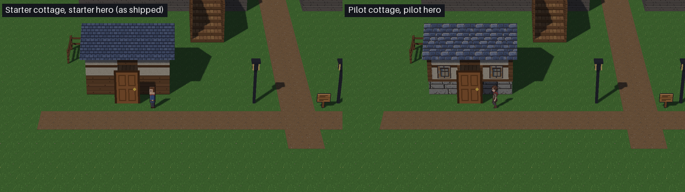
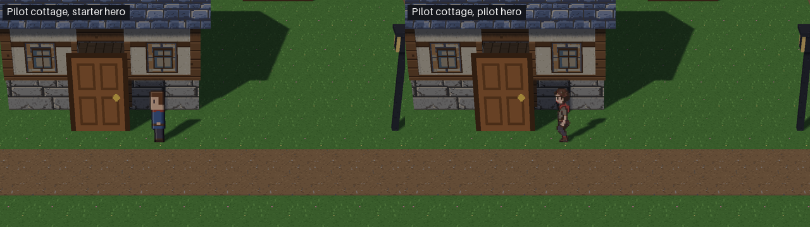
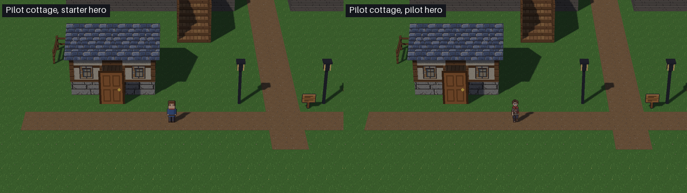

# Milestone 17, Stage 1: HD-2D visual-quality pilot

**Recommendation: CONDITIONAL PASS as an art direction. FAIL as ready-to-ship assets. Adopt nothing yet.**

The pilot produced:

- one cottage variant, built in Blender from PixelLab textures on the starter geometry;
- one PixelLab player character.

Both were compared with the starter art in Mesh's own renderer, under identical conditions. Two independent QA agents then reviewed them.

**The result is mixed:**

- **Cottage:** modestly but clearly better at both distances. Most of that gain comes from modelling and layout (front windows, a stone plinth, a sill line), not from the PixelLab textures. Only 3 of the 15 generated textures were used, and one of those, the roof, is a step back.
- **Character:** a clear gain close up. At gameplay distance it reads worse than the baseline: lower contrast, a smaller silhouette, and an idle pose that is mid-stride.

**Technically the swap is clean:**

- collision is byte-identical;
- navigation, the door, the cutaway and Studio reimport are unchanged;
- there is no GPU leak;
- the frame-time cost can't be told apart from noise.

**What can't be committed or shipped as is:**

- Shipping is blocked on a licence decision.
- The raw API dumps contain the account id, so they stay out of git.

The starter art is untouched, and nothing has been adopted. Everything below is for the owner's review.

## What was made

| | Starter (A) | Pilot |
|---|---|---|
| Cottage walls | timber to 1.3 m, plaster above | **stone plinth** to 0.9 m (PixelLab `stone_b_seamfix`), starter plaster above |
| Cottage roof | starter shingles | PixelLab `roof_slate`, UV mapped along the slope |
| Cottage details | none | 2 front windows (PixelLab `window_a`), corner posts, a sill beam and door jambs in starter timber (drawn only, no collision) |
| Geometry and collision | `build_cottage.py` | the same `build_cottage.build()` call, with the material split moved and the details added; the 7 `col_` nodes are **byte-identical** |
| Player | `hd2d_hero.png`: 40–41 px, blocky | `hero_m17.png`: 42–44 px, a cloaked traveller with a stride, in the same 4×4 sheet of 32×48 frames (no format change) |

Files:

- `tooling/hd2d_assets/pilot_m17/` holds:
  - `textures/`: the 15 candidates, plus provenance, the tiling report and a contact sheet;
  - `characters/`: the sheet, its frames, provenance and measurements;
  - `models/`: `cottage_m17.glb`, plus its provenance;
  - `build_cottage_m17.py`.
- `tooling/m17_visual_pilot.py` is the comparison harness.
- Evidence is in [`milestone17_stage1_evidence/`](milestone17_stage1_evidence/).

Rebuild the pilot cottage with headless Blender:

    blender --factory-startup -noaudio --background --python tooling/hd2d_assets/pilot_m17/build_cottage_m17.py -- tooling/hd2d_assets/pilot_m17/models/cottage_m17.glb

Two builds give the same sha256.

Rerun the in-engine comparison, which uses hidden windows only:

    py -3.13 tooling/m17_visual_pilot.py compare OUT

## PixelLab usage and cost

**Integration.**

- There is no PixelLab MCP connector in this environment.
- The authorised integration is PixelLab's HTTPS API v2, using the account token from the `PIXELLAB_API_TOKEN` environment variable.
- The token was never printed or written. A check that prints only a boolean confirms it appears in no file under `pilot_m17`, the evidence folder or the scratch outputs.

**Endpoints used:**

- `create-tiles-pro`;
- `create-image-pixflux`;
- `create-image-bitforge`;
- `inpaint-v3`;
- `create-character-with-4-directions`;
- `characters/animations`, with the `walking-4-frames` template.

**Spend:** 41 generations in total, from 3568.7 down to 3527.7 of the Tier 2 plan's 5000. USD credit was not used and is still $0.00.

| Agent | Generations | Cap | Notes |
|---|---|---|---|
| Textures | 35 | 30 | **Over the cap by 5.** `create-tiles-pro` costs 15 per call. `inpaint-v3` costs 10, which isn't documented; the agent tried it with 5 generations left. The stone seam repair it paid for was barely visible. |
| Character | 6 | 30 | 2 base candidates (the first was rejected: too tall, and its palette collapsed) and 4 walk directions. |

Lesson for the next round: check per-endpoint costs before calling. Tiles-pro and inpaint use most of a 30-generation budget in two calls.

## Asset results (generation agents' own findings, then verified by QA)

**Textures.** All 15 are 32 px/m as used. None is resized or half-resolution, and all use one shared 35-colour palette.

- **Kept:**
  - `stone_b_seamfix`: the only clear gain; the kit has no stone wall.
  - `roof_slate`: used, but QA rates it worse than the starter (see below).
  - `window_a`.
- **Rejected:**
  - Plaster `a`, `b` and `c`. They are flat with one bold repeating crack (`b`), or their cracks are cut off at the tile edge (`a`, `c`). Iteration 1 used `plaster_b`, and it read worse than the starter, so iteration 2 went back to the starter plaster.
  - Timber `a` and `b`: visible seams.
  - Both moss attempts: no moss in one, floor tiles in the other.
  - `roof_clay`: reads as a woven grid.
  - `door_a`: its stone and timber surround is baked in, so it doesn't fill the doorway.
- **Generator bias:** `create-tiles-pro` draws game floor tiles, so about half its variations were useless for walls.

**Character.**

- Clearly better anatomy: a cloak, a narrowing torso, hands and joints.
- A real stride left and right; the down and up walks are weaker.
- 30 colours in total, with binary alpha.
- Feet on the bottom row in all 16 frames, and frames cropped from the 56 px output without resampling.
- It is not the brief's colours: the tunic came out grey-brown instead of moss green.

## In-engine comparison

Setup:

- three projects from the HD-2D RPG (Preview) template:
  - **A**, as shipped;
  - **B**, with the pilot cottage under the same structure id;
  - **C**, B plus the pilot hero;
- the same key-driven walk;
- 1280×720, the template's 12° camera, and the same sun and lamps;
- gameplay distance (2×) and a close-up (4×) at three spots, plus a walking clip.

The cottage, as shipped vs the pilot, close up and at gameplay distance:

The character, starter hero vs pilot hero in front of the pilot cottage:

More pictures:

- [the village centre](milestone17_stage1_evidence/compare_before_after_centre.png);
- [the walking clip, A / B / C](milestone17_stage1_evidence/walk_compare.webp);
- [sprite strips at gameplay distance](milestone17_stage1_evidence/sprite_gameplay_strip.png) and [close up](milestone17_stage1_evidence/sprite_close_strip.png);
- [the hero sheet at 8×](milestone17_stage1_evidence/hero_m17_8x_grid.png).

### Is it a meaningful improvement?

- **Cottage at gameplay distance: yes, modestly.**
  - The starter is a flat timber-and-plaster box. The pilot reads as a lived-in cottage with a base, a sill line and windows.
  - About 70% of that comes from layout and modelling, by Art QA's estimate. The front windows do most of the work, and the stone is the only PixelLab texture that adds anything.
  - Iteration 1 had its windows on the side walls, which the camera never sees, and the cracked plaster. It was a sideways move, not an improvement.
- **Cottage close up: mixed.**
  - Better: the stone plinth.
  - The same: the plaster.
  - Worse: the roof, the corner posts textured as horizontal boards, and the cream window panes.
- **Character close up: yes, clearly.** It has a silhouette, anatomy, costume detail and a stride.
- **Character at gameplay distance: no, it's worse.**
  - Its edge contrast against the background is below the baseline's at all three spots: 25.4, 29.6 and 22.3, against 27.4, 33.5 and 25.6.
  - It covers 17–22% fewer screen pixels.
  - On the dirt path the grey-brown tunic blends in, and the red scarf is the only thing that separates it.
  - Gameplay distance is where the player spends the game.

The generated images alone don't make this a success. The useful findings are:

- PixelLab can supply material textures, stone in particular, that fit the 32 px/m standard.
- Its tile and wall generations need heavy curation: 3 of 15 used.
- The biggest cottage gains are cheap modelling work.
- A character has to be judged at 2× against the village palette, not only close up.

## Art QA (independent): CONDITIONAL PASS as a direction

There are no blockers. Nothing is blurry, resized, half-resolution or semi-transparent. The palette stays within the village's hue range; the clashes are in lightness and contrast. Full report: [`art_qa.md`](milestone17_stage1_evidence/art_qa.md).

| Severity | Defect |
|---|---|
| major | **The roof texture is upside down.** The roof UV runs from the ridge down, so the top of the image lands at the eave ([evidence](milestone17_stage1_evidence/roof_orientation_evidence.png)). The slates' drawn highlights are also lit from below, so fixing the mapping alone exposes a lighting error. |
| major | **The roof is too bright.** Its lightness reaches 51 against 32 for the starter roof in the same frame, brighter than the grass and the dirt. The cream outline round each slate gives it a floor-tile or brick look. |
| major | **The hero's idle pose is mid-stride.** Facing down or up, one foot is lifted 3 px whenever the player stands still, because walk frame 0 is used as the idle frame. `down_3` has both feet down. |
| major | **The hero has less contrast at gameplay distance** (see the figures above). The prompt asked for a moss-green tunic and got grey-brown. |
| minor | The front and back walk rhythm is lopsided and the head bob is irregular. Details flicker between frames: the satchel, red pixels on the legs and mouth, and the face in one frame. |
| minor | `roof_slate` has a partial vertical seam every 2 m, although `tiling_report.json` says it tiles. `stone_b` has a stray highlight line through blocks at its edge, which the paid seam fix didn't touch; it is hidden only because the plinth uses the bottom 45% of the texture. |
| minor | The plinth shows a cut top course and a crack motif repeating every 2 m, with a strong baked bevel. |
| minor | The door jambs sit behind the door sprite, so only one shows. The corner posts use the horizontal board texture. The window panes are cream, not glass. |

## Technical QA (independent): CONDITIONAL PASS

Measured afresh rather than copied from the generator's reports. Full report: [`tech_qa.md`](milestone17_stage1_evidence/tech_qa.md).

| Check | Result |
|---|---|
| GLB validity | Structurally valid: chunks, accessors, index ranges, normals and the embedded PNGs. No degenerate triangles, no flipped normals. Mesh's `load_glb` loads it. |
| Collision | The 7 `col_` nodes are byte-identical to the starter's. |
| Navigation | 1,450 floor-height queries over the cottage give identical results. Wall stops, door entry, walking inside and walking out are all the same. The cutaway is identical. |
| Studio import and reimport | Reimport pilot → reload → pilot → starter → pilot leaves **123 / 43 / 7 / 28** live buffers / textures / framebuffers / programs every time. No geometry or texture is left over. |
| Sharpness | Every texture is NEAREST in-engine, before and after 4 reloads. At 720p every camera-facing surface is magnified, so there is no shimmer or moiré. |
| Depth precision | The 1 cm window offset is 6.6 depth-buffer steps at 54 m (24-bit depth, near 0.1 m, far 500 m). That is safe but thin; 2 cm would give about 13. |
| Hero sheet | 128×192 RGBA with binary alpha; feet on row 47; no bleed between frames. The `character_clips` call and the auto collider are unchanged. |
| Cost | +2 draw calls, +136 triangles (288 against 152 in the cottage) and about 31 KB of textures. Frame-time medians are 6.80 ms for the starter and 6.45 ms for the pilot; single rounds range from 4.8 to 7.9 ms for both, so there's no measurable difference. The +25% in the harness's single run is not reproducible. |
| GPU cleanup | No pilot leak after reloads or close. The live *buffer* count drifts with Python GC timing in both A and the pilot. That is pre-existing and not caused by the pilot; textures, framebuffers and programs never drift. |
| Token | Not present anywhere, including the zips. |

| Severity | Defect | Status |
|---|---|---|
| major | The mypy gate found 2 new `no-any-return` errors in `build_cottage_m17.py` and `m17_visual_pilot.py`. | **Fixed** in this PR; the new files add no mypy errors. (The local gate also reports two errors in `tooling/hd2d_lab/`, which this PR doesn't touch. They appear on the base commit too with local numpy 2.4.4, and CI's gate is green.) |
| major | `raw/` (144 files) contains the owner's PixelLab account id inside storage URLs, plus duplicate zips. | **Not committed.** It stays untracked in the worktree as local evidence. The committed provenance holds job ids, endpoints, prompts and md5s; the account id is absent. |
| major | **Licence.** `assets/NOTICE.md`, the kit's provenance and its catalog say the starter kit is Mesh's own work, drawn in code. PixelLab's [terms](https://www.pixellab.ai/termsofservice) (updated 2025-11-23) let the account holder keep and distribute their outputs, but they restrict use for training models and require compliance with the Open RAIL-M licence. An open engine licence can't pass those restrictions on. | **Owner or legal decision before anything moves into `assets/`.** Shipping would also need a NOTICE entry, the bundling allow-list and its wheel test, and the catalog licence lines. |
| minor | The timber framing extends into the walls with backface culling off. Where the cutaway opens a wall, faces from different materials z-fight; a timber streak shows on cut stone ([evidence](milestone17_stage1_evidence/corner_A_vs_B.png)). The corner posts are 0.22 m deep against 0.20 m walls, so they stick 2 cm into the room. | Open. |
| minor | Reimporting a model in Studio leaves the catalog licence line saying "made by Mesh's own scripts". | Open; it's engine behaviour, worth fixing before any third-party art is adopted. |
| minor | The hero sheet and the stone seam fix were built by one-off scratch scripts. | QA rebuilt all 16 hero frames pixel-exactly from the documented steps, so `characters/README.md` and the provenance are the record. |
| minor | The hero's ground shadow is about 19% narrower than the baseline's. | Open. |

## Recommendation

**CONDITIONAL PASS for the direction:** PixelLab material textures plus Blender modelling on the existing geometry, under the 32 px/m standard. Don't adopt these assets as they are.

Conditions before any adoption:

1. **Licence.** The owner decides whether PixelLab outputs, with their Open RAIL-M use restrictions, may ship in Mesh's starter kit. If they may, update NOTICE, the allow-list and the catalog licence lines. Fix Studio's reimport licence text first.
2. **Cottage.**
   - Fix the roof UV, and redraw or replace the slate with a darker texture lit from the upper left. Otherwise keep the starter roof until every roof changes together.
   - Give the posts a vertical-grain texture, and keep the framing out of the walls (or cap it).
   - Use glass-like window panes, and a 2 cm window offset.
   - A cheap control is worth running first: the new layout with starter textures only. It would show how much the PixelLab textures add on their own.
3. **Character.**
   - Use `down_3` as the idle frame.
   - Recolour the tunic (moss green, as asked) until its edge contrast at 2× is at least the baseline's at all three spots.
   - Steady the satchel and face, and clean up the front and back walk.
4. **Cohesion.** Next time, restyle one cluster of the village at once (a few buildings and the NPCs). A single pilot building beside starter neighbours is now the main style risk.

The next round would cost about 30–40 generations if it targets only these defects. Moss would come from inpainting a band of `stone_b` (about 10), and the plaster from pixflux rather than tiles-pro.

## Boundaries kept

- The starter textures, models and sprites are untouched: `git status` shows only new files.
- The camera, renderer and gameplay are unchanged, and no NPC was replaced.
- No village-wide generation, weather or cinematic effects.
- Blender ran headless only; every game window was hidden.
- No user projects or settings were touched, and #344 was not merged.
- Housekeeping is separate: [#369](https://github.com/septimus82/Mesh/pull/369) proposes retiring `build.yml` (issue #368) and lists what `ci.yml` doesn't cover. It stays a draft.
