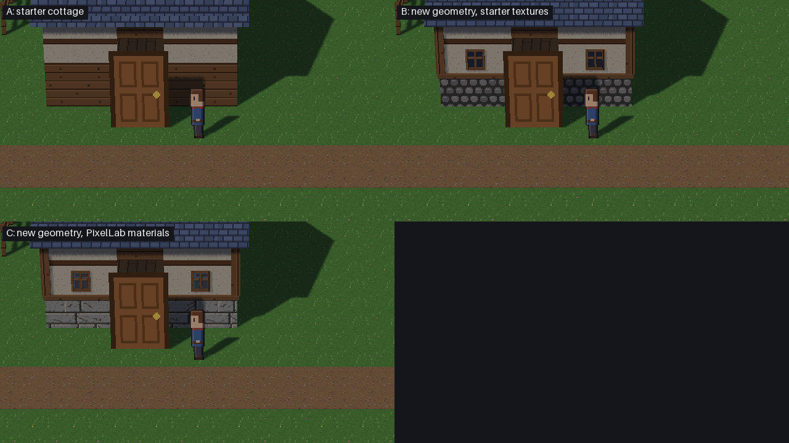
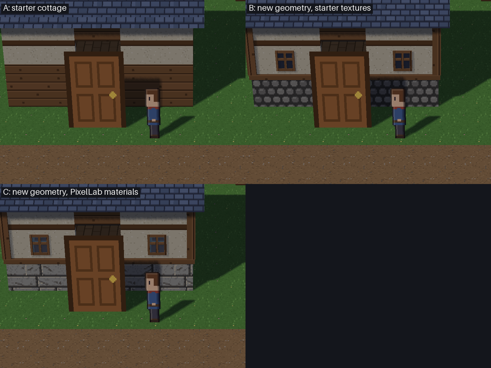
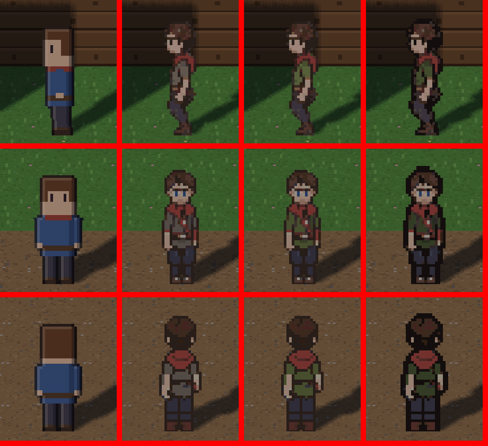

# Milestone 17, Stage 1B: controlled art refinement

**Recommendation:**

- **Adopt the cottage geometry (B)**, built with the starter textures only, together with the roof-UV fix.
- **Adopt the PixelLab stone** only after a 20-pixel repair, and only once the licence question is settled.
- **Reject every hero candidate**, and the recoloured PixelLab window.

Nothing has been adopted. The public starter art is untouched, and the owner reviews before any merge.

This stage used **zero new PixelLab generations**. Everything was corrected from the Stage 1 outputs with Blender and
procedural editing.

**Why:**

- **Cottage:** separating geometry from texture answers Stage 1's question. About **85% of the visible improvement is
  modelling with starter textures** (Art QA's estimate). The PixelLab textures add little at gameplay distance.
- **Hero:** none of the repaired candidates reads better than the starter hero at 2×. The best-scoring one (H4) won on
  a measure that it had effectively gamed.

## 1. Cottage: geometry versus texture

| Variant | What it is |
|---|---|
| **A** | The starter cottage, as shipped. |
| **B** `models/cottage_m17_geo.glb` | The new geometry with **starter textures only**:  • cobble plinth to 0.85 m  • starter plaster  • sill ring and L-shaped corner posts in starter timber, with **vertical grain**  • two modelled front windows with flat dark panes (base colour, no image)  • the starter shingles, with the **roof UV fixed** to run up the slope at 32 px/m |
| **C** `models/cottage_m17.glb` | The same geometry with **PixelLab materials**:  • stone plinth (`stone_b_seamfix`)  • recoloured window (`window_a_glass`)  • the roof stays on the starter shingles, as the brief asked |

Both B and C are built by `build_cottage_m17.py --set starter|pixellab` from the unchanged
`build_cottage.build()`. Each rebuilds to the same sha256.

Fixes from Stage 1, verified by Technical QA:

- **Window depth:** the panes are 2 cm out from the wall. That's 12.8 depth-buffer steps at the gameplay camera, up from 6.6.
- **Overlapping faces:** coplanar overlapping faces between different materials went from **60 to 0**, ending the z-fighting the cutaway exposed.
- **Room intrusion:** no framing sits inside the walls or the room.
- **Door jambs:** removed; the door sprite hid them.
- **Plinth top:** it now lands on a mortar line.

At gameplay scale, 1:1 crops of the 720-line picture (2× art), no resampling:

Close up, 1:1 crops at 4×:

More pictures:

- [the path](milestone17_stage1b_evidence/cottage_path.png);
- [walking past A, B and C at 1:1](milestone17_stage1b_evidence/cottage_walk.webp);
- Art QA's [1:1 wall comparison](milestone17_stage1b_evidence/cottage_1to1_ABC.png).

**Attribution (Art QA, measured on the renders):**

- **A→B, modelling only: the large gain.** The windows give the front a face. The plinth, sill line and corner posts turn a striped box into a timber-framed cottage on a base. Each element reads at 2×.
- **B→C, PixelLab only: small.**
  - **Stone:** the dressed stone reads better than B's cobbles, which look a little like polka dots, mostly close up.
  - **New defect in the stone:** the new texture offset brings a "phantom joint" at the texture's left edge onto the wall, repeating every 2 m in the top course ([evidence](milestone17_stage1b_evidence/stone_phantom_C_close4x_x2view.png)). Repainting about 20 px fixes it.
  - **Recoloured window:** worse than B's flat pane at 2×. Its lighter panes weaken the window (median pane L\* 22.6 against 10.4). At 4× the texture's inner frame shows as a misaligned second frame ([evidence](milestone17_stage1b_evidence/windows_BC_close_x6view.png)).

## 2. Hero: repairs judged at gameplay scale

All candidates are built deterministically from the Stage 1 sheet by `characters/build_hero_1b.py`, in the same 4×4 sheet of 32×48 frames.

| | Changes | Edge contrast at cottage / path / centre (tool) |
|---|---|---|
| H0 | the starter hero | 32.8 / 41.8 / 44.6 |
| H1 | Stage 1 PixelLab hero | 26.4 / 37.4 / 41.6 |
| H2 "repaired" | both feet down at idle; one consistent face; stray red removed; satchel removed (it was in 2 of 16 frames); even front/back rhythm | 27.7 / 36.9 / 40.3 |
| H3 "moss tunic" | H2 with the moss-green tunic the brief asked for | 27.6 / 36.9 / 40.3 |
| H4 "legible" | H3, deeper tunic, outline darkened and a 1 px outline ring | **36.1 / 53.0 / 54.7** |

The table shows the mean luminance step across the sprite's outline, from `tooling/m17_visual_pilot.py`.

**H4 is rejected despite its scores.** That metric reads only the outermost ring of pixels, which is exactly what H4 darkened. Art QA measured what the metric misses, at 1:1 in the gameplay frames:

- **Head at the cottage door:** H4's head disappears into the dark timber wall. Its colour difference from the background around it is 6.2, against 17.1 for H0.
- **Interior values:** 40–51% of H4's pixels are near-black, against 17–18% for H0. The legs merge, and the face shrinks.
- **Costume:** the torso separates from the background far less: 17–27 for H4, against 33–38 for H0's blue sweater.
- **Style:** H4 is the darkest, most heavily outlined figure in the village ([with the NPCs](milestone17_stage1b_evidence/npc_cohesion_2x_x3view.png)).
- **More signs the metric is flattered:** H3 scores within 0.1 of H2 despite a full tunic recolour. H4's cottage score moves from 36.9 to 42.8 when only the wall behind it changes.

The owner's rule, that a candidate better enlarged but worse in gameplay is rejected, therefore rejects H4. H2 and H3 sit below H0 at every spot.

**What the repairs did fix:**

- **Idle:** in column 0, both feet now rest on row 47. Stage 1 had no front or back frame with both feet down, so the agent rebuilt the stand frames by mirroring the planted leg.
- **Consistency:** the face is the same in every frame, the red is gone from the legs and mouth, and the front/back rhythm is even. Every frame of the walk clip matches its sheet frame ([all frames](milestone17_stage1b_evidence/hero_all_frames_6x.png)).

**Still wrong:**

- **Front and back walks:** the upper body is frozen with no head bob, so the walk slides.
- **Side rows:** they bob unevenly.
- **H3's moss tunic:** it blends into the grass at every spot.

The combined comparison (as shipped, against B and against C, each with H4) shows the whole package at gameplay scale:
- [beside the door](milestone17_stage1b_evidence/combined_cottage.png);
- [on the path](milestone17_stage1b_evidence/combined_path.png);
- [the village centre](milestone17_stage1b_evidence/combined_centre.png);
- [the heroes at 1:1](milestone17_stage1b_evidence/combined_hero_path.png);
- [walking](milestone17_stage1b_evidence/combined_walk.webp).

**Next hero step, if any.** Put the effort into value design, not outlines:
- a light tunic that stands apart from both grass and dirt;
- a separate trouser value;
- a clearer face;
- a single normal outline.

The comparison tool should also gain region and face contrast measures alongside the edge measure, so that what it rewards is real readability.

## 3. Independent QA

Full reports:
- [Art QA](milestone17_stage1b_evidence/art_qa_1b.md): 12 defects, 0 blockers, 3 major;
- [Technical QA](milestone17_stage1b_evidence/tech_qa_1b.md).

Both QA agents were read-only.

| Area | Result |
|---|---|
| Blender model validity | B and C pass the structural glTF checks, load in `load_glb`, have no degenerate triangles, use 32 px/m and NEAREST everywhere, and rebuild byte-identically. B's untextured panes come out as exactly (40, 46, 64) in the reader, the renderer, the Studio catalog and preview, and `mesh export`. |
| Collision and navigation | The `col_` nodes are byte-identical to the starter's. 1,450 floor queries match exactly. Wall stops, door entry, walking inside and exit are the same for A, B and C. |
| Cutaway | The player shows behind the cottage in all three. A depth-perturbation test finds no new z-fighting in B or C. |
| Studio import and reimport | B → C → starter → C → C gives correct triangle and material counts each time, with nothing left over. GL counts are stable from the first round. |
| Hero sheets | H2–H4 are RGBA 128×192 with binary alpha, feet on row 47, and nothing touching a cell edge. The clips and the auto collider are unchanged. `build_hero_1b.py` reproduces them byte-identically. |
| Performance | Median frame time over 5 interleaved rounds: A 5.03, B 5.07, C 5.07 and H4 5.01 ms, so no measurable cost. B and C add 2 draw calls, about 250 triangles and 4 KB (B) or 19 KB (C) of textures. |
| GPU resource lifetime | Textures, framebuffers and programs never drift through reloads or after close. The live buffer count drifts with Python GC timing in every variant, the starter included. That predates the pilot. |
| Texture seams and lighting | The starter textures tile cleanly. The C stone has a phantom joint at the texture's left edge (above). The shingles are now upright. |

Technical QA's other findings, and their status:

| Finding | Status |
|---|---|
| **Budget (major):** reservations accepted negative, zero and fractional amounts, and settle accepted a negative amount (`units=-3` let 45 generations through a budget of 20). | **Fixed:** whole units ≥ 1 and usage ≥ 0, with tests. |
| **Budget (major):** `sanitize` let through bare account-id fields, storage paths without a scheme, the token under unlisted key names, and tuples. | **Fixed:** it drops account, user, owner and email fields, removes storage paths with an id, redacts the environment token by default and handles tuples, with tests. |
| **Hygiene (minor):** CI has neither the token nor the account id, so the test couldn't recognise a bare one there. | **Fixed:** the test now holds their SHA-256 digests (both UUID-shaped, so the digests can't be reversed) and checks every UUID in tracked text against them. |
| **Mypy gate (minor):** the local gate checked git-ignored folders (`raw/scripts`) as well as untracked ones. | **Fixed** in `tooling/mypy_gate.py`, with a test. |
| **Mypy config (minor):** its `exclude = ["build", …]` matches any path containing "build", so `build_hero_1b.py` is never type-checked (19 errors when run directly). | Open. The config problem predates this stage; worth a separate fix. |
| **Window (minor):** the frame pieces are 4 mm apart, not 2, and the pane sticks out 2 mm past the frame. | Open. Specks show only at the joints in the 4× close-up. |
| **Provenance (minor):** the scripts that made Stage 1's `hero_m17.png` and `stone_b_seamfix.png` live only in the ignored `raw/` folder. | Open. Their steps are documented and Stage 1 QA reproduced the hero exactly. |
| **Licence line (minor):** Studio's reimport keeps "made by Mesh's own scripts" on the catalog entry, even for C. | Open. Engine behaviour; must be fixed before any third-party art ships. |
| **Floor slab (info):** in A, B and C the floor slab's bottom face flickers against the ground at the foot of every cutaway. | Open. It predates the pilot. |
| **Frame cost (minor):** the comparison tool reports one frame-cost run per variant, which is noise. | Cite Technical QA's interleaved medians instead. |

## 4. Licence and provenance

Full review: [licence_review.md](milestone17_stage1b_evidence/licence_review.md). It covers the sources, findings, options and a draft email. It is not legal advice; PixelLab's terms are governed by Swedish law.

**Sources.** PixelLab's [Terms of Service](https://www.pixellab.ai/termsofservice) (last updated 2025-11-23, read 2026-10-25), its FAQ, pricing, API and docs pages, and the CreativeML Open RAIL-M licence the terms link to.

- **Commercial use:** allowed. The subscriber owns the outputs and may use, modify and distribute them commercially, "for any purpose" (§1.3, §3.3). There is no plan-tier condition and no "no asset packs" clause.
- **Restrictions that travel with the files:**
  - **no training of AI models** on the outputs without PixelLab's written permission (§1.2, §3.3);
  - the **Open RAIL-M use restrictions** (its Attachment A), which govern how outputs are used (ToS §4.1).
  - Generated images aren't "Derivatives of the Model" under Open RAIL-M's definitions, so passing the restrictions on isn't strictly required. It is prudent and costs nothing.
- **No warranty:** PixelLab gives none on IP (§5.1).
- **No attribution required.** Note that storefronts such as Steam require games to disclose AI-generated content, so the files need labelling.
- **Correction to Stage 1:** Mesh has **no LICENSE file**; `pyproject.toml` says `LicenseRef-Proprietary`. Downstream permissions are undefined even for today's starter kit. The question isn't compatibility with an open licence; Mesh first needs a licence for its kit at all.

**If PixelLab files ship in a downloadable starter kit:**

| Mesh could grant | Mesh could not grant |
|---|---|
| Use, modification and redistribution in games, commercial or not | Permission to train AI models |
| | Release from the Open RAIL-M use restrictions |
| | Any warranty or any right to use PixelLab's service |

Shipping would also need all of these changes:
- **Notice:** a separate notice for those files, copied into every project (no notice is copied into projects today).
- **Kit documents:** corrections to `assets/NOTICE.md`, the kit's PROVENANCE and `docs/packaging.md`, which say the kit is all Mesh's own.
- **Catalog:** per-model licence lines (`make_starter_kit.py` stamps one string on all 14 models).
- **Packaging:** allow-list and wheel-test entries, and a `MANIFEST.in` review.
- **Studio:** a fix to its reimport so it stops keeping the old licence line.

**Options:**

- **A, recommended now:** don't ship; keep the pilot as reference. Since only the stone survived QA, little is lost.
- **B:** send the drafted clarification email, then ship under a separate notice once PixelLab confirms in writing.
- **C:** ship now under a separate notice that passes the restrictions on, accepting the ambiguities.

The **draft email** is in the review, §4.2. It covers redistribution in a kit, how far the training ban reaches, which models the Open RAIL-M clause covers, whether rights survive the subscription, attribution, and a future API integration. **It has not been sent.** Contacting PixelLab is the owner's call.

**Provenance.**

- **Coverage:** every tracked candidate has a record: endpoint, prompt, seed where the API gives one, cost and post-processing. Stage 1B adds build scripts for H2–H4 and for the window recolour.
- **Notice:** `tooling/hd2d_assets/pilot_m17/NOTICE.md` now states what is PixelLab-derived and which terms travel with it. The pilot commit was already public on GitHub, and the terms permit that distribution.
- **Redaction:** two occurrences of a truncated account-id fragment in Stage 1's Technical QA report are redacted. The fragment was not a usable id.
- **Hygiene rules:**
  - `.gitignore` excludes `tooling/hd2d_assets/**/raw/`;
  - `tests/test_generated_asset_hygiene.py` (fast tier) fails on any tracked raw record, PixelLab storage URL with an id, signed URL with an id in its path, bearer-token literal, or the token or account id themselves, matched by digest.
  - The patterns catch exactly the 10 raw files that hold the account id. They pass on the tracked tree, including Stage 1's evidence, which describes the URL form with placeholders.

## 5. PixelLab cost controls

`tooling/pixellab_budget.py` is the shared budget every future generation stage must use. It has tests in `tests/test_pixellab_budget.py`.

- **Costs:** each endpoint's cost is established in `COSTS`, with its source (Stage 1's measured `usage`):
  - `create-tiles-pro` 15;
  - `inpaint-v3` 10;
  - pixflux, bitforge and 4-direction characters 1 each;
  - template animation about 1 per direction.
  - An endpoint without an established cost is refused until its cost is found, from PixelLab's docs or one approved probe.
- **One ledger:** a single JSON ledger per stage (`init LEDGER --approved N --agents …`) is shared by all generation agents, behind a lock. Technical QA's test with 40 threads on a budget of 20 accepted exactly 20.
- **Reserve, then settle:** each request reserves its cost before it is sent, and is refused if it would exceed the approved budget. It then settles with the API's reported usage (overruns are flagged) or is released.
- **Sanitized results:** no URLs, storage paths, account or user fields, blobs or credentials.
- **Read-only QA:** QA agents are never named in the ledger, so they can't reserve. The ledger is a discipline for cooperating agents, not a security boundary: agents name themselves.

Stage 1 would have stopped at 30 under this: the texture agent's last `inpaint-v3` (10) would have been refused with 5 left. This stage made no PixelLab calls; the balance is unchanged at 3527.7 of 5000.

## 6. Housekeeping

[septimus82/Mesh#369](https://github.com/septimus82/Mesh/pull/369) was verified and merged into `redesign/visual-editor` as `4e8ea36`:
- the scope was two files: the deleted `build.yml` and its retirement document;
- CI was green on both runs;
- the branch was up to date with its base.

Issue #368 is closed. `docs/reviews/ci_build_yml_retirement.md` keeps the record of what `ci.yml` doesn't cover (Python 3.12/3.13, release-contract, content-contract, the clean-install wheel test) and how to restore each. #344 stays a draft, and `main` is untouched.

## 7. What to adopt

| Element | Adopt? | Condition |
|---|---|---|
| B geometry: windows, plinth, sill, vertical-grain posts, clean framing | **Yes** | Starter textures only, so no licence question. Optionally tidy the 4 mm window-frame gaps. Apply it to the kit's cottage builder in a separate, reviewed change. |
| Roof UV fixed to run up the slope at 32 px/m | **Yes** | The other kit roofs probably need the same remap (not yet measured). |
| C stone plinth (PixelLab) | **Later** | After the 20 px phantom-joint repair, and only after the owner chooses licence option B or C. B's cobbles are an acceptable starter-only fallback. |
| C window glass (PixelLab, recoloured) | No | B's flat dark pane reads better at 2×. |
| H2 / H3 / H4 heroes | No | None reads as well as H0 at gameplay scale. H2 is a usable base for a value-led redesign. |

Stop here for owner review. Nothing in this branch changes the public starter kit.
