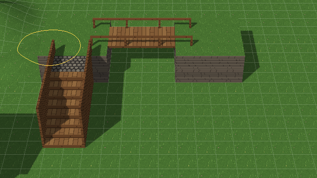
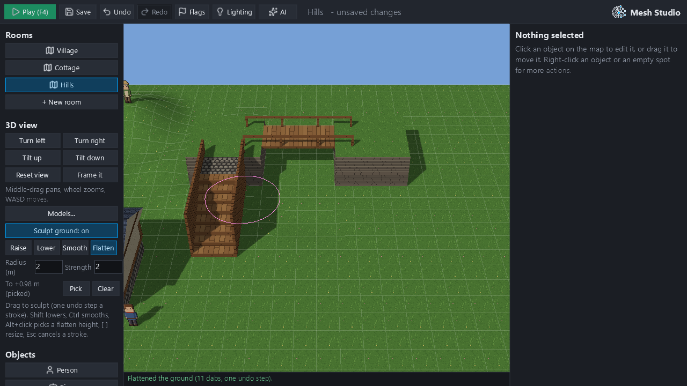
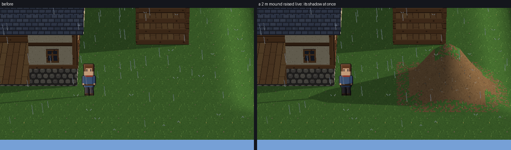
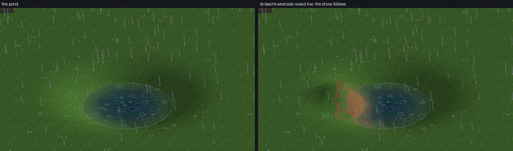
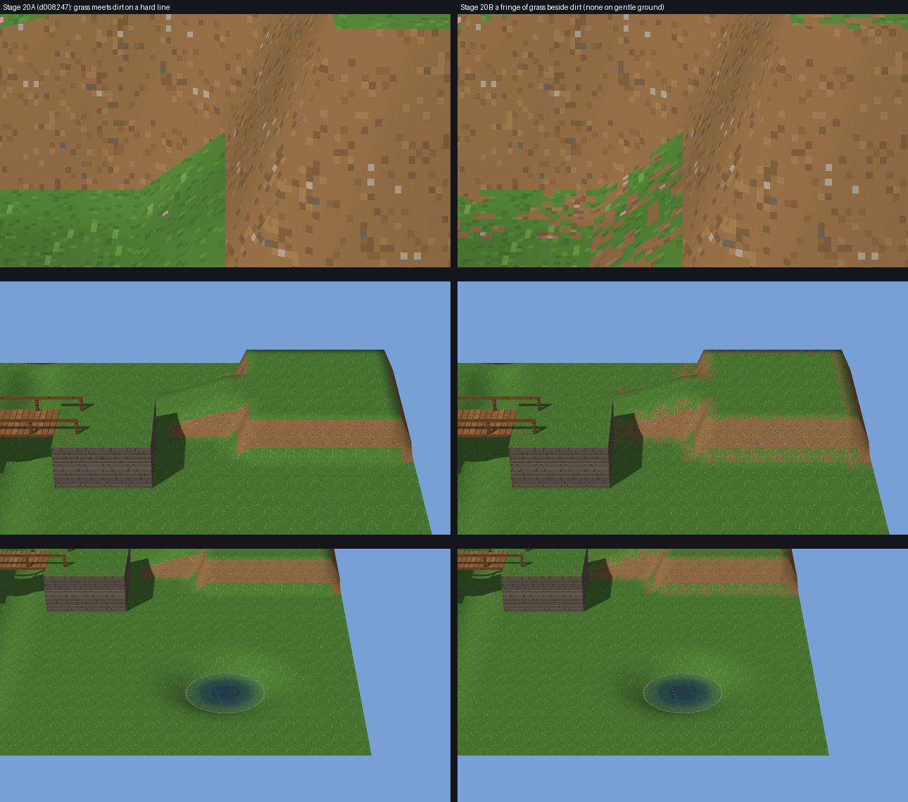

# Milestone 20B: live terrain sculpting

- **Branch:** `feature/m20b-live-sculpting`.
- **Draft PR:** [#385](https://github.com/septimus82/Mesh/pull/385), into `redesign/visual-editor`.
- **Builds on:** Stage 20A (#384, merged as `d008247`).
- **In scope:** sculpting the existing heightfield live in Mesh Studio.
- **Out of scope:** no terrain material painting, palettes, biomes, foliage, rivers or audio work. The heightfield
  and Blender-authored structure collision are unchanged.

**Verdict: PASS** (details at the end).

## Summary

The Stage 20A prototype reloaded the room after every click. Mesh Studio now sculpts while the mouse is held.

- **Press, drag and release.** The ground follows the brush every frame. One stroke is one checked edit and one
  undo step.
- **Strength by time.** Strength depends on elapsed time, not on the frame rate. A 1 m/s brush held for 1.01 s
  raised the ground 0.99 m.
- **Live updates.** Only the touched chunks are rebuilt; the collision World, shadows, rain, water and picking
  follow at once.
- **Saving.** On release the stroke is committed without reloading the room. What was shown is checked against what
  was saved.
- **Safe cancelling.** Escape, Play, a room change, Ctrl+Z or a refused GPU upload cancels a stroke and leaves the
  saved ground untouched.
- **One operation.** Studio, the `mesh author` CLI and AI (MCP) share `project_ops.sculpt_terrain_stroke`.

| Workflow (the Hills room, 32 × 24 m) | Stage 20A | Stage 20B |
|---|---|---|
| Shaping a mound | A click at a time; each click 0.38 s (0.38–0.50), most of it reloading the room | Hold and drag; the ground moves every frame (median 23 ms, p95 25 ms) |
| Ground update per frame | — | 10.7 ms median (chunk meshes, buffers, World) |
| Letting go | — | 12 ms for the checked edit; 103 ms until the next frame is drawn (UI and grid included) |
| Undo steps | One per click | One per stroke (50 dabs, one step) |
| Brush size | A "Bigger" button | Radius field; `[` `]` keys |
| Lowering / smoothing | Separate tool buttons | Also Shift (lowers) and Ctrl (smooths) while held |
| Flatten target | The height where the click lands | Where the stroke starts, or a picked height (Pick, or Alt+click) |
| Feedback | A brush ring | A ring that follows the ground, coloured by tool; "Ground +x.xx m here." under the cursor; the 1 m grid follows the ground |

Everything below is measured with Mesh Studio's own window events in hidden windows, on this machine. The tooling
is `tooling/m20b_sculpt_study.py` (`studio`, `flat`, `world`, `scale`, `rechecks`). Its results are in
[`milestone20_stage2_live_terrain_sculpting_evidence/`](milestone20_stage2_live_terrain_sculpting_evidence/).

## Part A — Live brush strokes

### How a stroke works

| Stage | What happens |
|---|---|
| Press (`Hd2dView.begin_stroke`) | Records the heights as they were, plus the tool, radius, strength and flatten target. A flat room's plain ground becomes sculpted ground in place (`Hd2dRenderer.ensure_terrain`). An open stroke is ended first. |
| Drag (`stroke_to`) | Lays dabs along the path, a quarter of the radius apart, so a fast drag leaves no gaps. The time since the last dabs is shared between them. Points outside the 3D view are ignored. |
| Held still (`tick`) | The brush keeps working by elapsed time, at most 30 dabs a second. Raise and lower add `rate × dt`; smooth and flatten move `1 − e^(−rate·dt)` of the way. Panning the view pauses it. |
| Exact heights | Each dab works on the heights before rounding to the stored step (0.25 px). They are carried from dab to dab of the stroke (`Terrain.sculpt(exact=…)`). Many small dabs therefore add up exactly as a few large ones would, whatever the frame rate. |
| Each frame (`_flush_stroke`) | `Hd2dRenderer.update_terrain` rebuilds only the touched chunks and their edge neighbours; `World.update_terrain` makes collision read the same heights. |
| Release (`end_stroke`) | The dabs become one `project.edit_scene` through `sculpt_terrain_stroke`: one undo step, no reload. The saved ground is then decoded and compared with the shown one; if they ever differ, the room reloads from the saved one. The status line reports what the stroke left out of place (Part D), and only the top bar is refreshed. A stroke that changed nothing records nothing. |
| The dab limit | A stroke reaching `STROKE_DABS` (20,000) is saved, and the brush goes on as a new stroke. Nothing is lost. |
| Escape, Play, a room change, Ctrl+Z, a failed upload (`cancel_stroke`) | Puts the recorded heights back, in the drawing and the World. Nothing is recorded. A flat room goes back to the plain ground. After a refused upload, the ground is redrawn once the GPU accepts it. |

The contract is deterministic: the same dabs on the same ground give the same heights. Studio applies the dabs live
and `sculpt_terrain_stroke` applies them again to the saved scene, so what was shown is what is saved. Studio
checks this after every stroke. Only the stored chunks the stroke changed are encoded again (`Terrain.changed`), and
the result equals a full encoding (tested).

### Evidence (`studio.json`, `rechecks.json`, `flat.json`)

| Check | Result |
|---|---|
| A 50-dab Raise stroke dragged across the Hills | One undo step; shown equals saved; raised 0.36 m |
| Undo / redo | Undo gives the heights before the stroke; redo gives those after |
| Save, reopen | Same heights; nothing unsaved |
| Escape mid-stroke | The ground had changed; it is back, and nothing is recorded |
| Play (F4) mid-stroke, then Stop | Play runs the saved ground; nothing recorded; back to editing |
| Room change mid-stroke | Nothing recorded; the saved ground loads |
| A refused GPU upload (simulated out-of-memory) | "The stroke stopped: the ground couldn't be drawn (…)"; ground back; nothing recorded |
| Ctrl+Z mid-stroke | Only the stroke is cancelled (the previous edit stays); shown equals saved |
| A right-button release mid-stroke | The stroke goes on; only the left button ends it |
| Alt held when the window loses focus (Alt+Tab) | Studio forgets held keys, so no stuck Alt, Shift or Ctrl |
| A held 1 m/s brush (`rechecks`) | 0.99 m in 1.01 s. 0.1, 0.3 and 1 m/s for 2 s gave 0.195, 0.594 and 1.953 m against 0.2, 0.607 and 2.013 m; the small shortfall is the measured corner sitting slightly off the brush centre |
| Shift held; `]` then `[`; Alt+click then Flatten | Lowers; radius 64 → 80 → 64 px; picked +0.98 m, flattened towards it |
| First stroke on a flat room | The plain ground becomes sculpted ground in place; undo returns the plain ground. Esc, or a stroke that changes nothing, leaves the plain ground and no undo step |

**A continuous stroke.** [`stroke.webp`](milestone20_stage2_live_terrain_sculpting_evidence/stroke.webp) shows one
stroke frame by frame. Mid-stroke, the brush ring rides the half-raised ground:

After release:

### Invalid operations

`sculpt_terrain_stroke` refuses a bad stroke whole, with the reason, and changes nothing. Refused strokes include:

- an unknown tool;
- empty dabs, or dabs that aren't `[x, y, strength]`;
- a strength that isn't a finite number in range ("Dab 3's strength …"; smooth and flatten take a share, 0–1);
- a brush off the room's ground;
- more than 20,000 dabs;
- a non-HD-2D room;
- a target out of range.

Interaction QA also tried NaN, ±inf, negative and zero values, an unknown setting, and a valid change followed by an
invalid one in the same batch. Every case was refused whole.

**One contract.** The authoring registry discovers `sculpt_terrain_stroke` and `settle_on_ground` automatically, so
the CLI and MCP can use them. QA found that with Studio closed, the CLI crashed when changing a room it hadn't loaded
yet. This was an older bug (`Project.clone` did not copy when each file was read), and it is fixed and tested
(`test_the_cli_sculpts_a_room_that_isn_t_the_first`).

## Part B — Creator controls

The controls sit in the 3D view's existing panel under "Sculpt ground", built from Studio's own buttons, fields and
labels. There is no separate terrain editor.

- **Tools.** Raise, Lower, Smooth and Flatten, each with a tooltip.
- **Brush.** A radius field in metres and a strength field (metres a second for raise and lower, a share for smooth
  and flatten). `[` and `]` resize the brush. Values that aren't finite numbers are refused.
- **Flatten target.** "To where a stroke starts", or a picked height (Pick, or Alt+click on the landscape). Clear
  forgets the pick.
- **Modifiers.** Shift lowers and Ctrl smooths while held; Escape cancels a stroke. These keys collide with no other
  Studio shortcut (QA checked both hotkey systems).
- **Cursor.** The ring is drawn on the ground's surface, coloured by tool. The status line gives the height under
  it, without immediately replacing a warning.
- **Hints.** One line of help under the controls lists the modifiers.

## Part C — Performance

### What was slow, and what was done

| Suspect | Finding | Done |
|---|---|---|
| Full room reload per edit | 241 ms of every 380 ms click in 20A | Removed: strokes update in place, and release commits without a reload |
| Pure-Python meshing | 4.2 ms a chunk in 20A | Corners, normals and faces worked out once per chunk: 1.6 ms a chunk; a live dab's rebuild 3–7 ms in the game |
| Whole-terrain serialization | 69 ms a click at 128 m in 20A | Only changed storage chunks are re-encoded; a short stroke commits in 13 / 27 / 79 ms |
| Draw calls | 527 shadow draws at 128 m in 20A | One combined caster buffer for all terrain: 16 shadow draws at every size; main-pass chunks culled |
| Sun-shadow passes | The shadow box was fixed at load | The box is measured again after edits, so it grows and shrinks |
| NPC navigation grid | 1.36 s at 128 m | Unchanged: built lazily on the first route after a load, never per dab (a limitation) |
| Studio's grid overlay | Found in 20B: 130,000 height samples a frame at 128 m, then a 1.6 MB upload a frame | Kept per chunk and packed, in its own buffer uploaded only when it changes: idle frame at 128 m 42 → 22 ms |
| Studio's interface rebuild | Found in 20B: 270 ms after each stroke | Only the top bar is refreshed (the full panel only when the Settle button changes) |
| Anchoring on release | Found in 20B: six whole-ground parses | One pass (`left_out_of_place`) |
| Undo | Found by QA: undo reloaded the room twice (1.8 s at 128 m) | Once: 1.3 s at 128 m |

### Scale (`scale.json`, the ground sculpted all over, run alone)

| | 32 × 24 m | 64 × 64 m | 128 × 128 m |
|---|---|---|---|
| Studio stroke frame, median / p95 | 21.9 / 26.2 ms | 32.2 / 35.7 ms | 36.9 / 39.3 ms |
| Release → next frame (a 6 m stroke) | 162 ms | 210 ms | 548 ms |
| The checked edit (commit) | 12.7 ms | 27.2 ms | 78.7 ms |
| Studio idle frame (median) | 14.7 ms | 18.5 ms | 21.9 ms |
| Live dab rebuild in the game (median / p95) | 3.4 / 6.4 ms | 6.8 / 12.0 ms | 7.1 / 12.5 ms |
| Playing frame (median) | 4.7 ms | 7.8 ms | 10.4 ms |
| Draw calls / shadow draws | 36 / 16 | 47 / 16 | 72 / 16 |
| Terrain on the GPU | 1.1 MB | 5.0 MB | 19.3 MB |
| Navigation grid | 67 ms | 317 ms | 1.36 s |
| Game room load | 0.31 s | 0.45 s | 1.01 s |
| Studio room reload (also what undo costs) | 0.20 s | 0.36 s | 1.06 s |
| Save | 147 ms | 146 ms | 162 ms |
| Stored text | 85 k chars | 125 k chars | 264 k chars |

For comparison, Stage 20A:

- room load 0.22 / 0.63 / 1.6 s;
- 527 shadow draws at 128 m;
- a Studio click 0.38 s at 32 × 24.

The release grows with stroke length, because the commit replays every dab, about 1–3 ms per dab for an 8 m brush.
Performance QA measured an 11 s hold with an 8 m brush at 128 m (about 330 dabs) at about 1.1 s. Holding the brush
still is capped at 30 dabs a second for this reason. Studio frame times include a framebuffer readback (3–5 ms), so
they are slightly pessimistic.

### Budgets per size

These are budgets for the sculpting workflow on this machine, not CI budgets; CI timing budgets are unchanged.

| Room | Stroke frame p95 | Release → next frame (short stroke) | Undo | Met |
|---|---|---|---|---|
| Normal (≤ 32 × 32 m) | ≤ 33 ms (30 fps while painting) | ≤ 250 ms | ≤ 300 ms | Yes: 26 ms, 162 ms, ~0.2 s |
| Large (≤ 64 × 64 m) | ≤ 50 ms | ≤ 400 ms | ≤ 500 ms | Yes: 36 ms, 210 ms, ~0.4 s |
| Very large (≤ 128 × 128 m) | ≤ 66 ms | ≤ 1 s | ≤ 1.5 s | Yes: 39 ms, 548 ms, 1.3 s. Usable; the pauses on release and undo are noticeable |

## Part D — Anchoring

Sculpting never moves anything. After every stroke, Studio and the operations report what the stroke left out of
place, in the status line and the AI/CLI summary:

- an object above or below the ground under its feet;
- a structure sunk into the ground, or now standing above it;
- water now under the ground, or standing in the air.

Only what this edit left out of place is listed; a bridge or platform that was never on the ground is not.

Settling is explicit:

- `settle_on_ground(scene, entity_ids, structure_ids)` stands the named objects on the ground under their feet, and
  the named structures on the ground under their centre.
- Studio's "Settle on the ground (N)" button does the same for what the strokes left out of place. Its list belongs
  to its room and keeps only what is still out of place. QA found it carried to another room and edited that room's
  same-id structure, and made empty undo steps after an undo; both are fixed.
- Water is never settled: its level is a choice.

| Case | Covered by | Result |
|---|---|---|
| An NPC on a hill raised under them | `test_sculpting_never_moves_what_stands_there_…` | Reported "'Elder' is 0.x m below the ground", not moved; settle stands them on it |
| Someone on a platform | same | Not reported (never on the ground) |
| A partly buried building | `test_anchoring_reports_water_…_and_settles_structures` | Reported by id; settle raises it onto the ground |
| A valley dug under a structure; a bridge already above the ground | `test_a_valley_dug_under_a_structure_…` | The hut is reported "above the ground" and not moved; the bridge is not reported |
| Bridges and underpasses (the Hills room) | `test_the_player_walks_the_sculpted_ground_…` (GPU, 20A) | Walked over and under |
| Water left under new ground / standing in the air | `test_anchoring_reports_water_…` | Both reported; water never settled |
| Players at different elevations in different rooms | `test_settling_the_shared_player_settles_it_in_its_room_only` | Each room keeps its own start elevation |
| A hand-made shared player definition with an elevation | `test_a_hand_made_shared_player_keeps_its_elevation_without_migration`; interaction QA | The definition keeps it on save; a room stores its own only where it differs; `prefabs.json` isn't rewritten. No project is migrated |
| The Settle list after a room change and after undo | `test_qa_s_findings_stay_fixed` (GPU) | Empty in another room; pruned after undo |
| Save, reload, room changes, Play | `studio.json`; interaction QA | Exact heights; nothing moved; Play uses the saved ground; a steep raised wall blocks the player |

No existing project is migrated or modified automatically.

## Part E — Rendering consistency

A live edit updates each system from the same heights (`world.json`). Rendering QA compared live-edited rooms with
fresh loads of the same saved heights, pixel by pixel, after:

- a stroke, undo and redo;
- Esc;
- a tall spike put back;
- a mound by a lamp, and one lowered away;
- a pond shore raised and restored;
- an edit at a chunk corner and one at the room's edge.

After the fixes, every comparison is **0 px different**.

| System | How it follows | Evidence |
|---|---|---|
| Terrain buffers | Only the touched chunks and their edge neighbours are rebuilt | 0 chunk edges not meeting; 0 px against fresh loads |
| Sun shadows | The combined caster buffer is updated per chunk; the room's box (and the sun's map) is measured again after each edit, so it grows and shrinks | A 2 m mound raised live darkens 15,359 px west of it (`live_shadow.png`); box top 6.3 → 50.5 m for a 48 m spike, back to 6.3 m when it is removed or the stroke is cancelled |
| Lamp shadows | Lamp maps are redrawn when an edited chunk is within their reach | 0 px against a fresh load next to a lamp |
| Rain | Precipitation maps are invalidated | Rain stops on the mound at 1.92 m (its top is 2.0 m) |
| Water | The terrain-height texture is rewritten in place | Water pixels 20,572 → 17,106 when the basin's west side is raised (`live_water.png`); 0 px after restoring |
| Picking and cursor | `Terrain.ray` reads the live heights | The ring rides the ground mid-stroke (`stroke_mid.png`) |
| Collision and navigation | The World reads the heights (`surface_at`) | The player walks onto a live-raised mound (elevation 0.993 m = the ground); an NPC route crosses it; after a stroke and after undo, collision matches the shown ground |
| Shadow casters at the room's edge | A chunk's caster slot holds four skirt sides | QA: grounds 16 cells across lost an edge wall's shadow (62,903 px); now 0 dropped |
| GPU objects | Freed on release | Level over 40 game edit/undo cycles, 12 Studio stroke/undo cycles at 128 m, room changes and Play/Stop |

**Rooms without sculpted ground are unchanged.** These were rendered with this branch and with `d008247`:

- the template village and cottage;
- the M19 water village, dry and in rain (pond and puddle views);
- a 2D room.

All seven pictures are 0 px different, and the walkable places and a scripted walk are identical.

## Part F — Material

**Findings.** In 20A, each cell is the ground's texture or dirt: dirt once a face's normal z falls below 0.75 (about
41°). Grass therefore meets dirt on a hard, cell-shaped line at every cliff. The dirt is the starter kit's (plain
earth without it).

**First attempt, rejected by QA.** A slope band (normal z 0.75–0.85) in a texel checkerboard of grass and dirt.
Rendering QA showed that it hatched gentle basins, which have no dirt at all, with a red-brown lattice, and that it
aliased into stripes on ramps.

**Done.** A one-cell fringe, only on grass cells beside a dirt cell. Its texture, made at load, is the ground's
texture with fixed 2 × 2-texel clumps of dirt (about two in five). Gentle ground looks exactly as in 20A, and cliffs
get a worn edge. A corner's change can alter the fringe two cells away at most, and `chunks_of` already redraws that
far. The meshes are verified identical to an unoptimised reference, and meshing costs 1.6 ms a chunk.

**Not done.** A per-room choice of steep texture, material painting, palettes and biomes are out of scope.

## QA

Three Opus QA agents worked independently, in hidden windows only, through Studio's own window events. They edited
no repository file.

**Rendering and visual consistency.** Four defects, none blocking; all fixed and verified at 0 px:

- the room's box only grew, so shadows stayed coarse after Esc or after lowering a tall edit;
- the caster slot dropped edge walls for grounds 16 cells across;
- a flat room's cancelled or no-op first stroke left sculpted (flat) ground;
- the checkerboard band read as a third material (replaced, Part F).

Two code-reading notes were not reproduced:

- a lamp far from a lowered edit could keep a stale map;
- the grid cache is keyed by object identity.

**Interaction, undo/redo and collision.** Four major and several minor defects; all fixed, rechecked with QA's own
probes and pinned by `test_qa_s_findings_stay_fixed`.

- *Strength depended on the frame rate.* Small dabs rounded away: 0.1 m/s for 2 s gave 0.008 m, and at 240 fps a
  1 m/s brush did twice as much as at 30 fps. Exact heights are now carried through the stroke.
- *A stroke past 20,000 dabs was discarded on release.* It now saves at the limit and goes on.
- *Alt, Ctrl or Shift stuck after Alt+Tab*, so every click became a pick. Studio now forgets held keys on focus
  loss.
- *The Settle button acted in another room* on a same-id structure.
- *Minor:*
  - Settle made empty undo steps after an undo;
  - the height readout pushed warnings off the status line;
  - a right or middle release ended a stroke, and panning kept the brush working;
  - strokes kept sculpting beyond the view's edge;
  - Ctrl+Z mid-stroke also undid the previous edit;
  - NaN or inf was accepted as a field minimum or maximum.
- *Not 20B's, but it blocked the CLI:* the `Project.clone` crash above.
- *Left as is (cosmetic):*
  - a field keeps showing rejected text;
  - `[` `]` mid-stroke changes the next stroke's radius, not the running one's.

**Performance, scaling and lifetime.**

- *Major: undo at 128 m took 1.8 s* (two reloads). Now 1.3 s.
- *Major: the dab-limit loss* (above).
- *Minor, fixed:*
  - the caster slot (above);
  - the grid re-uploaded every frame (3.9 ms at 128 m).
- *Minor, measured and documented:*
  - the release grows with stroke length (Part C);
  - edits near shadow-casting lamps redraw every lamp's map each frame (+10 ms a stroke frame at 128 m with two
    lamps);
  - the water's height texture is rewritten whole per edit (about 4.7 ms at 128 m, rooms with water only).
- *Checked and fine:*
  - GPU object counts level over strokes, undo, room changes and Play/Stop;
  - Python memory: about 0.5 MB per undo step (snapshots);
  - the grid cache always equal to a fresh computation;
  - no reloads on release;
  - flat frame times over long holds;
  - save size stable.

## Gates

| Gate | Result |
|---|---|
| Fast tier (`pytest -m fast`) | 4,737 passed, 6 skipped |
| Terrain unit tests (`tests/test_terrain.py`) | 41 passed |
| GPU suites (`MESH_GL_SMOKE=1`: terrain, Studio, runtime, lighting, floors, cutaway, water, weather, particles, starter, visual standard, character shadows) | 95 passed, plus `test_qa_s_findings_stay_fixed` |
| Ruff gate | ok |
| Mypy gate | Only the two existing `tooling/hd2d_lab` errors from the base |
| Rooms without terrain against `d008247` | 0 px in 7 pictures; walkable places and walk identical |
| CI (Linux, Windows) | The checks on [#385](https://github.com/septimus82/Mesh/pull/385); a Windows timing-budget failure, if any, is the known #373 (budgets unchanged) |

## Remaining limitations

- **Very large rooms pause on release and undo.** At 128 m: 0.55 s after a short stroke, about 1 s after a long
  held stroke with a large brush (the commit replays every dab), and 1.3 s for undo (it reloads the room). Normal and
  large rooms stay within budget.
- **The NPC navigation grid** (1.36 s at 128 m) is built on the first route after a load. In the game this is a
  one-off hitch; it predates 20B.
- **Lamps near an edit** are all redrawn while a stroke passes near them, and **water's height texture** is rewritten
  whole per edit. Both costs show only in rooms that have lamps or water.
- **During a stroke** the 1 m grid keeps its old heights; it catches up on release.
- **Cosmetic:**
  - a brush field keeps showing rejected text;
  - `[` `]` mid-stroke applies to the next stroke.
- **Heightfield limits stand:** caves and overhangs remain structures' job.

## Verdict

**PASS.**

Mesh Studio now sculpts the HD-2D ground live:

- hold and drag, with strength by time and smooth interpolation;
- only the changed chunks rebuilt, and collision from the same heights;
- one stroke, one undo step;
- safe cancels;
- exact undo, redo, save and reopen;
- one validated operation for Studio, the CLI and AI, checked after every stroke so the preview can't diverge from
  the save.

Water, shadows, lamps, rain, picking and collision follow every edit, matching a fresh load to the pixel. The
controls sit in Studio's existing panel. Anchoring never moves anything, says what is out of place, and settles only
on request, and no project is migrated. Normal-size rooms paint at 30+ fps with sub-quarter-second releases. Very
large rooms are usable, with the release and undo pauses listed above. All defects the three QA passes found are
fixed except the cosmetic ones listed.

Stage 20B stops here for owner review. Material painting, foliage, rivers and audio work have not been started.
