# Milestone 20C: terrain materials

- **Branch:** `feature/m20c-terrain-materials`.
- **Draft PR:** [#386](https://github.com/septimus82/Mesh/pull/386), into `redesign/visual-editor`.
- **Builds on:** Stage 20B (#385, merged as `8216592`).
- **In scope:** painting materials onto the sculpted heightfield in Mesh Studio, the material transitions, and
  natural paths.
- **Out of scope:** no foliage scattering, rivers, waterfalls, biome systems, erosion or audio work, and no PixelLab
  generations. The heightfield, its collision and the live-sculpting architecture are unchanged.

**Verdict: PASS** (details at the end).

## Summary

Mesh Studio's 3D view gets **Paint ground** beside **Sculpt ground**.

- **Painting.** Hold the mouse on the ground and drag to paint it Earth, Stone, Mud or Sand, or Grass again.
  - Each stroke is one undo step, saved without reloading the room.
  - Undo, redo, save and reopen give byte-identical paint.
- **Pixel-art borders.** Every texel shows exactly one material, picked from the painted weights at that texel. Edges
  are crisp pixels along smooth curves.
  - **Soft** (the default): a fixed noise makes borders wander a little, and bare earth shows along cliff tops.
  - **Hard:** borders lie exactly where they were painted.
- **What paint doesn't touch.** No height changes, so collision and NPC navigation are untouched.
  - Rooms that are never painted store and allocate nothing new.
  - Rooms without sculpted or painted ground render identically to 20B: 0 px in 6 pictures.
- **One validated operation** for Studio, the `mesh author` CLI and AI: `project_ops.paint_terrain_stroke`, which
  replays the dabs. Studio saves the chunks it drew through the checked `set_terrain_paint`, so what was shown is
  what is saved.
- **The 20B speckled fringe is retired.** Soft edges replace it; Hard edges give the clean 20A boundary. The
  comparison is in Part 4.

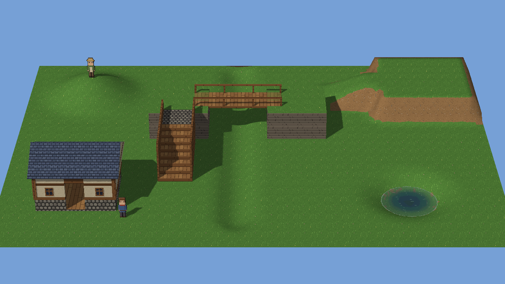

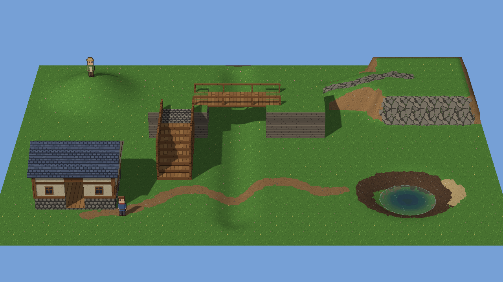

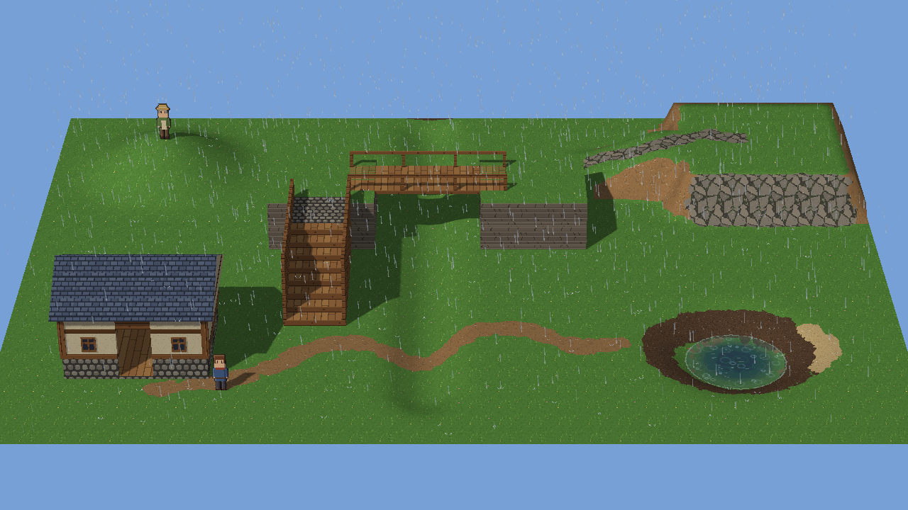

All measurements below use Mesh Studio's own window events in hidden windows on this machine. The tooling is
`tooling/m20c_material_study.py`, with the commands `look`, `edges`, `studio`, `flat`, `scale` and `identity`.
Results and pictures are in
[`milestone20_stage3_terrain_materials_evidence/`](milestone20_stage3_terrain_materials_evidence/).

## 1. Architecture

### What was there (reviewed first)

| Part | Stage 20B |
|---|---|
| Heights | `settings.hd2d.ground.terrain.chunks`: int16 per corner, sparse base64 chunks of 16 × 16 corners, sorted keys |
| Chunk meshes | Per chunk, three vertex lists in the ground's format (position, normal, uv): gentle cells, a "fringe" of gentle cells next to steep ones, and steep cells (with the border skirt) |
| UV mapping | Gentle: world metres (32 texels a metre, as the flat ground). Steep: box-mapped onto the face's side, so texels keep their size on a cliff |
| Textures | The ground's own (grass) on gentle cells; `dirt.png` on steep cells; a CPU-made grass/dirt speckle texture on the fringe |
| GPU buffers | One vertex buffer per chunk and kind (up to three draws a chunk); one combined position-only buffer for the sun's shadows, lamp shadows and rain maps |
| Collision and navigation | Read the same heights (`Terrain.surface_at`); the mesh is drawing only |

### What changed

| Part | Stage 20C |
|---|---|
| Paint storage | `ground.terrain.materials`: four bytes per corner (earth, stone, mud, sand weights, 0–255; grass is what is left), in the same sparse, sorted 16 × 16 chunks as the heights. All-zero chunks are left out. `"edges": "hard"` is written only when chosen. A 20B room reads and writes byte for byte as before, with no new keys. |
| Chunk meshes | Two lists (gentle, steep), with the same triangles as 20B's three. The fringe is no longer a separate mesh: it is decided per texel. Verified: all 101 chunks of two sculpted grounds give identical triangles to 20B's gentle + fringe + steep. |
| Drawing | Sculpted ground draws with its own program (`GROUND_FS`). Per texel it reads the painted weights at the texel's centre (bilinear across the corners), nudges each by a fixed value noise of that texel (soft edges only), and shows the winning material's tile. Steep faces do the same with their box-mapped uv, and unpainted they show earth, as before. |
| Textures | One 256 × 32 atlas (32 KB) of the materials' tiles, plus one RGBA paint texture of one texel per corner, made only once something is painted (264 KB at 128 × 128 m). |
| Live painting | A dab updates the paint bytes, and the frame sends one rectangle of the paint texture. No chunk mesh, shadow map, rain map, collision or navigation is rebuilt. |
| Collision | Unchanged. Paint is visual only, and the physical terrain is untouched (tested). |

Unpainted rooms pay nothing new: no paint texture, no paint bytes, nothing stored. The ground program is compiled
only for rooms with sculpted or painted ground.

### The materials

| Material | Gentle ground | Steep faces | Source |
|---|---|---|---|
| Grass | The ground's own texture (the template's `grass.png`) | Earth | — |
| Earth | `dirt.png` | `dirt.png` | existing starter kit |
| Stone | `stone.png`: irregular slabs with dark joints, a little moss | `stone.png` (one stone face; see Art QA) | new, `tooling/hd2d_assets/pixel_textures.py` |
| Mud | `mud.png`: wet dark earth with a scattered sheen | `mud.png` | new, same script |
| Sand | `sand.png`: pale grains, a few shell-white specks | `sand.png` | new, same script |

- **Origin and licence.** All three new tiles are original, drawn in code from fixed seeds: 32 × 32, one tile a
  metre, seamless, the same density and nearest filtering as the kit. They are not PixelLab art and have no
  third-party source.
- **Where they ship.** The kit's `PROVENANCE.md`, the wheel's allow-list and the HD-2D template's file list include
  them.
- **Projects made before 20C** read Mesh's own copy. Nothing is written into the project: no migration, no
  modification.
- **If a file is missing** entirely, the material shows its plain colour.

## 2. Live terrain painting in Studio

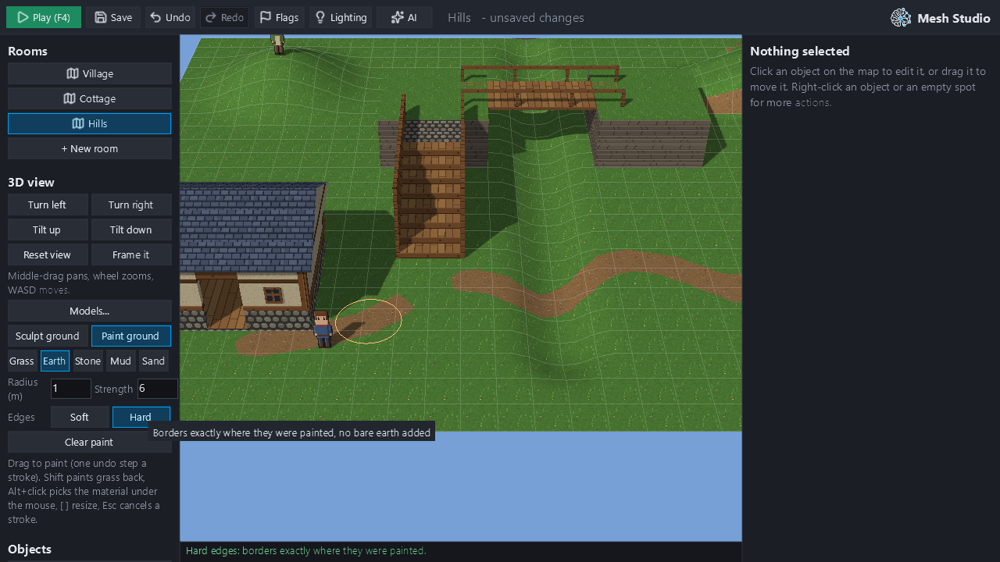

### The controls

The controls share the 3D view panel's existing section, in Studio's own buttons, fields and tooltips. Sculpt
ground and Paint ground are a pair of toggles. Paint's controls appear only while it is on.

| Control | What it does |
|---|---|
| Grass / Earth / Stone / Mud / Sand | The material (Grass paints the others away) |
| Radius (m), Strength | 0.25–16 m (`[` `]` too); strength is a rate per second, so a held or slow brush paints more |
| Edges: Soft / Hard | The room's border style, one undoable edit (a click on the current one records nothing) |
| Clear paint | All the room's paint off, heights kept, one undo step |
| Shift | Paints grass back with any material selected |
| Alt+click | Picks the material under the mouse |
| Esc | Cancels the stroke |
| Cursor | The ring follows the ground in the material's colour; the status line says "Ground +0.50 m here, earth." |

### How a paint stroke works

| Stage | What happens |
|---|---|
| Press | Records the paint as it was. A plain room's ground becomes painted ground in place. |
| Drag, hold | Dabs a quarter of the radius apart, worth the time since the last ones; held still, up to 30 dabs a second. The falloff scales the rate (`1 − (1 − s)^falloff`), so n small dabs paint exactly what one big one does at every distance, whatever the frame rate (tested). Weights before rounding are carried through the stroke. Each dab's position is rounded once, so the shown dab is the recorded one. |
| Each frame | One rectangle of the paint texture is sent: median 0.03–0.06 ms. |
| Release | The chunks the stroke touched are saved as drawn (`set_terrain_paint`, which checks each one): one undo step, no reload. The saved text is compared with the drawn chunks, and the room would reload from the saved one if they ever differed. That happened 0 times in all runs. |
| Esc, Play, a room change, Ctrl+Z, a refused upload | The paint goes back on screen and nothing is recorded. A plain room goes back to the plain ground. |
| Focus lost (Alt+Tab) | The stroke ends where it is, as one undo step, and paints no more. This also fixes 20B's sculpt stroke, which kept working without a release. |
| Very long strokes | A stroke reaching `STROKE_DABS` is saved in parts, and the status line says so. |

### Results (`studio` and `flat`; the Hills room, 32 × 24 m)

| Check | Result |
|---|---|
| A winding earth path, one continuous stroke at about 3 m/s (370 drag frames, 356 dabs) | Frame median 15.09 ms, p95 17.72 ms; upload median 0.06 ms |
| Letting go | 7.1 ms for the checked edit; 99.4 ms to the next frame (UI included) |
| Undo steps added | 1 |
| Shown = saved; heights unchanged; collision unchanged | True; True; True |
| Undo gives the paint before; redo the paint after; saved clean | True; True; True |
| Esc / Play / room change / refused upload mid-stroke: nothing recorded, paint as saved | all True |
| Focus lost mid-stroke | ended, one undo step, paints no more |
| Shift paints grass; Alt+click picks | grass; earth |
| `[` `]` | 32 → 40 → 32 px |
| Hard edges, one undo step; Soft when soft | hard, then soft after undo; 0 undo steps |
| A mound sculpted across the path (0.534 m) | paint kept; still earth there; a branch painted over it: earth |
| Save, close, reopen | identical: True |
| A plain room's first stroke (Village) | paint stored, no heights; frame p95 16.98 ms; undo and Esc give the plain ground back: True, True |

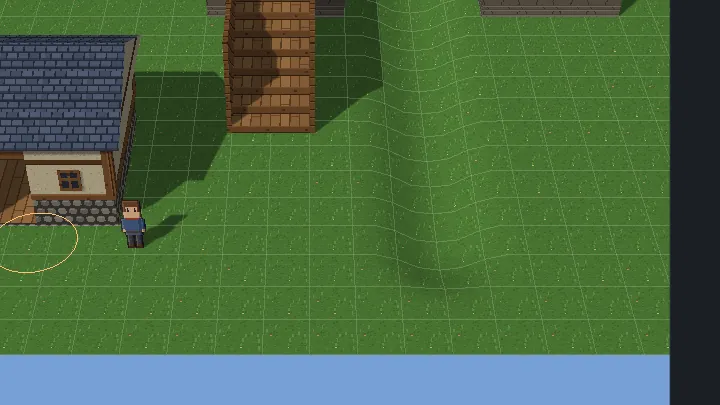

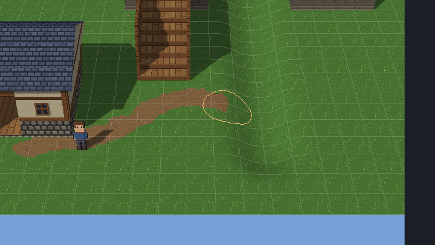

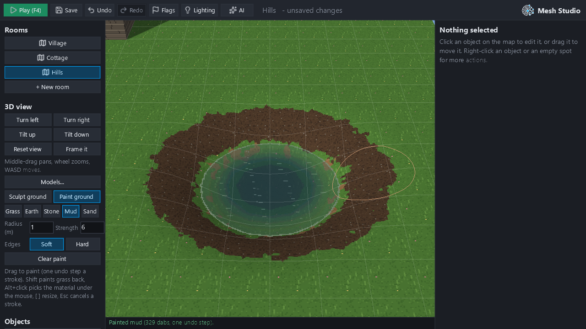

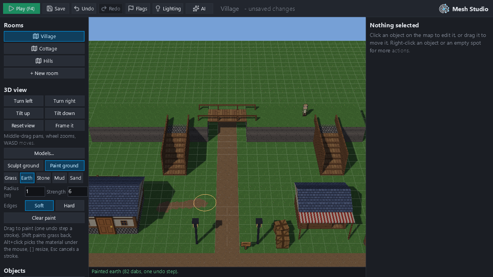

### One operation for Studio, the CLI and AI

| Operation | Used by |
|---|---|
| `paint_terrain_stroke(material, dabs, radius)` | AI and the `mesh author` CLI: the same dabs always give the same stored text |
| `set_terrain_paint(chunks)` | Studio's release (and anyone holding drawn chunks); every chunk is checked |
| `set_terrain_edges(edges)` | Studio, AI and CLI |
| `clear_terrain_paint()` | Studio, AI and CLI; the way out of unreadable paint |

All of them are discovered by the authoring registry. The AI's change summary describes paint in words, for example
"ground painted: stone about 12 m²" and "material edges hard".

Each operation refuses bad input with the reason:
- an unknown material;
- empty, malformed, non-finite or too many dabs;
- strength outside 0–1, or a radius below 0.25 m;
- a brush off the ground;
- a room that isn't HD-2D;
- broken chunks: not base64, the wrong size, outside the ground, or a corner over 255.

## 3. Natural paths

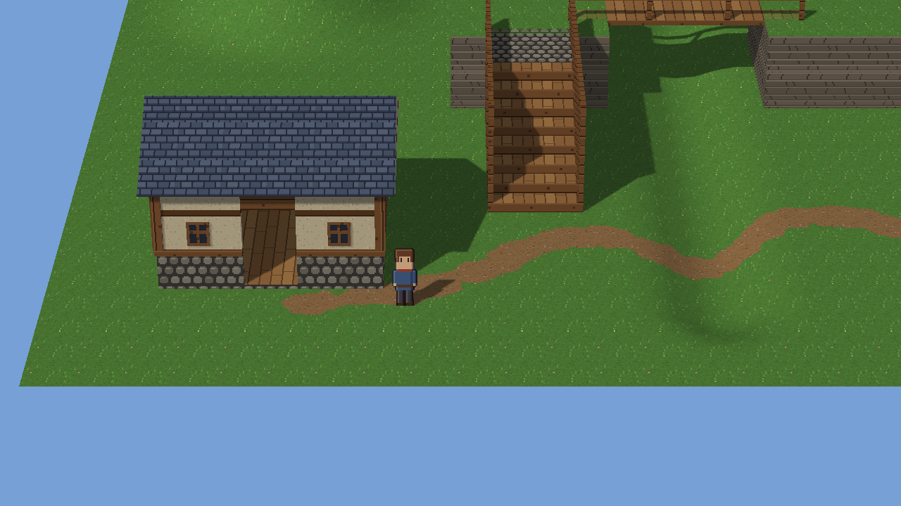

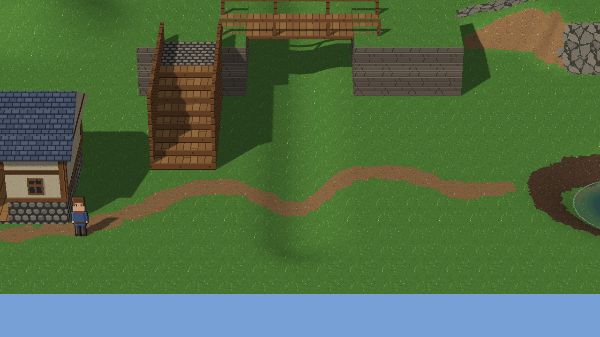

| Requirement | Result |
|---|---|
| Follows slopes | Paint is laid in plan, and the path goes down the valley's side and up again with the ground (pictures above). Gentle faces use world-metre uv as grass does; steep faces box-map, so nothing stretches on a cliff. |
| Coherent at the gameplay camera | Every picture here uses the approved HD-2D gameplay camera |
| Organic curves | A creator's drag is a curve. The study drags along a spline at about 3 m/s; the border follows the weights' smooth contour, not the 0.5 m cells. |
| No repeated grid pattern | The border noise comes from a hash of the texel's world position, so it never repeats. Art QA's tile fixes removed the visible per-metre marks in mud. |
| Navigation and collision | Unchanged: heights are byte-identical after painting; `World.heights_at` at 12 probes and the whole navigation grid are equal (tested). |
| Editable after sculpting | A 0.57 m mound raised across the painted path keeps its earth and follows the new shape; a branch is then painted up over the mound. Paint survives sculpting, flattening and edge changes (tested). |

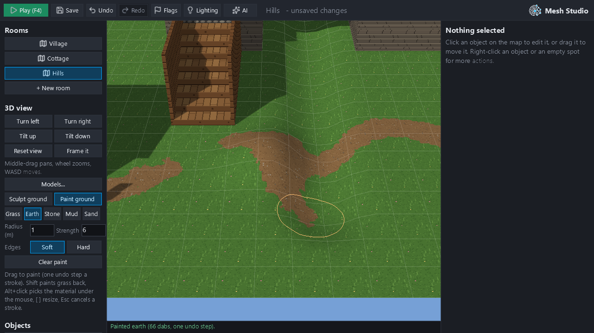

No road-network generator was built.

## 4. Material transitions

20B's grass/dirt fringe was a CPU-made texture: grass with 2 × 2 dirt clumps over two cells in five, on a one-cell
band beside every steep cell. Three treatments were compared at the gameplay camera, on the same room and views
(20B rendered from its own tree):

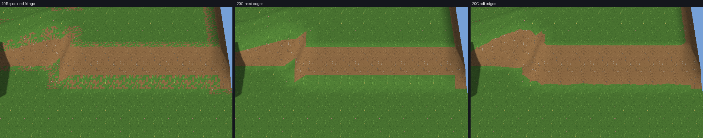

| Treatment | At gameplay distance |
|---|---|
| 20B speckled fringe | A noisy checkerboard band; the worst of the three (Art QA agrees) |
| 20C hard edges | Clean curves exactly on the paint. Cliff tops meet grass on the cell line, as in 20A. Smooth, but cut-out looking. |
| 20C soft edges | Crisp pixel borders that wander in bays and points (value noise 9 and 3 texels across). Bare earth for grass where the corner normals tilt (cliff tops, the steepest gentle ground), never over paint. No checkerboard, no comb, no stray single pixels. |

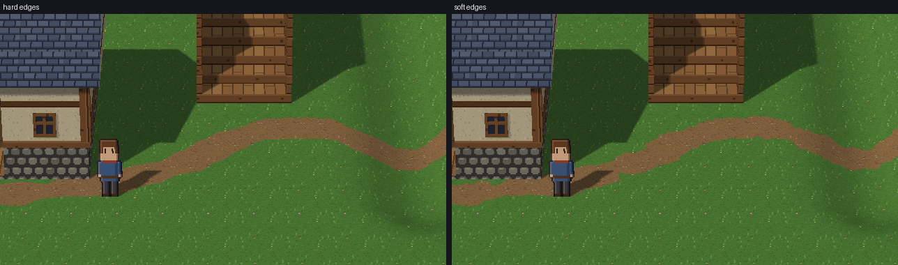

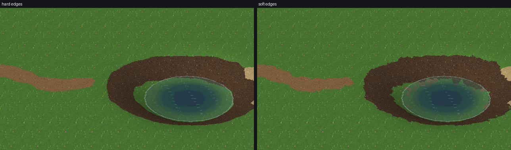

**Decision:**
- **Soft is the default.** Art QA judged it better than a deliberate hard boundary.
- **Hard is kept** as a per-room option (`"edges": "hard"`).
- **Effect on 20B rooms.** Their cliff tops change from the speckle to the soft edge. Their geometry, heights,
  collision and everything else are unchanged.

## 5. Performance

Measured by `scale`, run alone. Each size is a ground sculpted all over (rolling hills and terraces with cliffs),
raining, with shadows. It was measured unpainted, and painted about half over with every material, as about 30
short winding strokes per 100 m².

| | 32 × 24 unpainted | 32 × 24 painted | 64 × 64 unpainted | 64 × 64 painted | 128 × 128 unpainted | 128 × 128 painted |
|---|---|---|---|---|---|---|
| Stored (characters, whole room file) | 84,962 | 107,255 | 125,264 | 232,408 | 264,043 | 657,962 |
| …of which paint | 0 (0 chunks) | 21,888 (16 chunks) | 0 (0 chunks) | 105,336 (77 chunks) | 0 (0 chunks) | 387,144 (283 chunks) |
| Game room load | 341.8 ms | 320.9 ms | 441.1 ms | 461.1 ms | 890.2 ms | 957.2 ms |
| Game frame CPU, median / p95 | 5.59 / 5.94 ms | 7.16 / 10.57 ms | 4.75 / 8.44 ms | 3.94 / 6.97 ms | 5.12 / 8.09 ms | 3.79 / 4.23 ms |
| Draw calls (terrain draws) | 34 (18) | 34 (18) | 41 (96) | 41 (96) | 67 (357) | 67 (357) |
| GPU: terrain meshes + paint texture + tiles | 1.1 MB + 0 KB + 33 KB | 1.1 MB + 13 KB + 33 KB | 5.0 MB + 0 KB + 33 KB | 5.0 MB + 67 KB + 33 KB | 19.3 MB + 0 KB + 33 KB | 19.3 MB + 264 KB + 33 KB |
| Studio reload | 348.4 ms | 226.6 ms | 340.5 ms | 344.9 ms | 824.3 ms | 831.8 ms |
| Paint frame, median / p95 (1 m brush) | 15.91 / 19.14 ms | 16.18 / 20.57 ms | 10.74 / 11.58 ms | 13.53 / 19.62 ms | 16.5 / 20.89 ms | 16.52 / 21.54 ms |
| Paint upload a frame, median / p95 | 0.06 / 0.1 ms | 0.06 / 0.1 ms | 0.03 / 0.08 ms | 0.03 / 0.08 ms | 0.03 / 0.08 ms | 0.03 / 0.07 ms |
| Commit / release to next frame | 7.2 / 117.8 ms | 7.6 / 105.4 ms | 10.1 / 70.8 ms | 12.7 / 80.1 ms | 21.3 / 87.4 ms | 30.3 / 101.4 ms |
| 16 m brush held 3 s: frame p95 / release | 26.68 / 99.8 ms | 25.76 / 98.1 ms | 21.62 / 75.5 ms | 22.41 / 83.9 ms | 29.07 / 83.9 ms | 30.23 / 92.4 ms |
| Mismatch reloads | 0 | 0 | 0 | 0 | 0 | 0 |
| Undo (key and frame) | 0.54 s | 0.50 s | 0.83 s | 0.69 s | 1.20 s | 1.27 s |
| Save | 168.0 ms | 166.4 ms | 141.2 ms | 132.4 ms | 135.2 ms | 135.0 ms |
| Studio idle frame p95 | 20.99 ms | 20.16 ms | 12.27 ms | 21.21 ms | 24.0 ms | 22.26 ms |

Performance QA measured the ground pass alone on the GPU, 64 m room:

| Ground pass | 720p | 1080p |
|---|---|---|
| 20B | 0.03 ms | 0.07 ms |
| 20C, unpainted | 0.08 ms | 0.16 ms |
| 20C, painted | 0.41 ms | 0.87–0.93 ms (before the early-out below) |

- **Shader early-out.** A texel whose leading material wins by more than the noise can move skips the noise entirely.
  It changes no pixel: the unpainted pictures are 0 px different.
- **Draw calls are lower than 20B's:** at most two a chunk, against three. At the 64 m gameplay camera that is
  39 against 46.

| Proposed budgets (this machine, brush ≤ 8 m) | Paint frame p95 | Release | Undo |
|---|---|---|---|
| ≤ 32 × 24 m | ≤ 33 ms | ≤ 300 ms | ≤ 0.6 s |
| ≤ 64 × 64 m | ≤ 40 ms | ≤ 400 ms | ≤ 0.8 s |
| ≤ 128 × 128 m | ≤ 50 ms | ≤ 500 ms | ≤ 1.5 s |
| Any brush held up to 10 s | | ≤ 1 s | |

All are met (table above).

## 6. Visual acceptance

The study scene is the 20A Hills room, painted only through the checked operation:

| Element | Painted as |
|---|---|
| Winding path | Earth, from the cottage down into the valley south of the bridge, up to the pond |
| Grassy hill | Left grass |
| Exposed rocky slope | Stone up the ramp onto the terrace and over the terrace's cliff and top edge |
| Pond | Mud on its banks, a little sand on the far side |
| Structures | The template's bridge, platforms, stairs and cottage (Blender models), unchanged |

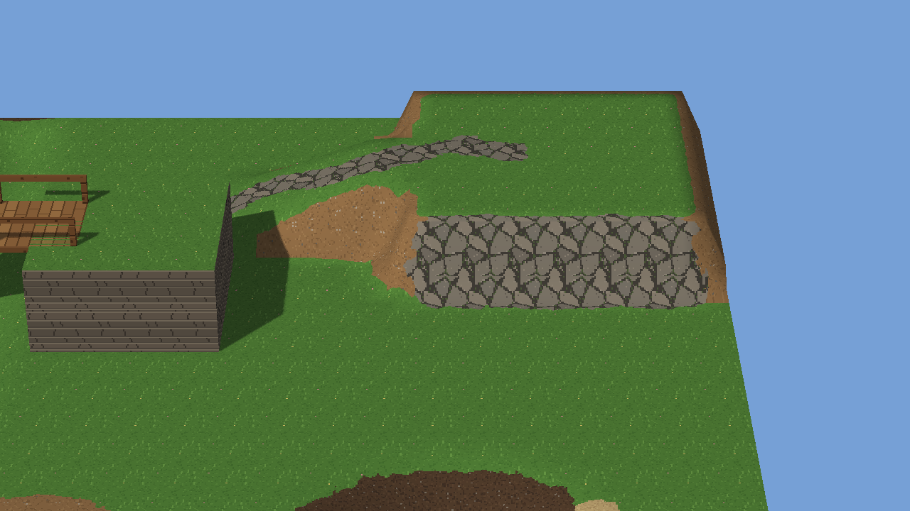


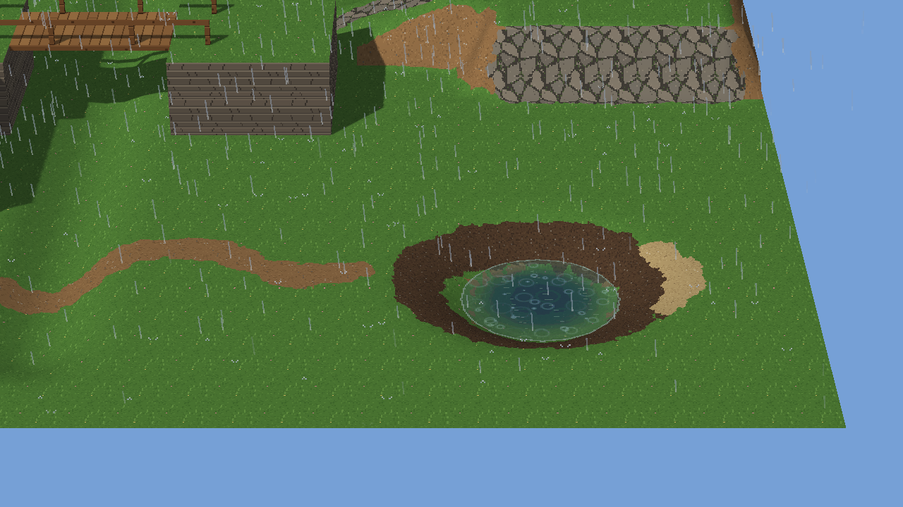

The scene was rendered at the gameplay camera, in daylight and in rain (`look`). Rain falls, shadows fall and the
pond's water lies over painted ground as it does over grass.

## 7. QA

Three independent Opus subagents worked only in hidden windows and their own scratch folders. Every finding was fixed
and is kept fixed by a test, or recorded below as a limitation.

**Art QA.** Verdict before fixes: *partly*. Earth paths and soft edges improve the environment; three tiles needed
work.

| Finding | Fix |
|---|---|
| The stone cliff read as stacked planks: the `rock` tile's level ledges repeated per metre, and a seam showed where the cliff's lower slope turned gentle (a stone-slab band under rock) | The stone tile on steep faces too: one natural stone face. `rock` is not added to the kit. |
| Mud's dark patches repeated on a 1 m grid and read dry | Retuned: scattered speckle and sheen, no patches |
| Sand was the brightest thing in the scene | About 8% darker |
| Soft edges left about 1.9% isolated border texels and 1-texel teeth (the noise's per-texel term) | That term removed: about 0.3% |
| Staging: the path ran under the cottage's foundation; the mud covered the whole basin | Path start moved; a narrower bank |

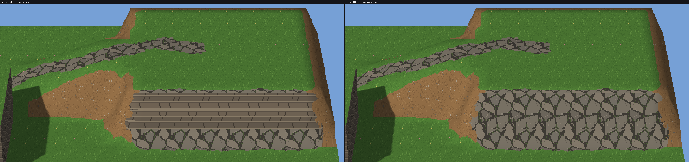

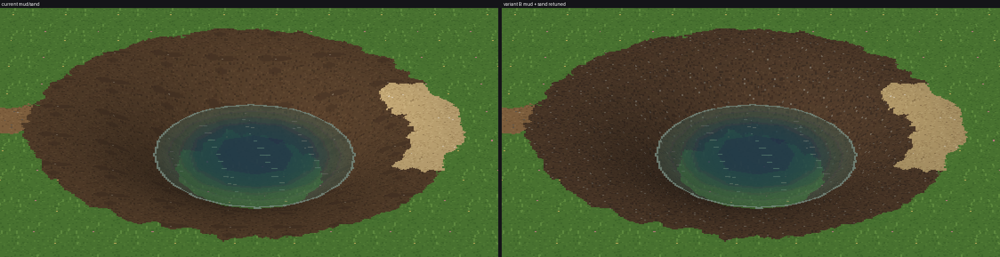

Art QA found good: winding, believable paths about 1–1.3 m wide; texel density and palette consistent with the kit;
the stone path reads as flagstones; rain is consistent; the hill gets no stray earth.

**Technical QA.** 2 major, 4 minor and 2 cosmetic findings; no blockers.

| Finding | Fix |
|---|---|
| Major: the AI/CLI change summary said nothing about paint or edges | Summary lines added ("ground painted: stone about N m²", "material edges hard") |
| Major: one unreadable paint chunk dropped the heights too: cliffs became walkable, and no op could run | Broken paint alone is set aside; heights and collision stay; Studio says "shown unpainted … Clear paint starts it afresh"; `clear_terrain_paint` mends it |
| Minor: Hard edges chosen on a plain room were lost | Kept until painted (and by flatten-all) |
| Minor: a Soft click on a plain room recorded an empty undo step | No edit when nothing changes |
| Minor: focus lost mid-stroke kept painting (and sculpting, from 20B) | The stroke ends there |
| Minor: paint in a last cell cut short by the ground's edge was misplaced | The shader and eyedropper map that cell as it is |
| Cosmetic: a stroke split in parts still said "one undo step" | It says how many |
| Cosmetic: repeated erasing left weight-3 traces | Rounding towards the brush's goal; no trace stored |

Technical QA verified:
- interleaved paint and sculpt undo/redo, exact at every step;
- save and reopen byte-identical;
- every cancel path;
- collision unchanged;
- GPU objects flat over many cycles, with `release()` freeing exactly what `gl_objects()` lists;
- deterministic storage;
- older projects falling back to Mesh's textures;
- paint under a pond.

**Performance QA.** Two high findings and one medium.

| Finding | Fix |
|---|---|
| High: release time grew with dabs × radius² (the commit replayed every dab; a 32 m brush held 10 s would freeze about 10 s) | Studio saves the chunks it drew (`set_terrain_paint`). Release no longer depends on dabs: a 16 m brush held 3 s releases in ≤ 100 ms at every size. The radius is capped at 16 m, since a dab's live cost grows with its area. |
| High: a "never expected" mismatch reload (about 1 s at 128 m) happened on 4 of 6 grid-aligned strokes. Live dabs used unrounded positions, and weights of 1–2 slipped past the trace check. | Positions rounded once; traces checked on the stored byte; 0 mismatch reloads since |
| Medium: a 128 m commit decoded the ground five times (110 of 122 ms) | One parse now: commit 30 ms at 128 m painted |

Performance QA also measured:
- **The shader:** painted ground cost about 5× unpainted on the GPU (0.9 ms at 1080p); the early-out followed.
- **Lifetime:** no leaks; the paint texture is made once per room.
- **Long strokes:** 4,001 dabs showed no frame growth.
- **Compression** isn't worth it: 0.39 M characters of paint at 128 m, half painted.

## 8. Tests and gates

| Gate | Result |
|---|---|
| Fast tier (`pytest -m fast`) | 4,770 passed, 6 skipped |
| Terrain tests (`tests/test_terrain.py`, `tests/test_terrain_materials.py`) | 74 passed: storage, sparseness and order, determinism, time-based strength, 20B compatibility, refusals, broken data, collision and navigation unchanged, paint kept through sculpting, flattening and edges, the AI and CLI path, and QA's findings |
| GPU suites (`MESH_GL_SMOKE=1`: every GL suite, plus water and weather) | 200 passed. Terrain adds: each material drawn live, then grass again 0 px from before; no GPU objects pile up; `release()` frees all; Studio painting (the `studio` study's checks); a plain room's first stroke |
| Ruff gate, mypy gate | ok; no new `# type: ignore` |
| Rooms without terrain against `8216592` (20B) | 0 px in 6 pictures (template village and cottage; water village, dry and rain) |
| Geometry against 20B | All 101 chunks of two sculpted grounds: identical triangles |
| Painted pictures across the performance fixes | Unpainted 0 px; painted ≤ 22 px of 921,600 (stored weights' corrected rounding) |
| Linux / Windows CI | See the PR's checks (#373 for any Windows timing-budget failure) |

## 9. Remaining limitations

- **Undo reloads the room**, as in 20B: about 1.3 s at 128 × 128 m.
- **Paint resolution is the corner grid** (0.5 m by default). Borders are curves drawn per texel, but a detail
  smaller than about a cell can't be painted. Paths narrower than about 0.75 m break up.
- **Stone on cliffs** is a stone face, not stratified rock. A natural rock-face tile would be better; that is an art
  task, possibly a later PixelLab one with approval.
- **Steep faces read paint in plan.** A thin painted line across a cliff shows as a vertical stripe down it.
- **No per-room custom materials or palettes.** The four materials are fixed (as asked: a small set). A room's own
  ground texture is still its grass.
- **The GPU cost** of painted ground was measured on this machine only. It is below 1 ms at 1080p, and should be
  checked once on an integrated GPU.
- **Stored size.** A heavily painted 128 m room stores about 0.4 M characters of paint, uncompressed by choice: it
  diffs per chunk and saves in about 140 ms.
- **The large-room numbers** come from synthetic rooms, as in 20B, not hand-made levels.

## 10. Verdict

**PASS.**
- **Painting:** creators paint four materials live with Sculpt-grade responsiveness. A stroke is one undo step, saved
  exactly as shown, and safe to cancel.
- **Paths and transitions:** paths are natural and editable after sculpting. Transitions are crisp pixel-art borders
  that Art QA judged an improvement over both 20B's fringe and hard edges, which remain available.
- **What stays the same:** collision and navigation are untouched, and unpainted rooms keep the accepted 20B
  behaviour.
- **QA:** every finding from Art, Technical and Performance QA was fixed and is covered by tests.

Stopping here for owner review before Stage 20D. #344 is still a draft; `main` is untouched; nothing was merged
automatically.

## Reproduce

```
py -3.13 tooling/m20c_material_study.py look OUT      # gameplay camera, dry and rain, painted and not
py -3.13 tooling/m20c_material_study.py edges OUT     # hard and soft, painted and not (edges-base: run in the 20B tree)
py -3.13 tooling/m20c_material_study.py studio OUT    # Studio: strokes, undo/redo/save/reopen, cancels, controls
py -3.13 tooling/m20c_material_study.py flat OUT      # a plain room's first paint stroke
py -3.13 tooling/m20c_material_study.py scale OUT     # 32 x 24, 64 x 64, 128 x 128 m (run alone)
py -3.13 tooling/m20c_material_study.py identity OUT  # rooms without terrain (compare with the same run in 8216592)
```
