# Milestone 20D: foliage and landscape composition

- **Branch:** `feature/m20d-foliage`.
- **Draft PR:** into `redesign/visual-editor`; see the PR's checks for CI.
- **Builds on:** Stage 20C (#386, merged as `ec51e36`).
- **In scope:** scattering vegetation, rocks and environmental props over the sculpted and painted ground in Mesh
  Studio, the original starter assets, and the composition of the Stage 20C Hills room.
- **Out of scope:**
  - rivers, waterfalls, biome simulation and the audio expansion;
  - PixelLab and any paid generation.
- **Unchanged:** the heightfield, terrain materials, water, weather, shadows and saves.

**Verdict: PASS** (details at the end).

## Summary

Mesh Studio's 3D view gains **Scatter** beside **Sculpt** and **Paint**.

**What a creator does.** Choose a collection or a single asset, then drag over the ground:

- Collections: Meadow, Wildflowers, Pond edge, Shrubs, Rocks, Deadfall.
- Single assets: grass tufts, tall grass, dry grass, yellow and pink flowers, two bushes, reeds, cattails, small and
  medium rocks, a boulder, a fallen branch.

**What the brush does.**
- **Fill:** each stroke fills the ground it passes over up to a density, in clumps, with minimum spacing.
- **Rules:** things go only where the rules allow:
  - the materials switched on, and each thing's own;
  - no steeper than the slope limit;
  - out of water (reeds may stand in the shallows);
  - off buildings, keeping 1 m clear of doors, arrivals, the player's start and the foot of stairs and ramps.
- **Thin and remove:** Shift removes what is under the brush and Ctrl thins it.
- **Undo:** one stroke is one undo step.

**What it means for the room.**
- **Saved as placed:** the decoration is stored exactly as placed. Reloading never changes it.
- **Attached to the ground:** it stands on the ground and rises and falls with it when the ground is sculpted. It
  never moves sideways.
- **Collision:** everything is walked through except the boulder. When a boulder stands where people need to pass,
  Studio says so.
- **Shared operations:** Studio, the `mesh author` CLI and AI use the same validated operations
  (`scatter_stroke`, `set_scatter`, `clear_scatter`). The AI's change summary says what was scattered and what is in
  the way.

**Cost.**
- **Draw calls:** one per 8 m chunk for all its sprites, and at most one shadow draw per 32 m block.
- **GPU:** 10,000 instances cost about 2 ms per frame on this GPU.
- **Rooms without scatter** are unchanged: 0 px against 20C in 34 pictures.


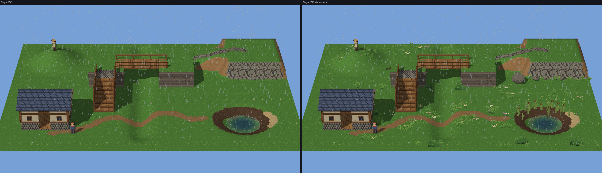

Everything below was measured in hidden windows on this machine, using Mesh Studio's own window events. The tooling
is `tooling/m20d_scatter_study.py`, with the commands `look`, `studio`, `walks`, `scale` and `compose`. Results and
pictures are in
[`milestone20_stage4_foliage_and_composition_evidence/`](milestone20_stage4_foliage_and_composition_evidence/).

## Part A: Architecture

### What was reviewed

| Part | What it does, and what it meant for scatter |
|---|---|
| Blender GLB imports | Models are read once (`engine.hd2d.glb`); collision objects are tagged `mesh_collision`. The scatter models are ordinary GLBs; the boulder carries a wall collider. |
| Structure catalogue | Placed structures are selectable, movable, one entity each, batched per texture. That is the right home for hero props, but too heavy for thousands of tufts, so scatter is separate. The kit's scatter GLBs are kept out of the Models browser. |
| Instancing | Structures are merged into static buffers per texture (`_build_batches`). Scatter does the same per 8 m chunk, so a stroke rebuilds only the chunks it touches. |
| Scene entities | Characters are sprites rebuilt as billboards every frame. Scatter must not be entities. |
| Terrain heights and Studio editing | The stroke and undo machinery of 20B and 20C was reused. |
| Collision | `engine.hd2d.world`: only blocking assets add walls, built from the model's own wall collider and standing on the ground as it is now. |

### Storage: explicit, never regenerated

```
"scatter": {"grass_tuft": [[320, 96, 40, 104], ...], "boulder": [[736, 448, 211, 96]]}
```

- **Shape:** for each asset, its instances as `[x, y, turn, size]`: px, px, degrees, and hundredths of the drawn
  size.
- **Order:** assets in a fixed order, and each list sorted.
- **Validation:** `parse_scatter` checks the asset names, whole numbers, the ranges, and at most 50,000 instances
  per room.
- **Broken data:** a lenient load sets broken scatter aside, logs the reason, and Studio shows it; the rest of the
  room is untouched.
- **Never regenerated:** nothing is regenerated from a seed or from the rules. Loading shows exactly what was saved,
  and a later change to the brush's code cannot move anything that is already placed.

### Attachment: decoration stands on the ground

- **Height:** an instance has no height of its own. It stands on the sculpted ground under it (or the plain
  ground's elevation), as it is now.
- **Models:** a rock or branch stands on the lowest ground under its footprint (`foot_height`), so on a slope it
  sinks at the high side rather than floating at the low one. Rocks are allowed up to 40°, branches up to 12°.
- **Sculpting:** sculpting under scatter moves it up or down with the ground, never sideways. Only the chunks over
  the sculpted ground are rebuilt.
- **Rules after the fact:** a thing's placement rules (slope, material, water) are checked when it is placed, not
  afterwards. After a sculpt or paint stroke, Studio says how many things now stand where they wouldn't be put.
  They are kept, and Ctrl-Scatter thins them or Shift removes them.
- **Tested:** in Studio, a raise under a meadow left every instance in place and lifted 13 of them with the ground;
  their chunks were rebuilt.

### The brush

`engine.hd2d.scatter.brush`, one dab:

- **Add:**
  - fills the circle up to the density, capped at what the assets' spacing allows;
  - picks among the collection's assets by weight;
  - clumps through value noise;
  - keeps two things apart by the mean of their spacings (so a boulder may lie by a pebble);
  - places only where the rules allow;
  - adds at most 1,500 per dab and stops after a run of misses;
  - is repeatable: the same seed gives the same result.
- **Thin:** removes a share of what is under the brush, each instance considered once per stroke.
- **Remove:** removes all of it.

### Drawing

`engine.hd2d.scatter_layer`, per 8 m chunk:

- **Sprites:** one static buffer of quads per chunk (foot, corner offset, uv). The vertex shader turns every quad to
  face the camera, so turning the view rebuilds nothing.
  - They are alpha-tested and lit like the characters, stretched by 1/cos(pitch) as the characters are.
  - Each sprite asset has several variants, chosen by where the instance stands, so neighbours differ.
- **Models:** placed and merged into one buffer per texture per chunk, drawn and lit like structures.
  - Their shadows come from one position-only caster draw per 32 m block.
- **Culling:** chunks outside the frustum are skipped, and so are sprite chunks more than 60 m from where the camera
  looks.
- **Rebuilds:** a stroke rebuilds only the chunks it touched.

### Human and AI authoring

| Operation | Used by |
|---|---|
| `scatter_stroke(collection, dabs, radius, density, mode, seed, clumping, share, on, slope, avoid_water, avoid_structures)` | AI and the `mesh author` CLI: the same stroke always gives the same scatter |
| `set_scatter(scatter)` | Studio's release: what it drew, checked |
| `clear_scatter(assets?)` | Studio's Clear scatter, AI and CLI |
| `scatter_report`, `scatter_obstructions` | What is in the way; what breaks its own rules |

Every operation refuses bad input with the reason: an unknown collection or asset, malformed or non-finite dabs, out-of-range density, radius or slope, a non-integer seed, an unknown material, or too many instances. All of them are discovered by the authoring registry.

## Part B: Original starter assets

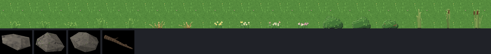

| Asset | Kind | Variants | Notes |
|---|---|---|---|
| Grass tuft, tall grass, dry grass | sprite | 3, 2, 2 | One-pixel blades in the ground's own greens: dark where they meet the ground, lit tips, no outline |
| Yellow flowers, pink flowers | sprite | 2, 2 | Small heads on stalks |
| Bush, berry bush | sprite | 2, 1 | A dome, shaded from the upper left, with 3–4 px leaf clusters and an outline in a darker shade |
| Reeds, cattails | sprite | 2, 1 | 0, 1 and 3 cattail heads; may stand in water up to 0.3 m deep |
| Small rock, rock | model | 1 each | Faceted hulls of jittered points, one 32 px tile a metre (`boulder.png`) |
| Boulder | model | 1 | 1.6 m; blocks (a `mesh_collision` wall) |
| Fallen branch | model | 1 | An eight-sided tapering log with two broken stubs (`bark.png`) |

**Provenance and rights.** All of this is original, drawn and built by Mesh's own scripts from fixed seeds. It
contains no third-party art and no PixelLab output. It is licensed with the rest of the starter kit and recorded in
`assets/hd2d_starter/PROVENANCE.md`.

| What | Made by |
|---|---|
| `scatter/foliage.png` | `tooling/hd2d_assets/scatter_art.py`: PIL, 48 × 48 px cells at 32 px a metre, the character style's palette rules |
| `scatter/*.glb` | `tooling/hd2d_assets/build_scatter_models.py`, run in headless Blender. A rebuild writes identical bytes (checked). |
| `boulder.png`, `bark.png` | `tooling/hd2d_assets/pixel_textures.py` |

**Where they go.** The template copies them into new projects, and the wheel's allow-list includes them. Older
projects read Mesh's own copy; nothing is written into them.

## Part C: The Scatter brush in Studio

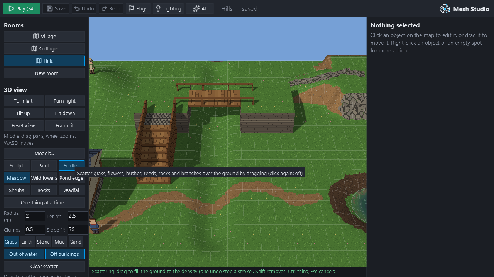

| Control | What it does |
|---|---|
| Meadow / Wildflowers / Pond edge / Shrubs / Rocks / Deadfall | The collection, with its density and rules. "One thing at a time..." shows every asset on its own. |
| Radius (m), Per m² | 0.25–16 m (also `[` `]`); 0.01–20 per m² |
| Clumps, Slope (°) | 0 (even) to 1 (patches); the steepest ground to use |
| Grass / Earth / Stone / Mud / Sand | The materials to scatter on; at least one stays on |
| Out of water, Off buildings | Keep out of ponds; keep clear of structures and of doors, arrivals, the player's start and the foot of stairs and ramps |
| Clear scatter | All of it off: one undo step |
| Shift, Ctrl | Remove, thin |
| Cursor | A ring on the ground: green to add, amber to thin, red to remove |

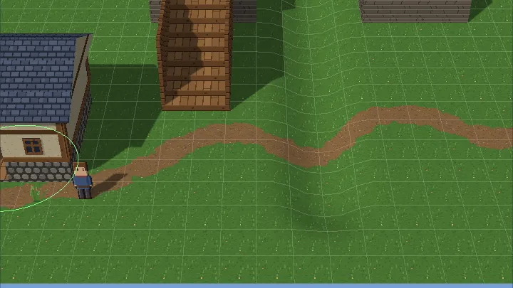

Results of the `studio` study, in the Hills room, using Studio's own events:

| Check | Result |
|---|---|
| A Meadow stroke beside the path (166 drag frames) | 151 placed. Frame median 16.65 ms, p95 19.13 ms. Update 0.47 ms a frame. Commit 4.9 ms; 104.2 ms to the next frame. |
| Undo steps; shown = saved | 1; true |
| Undo, redo, save, reopen | None, then all of it back; identical after reopening |
| Esc, Play, room change, refused upload mid-stroke, refused upload at release | Nothing recorded; the scatter as saved |
| Focus lost mid-stroke | The stroke ends there, as one undo step, and adds no more |
| Ctrl thins, Shift removes | 151 → 124 → 25 |
| Earth only (Deadfall along the path) | 22 placed, all on earth |
| Pond edge by the pond | Only reeds and cattails stand in water |
| A boulder dropped on the player's start (off buildings switched off) | Placed; "In the way (not moved): a boulder at (8.8 m, 4.1 m) blocks the player's start" |
| Sculpting under the meadow | No instance moved; 13 rose with the ground; their chunks rebuilt: True |

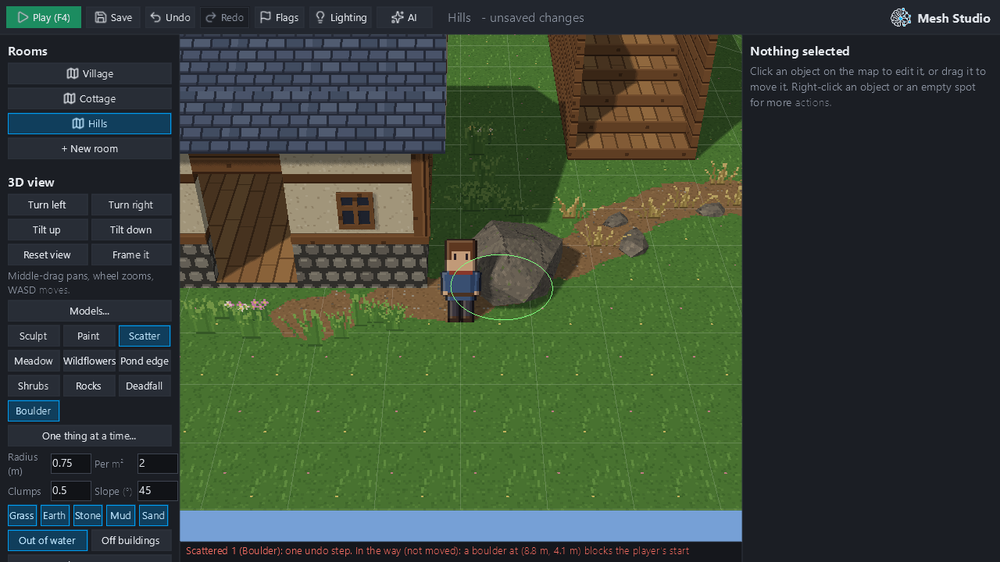

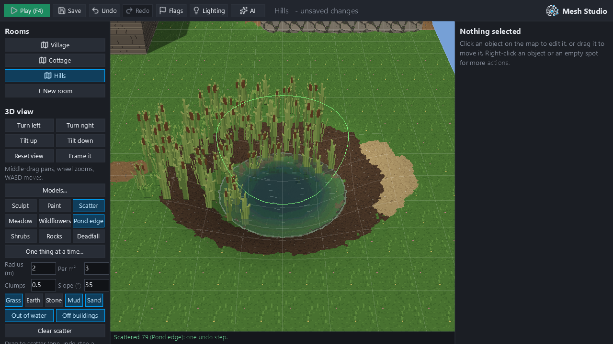

## Part D: Performance

The `scale` study ran alone: a sculpted room with shadows on, the game playing at the gameplay camera, and a fixed
mix of instances (mostly grass and flowers; 10% models).

| | 64 m: none | 100 | 1,000 | 10,000 | 128 m: none | 10,000 |
|---|---|---|---|---|---|---|
| Room load | 464 ms | 449 ms | 543 ms | 688 ms | 896 ms | 1317 ms |
| Game frame CPU, median / p95 | 5.65 / 6.33 ms | 8.79 / 12.36 ms | 10.08 / 14.41 ms | 7.13 / 13.43 ms | 5.96 / 11.92 ms | 9.77 / 13.87 ms |
| Frame GPU (whole frame) | 0.506 ms | 1.47 ms | 1.518 ms | 2.003 ms | 1.694 ms | 2.05 ms |
| Draw calls / shadow draws | 40 / 16 | 51 / 20 | 74 / 20 | 108 / 20 | 66 / 16 | 151 / 32 |
| Sprite draws at the camera / zoomed out | – | 8 / 22 | 17 / 38 | 18 / 40 | – | 21 / 40 |
| Scatter GPU memory | 0.00 MB | 0.20 MB | 0.67 MB | 5.79 MB | 0.00 MB | 5.79 MB |
| Models cast no shadow: frame GPU | – | 1.468 ms | 1.511 ms | 1.907 ms | – | 2.115 ms |
| Zoomed out GPU, distance culling on / off | – | 1.581 / 1.581 ms | 1.711 / 1.728 ms | 2.234 / 2.238 ms | – | 2.564 / 2.184 ms |
| GL objects stable over reloads; release frees all | – | True; True | True; True | True; True | – | True; True |
| Studio reload | – | 364 ms | 390 ms | 619 ms | – | 1099 ms |
| Studio 8 m add stroke frame, median / p95 | – | 19.41 / 24.39 ms | 20.62 / 25.35 ms | 18.46 / 25.22 ms | – | 24.24 / 31.77 ms |
| Commit / release to next frame | – | 5.3 / 110.2 ms | 8.9 / 80.3 ms | 159.5 / 232.6 ms | – | 228.9 / 314.4 ms |
| Undo (reloads the room) | – | 0.68 s | 0.63 s | 0.94 s | – | 1.70 s |

**What these numbers show:**
- **Shadow draws:** they no longer grow with the instance count. Before Performance QA's fix they were 192 at 10k
  on 64 m and 499 on 128 m: a draw per chunk and texture, every frame.
- **Frame CPU:** on the 128 m room at 10k, the frame costs +3.8 ms of CPU over no scatter; it was +9.4 ms before the
  fix.
- **GPU:** whole-frame GPU readings under about 2 ms are noisy here; Performance QA showed the 0 → 100 step is noise.
  Billboards cost at most 0.6 ms even zoomed out at 50k.
- **Optional shadows:** turning off the models' shadows saves about 0.1 ms on the GPU at 10k. Shadows stay on for
  rocks, the boulder and the branch, and sprites cast none.
- **Distance culling** (60 m from the camera's target) makes no difference up to 128 m. Frustum culling does the
  work (18–21 sprite draws at the gameplay camera, 40 zoomed out). It is kept for larger rooms.
- **Memory:** 136 B per sprite instance and about 3 KB per model instance. 10k instances use 5.8 MB of GPU buffers.
- **Collision and navigation:** decoration is walked through. Grass leaves the navigation grid identical, and a room
  of grass alone builds no collision world. Only the boulder blocks.
- **GPU lifetime:** objects are stable over reloads, and `release()` frees everything (at every count).

**Budgets** (this machine; the extra cost over the same room without scatter):

| | 100 | 1k | 10k |
|---|---|---|---|
| Frame CPU | +1.5 ms | +2.5 ms | +4 ms |
| Room load | +50 ms | +100 ms | +450 ms |
| Studio stroke frame p95 | 30 ms | 30 ms | 35 ms |
| Release | 150 ms | 150 ms | 350 ms |
| Undo (reloads the room) | 1 s | 1 s | 2 s |

All are met in the table above. Performance QA proposed tighter targets for 10k (+2 ms CPU, +150 ms load, 200 ms
release, 0.3 s undo applied in place). The remaining gap is listed under limitations.

## Part E: Visual composition

The 20C Hills room, decorated through `scatter_stroke` only (`compose()`, 244 instances):

- broken clumps of grass and flowers along both sides of the winding path, with gaps, never on it;
- a few meadow patches, with plenty of plain grass left;
- a focal point of flowers and grass on the hill top by the Elder;
- larger stones, unevenly spaced, at the foot of the terrace's cliff (tufts at their bases), and a boulder at its
  west end;
- reeds and cattails on the pond's far bank only, its near side and the path's side open;
- bushes beside the bridge's piers and the cottage's sides;
- dry grass and a fallen branch on the hill's flank;
- a little foreground depth along the near edge.

Doors, the player's start and the foot of the stairs are kept clear by the brush itself.

The pictures below are at exactly the same gameplay camera, Stage 20C (left) against decorated (right):

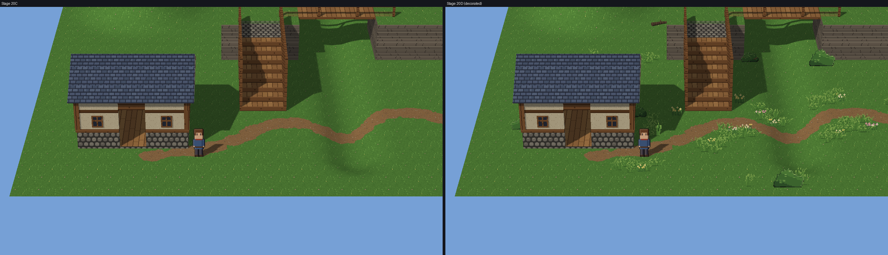

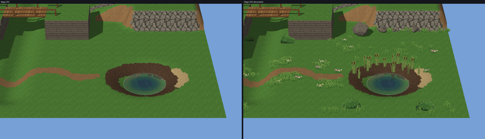

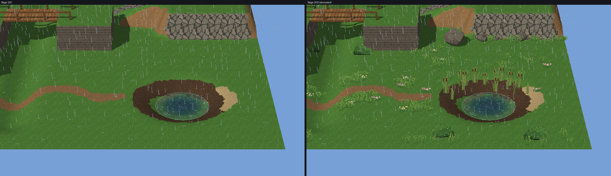

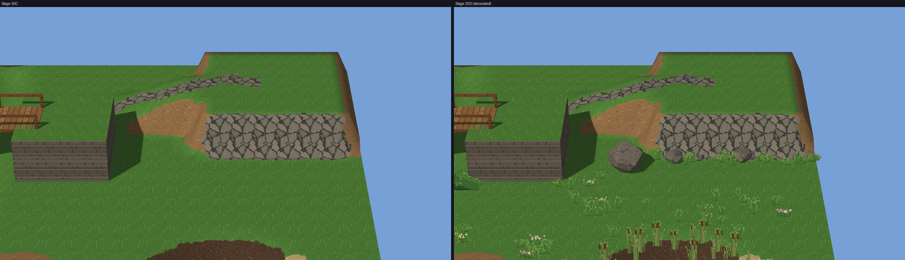

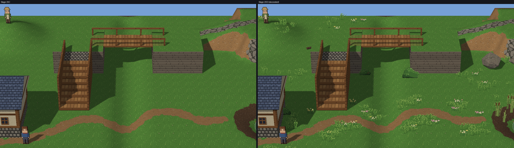

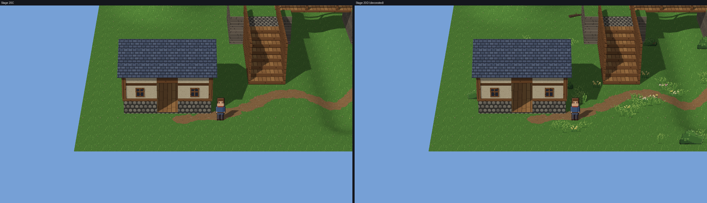

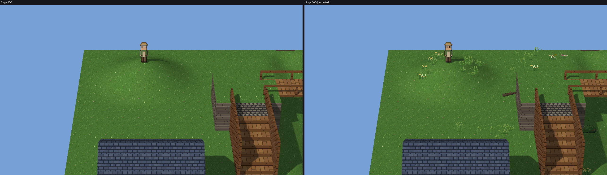

| Concern | How it was handled |
|---|---|
| Repetition | 2–3 variants per sprite asset, chosen by position; random turn (models) and mirroring (sprites); random size |
| Artificially uniform scattering | Clumps (value noise), broken strokes, and spacing that lets tufts crowd into clumps |
| Pixel scale | 32 px a metre, as the ground and the characters: sprite texels and character texels both render at about 2 screen px (Art QA) |
| Character readability | The player and the NPC stay fully readable; nothing is placed at the player's start |
| Environmental depth | Tall reeds behind the pond, a foreground band, a hill-top focal point |
| Occlusion round structures | Off buildings keeps a margin; the door and the foot of the stairs are kept clear |
| Daylight and rain | Consistent: no foliage-specific artefacts in rain |
| Density | Deliberately sparse: 244 things in a 32 × 24 m room. The first attempt (1,400) was a carpet of identical tufts, and was cut back. |

## Part F: Compatibility and QA

**Kept working:**
- **Rooms without scatter:** 0 px against `ec51e36` (20C), in 6 pictures (village, cottage, water village dry and
  rain).
- **The 20C study room:** painted and unpainted, day and rain, 0 px in 28 pictures.
- **20A's walks:** unchanged in the decorated room (over the hill, up the ramp, into the cliff, along the valley under
  the bridge, up the stairs and across, into the pond). Walking into the boulder stops at 21.16 m, short of it.
- **Sculpting:** never moves scatter sideways. It rises and falls with the ground, and the boulder's wall follows it
  (after sculpting, undo and redo; Technical QA).
- **Collision near bridges, stairs, cliffs, doors and NPC routes:**
  - Off buildings keeps decoration out of structure footprints (rotated and scaled ones too) and 1 m clear of doors,
    arrivals, the player's start and the foot of stairs and ramps.
  - A boulder near any of these, or on an NPC's patrol loop, is reported.
  - Nonblocking decoration stays nonblocking.

**QA.** Three independent Opus subagents worked only in hidden windows and their own scratch folders.

**Art QA:** *partly*, before fixes.

| Finding | Fix |
|---|---|
| The pond reeds were a wall in front of the water: every reed had cattails, all the same height | Reeds on the far bank only; reeds with 0, 1 and 3 heads |
| The path drifts were even, isolated stamps (spacing kept tufts apart; the clump noise was wider than the drift) | Tufts may crowd (0.16 m), and the drifts were redone as broken clumps |
| Dry grass read as hay or stumps | Fewer, leaning blades |
| The bushes were too small and got lost; mirrored pair at the bridge | Larger; dome shading with leaf clusters; not mirrored |
| Too few cliff rocks to break the tiling | Larger, uneven stones at the foot, tufts at their bases |
| No focal point; no new depth | A hill-top patch by the Elder; a foreground band |
| Tufts on the bottom step; flowers at the player's start | The brush keeps ways in clear (an engine rule, not just staging) |

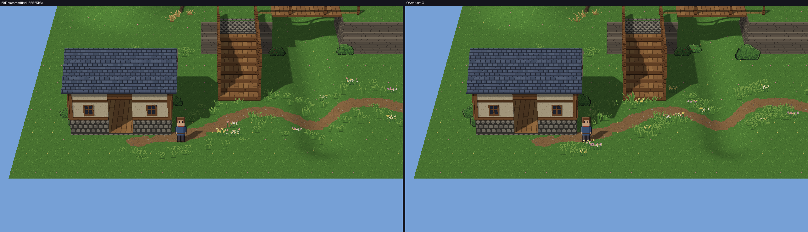

**Art QA's re-review**, at the same cameras after the fixes: **yes**. The room is "clearly better than 20C":
- the path has clumped drifts with gaps;
- the pond water is clear, with reeds only on the far bank;
- the Elder's hill reads as a focal point;
- dry grass reads as grass;
- the cliff foot is grounded;
- the stair feet and the door are clear;
- daylight and rain match.

It listed five smaller issues, and all five were then fixed:

| Remaining issue | Fix |
|---|---|
| The new bushes read as smooth blobs: a dome with low-contrast clusters, outlined over the top, and stamped in the foreground | Notched leafy tops, brighter lit clusters, no outline over the top, sizes 0.9–1.45, tall grass at their bases |
| The fallen branch was gone (its 12° limit refused the hill's flank) | Deadfall and a branch on level ground past the hill's foot |
| The cliff's tiling still showed | More stones along its east half |
| Flowers 1.2 m in front of the player's start covered his boots | The clear space is 1.6 m on the camera's side |
| The reeds were all one height | Sizes 0.7–1.2 |

**Technical QA:** five major, three minor and some cosmetic findings; no blockers.

| Finding | Fix |
|---|---|
| One grass tuft made a room build a collision world (it read the boulder's model), so walking at the ground's edge changed | Rooms read only the scatter models they use; Studio builds the world when a boulder is placed |
| A dab at panel-legal settings froze Studio for about 10 s | Density capped by the spacing; stop after a run of misses; 1,500 per dab; cached noise |
| Rocks and branches floated on slopes (up to 0.46 m) | Stand on the lowest ground under the footprint; lower slope limits |
| Collections put things on materials their own rules refuse, then reported them as misplaced | Each thing grows only on its own materials, within the brush's |
| A refused upload at release recorded an empty undo step and said "Scattered" | The release stops when its last drawing is refused |
| False "in the way" by crates and walls; patrols' closing legs missed | Spots only at the foot of raised floors; the whole patrol loop watched |
| Broken scatter was set aside silently | Logged, and shown in Studio |
| `]` grew the brush past 16 m; fields showed two digits and kept "nan" | Fixed |

Technical QA also verified:
- interleaved undo and redo across scatter, sculpt, paint and thin;
- exact save;
- the boulder's wall after sculpting, undo and redo;
- determinism;
- validation;
- footprints of rotated and scaled structures;
- GPU objects stable over strokes, undo and room switches;
- older projects falling back to Mesh's bundled kit;
- the AI and CLI path.

**Performance QA:** three high, four medium and two low findings.

| Finding | Fix |
|---|---|
| The models' shadow casters: a draw per chunk and texture, every frame (9.4 ms of CPU at 10k on 128 m) | One position-only caster per 32 m block (now +3.8 ms in all) |
| Commit and undo deep-copied everything | Snapshots by pickle round trip; `set_scatter` doesn't copy the old scatter |
| Removal was O(n) (61 ms frames removing at 50k) | Sets; removal dabs bounded too |
| The release computed and threw away half the report | It reads only what blocks |
| Layer build re-walked model bounds per instance | Bounds cached; boxes from the model's box |
| Culling re-did Python work every frame | No empty model draws; chunk centres cached |
| The brush ignored the room's limit; a wide brush over 1,500 or more existing instances added nothing | Stops at the limit; the need is never negative |
| `SPRITE_FAR` does nothing up to 128 m | Kept, documented: it is for larger rooms |
| Undo reloads the room (1.16 s at 10k) | Not changed (as in 20B and 20C); see limitations |

## Tests and gates

| Gate | Result |
|---|---|
| Fast tier (`pytest -m fast`) | 4,798 passed, 6 skipped |
| Scatter and terrain tests (`test_scatter.py`, `test_terrain.py`, `test_terrain_materials.py`) | 28 scatter tests: storage, determinism, density, spacing and clumps, every rule, thin once, refusals, broken data, collision (grass walked through, the boulder blocks and rises with the ground), what is in the way, AI and CLI, and QA's findings. Terrain and materials pass too. |
| GPU suites (`MESH_GL_SMOKE=1`: every GL suite, plus water and weather), run alone | 203 passed. The one failure was the scatter Studio test's own unreliable `id()`-based check, replaced by a build counter; that file was then rerun alone: 4 passed. Earlier, 20B's time-based held-brush test failed once while a render ran alongside, and passed alone. |
| Scatter GPU tests | Batches drawn; a scatter-free view differs; GL objects stable over reloads; `release()` frees all; 20A's walks unchanged and the boulder stops the player; grass alone builds no collision world, a boulder does; the Studio study's checks |
| Ruff gate; mypy (fresh) | ok; 73 errors (no new ones); no new `# type: ignore` |
| Rooms without scatter against `ec51e36` (20C) | 0 px in 6 pictures; the 20C study room 0 px in 28 |
| Starter assets | A headless Blender rebuild writes identical bytes |
| Linux / Windows CI | See the PR's checks (#373 for any timing-budget failure) |

## Known limitations

- **Undo reloads the room**, as in 20B and 20C: 0.9 s at 10k on 64 m and 1.7 s on 128 m. Undoing a scatter stroke
  in place would make it nearly instant; that is a contained follow-up.
- **Undo memory:** each undo snapshot copies the project. At 50k instances one is about 4.5 MB, so a 100-step history
  could reach about 450 MB.
- **Room load:** +0.42 s with 10k instances on 128 m (building the layer in Python). NumPy would cut it if needed.
- **No hero editing of individual scatter instances:** they can't be selected or dragged; a creator removes and
  re-scatters. Hero props (a single sculpted boulder) are best placed as structures from the Models panel.
- **Sprites cast no shadow:** grass, bushes and reeds. Only the models do.
- **Fixed assets:** the starter set and collections can't be extended by a project yet (its own sprites or GLBs as
  scatter).
- **The rules are checked at placement:** after sculpting or painting, Studio reports what now breaks them; it doesn't
  remove or move anything by itself.
- **Measured on one machine:** an RTX 4070. Billboards cost at most 0.6 ms at 50k, but should be checked once on an
  integrated GPU.

## Verdict

**PASS.**
- **Architecture:** creators decorate sculpted and painted terrain inside Mesh Studio's existing workflow, with a
  brush that respects slope, material, water and structures. Scatter is explicit, never regenerated, attached to the
  ground, one undo step per stroke, and exact across save and reopen. It is the same validated operation for Studio,
  the CLI and AI.
- **Assets:** the original starter set is small and convincing. Art QA judged the composed room clearly better than
  Stage 20C, in daylight and rain.
- **Performance:** decoration costs one draw per 8 m chunk and at most one shadow draw per 32 m block. At 10,000
  instances it adds about 2 ms of GPU and 1.5–4 ms of CPU per frame. It leaves collision, navigation and every
  undecorated room exactly as they were.
- **QA:** every finding from the three QA passes was fixed and is covered by tests.
- **Remaining costs:** undo reloads the room, and large rooms load more slowly. Both are listed above; neither blocks
  creators.

Stopping here for owner review. #344 is still a draft and `main` is untouched. Nothing was merged automatically.
Rivers, waterfalls, biome simulation and the audio expansion were not started.

## Future checkpoint: the final terrain visual-quality acceptance scene

**Proposal: "The Lakeside Village".** One room of about 64 × 48 m, built only with Studio's own tools (Sculpt,
Paint, Scatter, Models, Lights, Weather) and the starter kit, then judged at the gameplay camera:

- a village street of the kit's cottages and shop on painted cobbles, with a stone path and stairs up to a terrace
  overlook;
- a sculpted hill with a winding earth path, a cliff with rocks at its foot, and a pond with mud banks and reeds;
- the bridge over a valley, with paths running under it;
- meadows, flowers and bushes composed for focal points and clear routes;
- an NPC on a patrol route that the decoration respects;
- evening lamps, rain, and a short walk-through capture at the gameplay camera.

**Acceptance:**
- **Art QA:** the art reads as one coherent HD-2D place at the gameplay camera, in day and rain. Repetition,
  readability, depth and occlusion are judged together.
- **Performance:** frame CPU and GPU, load, and Studio editing within the budgets of 20B, 20C and 20D on this machine;
  a check on an integrated GPU if one is available.
- **Workflow:** the scene's build is recorded as a Studio and AI session, the time it took a creator, and anything
  that was awkward.
- **No new terrain milestone** unless the scene shows a concrete blocker. Candidates that would count: shadows for
  scatter sprites, if the scene needs them to read; in-place undo for scatter, if editing feels slow; a project's own
  scatter assets, if the starter set limits the composition.

## Reproduce

```
py -3.13 tooling/m20d_scatter_study.py look OUT     # 20C and the composed room, same cameras, dry and rain
py -3.13 tooling/m20d_scatter_study.py studio OUT   # scattering in Studio: strokes, undo/redo/save, cancels, rules
py -3.13 tooling/m20d_scatter_study.py walks OUT    # 20A's walks in the decorated room, and into the boulder
py -3.13 tooling/m20d_scatter_study.py scale OUT    # 100, 1,000, 10,000 instances (run alone)
py -3.13 tooling/m20c_material_study.py identity OUT  # rooms without terrain or scatter (compare with ec51e36)
```
