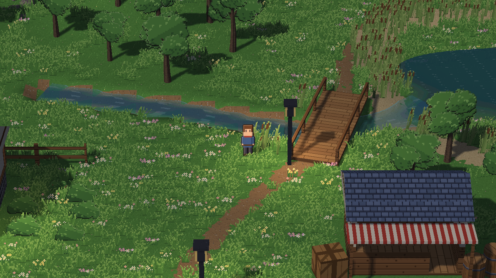
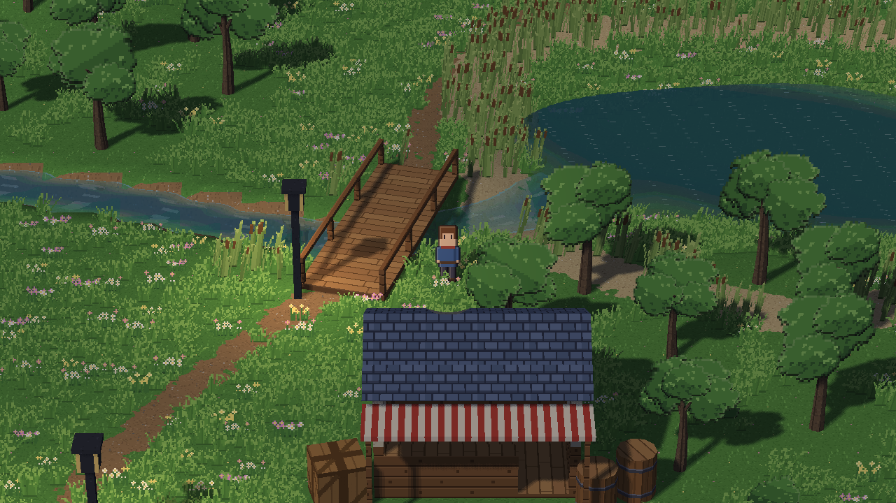
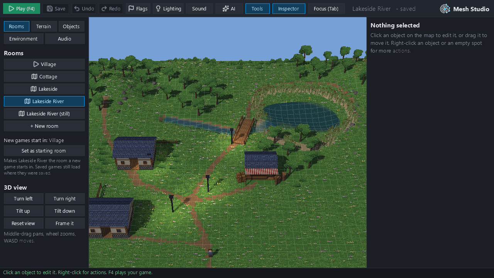
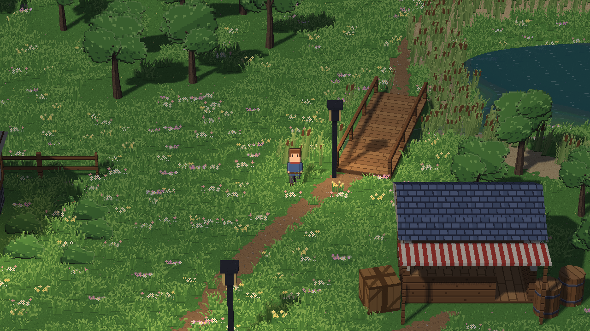

# Rivers R1: evidence (#461) — not for merge

All pictures are real 1280×720 hidden-window frames from the R1 renderer (`feature/rivers-r1`, d95fbf6; the review
fixes in 0b41158 change no picture here except the new bend capture). There are no diagrams. Projects are scratch copies: the owner's Lakeside originals were not touched.

**R1 is not creator-complete.** There is no River tool in Studio. Rivers are made through the checked ops
(`add_river`, `set_river`, `remove_river`; MCP / `mesh author`).

## Lakeside: a brook through a sculpted bed, under the footbridge, into the lake

Scratch copy of Lakeside, made by `tools/lakeside_river.py` with the engine's own ops:
1. The lake's arm under the bridge ("Puddle 2") is removed.
2. The bed is flattened with `sculpt_terrain_stroke` "flatten" (the existing terrain tool; R1 doesn't carve).
3. The grass and reeds along the course are removed with `scatter_stroke` "remove" (the Scatter brush; R1 doesn't
   clear scatter).
4. `add_river`: 8 points, 56 to 84 px wide, the level falling from −4 to −13.25 px (the lake's level), flow 1.2 m/s.

| | |
|---|---|
|  |  |
| gameplay: the brook passes under the footbridge | gameplay: and on into the lake |
|  |  |
| Studio's 3D view of the same scene (the room listed) | before: the #461 study's chain of rotated pond rectangles |

**Flow sequence** (`flow_sequence_sheet.png`). Top row: flow 1.2 m/s, at t = 10.00, 10.25, 10.50 and 10.75 s.
Bottom row: the flow-0 control. Measured along the brook, as the renderer drew it:

- **Flowing:** the surface moves +10 texels downstream per 0.25 s (correlation 0.73). At 1.2 m/s, 9.6 texels were
  expected.
- **Still:** no change along the brook between moments (correlation 0, nothing to correlate). The whole frames still
  differ, because the lake beside it is a pond with its own waves, as before.

`lakeside_river_bend_x3.png` is a close crop of a bend, scaled 3× with nearest-neighbour: texels as drawn, with the
waterline one texel wide and the streaks running along the flow.

## Template village (the GPU tests' scene: `tooling/r1_river_study.py`)

`template_north_river_under_bridge.png` and `template_east_river.png` show two streams in beds flattened with the
terrain op:
- **North:** under the template's bridge, where its north path was.
- **East:** south of the road.

The tests check:
- **Coverage:** every visible texel of each course differs from the same village with the beds only. The east river
  is drawn whole. The north river is hidden only behind the bridge deck, and reappears beyond it.
- **Drift:** +10 texels per 0.25 s at 1.2 m/s for both rivers (north-flowing and east-flowing).
- **Still water:** byte-identical frames over 3 s at flow 0.
- **World anchoring:** the pattern stays put when the camera moves.
- **GPU objects:** made once (same objects, same counts over 30 frames), freed with the room, and level over room
  changes.

**Mutation:** reversing the drift in the shader (`u + drift`) fails the test (−10 texels on the north river).

## Review fixes (0b41158)

**River-only rooms flow in real play.** The first head's water clock ran only for ponds, so a room with only rivers
stayed frozen; the earlier GPU tests had set the clock themselves. A new test drives a room with rivers and no
ponds through the game's own update ticks. After 30 ticks the clock reads 0.5 s, both rivers drift 8–12 texels per
0.25 s at 1.2 m/s, and they stand still at flow 0. With the old clock the test fails (clock 0.0).

**Bank to bank, round a bend** (`bend_widening_top_down.png`, `tools/bend_probe.py`). A right-angle bend widening
from 1.25 m to 3 m, seen from straight above:
- inside the banks: 23,108 of 23,108 texels drawn (more than 3 texels inside);
- outside the banks: 0 of 92,688 texels drawn (more than 3 texels outside).

Mutations that punch holes along the banks (2,839 found) or draw the banks 10% wide (391 found) fail it.

**On the ground and bounded.**
- Both banks must lie on the room's ground.
- At most 16 rivers per room, each up to 1,024 m, 2,048 m together. The lengths are checked from the course before
  any sampling.

**Footsteps.** Rivers make no ripples where someone wades through them yet (deferred). The shader only draws rings
that ponds and puddles add.

**Scratch-output guard** (`tools/scratch_guard.py`). Every evidence script refuses to write outside the session
scratchpad before writing anything. A `/c/...` path resolves to `D:\c\...`, and the guard refuses it.

## Rain (`rain_crop_x2.png`)

The template's north river at flow 0 in rain: rings on the open water, from the same `rain_rings()` and shelter test
the ponds use.

## Ponds, 2D rooms and older scenes: unchanged

The pond shader now calls the shared functions (`SHARED_GLSL`: `rain_rings`, `step_rings`, `mirror` and helpers).
These frames are **pixel-identical** between base 082041c and R1:
- Lakeside day;
- Lakeside night;
- Lakeside Soundscape;
- the starter village;
- Studio's Lakeside view;
- a 2D room (starter template) with a puddle and a natural pond.

## Geometry (`geometry_smoke.txt`, `tools/smoke.py`)

Accepted:
- the Lakeside course;
- a gentle S;
- a narrow stream doubling back roomily.

Refused, with the reason and where:
- a wide hairpin, a loop and a wide S (the inner bank folds);
- near-touching arms;
- uphill points;
- crossing rivers.

The fast tests add two more refusals: a spiral (its banks cross) and a U whose arms close to 0.2 m between the banks.

A 245 m river with 40 points has 1,964 vertices (84 bytes each) and takes 65 ms to parse, check and pack twice.
That cost is paid once per edit, not per frame.

## Cost

Local (real GPU, Windows): Lakeside with the brook takes 12.4 ms per frame (median, read back).
- The template village with its two rivers: 9.8 ms.
- The template village with the beds only: 11.1 ms.

The difference is within noise. llvmpipe figures come from CI's GPU lane: `measure.river_frame_ms` in the lane's
JUnit and summary.

## Not in R1

- a Studio River tool;
- bed carving;
- scatter clearing;
- blocking or slowing characters;
- lake mouths and tributaries;
- waterfalls;
- rivers in 2D rooms;
- shaped river ends (a river's ends are cut square);
- banks drawn by the river itself (the sculpted ground is its shore).

Where the bed is wider than the river, the river's straight edge shows.
