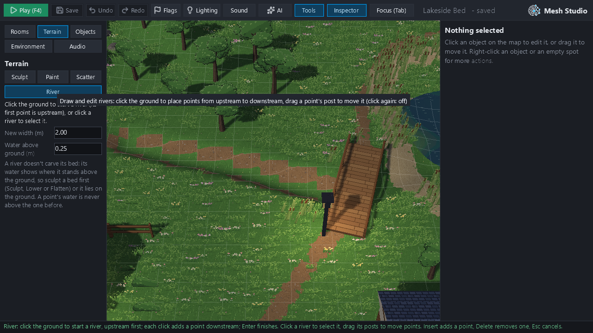
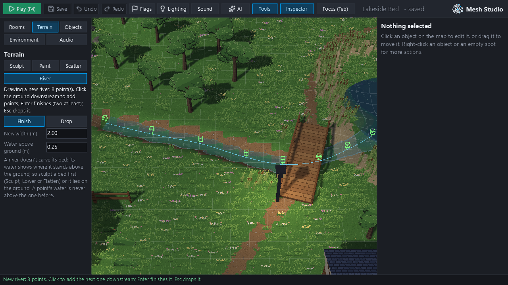
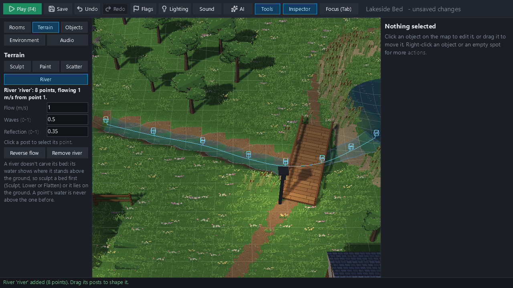
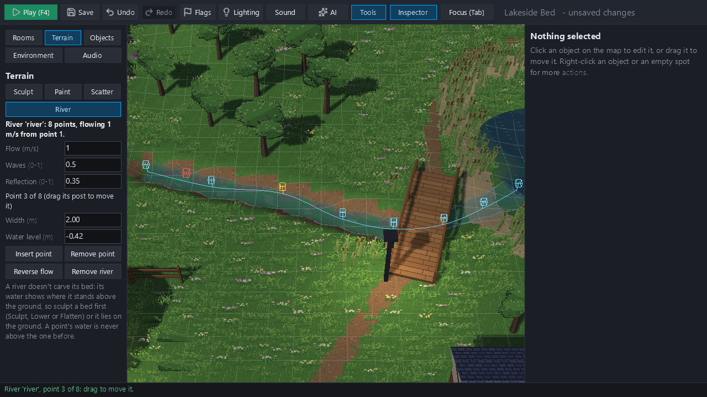
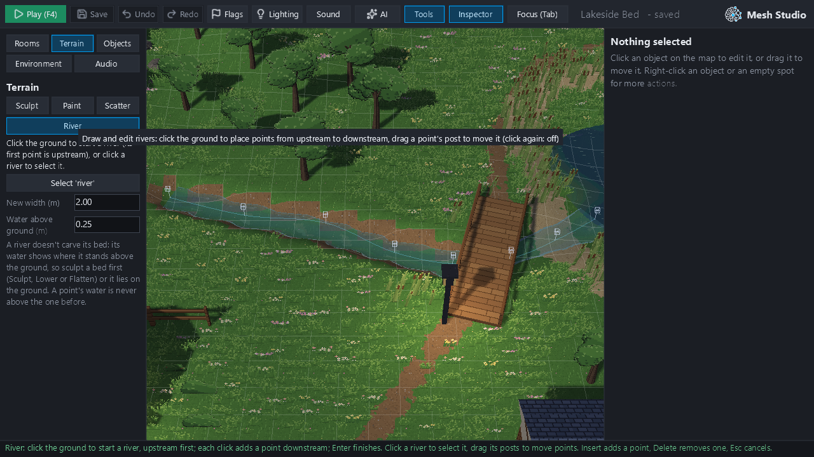
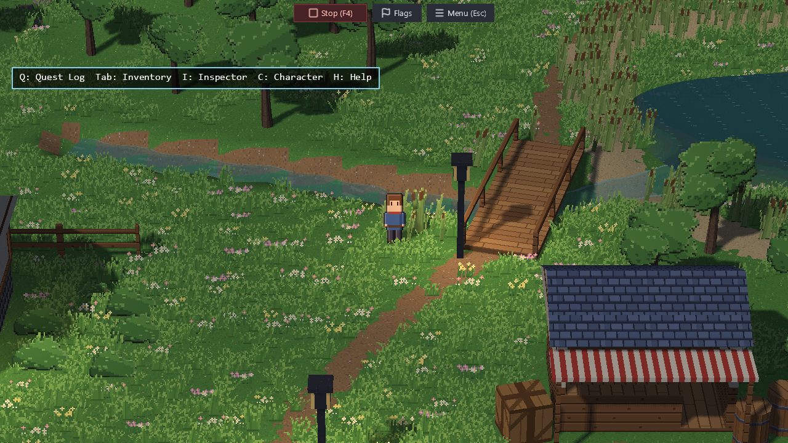
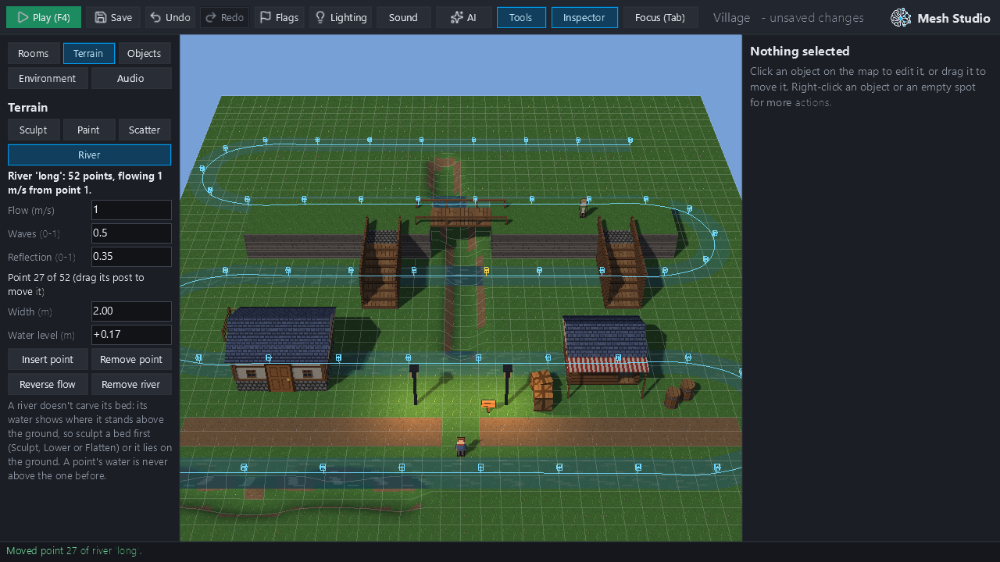

# Rivers R2: the Studio River tool, evidence (#461) — not for merge

Real 1280×720 hidden-window Mesh Studio frames from `feature/rivers-r2` at `4e7520c`. Everything was driven through
Studio's own window events (clicks, drags, keys), with no OS desktop automation, by `tools/r2_evidence.py`.

The scene is a scratch copy of Lakeside: R1's demo bed under the footbridge (flattened with the terrain tool, its
scatter cleared), with no river. The owner's Lakeside originals were not touched, and every write is refused
outside the scratchpad (`tools/scratch_guard.py`).

| | |
|---|---|
|  **01** River on, the empty bed |  **02** drawing: 4 points, previewed, nothing saved |
|  **03** 8 points, before Enter |  **04** Enter: saved, one undo step |
|  **05** dragging point 3 |  **06** let go: saved once |
|  **07** dragged where the checks refuse: last valid shape kept, red post at the mouse |  **08** let go there: refused, the river as it was |
|  **09** Insert after point 5 (then Delete) |  **10** undo: the point back |
|  **11** redo |  **12** saved, reopened in a new Studio |
|  **13** Play (F4), beside the bridge: the saved river |  **14** a ~190 m river in the template village, a point dragged |

`report.json` holds every step's message and saved river data, and these checks:
- `reopened_from_disk_same`, `reopened_shown_same` and `play_rivers_same` are all **true**;
- the water clock in Play ran (1.03 s).

## Cost (local Windows, real GPU; reporting only)

Each row is a drag of 30 moves, one frame each, then a release.

| | Lakeside brook (18.7 m) | template village river (189.9 m) |
|---|---|---|
| R1 check per move (median / max) | 2.7 / 5.5 ms | 24.0 / 27.0 ms |
| checks per drag | 31 (once a frame) | 31 |
| Studio frame while dragging (median / max) | 17.3 / 90.5 ms | 48.4 / 119.6 ms |
| idle frame after (median) | 12.9 ms | 20.3 ms |
| release: the checked save + top bar | 416 ms, of which 315 ms is the checked edit | 153 ms, of which 44 ms is the checked edit |
| river buffers made during the drag (these scenes) | 0 | 0 |
| shader programs before → after | unchanged | unchanged |

The Lakeside checked edit varied from 152 to 334 ms between runs. It is R1's `set_river`, which copies and
validates the whole Lakeside scene; the brook itself is small.

- **Ribbon cache.** On the long river, caching each river's ribbon (computed once for the check, the vertices,
  picking and the overlay) brought the drag frame median from 89 to 51 ms. That was measured before the shipped
  version, which is shown in the table.
- **Release.** Refreshing only the top bar after a drag, instead of the whole panel, brought the long river's
  release from 284 to 153 ms.
- **No thresholds.** None were added. CI's GPU lane records `measure.river_tool` (the test's own timings) on
  llvmpipe.

**Scope of the buffer figures.** A drag writes into the river buffers while the river fits their reserve (1.5×
when made). A river that grows past it gets bigger buffers. The zeros above are what these two scenes measured,
not a guarantee for every drag; the GPU test allows at most one new buffer.

**Review fix (`75c0264`).**
- Losing window focus now drops a river being drawn as well as a dragged point, with a real-window regression.
- Reverse flow says it relevels the water (a sloping river's surface rises at its old mouth).
- No pictures above changed.

## Not in R2

Bed carving, scatter clearing, collision and wading (R3); lake mouths, tributaries and waterfalls (R4).
