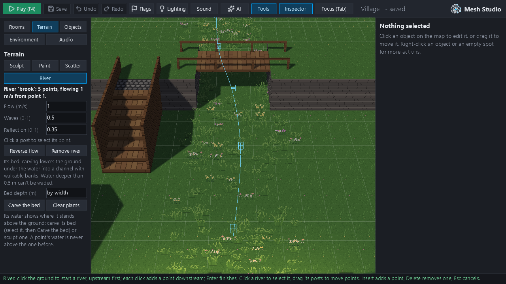
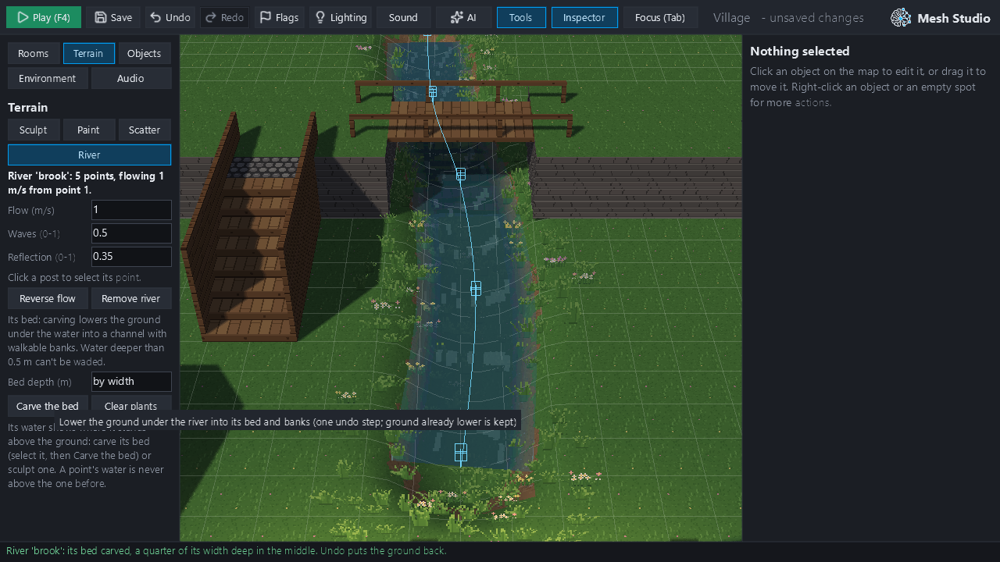
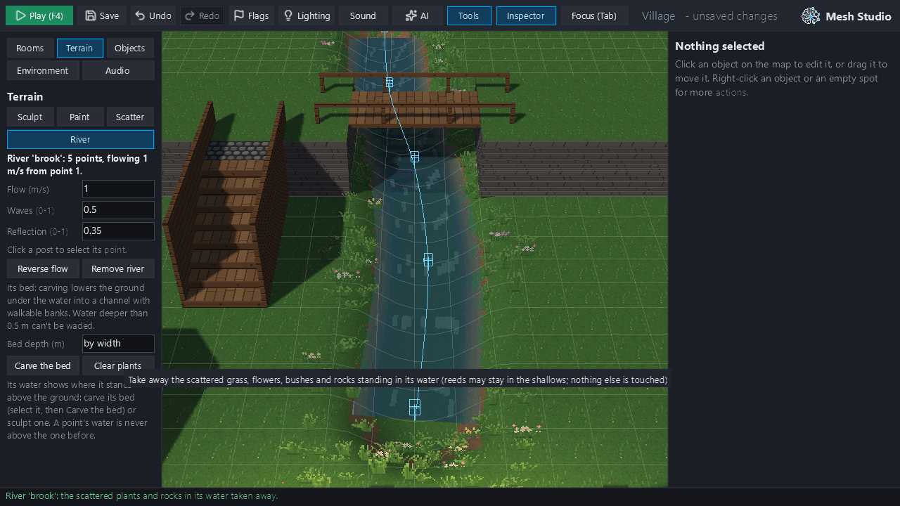
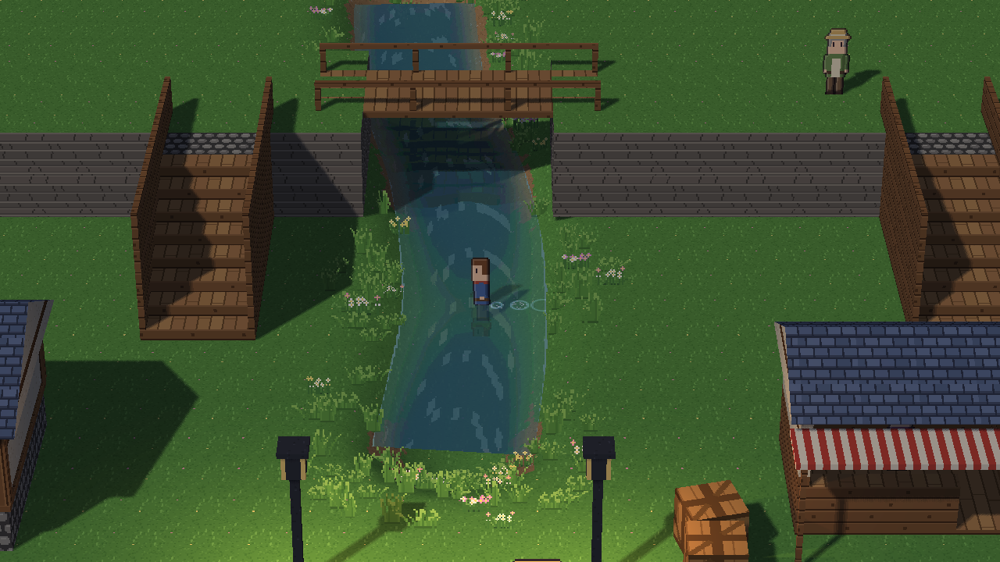
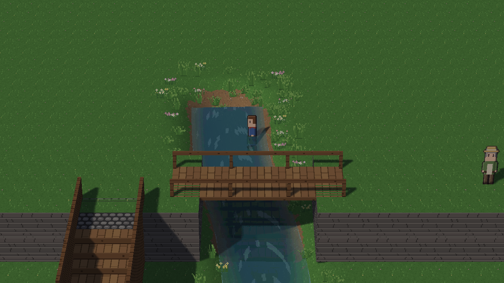
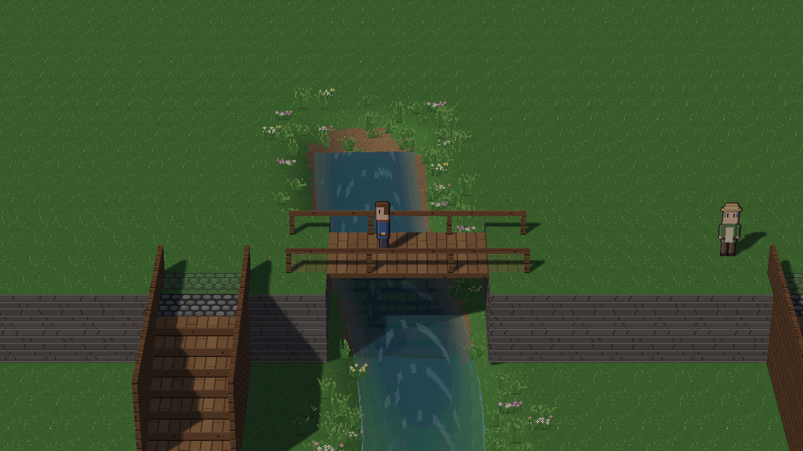
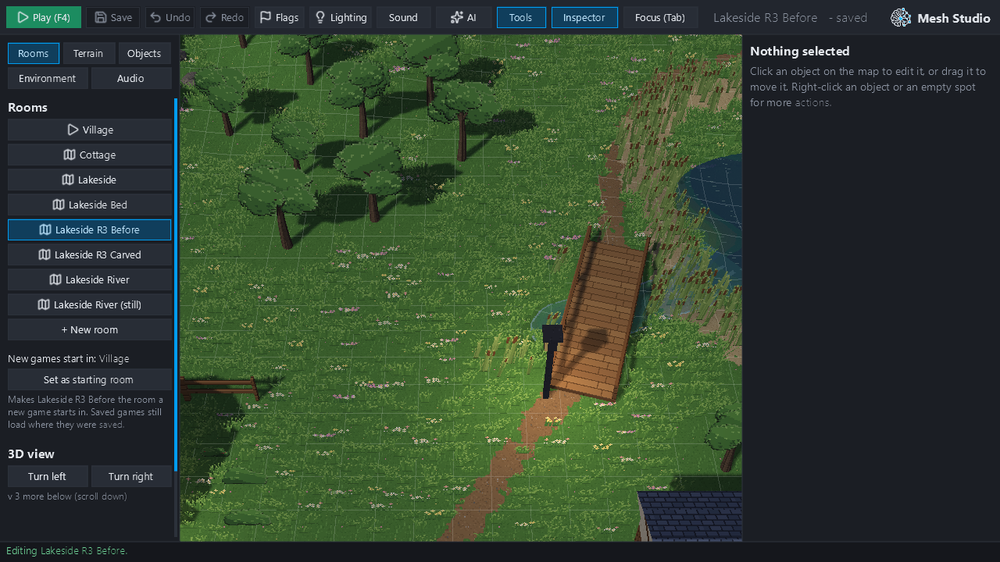
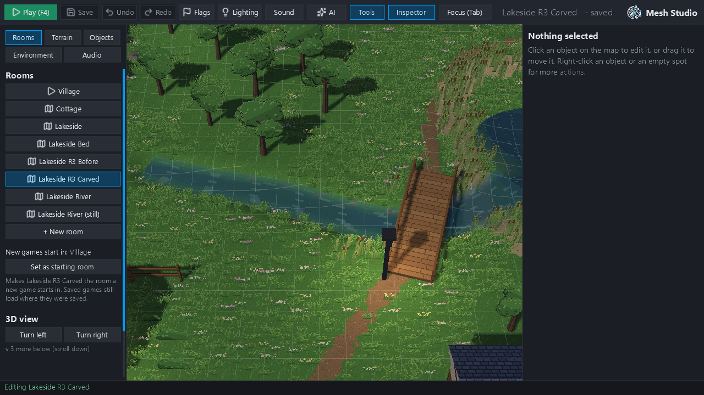
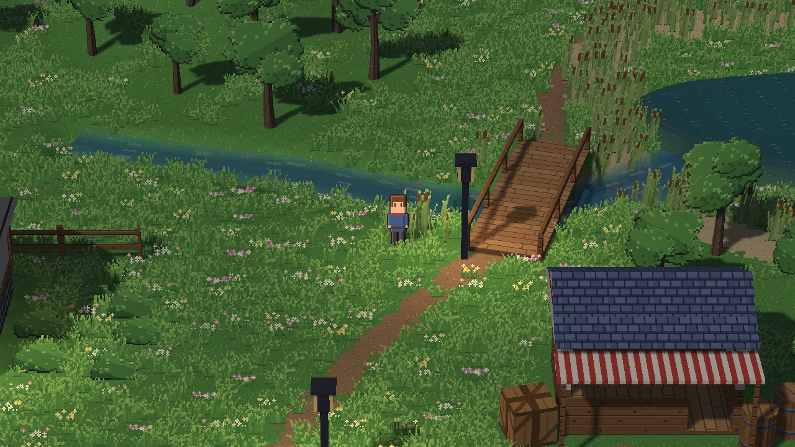
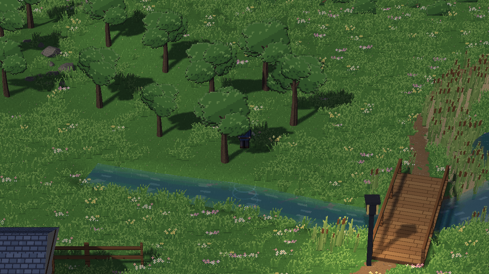

# Rivers R3: the bed, scatter, wading and deep water (#461) — evidence, not for merge

These are real 1280×720 hidden-window frames from `feature/rivers-r3` at `4b2b060`, made by `tools/r3_evidence.py`
through Studio's buttons and the game's own key events (no OS desktop automation). Only scratch copies were used;
the owner's Lakeside originals were not touched, and the scripts refuse to write outside the scratchpad
(`tools/scratch_guard.py`). `report.json` holds the numbers below.

## A. Studio: carve the bed, clear the plants (the R3 study village)

The village is `tooling/r3_river_bed_study.py`: a 3 m stream under the bridge, its water 0.25 m below the flat
ground, with meadow scattered over its course before it was there.

| | |
|---|---|
|  **A1** the river selected; its water is under the ground, so unseen |  **A2** **Carve the bed**: a channel, banks, the water showing |
|  **A3** **Clear plants**: the scatter in its water gone; the banks' scatter kept | |

**Carve the bed** took 686 ms from click to the reloaded room. Each button is one undo step. The GPU test checks
that undo puts the ground back exactly and redo carves it again.

## B. Play there (carved: 0.8 m deep, but 0.3 m at its second point, a ford)

| | | |
|---|---|---|
|  **B1** wading the ford: 0.33 m of water over the feet, ripples behind |  **B2** walking into the deep stretch: stopped in 0.47 m of water, short of the 0.8 m middle |  **B3** on the bridge's deck over the deep water: dry, 2 m up |

Each walk is the window's own key events: A held for 150 frames from the east bank.

| walk | ended at x (px) | deepest water over the feet | wading steps |
|---|---|---|---|
| across the ford | 526 (across) | 0.33 m | 7 |
| into the deep stretch | 633.5 (stopped; its middle is at 604) | 0.47 m | 2 |
| across the bridge's deck | 345 (across, still 2.0 m up) | — (dry) | 0 |

## C. Lakeside (scratch copy): R1's brook on the room's own ground, carved with the ops

| | |
|---|---|
|  **C1** before: the brook's water under the meadow |  **C2** carved and cleared: a channel to the footbridge and the lake |
|  **C3** Play, by the bridge |  **C4** walked north across the 2 m brook: by default a quarter of its width deep, 0.47 m at most, so it is wadeable; ripples behind |

- Carving Lakeside's brook took **60 ms**, and clearing its scatter **36 ms**.
- While walking through the river, play frames had a median of **12.9 ms** locally.

## Limitations

- **Carving only lowers the ground.** Where the ground beside the water is already lower than the water, no bank
  is made, and the ribbon's straight edge shows. A river's two ends are cut square. Past an end, the bed stops and
  a bank rises from that end's water level (lake mouths are R4).
- **Collision follows the drawn water.** The deep-water rule asks of the ribbon (`RiverIndex`) and the floor under
  the feet; it ignores ponds, whose own walkable/blocking rule is unchanged.
- **Ripples are on a 0.5 m terrain grid.** Wading shows ripples (with `water_step` events) but no speed change and
  no wading sound. Rivers have no `step_sound` field yet.
- **A 2 m stream is wadeable by default.** By default a bed is a quarter of its width deep, so a 2 m stream is
  0.5 m at most. Make deeper or shallower stretches with **Bed depth**, or with per-point depths (AI / `mesh author`).
- **A test-order issue, found while checking:** `tests/test_scatter.py::test_the_way_onto_stairs_is_kept_clear…`
  fails when run right after the HD-2D world, floors and terrain suites. It fails the same way on the base commit
  `eb680c3`, passes alone, and passes in CI's order. It is reported here and not changed.
